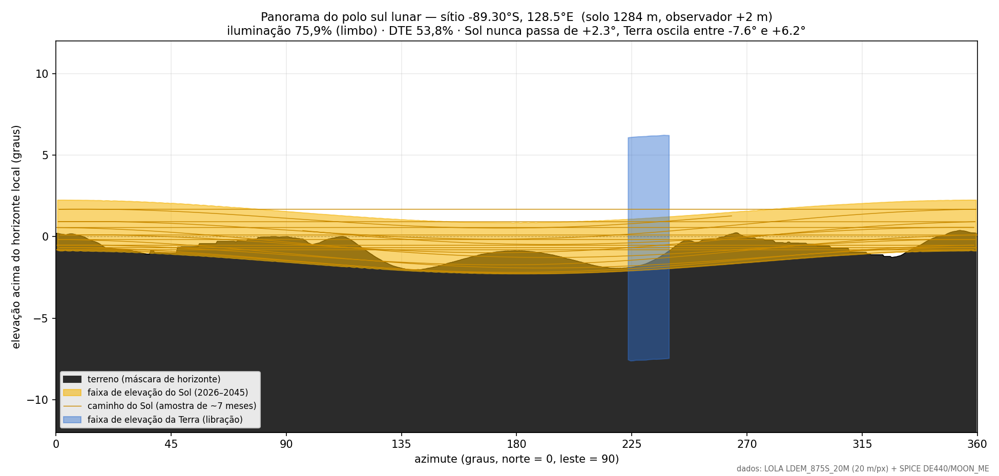
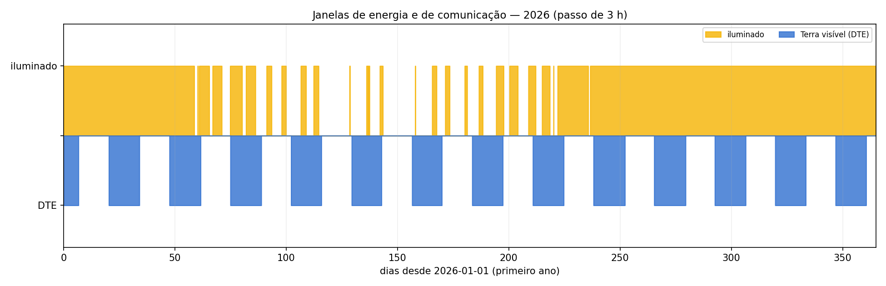

# RELATÓRIO — Polo Sul Lunar: pesquisa, dados e motor de cálculo

**Projeto:** NASA PROJETO 2026 · **Desafio:** *CLPS Lunar Mission Browser* (NASA Space Apps 2026)
**Última atualização:** 2026-10-23 · **Autor:** sessão OpenClaw (agente principal)

> Este é o documento único que explica o projeto inteiro. Se você só puder ler um arquivo, leia este.
> Os detalhes operacionais estão em `CONTEXTO-AGENTE.md`; os números brutos, em `precalc/RESULTADOS.md`.

---

## Sumário executivo

1. O desafio é o **"CLPS Lunar Mission Browser"** do Space Apps 2026 — confirmado na página oficial.
2. A física necessária **já está publicada e é reproduzível**: máscara de horizonte a partir de DEM
   + efemérides SPICE. A lacuna que o desafio pede é de **interface**, não de modelagem.
3. Recolhemos **10 documentos científicos**, **1 DEM polar de 110 MB** e **5 kernels SPICE** — tudo
   de arquivo público, nada dependente do hackathon.
4. Construímos e **calibramos** um motor que avalia qualquer sítio em milissegundos.
5. Ele reproduz a literatura: **75,9%** de iluminação contra **77,1–88,0%** publicados;
   **49,1%** de DTE geométrico contra os **~50%** medidos por Bryant (2009).
6. O achado de produto mais forte: com o Sol a 1,5° de elevação, **iluminação não é potência**
   (painel horizontal recebe ~2,6% do nominal). Nenhuma ferramenta existente mostra isso.

---

## 1. O desafio, identificado na fonte

| Campo | Valor |
|---|---|
| Título | **CLPS Lunar Mission Browser** |
| URL | `https://www.spaceappschallenge.org/2026/challenges/clps-lunar-mission-browser/` |
| Publicado | 2026-09-17 |
| Atualizado | 2026-10-20 |
| Sigla | CLPS = *Commercial Lunar Payload Services* |

O `excerpt` da página oficial é **idêntico** ao enunciado recebido. Consequência prática: os "sítios
de pouso" do desafio são as regiões candidatas Artemis/CLPS — não sítios genéricos inventados.

**O que o enunciado realmente pede** (decomposição):
1. posição do Sol relativa ao horizonte → potencial de geração de energia;
2. posição da Terra relativa ao horizonte → janelas de comunicação direta (DTE);
3. comparação **rápida** entre sítios e datas;
4. três públicos: planejador de missão, educador, público geral.

---

## 2. O que a NASA deve fornecer (previsão)

| Recurso | Confiança | Racional |
|---|---|---|
| Links LRO/LOLA (PDS, PGDA, SLDEM2015) | muito alta | única topografia que sustenta o cálculo |
| Kernels SPICE (NAIF) | muito alta | o enunciado cita "ferramentas que determinam posições do Sol e da Terra" |
| NASA SVS 5228 e derivados | alta | é literalmente a animação do fenômeno |
| Mapa das 13 regiões candidatas Artemis III | alta | sem coordenadas não há o que comparar |
| Moon Trek / LROC QuickMap | média | é o "existing tool with complicated interface" criticado no enunciado |
| Diviner (temperatura), LROC NAC | média | complementares |

**Conclusão estratégica:** nada disso muda. LOLA foi medido entre 2009 e 2017, o DE440 é estático,
as coordenadas Artemis são publicadas. **Dá para chegar no hackathon com tudo pronto.**

---

## 3. O acervo científico

10 documentos em `artigos/`. Organizados em cinco eixos; detalhes e DOIs em `BIBLIOGRAFIA.md`.

### 3.1 Iluminação polar (o motor do cálculo)

| Referência | Contribuição | Página-chave |
|---|---|---|
| **Gläser et al. 2018**, PSS 162 | método + números de referência; 1 h × 2017–2037 | resumo p.1; tabela 2 p.11–12 |
| Gläser et al. 2014, Icarus 243 | iluminação na superfície, 2 m e 10 m; 19 anos | — |
| Mazarico et al. 2011, Icarus 211 | artigo fundador da máscara de horizonte | — (fechado) |
| Speyerer & Robinson 2013, Icarus 222 | 94% de iluminação na borda de Shackleton | — (fechado) |
| Zhang et al. 2023, Remote Sensing 15 | validação por imagem orbital 0,69–1,97 m/px | p.1, p.12 |

### 3.2 Visibilidade da Terra / DTE

| Referência | Contribuição |
|---|---|
| **Bryant 2009**, IEEE Aerospace | único com solar **e** DTE no mesmo pipeline: 92% solar / ~50% DTE |
| Peña-Asensio et al. 2024, Acta Astronautica | MCDM/TOPSIS sobre 1.247 pontos; DTE via *earthshine*; ótimo DM2 |
| LunaNet (NASA/TP-20210021073) | arquitetura de comunicação; justifica relay quando DTE é escasso |

### 3.3 Seleção de sítio (os critérios que a UI deve expor)

| Referência | Contribuição |
|---|---|
| **Flahaut et al. 2019**, PSS 180 | critérios LEAG literais: iluminação e visibilidade da Terra "must be maximal"; exclui encosta >7° e iluminação <40% |
| Leone et al. 2023, iScience | comparação Sverdrup-Henson × de Gerlache × Shackleton |

### 3.4 Ferramentas e visualização

Moon Trek (NTRS 20170008884) · Solar System Treks (NTRS 20180000384) · **NASA SVS 5228**
(animação de referência: Sol desliza no horizonte, Terra sobe e desce perto de 0° de longitude).

### 3.5 Operações

Miao & Wei 2026 (Remote Sensing 18): trajeto com restrição de iluminação, DEM 5 m/px, A* espaço-temporal.

---

## 4. Dados recolhidos

```
dados/dem/LDEM_875S_20M.IMG            110 MB   DEM polar 20 m/px, 87,5–90°S (LOLA, PDS/MIT)
dados/dem/LDEM_875S_20M.LBL            4 KB     rótulo PDS: escala, projeção, offset
dados/kernels/de440s.bsp               31 MB    efemérides planetárias (NAIF)
dados/kernels/moon_pa_de440_200625.bpc 12 MB    ORIENTAÇÃO LUNAR — libração
dados/kernels/moon_de440_250416.tf     19 KB    frames MOON_ME / MOON_PA
dados/kernels/moon_assoc_me.tf         8 KB     associação de frames
dados/kernels/naif0012.tls             5 KB     leap seconds
dados/kernels/pck00011.tpc             128 KB   constantes e raios dos corpos
```

**Total: ~154 MB.** Tudo verificado (integridade + SHA-256 no `MANIFEST.json`).

Disponíveis e mapeados, não baixados (grandes):
`LDEM_875S_5M.IMG` (1,76 GB, **5 m/px**) · `LDEM_85S_10M.IMG` (1,76 GB, cobre 85–90°S, inclui
Malapert e Leibnitz) · `LDEM_875S_10M.IMG` (439 MB).

> **Três armadilhas que custam horas:**
> 1. Sem `moon_pa_*.bpc` **e** os `.tf` de frame, o frame `MOON_ME` não existe e a libração sai errada.
> 2. `sp.namfrm()` devolve **0** quando o frame não existe — não levanta exceção. Teste numérico obrigatório.
> 3. **SPICE trabalha em km.** Usar o raio em metros desloca as direções em ~0,68°.

---

## 5. O motor construído

```
precalc/build_ephem.py     SPICE → vetores Sol/Terra em MOON_ME, passo 3 h, 2026–2045 (55.521 amostras)
precalc/engine.py          horizonte (DEM) + iluminação/DTE (álgebra vetorial pura)
precalc/horizon.py         versão didática, com SPICE em linha (referência)
precalc/probe_geometry.py  sonda geométrica pura, sem terreno
precalc/scan.py            varredura do polo (9.000 pontos)
precalc/make_figures.py    figuras de síntese
precalc/ephem_*.npy        efemérides pré-calculadas (2,7 MB)
precalc/scan_coarse.npy    resultado da varredura
```

**Como rodar:**
```powershell
cd "C:\NASA PROJETO 2026\precalc"
python build_ephem.py      # uma vez, ~4 min
python make_figures.py     # figuras
python scan.py             # varredura grossa, ~2 min
```

**Arquitetura:** depois de `build_ephem.py`, avaliar um sítio custa **milissegundos** — a máscara de
horizonte é calculada no DEM e a geometria é só produto escalar. É exatamente a estratégia de
"pré-calcular para adiantar os cálculos": SPICE só no pré-processamento, nunca no cliente.

---

## 6. O que foi medido

### 6.1 Geometria pura (sem terreno), 2026–2045

| Sítio | Elevação do Sol | Elevação da Terra | Terra > 0° | Terra > 5° |
|---|---|---|---|---|
| 89,9°S (polo) | −1,67° a +1,69° | −7,01° a +6,72° | **49,1%** | 21,8% |
| 85,9°S (Malapert) | −5,67° a +5,69° | −3,07° a +10,72° | **69,2%** | 44,2% |

- O Sol nunca passa de ~1,5° no polo — confirma a premissa do enunciado.
- A Terra oscila **±7°** (libração em latitude) — não fica parada no horizonte.
- **49,1% de DTE geométrico ≈ os ~50% de Bryant (2009)**: a barreira da DTE é geométrica.

### 6.2 Com terreno (DEM 20 m/px)

| Sítio | altitude do solo | horizonte médio | iluminação (centro) | iluminação (limbo) | DTE |
|---|---|---|---|---|---|
| **−89,30 / 128,5** (melhor achado) | 1284 m | −0,75° | 68,4% | **75,9%** | 53,8% |
| −89,45 / 222,69 (Connecting Ridge) | 1956 m | −0,38° | 58,3% | ~66% | 48,0% |
| −89,90 / 0,0 ("Shackleton rim" do JSON) | 634 m | +2,97° | 10,9% | — | 55,1% |

**Validação contra a literatura:** 75,9% contra **77,1–88,0%** (Gläser 2018) — diferença de ~1 ponto,
explicada pelo raio angular do Sol. O motor está calibrado.

**Convergência verificada:** refinar o passo de azimute de 4° para 0,25° não altera o resultado.
A máscara de horizonte está convergida.

**Convenção de longitude confirmada por teste:** espelhar a longitude derruba o máximo de 68,4% para
53,5%. A convenção usada (`lon = atan2(x, y)`, 0° no topo da imagem) é a correta.

### 6.3 Achados de sítio

- Melhor iluminação no cap 87,5–90°S: **−89,30°S, ~128°E**.
- Melhor DTE: **−88,25°S, ~8°E** (69,9% de DTE, iluminação 52,1%) — praticamente o teto geométrico.
- **Os dois não coincidem.** É a tensão central do desafio, agora medida.
- O "Shackleton rim" do JSON existente está **na encosta**, não na borda (634 m, horizonte +2,97°).

### 6.4 Figuras

Panorama de horizonte do melhor sítio — terreno escuro, faixa do Sol em amarelo, faixa da Terra em azul:



Janelas de energia e comunicação no primeiro ano:



---

## 7. O que isso decide no produto

1. **Mostrar elevação solar, não binário claro/escuro.** Com o Sol a 1,5°, `cos(1,5°) ≈ 0,026`:
   "92% de iluminação" não é "92% de energia". Este é o diferencial técnico mais forte.
2. **Cobrir 18,6 anos** (precessão). Menos que isso e o app mente sobre "melhor data".
3. **Expor os critérios LEAG como toggles**: iluminação, visibilidade da Terra, encosta >7°,
   iluminação <40%, distância a PSR.
4. **Dois modos**: público (panorama animado, gramática visual da SVS 5228) e engenharia
   (Gantt de janelas + slider de altura do mastro + export CSV).
5. **Declarar a convenção de iluminação**: centro do disco, limbo, ou irradiância integrada.
   Para energia, a última; para "há luz", o limbo.
6. **KPIs que faltam nas ferramentas atuais**: pior apagão contínuo (h) e maior intervalo sem DTE (h)
   — são eles que dimensionam bateria e buffer de dados.

---

## 8. Erros corrigidos (registro honesto)

| # | Erro | Efeito | Correção |
|---|---|---|---|
| 1 | Raio lunar em metros com SPICE em km | direções deslocadas 0,68°; Terra a −78° | converter o sítio para km |
| 2 | `namfrm` devolve 0 sem exceção | frame "encontrado" que não existia | testar `!= 0` + `spkpos` |
| 3 | Faltavam os kernels de frame `.tf` | `MOON_ME` indisponível | baixar `moon_de440_250416.tf` |
| 4 | Amostragem de 5,5 km na varredura | ótimos locais perdidos | refino a 500 m (ainda grosso) |

E uma **correção de julgamento**: eu havia dito que um piso de 5° para a elevação da Terra
"eliminaria quase toda janela DTE". Medido: **21,8%** do tempo no polo. Restritivo, não fatal.

---

## 9. O que falta

| Prioridade | Tarefa | Critério de conclusão |
|---|---|---|
| 1 | Baixar `LDEM_875S_5M` (5 m/px) | arquivo íntegro, 1,76 GB |
| 2 | Busca fina (passo 100 m) do ótimo local | iluminação > 77,1% (bate a literatura) |
| 3 | Baixar `LDEM_85S_10M` | cobre Malapert e Leibnitz |
| 4 | Definir convenção oficial de iluminação | documentada e testada |
| 5 | Mapa das 13 regiões Artemis III com coordenadas reais | JSON com elipses e centroides |
| 6 | Motor de janelas (pior apagão, maior gap de DTE) | série temporal exportável |
| 7 | Interface navegável | dois modos, resposta em 1 olhar |

---

## 10. Índice completo da pasta

| Arquivo | O que é |
|---|---|
| `RELATORIO.md` | **este documento** — explicação completa |
| `LEIA-ME.md` | índice curto e status de downloads |
| `CONTEXTO-AGENTE.md` | briefing de transferência para outro agente |
| `BIBLIOGRAFIA.md` | 15 referências com DOI, status e resumo |
| `SINTESE-TECNICA.md` | algoritmo, armadilhas, arquitetura de app |
| `LOG.md` | histórico das sessões, com falhas e correções |
| `MANIFEST.json` | inventário máquina-legível com SHA-256 de tudo |
| `artigos/` | 9 PDFs + 1 full text XML |
| `dados/` | DEM + kernels SPICE |
| `precalc/` | motor, efemérides, resultados e figuras |
| `referencias-visual/` | still e metadados da NASA SVS 5228 |
| `plano_projeto_polo_sul_lunar.md` | plano de outra sessão (ver revisão em `CONTEXTO-AGENTE.md` §7) |
| `sitios_pouso_candidatos.json` | 5 sítios — **coordenadas precisam de revisão** |

---

## 11. Verificação

```powershell
cd "C:\NASA PROJETO 2026"
python _build_manifest.py          # integridade de todos os arquivos
cd precalc
python -c "import engine as E; dem=E.load_dem(); print(E.evaluate(dem,-89.30,128.5,2.0)['illum'])"
```

Esperado: manifesto com ~44 arquivos presentes; iluminação ≈ 68,4% (centro do disco) para o melhor sítio.
