# Relatório Técnico-Científico Consolidado da Tese

**Tema:** Navegação, Segurança Geotécnica e Seleção Multirresolução de Sítios no Polo Sul Lunar ($60\text{ m} \to 20\text{ m} \to 5\text{ m}$) sob Incerteza Topográfica e Restrições de Missão  
**Status do Documento:** Consolidação completa integrada com os resultados de Monte Carlo real (`26` sítios `PGDA 78`), comparação independente `SfS × LOLA + 486 fotos LROC NAC` (motor estereográfico e calibração corrigidos), ablação sintética, validação externa (*Pragyan*) e bateria multirresolução definitiva `60 / 20 / 5 m` (`POP = 100`, com e sem teto temporal).

> [!NOTE]
> **Protocolo Epistemológico da Redação:**
> 1. **Distinção estrita de etapas:** separa-se sempre **calibração** (ajuste de margem com dados medidos), **treino** (otimização de pesos KKT ou rede neural) e **avaliação** (teste em sítios/faixas nunca vistos).
> 2. **Transparência de resultados nulos e negativos:** todo resultado nulo ou negativo (ex.: células sem disparo em Haworth, peso neural sob `N3`, calibração de margem em missão nominal) é reportado com o mesmo destaque dos positivos.
> 3. **Rigor de prioridade científica:** evita-se reivindicação absoluta de ineditismo; emprega-se a formulação *"não encontrado publicado (busca curta)"* sobre o núcleo de medição pareada e diagnóstico.

### Índice Visual de Figuras e Bancos de Dados Reproduzíveis

| Bloco / Seção | Figura PNG | O que visualiza | Dados de Origem (CSV / JSON) |
|---|---|---|---|
| **1.1 Cronologia e Contexto Polar (`Fig. 01–02`)** | [fig_linha_do_tempo.png](file:///c:/NASA%20PROJETO%202026/docs/figuras_tese/fig_linha_do_tempo.png) / [ContextMap.png](file:///c:/NASA%20PROJETO%202026/dados/acervo_tese/02_PGDA_78_5M/ContextMap.png) | Cronologia `2009–2028` (`LRO/LOLA`, `GRAIL`, `ShadowCam`, `Artemis`) e mapa solar `PGDA 78` (`27` blocos) | [sitios_numerados.csv](file:///c:/NASA%20PROJETO%202026/docs/tabelas_tese/sitios_numerados.csv) |
| **1.2 Cobertura Real de Tiros LOLA (`Fig. 03–05`)** | [fig_cobertura_por_resolucao.png](file:///c:/NASA%20PROJETO%202026/docs/figuras_tese/fig_cobertura_por_resolucao.png) / [fig_mosaico_multiescala_ldec.png](file:///c:/NASA%20PROJETO%202026/docs/figuras_tese/fig_mosaico_multiescala_ldec.png) / [fig_mosaico_ldec_5m.png](file:///c:/NASA%20PROJETO%202026/docs/figuras_tese/fig_mosaico_ldec_5m.png) | Fração medida vs. interpolada (`5→120 m`) e distribuição espacial `LDEC_875S_5M` | [cobertura_multiescala.csv](file:///c:/NASA%20PROJETO%202026/docs/tabelas_tese/cobertura_multiescala.csv) |
| **1.2 Zoom e Auditoria Estatística `LDEC` (`Fig. 06–07`)** | [fig_zoom_001_5m_vs_20m.png](file:///c:/NASA%20PROJETO%202026/docs/figuras_tese/fig_zoom_001_5m_vs_20m.png) / [fig_intro_estatistica_tiros_lola_regioes.png](file:///c:/NASA%20PROJETO%202026/docs/figuras_tese/fig_intro_estatistica_tiros_lola_regioes.png) | Zoom Sítio `001` (`8,9%` vs. `77,1%`), Kruskal-Wallis ($H=73{,}59$) e Spearman ($\rho=+0{,}550$) | [gerar_figs_intro_lola.py](file:///c:/NASA%20PROJETO%202026/simulacao_rover/testes/gerar_figs_intro_lola.py) |
| **1.3 Amostras Ópticas `LROC NAC` (`Fig. 08–09`)** | [crop_Site01.png](file:///c:/NASA%20PROJETO%202026/lroc_nac/pgda78_26/figuras/crop_Site01.png) / [lua_real_lroc.jpg](file:///c:/NASA%20PROJETO%202026/src/assets/lua_real_lroc.jpg) | Sombras rasantes em `Connecting Ridge (Site01)` e escala métrica de trilhas em superfície | Acervo `LROC NAC` |
| **1.3 Histórico de Resolução `m/px` (`Fig. 10–13`)** | [fig_evolucao_resolucao_130_sitios.png](file:///c:/NASA%20PROJETO%202026/docs/figuras_tese/fig_evolucao_resolucao_130_sitios.png) / [fig_panorama_resolucao_polo_sul.png](file:///c:/NASA%20PROJETO%202026/docs/figuras_tese/fig_panorama_resolucao_polo_sul.png) / [fig_mapa_resolucoes_polo.png](file:///c:/NASA%20PROJETO%202026/docs/figuras_tese/fig_mapa_resolucoes_polo.png) / [fig_resolucao_por_regiao_artemis.png](file:///c:/NASA%20PROJETO%202026/docs/figuras_tese/fig_resolucao_por_regiao_artemis.png) | Evolução `2007–2023` (`130` sítios e `288.139 km²`), mapa estereográfico e `16` regiões Artemis | [resumo.json](file:///c:/NASA%20PROJETO%202026/docs/tabelas_tese/resumo.json) |
| **5.2 Monte Carlo (`Fig. 14–19`, `26` sítios)** | [g1_perigo_por_sitio.png](file:///c:/NASA%20PROJETO%202026/simulacao_rover/monte_carlo_lola/figuras/g1_perigo_por_sitio.png) / [g2_troca_perigo_alarme.png](file:///c:/NASA%20PROJETO%202026/simulacao_rover/monte_carlo_lola/figuras/g2_troca_perigo_alarme.png) / [g5_controle_mesmo_alarme.png](file:///c:/NASA%20PROJETO%202026/simulacao_rover/monte_carlo_lola/figuras/g5_controle_mesmo_alarme.png) | Perigo não vetado (`60 m × Tese`), troca por sítio e controle sob **mesmo falso alarme** | [dados_mc_26sitios_60m.csv](file:///c:/NASA%20PROJETO%202026/simulacao_rover/monte_carlo_lola/figuras/dados_mc_26sitios_60m.csv) |
| **5.2 Escala `20 m`, Troca e Falhas (`Fig. 17–19`)** | [g4_60m_x_20m.png](file:///c:/NASA%20PROJETO%202026/simulacao_rover/monte_carlo_lola/figuras/g4_60m_x_20m.png) / [g6_curvas_troca.png](file:///c:/NASA%20PROJETO%202026/simulacao_rover/monte_carlo_lola/figuras/g6_curvas_troca.png) / [onde_a_tese_falha.png](file:///c:/NASA%20PROJETO%202026/simulacao_rover/monte_carlo_lola/figuras/onde_a_tese_falha.png) | Partida `60 m × 20 m`, curvas `FA 5%–30%` e mapa espacial de falhas (`NPC` / `Haworth`) | [dados_mc_26sitios_20m.csv](file:///c:/NASA%20PROJETO%202026/simulacao_rover/monte_carlo_lola/figuras/dados_mc_26sitios_20m.csv) |
| **5.3 `SfS × LOLA` e `486` Fotos `NAC` (`Fig. 20–26`)** | [fig1_mapas_iluminacao_sfs_lola.png](file:///c:/NASA%20PROJETO%202026/sfs_comparacao/entrega_relatorio/fig1_mapas_iluminacao_sfs_lola.png) / [fig2_luz_falsa_por_grade.png](file:///c:/NASA%20PROJETO%202026/sfs_comparacao/entrega_relatorio/fig2_luz_falsa_por_grade.png) / [fig4_exemplo_foto_vs_previsao.png](file:///c:/NASA%20PROJETO%202026/sfs_comparacao/entrega_relatorio/fig4_exemplo_foto_vs_previsao.png) / [fig3_margens_perigos_nao_vistos.png](file:///c:/NASA%20PROJETO%202026/sfs_comparacao/entrega_relatorio/fig3_margens_perigos_nao_vistos.png) | Mapas `SfS × LOLA`, luz falsa (`486` fotos `NAC`), margens `P50/P90/P99` e diagnóstico `Haworth` (`Fig. 24–26`) | [tabela_validacao_fotos.csv](file:///c:/NASA%20PROJETO%202026/sfs_comparacao/entrega_relatorio/dados/tabela_validacao_fotos.csv) |
| **5.3 Interpolação e Ilustração (`Fig. 24–26`)** | [comparacao_sfs.png](file:///c:/NASA%20PROJETO%202026/simulacao_rover/monte_carlo_lola/figuras/comparacao_sfs.png) / [curvas_sfs.png](file:///c:/NASA%20PROJETO%202026/simulacao_rover/monte_carlo_lola/figuras/curvas_sfs.png) / [checagem_local_nac_haworth.png](file:///c:/NASA%20PROJETO%202026/simulacao_rover/monte_carlo_lola/figuras/checagem_local_nac_haworth.png) | Células sem disparo (`3,3 mi`) em `Haworth` e encaixe ilustrativo `NAC × LOLA` | [dados_sfs_haworth.json](file:///c:/NASA%20PROJETO%202026/simulacao_rover/monte_carlo_lola/figuras/dados_sfs_haworth.json) |
| **5.4–5.5 Ablação, KKT e Escada (`Fig. 27–30`)** | [fig_ablacao_sintetica.png](file:///c:/NASA%20PROJETO%202026/simulacao_rover/monte_carlo_lola/figuras/fig_ablacao_sintetica.png) / [fig_relevo_real_configuracoes.png](file:///c:/NASA%20PROJETO%202026/simulacao_rover/monte_carlo_lola/figuras/fig_relevo_real_configuracoes.png) / [fig_escada_chegada.png](file:///c:/NASA%20PROJETO%202026/simulacao_rover/monte_carlo_lola/figuras/fig_escada_chegada.png) / [fig_escada_tombamento.png](file:///c:/NASA%20PROJETO%202026/simulacao_rover/monte_carlo_lola/figuras/fig_escada_tombamento.png) | Ablação `D0→D4b` (`30` terrenos), relevo real (`POP = 20`) e escada `60 m` (`POP = 30`) | [dados_ablacao.csv](file:///c:/NASA%20PROJETO%202026/simulacao_rover/monte_carlo_lola/figuras/dados_ablacao.csv) |
| **5.6 Bateria Definitiva `POP = 100` (`Fig. 31–38`)** | [fig_multi_pop100_escada.png](file:///c:/NASA%20PROJETO%202026/simulacao_rover/monte_carlo_lola/figuras/fig_multi_pop100_escada.png) / [fig_multi_pop100_com_vs_sem_teto.png](file:///c:/NASA%20PROJETO%202026/simulacao_rover/monte_carlo_lola/figuras/fig_multi_pop100_com_vs_sem_teto.png) / [fig_multi_pop100_ganhos_e_desfechos_n3.png](file:///c:/NASA%20PROJETO%202026/simulacao_rover/monte_carlo_lola/figuras/fig_multi_pop100_ganhos_e_desfechos_n3.png) / [fig_multi_pop100_heatmap_tabelas.png](file:///c:/NASA%20PROJETO%202026/simulacao_rover/monte_carlo_lola/figuras/fig_multi_pop100_heatmap_tabelas.png) | Escada `60/20/5 m`, `800 s` vs. `4.000 s`, ganhos `N3` e heatmaps (`seaborn`) | [dados_multi_pop100.csv](file:///c:/NASA%20PROJETO%202026/simulacao_rover/monte_carlo_lola/figuras/dados_multi_pop100.csv) |
| **5.6 Estatística Inferencial `POP = 100` (`Fig. 35–38`)** | [fig_multi_pop100_desfechos_n0_n3.png](file:///c:/NASA%20PROJETO%202026/simulacao_rover/monte_carlo_lola/figuras/fig_multi_pop100_desfechos_n0_n3.png) / [fig_multi_pop100_distribuicao_faixas.png](file:///c:/NASA%20PROJETO%202026/simulacao_rover/monte_carlo_lola/figuras/fig_multi_pop100_distribuicao_faixas.png) / [fig_multi_pop100_forest_pareado.png](file:///c:/NASA%20PROJETO%202026/simulacao_rover/monte_carlo_lola/figuras/fig_multi_pop100_forest_pareado.png) / [fig_multi_pop100_tradeoff_pareto.png](file:///c:/NASA%20PROJETO%202026/simulacao_rover/monte_carlo_lola/figuras/fig_multi_pop100_tradeoff_pareto.png) | Desfechos `100%`, Friedman/Kendall $W$, *forest plot* (`IC 95%`, McNemar) e fronteira de Pareto | [dados_estatisticos_pareados_pop100.csv](file:///c:/NASA%20PROJETO%202026/simulacao_rover/monte_carlo_lola/figuras/dados_estatisticos_pareados_pop100.csv) |

---

## 1. Introdução

### 1.1 Contextualização Artemis e o Gargalo Computacional no Polo Sul Lunar

O planejamento de missões lunares polares tripuladas e robóticas — com destaque para o programa **Artemis** e os módulos robóticos comerciais (*CLPS*) — concentra-se na faixa de alta latitude sul ($80^\circ\text{S}$ a $90^\circ\text{S}$), onde a baixa obliquidade axial lunar ($\approx 1{,}54^\circ$) produz extremos simultâneos de interesse científico e operacional: picos topográficos com iluminação quase contínua adjacentes a Regiões Permanentemente Sombreadas (*PSRs*) capazes de preservar voláteis e gelo de água. Os catálogos plurianuais de visibilidade solar e comunicação direta com a Terra (*DTE*, produto `PGDA 69` e *Wueller et al., 2026*, com `130` sítios em `16` regiões Artemis) operam em grades macroscópicas de $60\text{ m/px}$, $120\text{ m/px}$ ou $240\text{ m/px}$, pois simular iluminação global em $5\text{ m/px}$ exige traçado de raios em escala cúbica $O(N^3)$, elevando o custo computacional em $12^3 = 1.728\times$.

A Figura 01 reúne a cronologia integrada das missões altimétricas, gravimétricas e ópticas que estruturam os dados lunares entre `2009` e `2028`. A sequência mostra que a janela de traços polares densos do `LOLA` encerrou-se em setembro de `2013`, sendo posteriormente refinada pela missão gravimétrica `GRAIL` (`PGDA 78` em `2021` e `PGDA 90` em `2023`) e complementada por sensores ópticos (`ShadowCam` em `2022`). Assim, todo o planejamento atual das missões `Artemis II–IV` depende de combinar séries históricas de `2009–2013` com modelos recentes de iluminação e correção orbital.

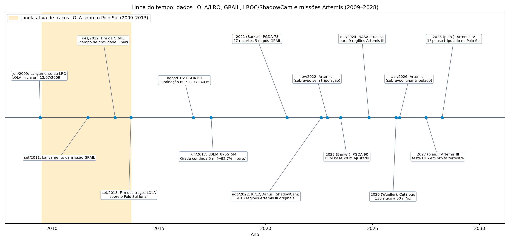

*Conclusão sucinta: o acervo altimétrico denso do Polo Sul foi adquirido essencialmente entre julho de 2009 e setembro de 2013, dependendo desde então de reprocessamento geodésico pós-GRAIL para atender ao ciclo Artemis.*  
*Fonte: consolidação cronológica sobre LRO/LOLA, GRAIL, PGDA 69/78/90, KPLO/ShadowCam e catálogo Wueller et al. (2026).*

A Figura 02 apresenta o mapa contextual de iluminação solar média sobre a faixa de $84^\circ\text{S}$ a $90^\circ\text{S}$, destacando os `27` blocos prioritários `PGDA 78` em $5\text{ m/px}$ nominais. A distribuição dos blocos evidencia que os levantamentos ajustados de alta resolução cobrem somente cristas e entornos selecionados, deixando extensas áreas adjacentes dependentes de grades de $10\text{ m}$ ou $20\text{ m}$. Assim, a navegação de longa distância exige integração contínua entre múltiplas resoluções.

*Conclusão sucinta: a cobertura de 5 m/px nominais concentra-se em 27 blocos geodésicos locais e não forma grade contínua sobre todo o Polo Sul.*  
*Fonte: acervo NASA PGDA 78 (`dados/acervo_tese/02_PGDA_78_5M/ContextMap.png`).*

> **[ESPAÇO RESERVADO PARA FOTO 1A — Mapa Oficial NASA das Regiões Artemis III/IV]**  
> *Inserir aqui fotografia ou mapa institucional oficial da NASA (atualização de outubro de 2024 com as 9 regiões candidatas de pouso no Polo Sul, NASA SVS / HQ).*

---

### 1.2 O Altímetro a Laser LOLA (`LRO`): Funcionamento, Janela de Operação e Auditoria dos Tiros Diretos

A referência geodésica absoluta do Polo Sul lunar provém do instrumento **LOLA (*Lunar Orbiter Laser Altimeter*)**, embarcado na sonda **LRO (*Lunar Reconnaissance Orbiter*)**, lançada pela NASA em junho de 2009. O LOLA iniciou suas operações sistemáticas de mapeamento em **13 de julho de 2009**, mantendo sua **fase de cobertura densa por traços polares até setembro de 2013**, período que concentra a maior parte das medições usadas nos modelos digitais de elevação atuais antes da transição para órbitas mais elípticas e revisitas esparsas.

Em operação orbital, o `LOLA` emite pulsos de laser infravermelho (`1064 nm`) à taxa de **$28\text{ Hz}$**, divididos por um elemento óptico difrativo em **$5$ feixes simultâneos** em padrão em cruz. Para cada disparo, o sensor mede o tempo de voo de ida e volta até a superfície — determinando a altitude absoluta `Z` em relação ao raio esférico lunar $R_{\text{Lua}} = 1.737.400\text{ m}$ —, o alargamento temporal do pulso (*pulse spreading*, indicador de rugosidade dentro da pegada de **$5\text{ m}$**) e a energia refletida em `1064 nm`. Nos vãos entre órbitas adjacentes onde o feixe não incidiu diretamente, a matriz **`LDEC`** (*Lunar Data Elevation Count*) registra zero disparos diretos.

> **[ESPAÇO RESERVADO PARA FOTO 1B — Sonda LRO e Instrumento LOLA (NASA/GSFC)]**  
> *Inserir aqui fotografia real de integração em laboratório ou ilustração técnica oficial da sonda Lunar Reconnaissance Orbiter (LRO) destacando o módulo óptico de 5 feixes do altímetro LOLA (fonte sugerida: NASA Goddard Space Flight Center / SVS).*

A Tabela 01 compara a fração de células fisicamente medidas por pulso direto (`LDEC > 0`) e a fração puramente interpolada entre as grades de $5\text{ m/px}$ e $60\text{ m/px}$ na calota polar sul ($87{,}5^\circ\text{S}\text{–}90^\circ\text{S}$). Os números mostram que a grade nominal de $5\text{ m}$ contém **$92{,}71\%$** de células geradas por interpolação matemática, enquanto a grade de $60\text{ m}$ atinge **$99{,}40\%$** de medição física direta. Assim, baixar a grade nominal sem auditar a matriz `LDEC` induz o planejador a tratar superfícies suavizadas como se fossem terreno medido.

**Tabela 01 — Cobertura física direta de disparos LOLA (`LDEC > 0`) e fração interpolada por resolução na calota polar sul (`87,5°S–90°S`)**

| Resolução da Grade ($\text{m/px}$) | Células com Tiro Direto LOLA (`LDEC > 0`) | Células Puramente Interpoladas | Estatuto Cartográfico na Calota $87{,}5^\circ\text{S}\text{–}90^\circ\text{S}$ |
|---:|---:|---:|:---|
| **$5\text{ m}$** (`LDEM_875S_5M` / `PGDA 78`) | **$7{,}29\%$** | **$92{,}71\%$** | Alta esparsidade física; predominância de interpolação entre órbitas |
| **$10\text{ m}$** (`GDR 85°S`) | **$25{,}90\%$** | **$74{,}10\%$** | Cobertura intermediária (~1/4 das células medidas diretamente) |
| **$20\text{ m}$** (`PGDA 90` base contínua) | **$67{,}97\%$** | **$32{,}03\%$** | Maioria medida; transição física para suporte contínuo |
| **$40\text{ m}$** (transição contínua) | **$95{,}93\%$** | **$4{,}07\%$** | Cobertura quase integral de disparos diretos |
| **$60\text{ m}$** (`PGDA 69` / *Wueller 2026*) | **$99{,}40\%$** | **$0{,}60\%$** | Base macroscópica fisicamente medida em quase $100\%$ do domínio |

*Cada linha reporta a fração de células da calota polar (`87,5°S–90°S`) com ao menos um tiro direto (`LDEC > 0`) versus fração interpolada.*  
*Conclusão sucinta: somente a partir de 20–40 m/px a maioria dos pixels da calota polar conta com medição direta do laser LOLA; a grade de 5 m/px é composta em 92,71% por interpolação.*  
*Fonte: arquivo `cobertura_multiescala.csv` e camada oficial NASA LOLA `LDEC_875S_5M`.*

A Figura 03 mostra em gráfico de barras a evolução da fração medida (`LDEC > 0`) ao agregar a grade de $5\text{ m}$ para $10\text{ m}$, $20\text{ m}$, $40\text{ m}$ e $60\text{ m}$. A progressão cresce de **$7{,}3\%$** (`5 m`) e **$25{,}9\%$** (`10 m`) até **$68{,}0\%$** (`20 m`), **$95{,}9\%$** (`40 m`) e **$99{,}4\%$** (`60 m`). Dessa forma, o gráfico quantifica a troca direta entre detalhe geométrico nominal e confiabilidade observacional.

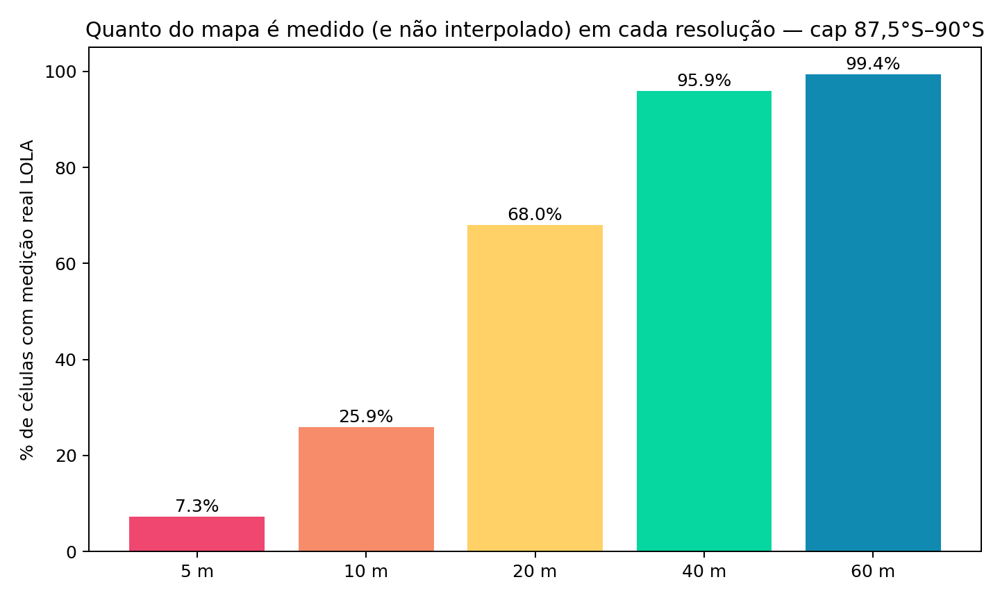

*Conclusão sucinta: a transição de 20 m para 40–60 m/px eleva a cobertura medida de 68,0% para acima de 95,9%, justificando seu uso como base geodésica contínua.*  
*Fonte: camada oficial `LDEC_875S_5M` (`cobertura_multiescala.csv`).*

A Figura 04 coloca as resoluções de $5\text{ m}$ até $120\text{ m/px}$ sob uma escala única de cores (`0%` em vermelho escuro a `100%` em verde escuro) para os `42` sítios Artemis internos à calota polar. O contraste cromático comprova que, em $5\text{ m/px}$ e $10\text{ m/px}$, apenas corredores estreitos de cruzamento orbital exibem densidade apreciável de disparos, tornando toda a calota vermelha ou alaranjada até $20\text{ m/px}$. Assim, a inspeção visual elimina a ilusão de amostragem homogênea nas grades finas.

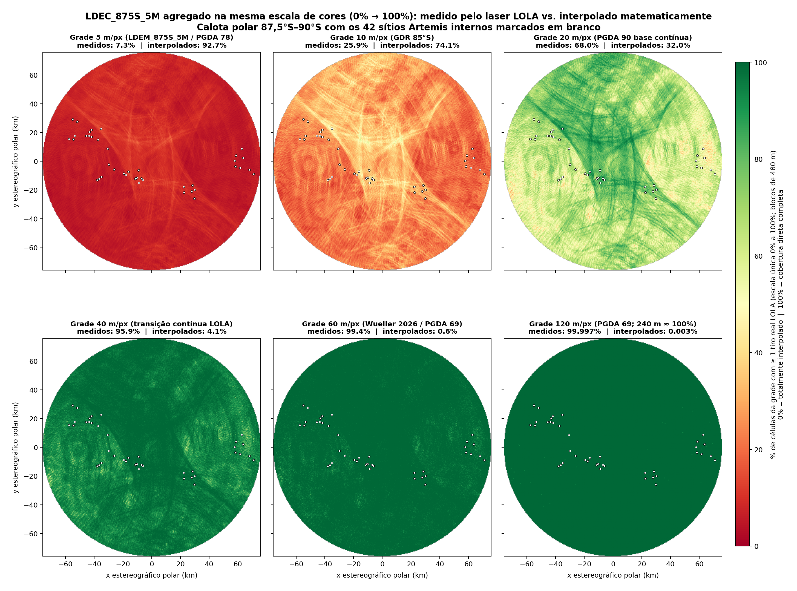

*Conclusão sucinta: sob legenda única, a calota polar só atinge preenchimento físico uniforme entre 40 m e 60 m/px.*  
*Fonte: camada oficial `LDEC_875S_5M` com pontos de `sitios_numerados.csv`.*

A Figura 05 amplia especificamente a grade de $5\text{ m/px}$ (`LDEC_875S_5M`) com a posição numerada dos sítios `Nº 89` a `Nº 130` dentro de $87{,}5^\circ\text{S}$. O mapa mostra os feixes de traços cruzados sobre o polo geográfico (faixas amareladas com `15%–25%` de tiros locais) cercados por extensas zonas avermelhadas com `< 5%` de amostragem real. Portanto, mesmo dentro dos sítios mais austrais, a incerteza topográfica varia abruptamente de um pixel para o vizinho conforme a geometria dos traços orbitais.

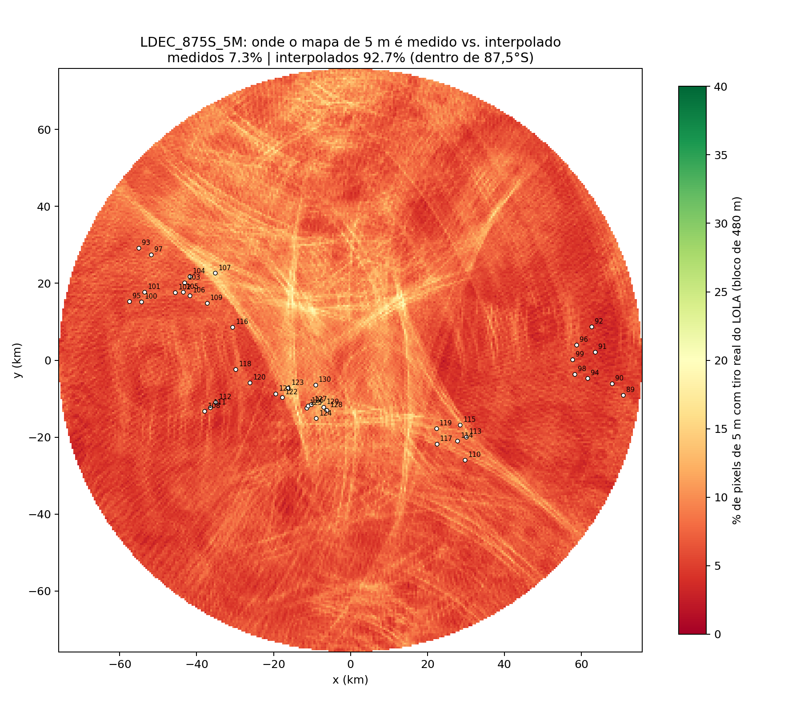

*Conclusão sucinta: a densidade real de tiros a 5 m/px organiza-se em faixas estreitas de cruzamento orbital, deixando a maior parte dos sítios nº 89 a nº 130 em zonas abaixo de 10%.*  
*Fonte: camada oficial `LDEC_875S_5M` (`resumo.json`).*

A Figura 06 compara um bloco local de `2 × 2 km` centrado no **Sítio `001` (*Connecting Ridge*, `Nº 126`)** nas escalas de $5\text{ m}$ e $20\text{ m}$. Na grade de $5\text{ m}$, apenas **`8,9%`** dos pixels recebem disparo direto (pontos verdes) contra **`91,1%`** interpolados (em vermelho) ao redor da elipse de pouso (`100 m`), ao passo que em $20\text{ m}$ **`77,1%`** das células registram ao menos um disparo. Esse resultado reforça que a interpolação domina inclusive a vizinhança imediata do sítio candidato de topo de crista.

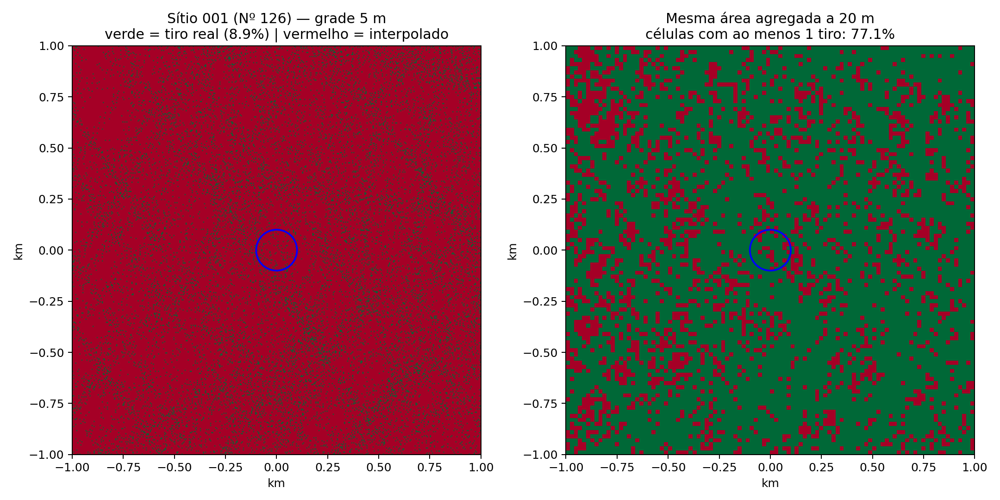

*Conclusão sucinta: dentro do raio de 100 m do pouso em Connecting Ridge, nove em cada dez pixels de 5 m/px são matematicamente interpolados.*  
*Fonte: camada `LDEC` do bloco `Site01` (`PGDA 78`).*

A Figura 07 audita estatisticamente a fração direta de disparos LOLA (`LDEC > 0` em $5\text{ m}$) nos **`104` sítios `PGDA 78`** estratificados pelas `14` regiões representadas e correlacionados com a latitude austral (`seaborn` + `scipy.stats`). A mediana global é de **`7,60%`** (`IIQ: 4,49%–10,28%`), variando de **`0,08%`** (`NR2_K2023`) a **`21,24%`** (`MMA04`), com diferença significativa entre regiões (**teste H de Kruskal-Wallis**, $H = 73{,}59,\ p = 1{,}74 \times 10^{-10}$) e gradiente positivo em direção ao polo (**Spearman** $\rho = +0{,}550,\ p = 1{,}43 \times 10^{-9}$; inclinação OLS `+0,98 p.p./grau`). Assim, mesmo sob convergência orbital máxima junto a $90^\circ\text{S}$, entre `78,8%` e `99,9%` dos pixels de $5\text{ m}$ permanecem interpolados.

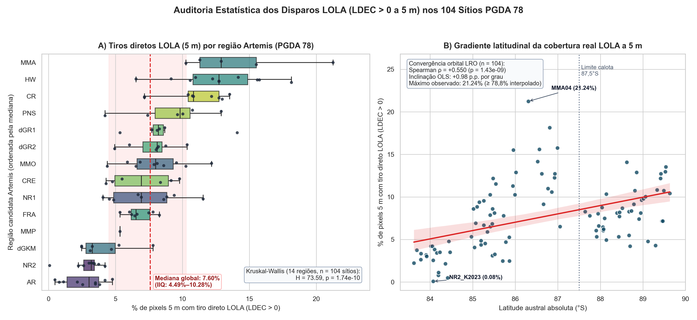

*Conclusão sucinta: a cobertura real do LOLA cresce com a latitude (ρ = +0,550) e difere entre regiões (p = 1,74e-10), mas mantém mediana global de apenas 7,60%.*  
*Fonte: análise estatística em [gerar_figs_intro_lola.py](file:///c:/NASA%20PROJETO%202026/simulacao_rover/testes/gerar_figs_intro_lola.py) sobre [sitios_numerados.csv](file:///c:/NASA%20PROJETO%202026/docs/tabelas_tese/sitios_numerados.csv).*

---

### 1.3 Histórico das Técnicas de Sensoriamento e Evolução da Resolução Espacial (`m/px`)

Para preencher os intervalos não amostrados pelo altímetro `LOLA` e detalhar micro-obstáculos, o mapeamento lunar combinou sensores altimétricos, gravimétricos e ópticos entre `2007` e `2026`. A Tabela 02 reúne essas cinco técnicas, comparando princípio físico, resolução espacial típica, desempenho em sombra e fornecimento de elevação geodésica `Z`. Os dados mostram que nenhuma técnica isolada combina simultaneamente escala métrica (`~1–2 m`), operação no escuro e datum geodésico absoluto `Z`, impondo a fusão multissensor para o planejamento de superfície.

**Tabela 02 — Síntese comparativa das técnicas orbitais de imageamento e altimetria polar lunar (`2007–2026`)**

| Técnica / Missão (Período) | Princípio de Medição | Resolução Espacial Típica | Opera dentro de Sombras / *PSRs*? | Mede Elevação Absoluta `Z`? | Limitação Operacional Principal |
|---|---|---|---|---|---|
| **`Kaguya LALT`** (`2007–2009`) | Altimetria a laser orbital (`1 Hz`) | **`~500 m – 2 km`** *(global)* | Sim (ativo no escuro) | Sim | Amostragem muito esparsa para engenharia de pouso ou rover |
| **`LRO / LOLA`** (`jul/2009–set/2013` denso; ativo) | Altimetria a laser multifeixe (`5 × 28 Hz`) | **`5 m`** (pegada/traço) a **`60 m`** (grade contínua) | **Sim** (ativo no escuro) | **Sim** (datum polar `Z`) | Esparsidade entre traços (`92,71%` interp. em `5 m` na calota `87,5°S`) |
| **`GRAIL` + Ajuste `PGDA 78/90`** (`2011–2012` → `2021/2023`) | Gravimetria + corregistro geodésico de traços `LOLA` | **`5 m`** (`27` blocos `PGDA 78`) / **`20 m`** (`PGDA 90` contínuo) | Sim (herda `LOLA`) | Sim (refinado) | Cobertura `5 m` restrita a `27` blocos locais; vãos mantidos interpolados |
| **`LROC NAC` + `SfS`** (`2009–presente`) | Fotometria orbital + *Shape-from-Shading* | **`~0,5–2 m/px`** | **Não** (cegueira em sombra projetada) | Não (relevo relativo derivado) | Degradação ou colapso em sombras longas sob Sol rasante (`1,54°`) |
| **`KPLO/Danuri ShadowCam`** (`ago/2022–presente`) | Imageamento óptico em luz secundária (`>200×` sens.) | **`~1,7–2 m/px`** | **Sim** (obstáculos por albedo) | Não (satura sob luz solar direta) | Sem fluxo solar direto nem referencial geodésico `Z` autônomo |

*Cada linha contrasta princípio físico, resolução típica, comportamento dentro de PSRs e papel geodésico das principais técnicas lunares.*  
*Conclusão sucinta: o LOLA assegura o datum absoluto Z mesmo no escuro, enquanto LROC NAC/SfS e ShadowCam fornecem detalhe óptico local complementar sem substituir a altimetria geodésica.*  
*Fonte: especificação dos produtos orbitais LRO/LOLA, GRAIL, LROC NAC/SfS e KPLO/ShadowCam.*

A Figura 08 apresenta uma imagem óptica real obtida pela câmera `LROC NAC` sobre o Sítio `01` (*Connecting Ridge*). O registro evidencia microcrateras nítidas nas vertentes iluminadas e perda completa de sinal nas sombras projetadas sob Sol rasante, explicando na prática por que técnicas puramente fotométricas (`SfS`) falham no interior das sombras polares.

*Conclusão sucinta: a fotografia LROC NAC confirma alta nitidez de micro-relevo ao Sol e cegueira total nas áreas em sombra projetada.*  
*Fonte: acervo orbital `LROC NAC` (`lroc_nac/pgda78_26/figuras/crop_Site01.png`).*

A Figura 09 mostra outra fotografia real `LROC NAC` de alta resolução capturando o entorno de um módulo pousado e as respectivas trilhas de rover na superfície lunar. O contraste de escala confirma que o imageamento óptico de alta resolução consegue auditar obstáculos e deslocamentos em escala submétrica a métrica sempre que há iluminação solar direta.

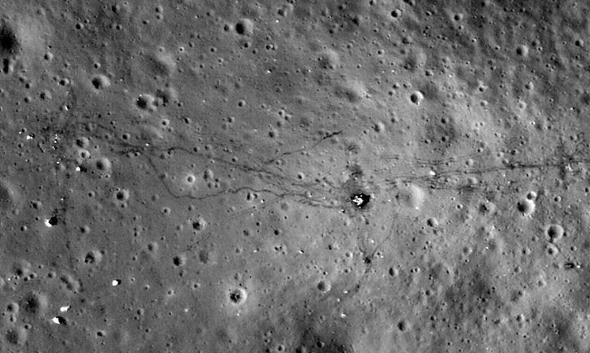

*Conclusão sucinta: quando iluminada, a câmera LROC NAC resolve traços de tráfego e microfeições na própria escala física do rover.*  
*Fonte: acervo `LROC NAC` (`src/assets/lua_real_lroc.jpg`).*

> **[ESPAÇO RESERVADO PARA FOTO 1C — Câmeras LROC NAC (ASU/NASA) e Sonda KPLO/Danuri + ShadowCam (KARI/NASA)]**  
> *Inserir aqui fotografias dos conjuntos ópticos LROC NAC e da sonda coreana KPLO (Danuri) equipada com a câmera ShadowCam (lançada em 5 de agosto de 2022).*

A Tabela 03 sintetiza os cinco marcos históricos da evolução real de resolução ($\text{m/px}$) entre `2007` e `2023`, separando pixels efetivamente medidos por pulso direto da fração interpolada a $5\text{ m}$. Os dados indicam que os `130` sítios candidatos evoluíram de $\ge 500\text{ m}$ para `80,0%` com cobertura nominal de `5 m`, porém com apenas **`6,1%`** de disparos reais no laser (versus `73,9%` interpolados); já no Polo Sul completo (`288.139 km²`), apenas **`0,7%`** conta com tiro direto a `5 m`. Assim, a evolução temporal dos arquivos em disco superestima o ganho físico efetivo se a fração interpolada não for discriminada.

**Tabela 03 — Evolução histórica real da resolução espacial (`2007–2023`) nos `130` sítios candidatos e no Polo Sul completo (`288.139 km²`)**

| Marco Histórico / Produto Cartográfico | Cobertura nos `130` Sítios (*Wueller et al., 2026*) | Panorama no Polo Sul Completo (`80°S–90°S`, `288.139 km²`) |
|---|---|---|
| **1. Pré-LRO (`2007–2009`, `Kaguya LALT`)** | `100%` em macroescala $\ge 500\text{ m}$ | `100%` em macroescala $\ge 500\text{ m}$ |
| **2. LOLA Pioneiro (`2011`, Mazarico / base `PGDA 69`)** | `100%` em base contínua `120–240 m` | `100%` em base contínua `120–240 m` |
| **3. `PGDA 69` Polar (`2016`)** | `80,8%` em `60 m` / `19,2%` $\ge 120\text{ m}$ | `31,9%` em `60 m` / `68,1%` em `120 m` (anel $80^\circ\text{–}85^\circ\text{S}$) |
| **4. LOLA `GDR V2` (`2017`, `LDEM_875S_5M`)** | `3,5%` `5 m` real + `37,3%` `5 m` interp. + `40,0%` (`10 m`) + `19,2%` (`20 m`) | `0,6%` `5 m` real + `7,4%` `5 m` interp. + `23,9%` (`10 m`) + `68,1%` (`20 m`) |
| **5. Pós-`GRAIL` (`2021–2023`, `PGDA 78 + 90`)** | **`6,1%` `5 m` real + `73,9%` `5 m` interp.** + `9,2%` (`10 m`) + `10,8%` (`20 m`) | **`0,7%` `5 m` real + `9,1%` `5 m` interp.** + `22,6%` (`10 m`) + `67,6%` (`20 m`) |

*Cada linha resume a distribuição real de resolução em cinco marcos históricos (`2007–2023`), separando pixels fisicamente medidos de células interpoladas em `5 m`.*  
*Conclusão sucinta: após 14 anos de evolução cartográfica (2007–2023), apenas 6,1% dos pixels nos 130 sítios e 0,7% do Polo Sul possuem medição direta LOLA em 5 m/px.*  
*Fonte: integração sobre `sitios_numerados.csv`, `PGDA 69`, `LDEM_875S_5M` e `PGDA 78/90`.*

A Figura 10 exibe a progressão histórica (`2007–2023`) da resolução alcançada especificamente nos `130` sítios candidatos do catálogo *Wueller et al. (2026)*. As barras empilhadas mostram que a transição pós-`GRAIL` (`2021–2023`) reduziu as parcelas presas a `10 m` (`9,2%`) e `20 m` (`10,8%`), porém concentrou **`73,9%`** em `5 m` interpolado contra **`6,1%`** de tiros diretos reais. Logo, a melhora de resolução nominal nos sítios candidatos depende criticamente de proteção estatística sobre a fração interpolada.

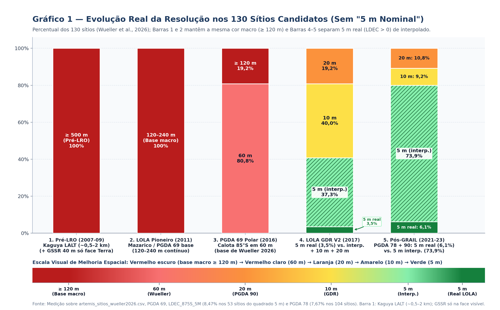

*Conclusão sucinta: a disponibilidade nominal de 5 m nos 130 sítios atingiu 80,0% até 2023, mas apenas 6,1% do total corresponde a disparos diretos LOLA.*  
*Fonte: medição direta sobre `sitios_numerados.csv`, `PGDA 69`, `LDEC_875S_5M` e `PGDA 78`.*

A Figura 11 projeta esses mesmos cinco marcos sobre a área esférica completa do Polo Sul lunar ($80^\circ\text{S}\text{–}90^\circ\text{S}$, `288.139 km²`). Em escala regional ampla, **`> 90%`** da superfície polar permanece fisicamente em `20 m` (`67,6%`) ou `10 m` (`22,6%`), enquanto `5 m` medido direto soma **`0,7%`** (com `9,1%` interpolados). Esse comportamento demonstra por que metodologias que partem de `60 m` ou `20 m` continuam indispensáveis fora das ilhas `PGDA 78`.

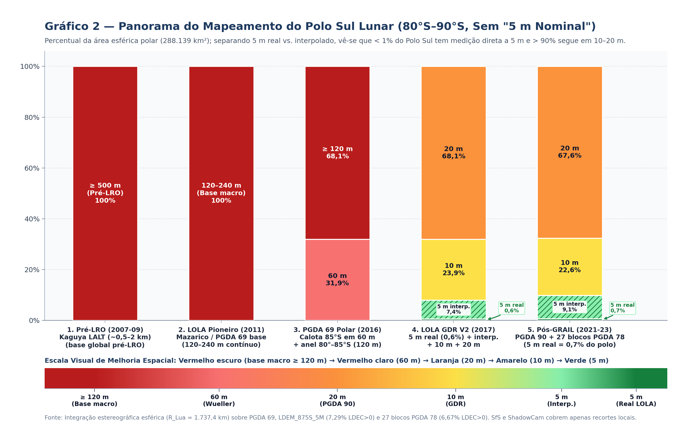

*Conclusão sucinta: considerando todo o Polo Sul lunar, mais de 90% da área segue em resolução física decamétrica (10–20 m/px), restringindo o 5 m direto a 0,7%.*  
*Fonte: integração esférica estereográfica ($R_{\text{Lua}} = 1.737{,}4\text{ km}$) sobre `PGDA 69`, `LDEM_875S_5M` e `27` blocos `PGDA 78`.*

A Figura 12 mapeia espacialmente onde cada grade `LOLA` (`60 m`, `20 m`, `10 m` e os `27` blocos `5 m PGDA 78`) cobre os `130` sítios numerados do norte (`Nº 1`) ao polo (`Nº 130`). Observa-se o agrupamento dos blocos roxos `PGDA 78` em setores prioritários, deixando grupos de sítios externos aos blocos dependentes de grades `GDR` contínuas de `10 m` e `20 m`. Assim, a heterogeneidade espacial reflete diretamente os anéis de latitude e as áreas priorizadas nos levantamentos pós-`GRAIL`.

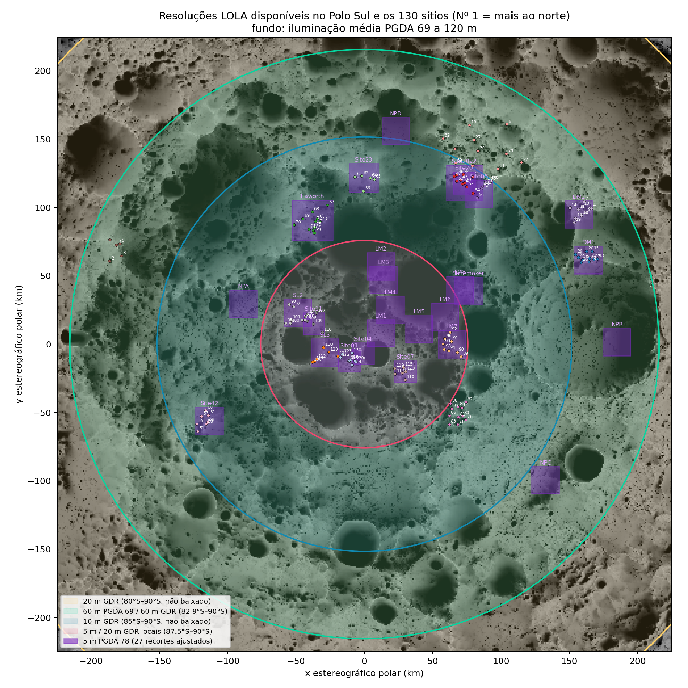

*Conclusão sucinta: a disponibilidade espacial de 5 m/px é fragmentada em blocos descontínuos sobre o mapa de iluminação a 120 m/px.*  
*Fonte: fundo de iluminação média `PGDA 69` (`120 m`), grades `GDR` e os `27` blocos `PGDA 78`.*

A Figura 13 estratifica a melhor grade `LOLA` disponível pelas `16` regiões candidatas Artemis, destacando as `9` regiões selecionadas pela NASA em outubro de `2024`. Enquanto `13` regiões contam com `100%` dos sítios dentro de blocos `5 m PGDA 78`, todos os **`26` sítios sem `5 m`** (`20,0%` do catálogo) concentram-se exclusivamente em três regiões da lista atual da NASA: **Peak Near Cabeus B (`PCB`, `5/5` em `20 m`)**, **Slater Plain (`SP`, `11/11` em `10 m`)** e **Mons Mouton Plateau (`MMP`, `9` em `20 m`, `1` em `10 m` e `1` em `5 m`)**. Portanto, reconstruir o risco de escala de `5 m` a partir de grades de `20 m` e `60 m` é uma necessidade imediata para regiões candidatas ativas do programa Artemis.

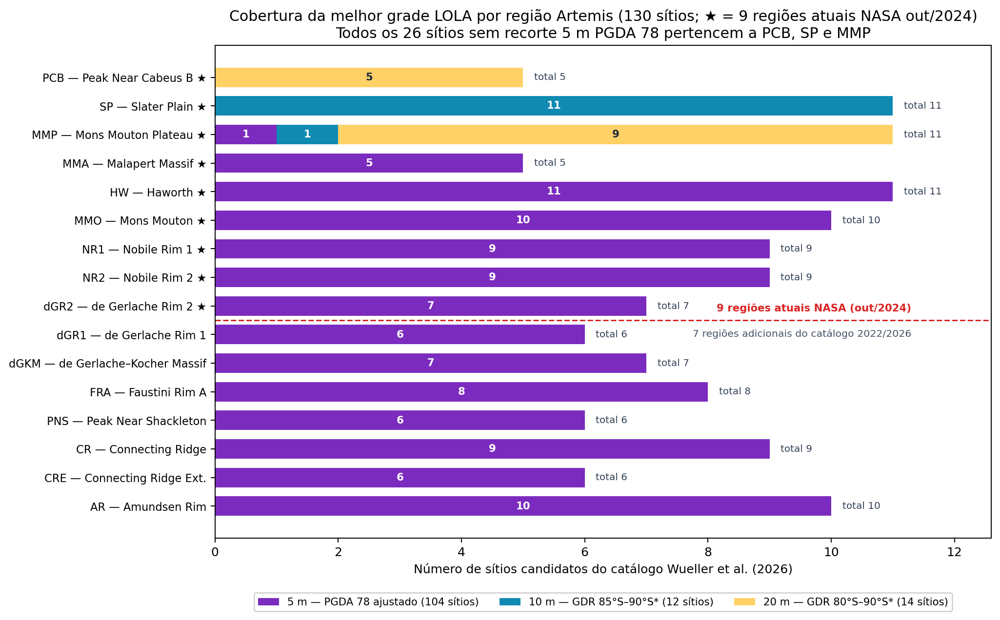

*Conclusão sucinta: três das nove regiões atuais da NASA (PCB, SP e MMP) respondem por todos os 26 sítios desprovidos de levantamento nominal de 5 m/px.*  
*Fonte: estratificação de [sitios_numerados.csv](file:///c:/NASA%20PROJETO%202026/docs/tabelas_tese/sitios_numerados.csv) por região Artemis e produto `PGDA 78` / `GDR`.*

---

### 1.4 Síntese do Risco Operacional e Escopo da Tese

A auditoria histórica e espacial realizada nos itens `1.1` a `1.3` confirma que confiar em grades médias de $60\text{ m}$ ou $20\text{ m}$ — ou tratar arquivos nominais de $5\text{ m}$ como verdade física contínua apesar de `92,7%` a `99,9%` de interpolação — oculta microcrateras decamétricas, escarpas afiladas e micro-taludes que derrubam landers e rovers (como exemplificado pelo tombamento do módulo *Athena IM-2* em março de 2025 e pelos desvios de emergência do rover *Pragyan / Chandrayaan-3* em agosto de 2023) e cria falsos positivos energéticos sob Sol rasante a $1{,}54^\circ$.

Diante desse quadro, esta tese propõe, implementa e audita um arcabouço integrado de **fusão topográfica multirresolução ($240 \to 60 \to 20 \to 5\text{ m}$)** com **escudo probabilístico conservador (`P50/P90/P99` e regra *No False Relief*)**, acoplado a **técnicas formais de otimização** (Programação Linear, Otimização Não-Linear com Restrições KKT, Planejamento por Custo Mínimo em Grade e Análise Multicritério `TOPSIS`) e **validação estocástica por Monte Carlo** em dados reais `LOLA/GRAIL`, `LROC NAC/SfS` e trajetórias reais de rover.

---

## 2. Objetivos

### 2.1 Objetivo Geral
Desenvolver e validar estatisticamente uma metodologia multirresolução e probabilística para seleção de sítios, avaliação de risco geotécnico-energético e planejamento de travessia de rovers no Polo Sul lunar, capaz de converter grades macroscópicas ($60\text{ m}$ e $20\text{ m}$) em estimativas seguras na escala de engenharia de $5\text{ m}$ sem inventar topografia onde o altímetro a laser não amostrou.

### 2.2 Objetivos Específicos
1. **Quantificar a lacuna observacional** dos $130$ sítios candidatos do catálogo *Wueller et al. (2026)* cruzando a cobertura real por disparo direto `LOLA` (`LDEC > 0`), tiles ajustados pós-`GRAIL` (`PGDA 78`) e grades contínuas (`PGDA 90` / `GDR`).
2. **Formular e calibrar a reconstrução multirresolução ($60/20\text{ m} \to 5\text{ m}$)** combinando convolução normalizada gaussiana dos resíduos locais do laser com atenuação de confiança em zonas interpoladas (*No False Relief*) e quantis de erro `P50/P90/P99`.
3. **Mensurar por Monte Carlo em dados reais** (*cross-validation* espacial sobre $26$ sítios `PGDA 78`, com controle justo de **mesmo falso alarme**) o ganho líquido da multirresolução versus o mero aumento uniforme da margem de segurança.
4. **Verificar de forma independente a modelagem de sombras e relevo** contra produtos `SfS 5 m` e `486` fotografias ortorretificadas da câmera `LROC NAC` usando geometria estereográfica esférica exata e efemérides `DE440`.
5. **Isolar por estudo de ablação e escada de dificuldade** a contribuição real de cada componente do pipeline — mapa multirresolução, escudo determinístico, Programação Linear (`Simplex`), Otimização Não-Linear (`Barreira Logarítmica / Pontos Interiores + Newton/KKT`), ajuste de pesos por Monte Carlo e Aprendizado de Máquina (`MLP` / `Rank-ES`) — definindo rigorosamente onde cada técnica agrega valor e **onde o uso de ML não é indicado**.
6. **Validar externamente o algoritmo em caso real documentado** (*Pragyan / Chandrayaan-3*, agosto de 2023) e em travessias reais `LOLA` sob múltiplos degraus de severidade de terreno e com remoção de teto temporal.

---

## 3. Dados e Estatística Descritiva

O acervo empírico reunido no projeto combina dados orbitais oficiais da NASA/GSFC, catálogos de sítios candidatos e produtos de missão publicados, organizados em cinco blocos auditáveis.

### 3.1 Catálogo Polar de Referência ($130$ Sítios — *Wueller et al., 2026*)
A Tabela 04 consolida as métricas estatísticas descritivas dos $130$ sítios candidatos do catálogo *Wueller et al. (2026)* (`sites/artemis_sitios_wueller2026.csv`), distribuídos por $16$ regiões polares (de `Nº 1 PCB04` em $-83{,}3691^\circ$ até `Nº 130 CR08` em $-89{,}6319^\circ$) sob grade original de $60\text{ m/px}$ e mastro de $2\text{ m}$ para `2025–2032`. Os números mostram elevada assimetria na disponibilidade de *PSRs* (mediana $30.750\text{ m}^2$, IQR $145.200\text{ m}^2$, máximo $3{,}32\text{ km}^2$) e forte variação interanual das janelas de iluminação contínua (`2026` mediana $8{,}00\text{ d}$ contra `2025` mediana $13{,}00\text{ d}$). Assim, selecionar sítios por apenas um ano ou por iluminação média mascara déficits severos de acesso a sombras frias e sazonalidade energética.

**Tabela 04 — Estatística descritiva do catálogo polar de referência (`N = 130` sítios, *Wueller et al., 2026*)**

| Variável (`N = 130`) | Média $\pm s$ | Mediana | $Q_1\text{–}Q_3$ ($\text{IQR}$) | Mín. – Máx. |
|---|---:|---:|---:|---:|
| Latitude planetocêntrica ($^\circ$) | $-86{,}42 \pm 1{,}87$ | $-86{,}16$ | $-88{,}07\text{ a }-84{,}85$ ($3{,}23$) | $-89{,}6319\text{ a }-83{,}3691$ |
| Sol contínuo `2025` (dias) | $12{,}77 \pm 9{,}34$ | $13{,}00$ | $4{,}25\text{–}17{,}00$ ($12{,}75$) | $0{,}00\text{–}32{,}00$ |
| Sol contínuo `2026` (dias) | $8{,}92 \pm 7{,}82$ | $8{,}00$ | $0{,}25\text{–}16{,}75$ ($16{,}50$) | $0{,}00\text{–}21{,}00$ |
| Sol contínuo `2028` (dias) | $8{,}29 \pm 6{,}01$ | $9{,}00$ | $2{,}25\text{–}13{,}00$ ($10{,}75$) | $0{,}00\text{–}20{,}00$ |
| Sol contínuo `2032` (dias) | $13{,}94 \pm 8{,}00$ | $12{,}00$ | $10{,}00\text{–}17{,}00$ ($7{,}00$) | $0{,}00\text{–}30{,}00$ |
| Sol + Terra (`DTE`) `2025` (dias) | $11{,}61 \pm 8{,}70$ | $11{,}50$ | $4{,}00\text{–}16{,}75$ ($12{,}75$) | $0{,}00\text{–}32{,}00$ |
| Sol + Terra (`DTE`) `2026` (dias) | $8{,}09 \pm 7{,}57$ | $7{,}00$ | $0{,}00\text{–}15{,}00$ ($15{,}00$) | $0{,}00\text{–}21{,}00$ |
| Sol + Terra (`DTE`) `2028` (dias) | $7{,}88 \pm 5{,}85$ | $9{,}00$ | $2{,}00\text{–}12{,}75$ ($10{,}75$) | $0{,}00\text{–}17{,}00$ |
| Área de *PSR* acessível até $2\text{ km}$ ($\text{m}^2$) | $177.202{,}7 \pm 417.145{,}2$ | $30.750{,}0$ | $0{,}0\text{–}145.200{,}0$ ($145.200{,}0$) | $0{,}0\text{–}3.322.004{,}0$ |

*Conclusão sucinta: a disponibilidade de iluminação contínua e de PSRs acessíveis a até 2 km apresenta dispersão acentuada entre os 130 sítios, exigindo critérios multicritério e janelas plurianuais.*  
*Fonte: arquivo `sites/artemis_sitios_wueller2026.csv` e [sitios_numerados.csv](file:///c:/NASA%20PROJETO%202026/docs/tabelas_tese/sitios_numerados.csv).*

### 3.2 Cobertura Real de Tiros LOLA (`LDEC`) e Estratos de Resolução
A auditoria pixel a pixel de `LDEC_875S_5M` sobre a calota $87{,}5^\circ\text{S}\text{–}90^\circ\text{S}$ ($30.336 \times 30.336\text{ px}$) e o cruzamento espacial com os $130$ sítios (`resumo.json`) revelam:

- **Fração com pelo menos 1 tiro real LOLA por escala de agregação:** $5\text{ m}$ = **$7{,}29\%$** (`7,287%`); $10\text{ m}$ = **$25{,}90\%$** (`25,903%`); $20\text{ m}$ = **$67{,}97\%$** (`67,968%`); $40\text{ m}$ = **$95{,}93\%$** (`95,928%`); $60\text{ m}$ = **$99{,}40\%$** (`99,404%`).
- **Estratificação da melhor grade disponível entre os $130$ sítios:**
  - **$104$ sítios ($80{,}0\%$):** cobertos por blocos ajustados `PGDA 78` de $5\text{ m/px}$ (distribuídos em $14$ blocos locais; mediana de apenas **$7{,}6\%$** de pixels com tiro real `LDEC > 0` dentro da elipse de pouso de $100\text{ m}$, variando de $0{,}08\%$ a $21{,}24\%$); destes, $42$ estão acima de $87{,}5^\circ\text{S}$.
  - **$12$ sítios ($9{,}2\%$):** melhor grade disponível de $10\text{ m/px}$ (`GDR 85°S–90°S`), concentrados em `SP` ($11$) e `MMP01` ($1$).
  - **$14$ sítios ($10{,}8\%$):** melhor grade disponível de $20\text{ m/px}$ (`GDR 80°S–90°S`), concentrados em `PCB` ($5$) e `MMP` ($9$).
  - Todos os **$26$ sítios sem cobertura de $5\text{ m}$** pertencem às três regiões incorporadas/revisadas em outubro de 2024 (`PCB`, `SP`, `MMP`).

### 3.3 Base do Monte Carlo em Dados Reais (`PGDA 78`)
Dos $27$ blocos `PGDA 78` ($5\text{ m/px}$ pós-`GRAIL`, contendo camadas `surf`, `slp`, `ldec`, `toterr`, `slperr` em `float32`), excluiu-se `Site20` por sobreposição central exata com `Site20v2`, resultando em **$26$ sítios independentes**: `DM1`, `DM2`, `Haworth`, `LM1`–`LM8`, `NPA`–`NPD`, `SL2`, `SL3`, `Shoemaker`, `Site01`, `Site04`, `Site06`, `Site07`, `Site11`, `Site20v2`, `Site23`, `Site42`. Em cada sítio avaliou-se a área central de $2.000 \times 2.000$ células ($10 \times 10\text{ km}$).

### 3.4 Base Óptica Independente (`SfS 5 m` + `LROC NAC`)
Utilizaram-se os três blocos `SfS ELEV 5 m/px` ($16 \times 16\text{ km}$, produtos `A3CLR22` #10, #9 e #8 de *Bertone et al., 2026*) sobre **Leibnitz Beta** ($85{,}4^\circ\text{S}$), **de Gerlache Rim** e **Peak Near Shackleton**, avaliados em grade de $2.523$ observadores ($841$ por região) e confrontados contra todas as **$486$ fotografias ortorretificadas `LROC NAC`** ($120$ em Leibnitz, $194$ em de Gerlache, $172$ em Peak Near Shackleton).

### 3.5 Base de Travessia em Relevo Real (`LOLA`) e Terrenos Sintéticos
- **Treino/Validação/Teste em Relevo Real (`animacao_tese_rover_neuroevolucao_v18.html`):** $52$ faixas de $3\text{ km} \times 550\text{ m}$ ($600 \times 110$ células de $5\text{ m}$), $2$ por sítio `PGDA 78`, selecionadas com $\approx 4{,}9\%$ de células acima de $15^\circ$: $34$ faixas de treino ($17$ sítios), $2$ de validação (`Site04`) e **$16$ faixas inéditas de teste** ($8$ sítios estratificados em aspereza: `Site23`, `Site42`, `Site11`, `LM8`, `Site20v2`, `LM3`, `NPB`, `Shoemaker`).
- **Ablação Pareada Controlada:** $30$ terrenos sintéticos inéditos calibrados (sementes `7101–7130`, $60$ rovers pareados por terreno = $1.800$ pares por transição).
- **Validação Externa (*Pragyan / Chandrayaan-3*):** Trilha real e crateras em *South Crater* ($69{,}37^\circ\text{S}$, $23\text{–}27/08/2023$, digitalizada de *Stooke, LPSC 2025 #1025*) escalonada em $12:1$ ($3\text{ m} \to 25\text{ cm}$, $7{,}29\%$ de células medidas) com $500$ realizações Monte Carlo.

---

## 4. Metodologia

Para assegurar clareza metodológica e rastreabilidade científica perante banca avaliadora, o método é estruturado em cinco frentes independentes e auditáveis.

### 4.1 Modelagem Física Polar e Geodésica
1. **Projeção Estereográfica Polar Sul:** Coordenadas planetocêntricas $(\varphi, \lambda)$ em radianos no referencial `MOON_ME` são projetadas no plano tangente sul ($\varphi_0 = -\pi/2$, raio lunar médio $R_{\text{Lua}} = 1.737.400\text{ m}$):
   $$r(\varphi) = 2\,R_{\text{Lua}} \tan\!\left(\frac{\frac{\pi}{2} + \varphi}{2}\right), \qquad x = r(\varphi)\,\sin\lambda, \qquad y = r(\varphi)\,\cos\lambda$$
2. **Máscara de Horizonte com Curvatura Esférica:** Para um observador $P_0 = (x_0, y_0, Z_0 + h_{\text{mastro}})$ e um pixel a distância planar $d_k$ na direção azimutal $\phi$, o ângulo de elevação do horizonte incorpora o abatimento esférico $d_k^2 / (2 R_{\text{Lua}})$:
   $$\alpha(\phi) = \max_{d_k \le d_{\text{máx}}} \arctan\!\left(\frac{(Z_k - Z_0 - h_{\text{mastro}}) - \dfrac{d_k^2}{2 R_{\text{Lua}}}}{d_k}\right)$$
3. **Efemérides `DE440` e Correção Escalar Crítica:** As posições horárias de Sol e Terra são calculadas diretamente a partir de `de440s.bsp` e `moon_pa_de440_200625.bpc`. Durante a auditoria do repositório, identificou-se e isolou-se um erro de escala legado nos scripts originais de pré-cálculo (`111.320 m/grau` terrestre no lugar de `30.323 m/grau` lunar), que encurtava raios de horizonte em $\sim 3{,}7\times$; todas as verificações físicas recentes (`sfs_comparacao` e simulação de rover) operam em geometria estereográfica lunar exata.

### 4.2 Extrapolação e Fusão Multirresolução ($240 \to 60 \to 20 \to 5\text{ m}$)
1. **Atenuação Log-Linear de Iluminação e Incerteza Analítica:** A degradação sistemática de visibilidade solar ao passar de $A_{\text{macro}}$ para $A = 25\text{ m}^2$ ($5\text{ m}$) é expressa por $L(A) = L(A_{\text{macro}}) - k_{\text{sombra}}(S)\ln(A_{\text{macro}}/A)$, combinada à equação de incerteza vertical de *Barker et al. (2021)* ($\varepsilon(R, S) = 0{,}0210\,R + 0{,}0051\,S + 0{,}022$) e à atenuação pela altura do mastro $f_{\text{mastro}}(h) = e^{-0{,}42(h - 1{,}0)}$.
2. **Reconstrução Local por Convolução Normalizada Gaussiana e Regra *No False Relief*:** Dada uma grade grossa (média em blocos $12\times 12$ para $60\text{ m}$ ou $4\times 4$ para $20\text{ m}$, reamostrada bilinearmente para $5\text{ m}$):
   - Calcula-se o resíduo altimétrico $r_i = Z_{\text{LOLA}} - Z_{\text{grade}}$ **exclusivamente** nas células medidas por disparo direto (`LDEC > 0`);
   - Espalha-se o resíduo por convolução gaussiana normalizada com $\sigma$ igual à metade do espaçamento médio entre disparos;
   - Multiplica-se o campo espalhado pelo peso de confiança local $w_c = \rho / (\rho + 0{,}02)$, impondo que, longe de medições diretas ($\rho \to 0$), o resíduo tenda a zero (*No False Relief*: o algoritmo não fabrica relevo sintético onde o laser não passou);
   - Nas células com tiro direto (`LDEC > 0`), preserva-se o valor medido, e calcula-se o declive pelo mesmo gradiente central do produto oficial `PGDA 78` (diferença média verificada contra `slp.tif` de $\approx 0{,}001^\circ$).
3. **Escudo Probabilístico (`P50 / P90 / P99`):** Cada célula estimada recebe uma margem assimétrica $\Delta S$ — menor perto de disparos diretos e maior em zonas interpoladas (ex.: nominal `P90`: $+2{,}03^\circ$ perto / $+3{,}56^\circ$ longe; calibrada `P90` em `PGDA 78`: $+2{,}99^\circ$ perto / $+2{,}78^\circ$ longe) — sendo vetada no planejamento quando $\hat{S} + \Delta S > S_{\text{lim}}$ ($15^\circ$ no rover; $8^\circ$ no pouso), mantendo margem zero apenas onde câmera ou `IMU` a bordo já mediram diretamente o terreno.

### 4.3 Técnicas de Otimização e Calibração por Monte Carlo
Em vez de heurísticas *ad hoc*, o pipeline separa cada problema em sua família matemática exata, complementada por calibração empírica via Monte Carlo. A Tabela 05 sintetiza as cinco técnicas empregadas e suas respectivas camadas de decisão. O detalhamento evidencia que despacho energético linear, controle contínuo restrito (`KKT`), roteamento em grafo, ranqueamento multicritério (`TOPSIS`) e controle estatístico justo (`bisseção`) operam de forma modular sem depender de aproximações caixa-preta.

**Tabela 05 — Arquitetura das técnicas formais de otimização e validação estatística do pipeline**

| Camada do Problema | Técnica Matemática Empregada | Formulação e Papel no Pipeline |
|---|---|---|
| **Despacho energético solar / sombra (solo)** | **Programação Linear — Método Simplex de Duas Fases + Dualidade (Preço-Sombra)** | `simplexDuasFases`: maximiza $c^\top x$ sujeito a restrições lineares ($\le, \ge, =$) de carga/descarga de bateria, horizonte solar e meta operacional em segmentos da travessia; extrai os preços-sombra duais $\pi_{\text{bat}}$ da restrição energética para modular a cautela nas decisões subsequentes. |
| **Controle contínuo a bordo e sintonia de pesos** | **Otimização Não-Linear com Restrições — Método de Pontos Interiores (Barreira Logarítmica) + Newton Multivariado com Regularização SPD e *Backtracking* + Condições KKT** | Em tempo de decisão (`2×2` para velocidade e ângulo de esterçamento) e na calibração de $7$ pesos (`7×7`), resolve $\min \Phi(x) - \mu \sum \ln(-g_k(x))$ sob restrições de obstáculo, bateria e inclinação limite, extraindo multiplicadores duais KKT ($\lambda_{\text{obst}}, \lambda_{\text{bat}}, \lambda_{\text{lim}}$) e folgas complementares para impor recarga ou desvio suave. |
| **Planejamento de rota em grade** | **Otimização em Grafos — Algoritmo de Dijkstra (8-vizinhos) com Barreira Contínua** | Planeja rotas globais em solo (e replaneja a bordo após panorâmica de $360^\circ$ caso o avanço seja $< 10\text{ m}$ em $40\text{ s}$) minimizando custo composto de distância, declive esperado + margem e penalização contínua por zona interpolada, substituindo o bloqueio binário que antes falhava em encontrar corredor passável. |
| **Ranqueamento multicritério de sítios** | **Otimização Multicritério `TOPSIS`** | Ordena os sítios viáveis de *Wueller et al. (2026)* após filtros rígidos (*Hard Constraints*) usando normalização vetorial $r_{ik} = x_{ik}/\sqrt{\sum_j x_{jk}^2}$, ponderação $v_{ik} = w_k r_{ik}$ e índice de proximidade relativa $R_i = d_i^- / (d_i^+ + d_i^-)$ às soluções ideal e anti-ideal sobre Sol em $5\text{ m}$, segurança na elipse de pouso, área de *PSR* e estabilidade interanual. |
| **Calibração e controle de incerteza** | **Monte Carlo em Dados Reais + Bisseção de Mesmo Falso Alarme** | `5-fold cross-validation` sobre células `LDEC > 0` com $100$ sorteios $\mathcal{N}(\text{slp}, \text{slperr})$ por sítio; no simulador dinâmico, gera realizações espaciais correlacionadas por suavização gaussiana de $20\text{ m}$ vezes `slperr` (evitando degraus falsos entre pixels vizinhos). Na comparação justa `grade × tese`, calibra a margem uniforme da grade por **bisseção** até igualar exatamente a fração de falso alarme da tese (diferença máxima obtida de $0{,}02\text{ pp}$). |

*Conclusão sucinta: cada camada do planejamento utiliza a formulação determinística ou estocástica exata compatível com sua estrutura física, isolando o papel do mapa multirresolução do ajuste de pesos.*  
*Fonte: especificação algorítmica implementada nos módulos de otimização, simulação (`v18`) e calibração Monte Carlo do projeto.*

### 4.4 Aprendizado de Máquina (`MLP`, `IA Híbrida`, `Rank-ES`) e Onde ML **NÃO** é Indicado
Uma contribuição metodológica central deste trabalho é delimitar **com evidência experimental negativa e positiva** onde técnicas de Aprendizado de Máquina (`ML`) fazem sentido e onde **não devem ser usadas**:

1. **Onde ML NÃO é indicado na cadeia topográfica e decisória:**
   - **Nos coeficientes ou na interpolação `60 m → 5 m` / `20 m → 5 m`:** O micro-relevo de crateras de um sítio não guarda relação causal aprendível por caixa-preta com crateras de outro quadrante distante a partir de grades de $60\text{–}240\text{ m}$. Usar ML para "prever" pixels de $5\text{ m}$ violaria a regra *No False Relief* e introduziria alucinações topográficas sem garantia geodésica. Por isso, a tese **não usa ML** nos coeficientes de fusão (apenas convolução geométrica dos tiros reais `LOLA` e erro publicado `slperr`/`Barker 2021`).
   - **Em mapas estáticos e determinísticos:** Quando o ambiente e o horizonte são conhecidos e determinísticos, algoritmos exatos de busca/otimização (`Dijkstra`, `A*`, Programação Linear) já encontram o ótimo global; ML nesse contexto produz apenas *overfitting* de rota.
   - **Como piloto soberano autônomo ou aprendizado online a bordo:** Deixar uma rede neural dirigir sem escudo determinístico ou aprender em voo é física e operacionalmente indefensável perante o *Sim-to-Real Gap*, risco de *Reward Hacking* (ex.: estacionar indefinidamente ao Sol para evitar tombamento) e limitações de processadores espaciais endurecidos à radiação.
   - **Para substituir a lógica energética determinística em ambientes com teto de sombra (`Ablação D3 → D4a/D4b`):** Nos testes controlados em $30$ terrenos inéditos, substituir o controlador baseado em regras + escudo completo por uma rede **`MLP 8→7→4`** sob escudo (`D4a`) reduziu a chegada à PSR em **$-5{,}1\text{ pp}$** (`95,9% → 90,9%`, McNemar por rover $p = 5{,}2 \times 10^{-10}$), elevando os congelamentos acima de $50\text{ h}$ de $54$ (`D2`) para $123$. Da mesma forma, a **`IA Híbrida 14→8→3`** sob escudo apenas direcional (`D4b`) derrubou a chegada em **$-13{,}9\text{ pp}$** (`95,9% → 82,1%`, McNemar $p = 9 \times 10^{-42}$): embora tenha reduzido quedas por relevo para apenas $0{,}4\%$ ($8$ em $1.800$ rovers), multiplicou os congelamentos no escuro para $231$ rovers ($12{,}8\%$) e desvios para fora do corredor ($53$ rovers) por não internalizar o horizonte energético.
   - **Para treinar políticas passo a passo sobre poucas faixas reais por geração (`Rank-ES` no relevo real):** Na evolução online geracional (`H_lola` em $8$ e $30$ gerações no relevo real LOLA, com ou sem Monte Carlo), o treino não superou o pré-treino sintético nem a regra determinística (`78,4%` vs `78,8%` com $p = 0{,}65$; e `44,8%` vs `44,2%` com $p = 0,75$ na rodada pré-correção), pois cada geração avalia uma faixa cuja aspereza intrínseca oscila de $0\%$ a $100\%$ e mascara o gradiente da Estratégia Evolutiva.
2. **Papel legítimo e restrito para ML neste domínio:**
   - **Ajuste secundário *offline* de pesos ou apoio/alerta subordinado a um *Safety Shield* soberano (`P90/P99` completo):** Quando usada *offline* para sintonizar os $7$ pesos da função objetivo não-linear (`D3`, ou `MT_ia_nom_P90`: $79{,}1\%$ chegada e $0{,}6\%$ tombamento no relevo real sintético→real) ou para atuar apenas sob escudo completo energético + geotécnico (`H_sint10_nom`: $79{,}7\%$ chegada no teste base), a IA mantém ou iguala o piso da regra determinística, sem contudo gerar salto transformador sobre ela — confirmando que **a contribuição estrutural vencedora reside na informação multirresolução do mapa e no escudo determinístico**, não na complexidade neural.

### 4.5 Simulações Dinâmicas de Rover e Validação Externa
1. **Escala Realista e Regras Físicas (`animacao_tese_rover_neuroevolucao_v18.html`):** Velocidade em escala realista ($1\text{ cm/s}$ físicos escalonados ao corredor), hibernação em sombra $\le 50\text{ h}$ (critério tipo *VIPER*), reflexo de `IMU` calibrado para $14{,}5^\circ$ (corrigido do limiar original de $13{,}0^\circ$ que disparava falsos alarmes em terreno legal de $13^\circ\text{–}15^\circ$), tombamento incondicional acima de $25^\circ$, fuga inteligente simétrica nos dois times e replanejamento a bordo por panorâmica $360^\circ$.
2. **Escada de Dificuldade ($N0 \to N3$) e Remoção de Teto:** Para evitar que o teto temporal (`T_MAX = 800 s`, que iguala ~15–20% de falhas por "tempo esgotado" em qualquer mapa) mascare a diferença entre resoluções (`60 m` vs `20 m` vs `5 m`), a bateria definitiva compara `8` configurações pareadas (`R60`, `RT_nom`, `R20`, `R20_marg`, `RT20`, `RLOLA5`, `RLOLA5_marg`, `R_oraculo`) em `POP = 100` por faixa ($1.600$ travessias por célula) em quatro níveis progressivos (`N0` base $4{,}9\% > 15^\circ$; `N1` relevo $\times 1{,}3 \Rightarrow 20{,}1\% > 15^\circ$; `N2` `N1` + erro real $\times 1{,}5$ + câmera $\times 0{,}75$; `N3` `N1` + erro real $\times 2{,}0$ + câmera $\times 0{,}5$ e $35\%$ de perda + sem replanejamento) em **duas baterias completas**: **com teto (`800 s`)** e **sem teto (`4.000 s`)**, registrando também fração de **perigo real atravessado** ($> 15^\circ$).

### 4.6 Técnicas e Ferramentas Expressamente Descartadas (Auditoria Metodológica)
Além das restrições ao uso de ML listadas na Seção 4.4, o projeto auditou e descartou explicitamente todas as ferramentas ou abordagens tecnicamente contraindicadas para o domínio lunar polar:
- **GMAT (NASA):** descartado para análise de risco superficial por simular órbitas e manobras espaciais, não topografia local nem mobilidade de rover (`slperr` do `PGDA 78` cumpre esse papel diretamente).
- **Cesium Moon Terrain para cálculos físicos:** restrito exclusivamente à visualização, por apresentar relato de deslocamento altimétrico de $\sim 2{,}5\text{ km}$ acima do referencial geodésico `LOLA`.
- **Carregamento integral do DEM polar em RAM e ray-tracing global a $5\text{ m}$:** inviáveis operacionalmente ($O(N^3)$, $1.728\times$ mais custoso que $60\text{ m}$), substituídos por leitura em janela espacial e calibração multirresolução.
- **Simplex ou Algoritmo Genético para escolher janela de pouso estática:** substituídos por enumeração direta em milissegundos; o `Simplex de Duas Fases` é reservado ao problema contínuo de despacho energético solar ao longo da travessia.
- **`Branch & Bound` e `A*/PD` como módulos separados no simulador dinâmico:** ausentes do controlador final; o roteamento em grade utiliza `Dijkstra` 8-vizinhos com barreira contínua.
- **Margem proporcional apenas ao declive da própria grade grossa:** descartada nas curvas de troca porque, sobre um único mapa, apenas reordena exatamente as mesmas células sem introduzir informação espacial dos disparos LOLA.
- **Fator plano terrestre (`111.320 m/grau`) legado:** corrigido nos scripts físicos para projeção estereográfica exata com raio lunar ($30.323\text{ m/grau}$).

---

## 5. Resultados Consolidados

### 5.1 Cobertura Observacional LOLA (`LDEC` e `PGDA 78`)
Os resultados da Seção 3.2 demonstram quantitativamente o paradoxo do mapa de $5\text{ m}$: enquanto `99,40%` da calota polar recebe ao menos um tiro dentro de uma célula de $60\text{ m}$ e `67,97%` em $20\text{ m}$, apenas **`7,29%`** das células de $5\text{ m}$ são medidas diretamente (`7,6%` em mediana na elipse de pouso dos `104` sítios `PGDA 78`). Nos cinco marcos históricos (`2007–2023`), mesmo após o ajuste gravimétrico pós-`GRAIL`, o avanço real em $5\text{ m}$ medido diretamente é de apenas `6,14%` sobre os `130` sítios (`73,86%` interpolado; `9,23%` em $10\text{ m}$; `10,77%` em $20\text{ m}$).

### 5.2 Monte Carlo em Dados Reais (`26` Sítios `PGDA 78`, `100` Sorteios/Sítio)

A Tabela 06 compara a taxa mediana de perigo real não vetado entre a grade macroscópica ($60\text{ m}$ e $20\text{ m}$) e a reconstrução multirresolução (`Tese P90`) nos `26` sítios independentes `PGDA 78`, impondo por bisseção o mesmo percentual mediano de falso alarme (`17,9%`). Os resultados mostram que a fusão $60 \to 5\text{ m}$ reduz o perigo não vetado de `6,45%` para `3,88%` em todos os `26/26` sítios ($p = 3 \times 10^{-8}$), enquanto a partida em $20\text{ m}$ mantém vantagem adicional de `12%` em `24/26` sítios ($p = 7{,}5 \times 10^{-7}$). Assim, o ganho líquido advém da modelagem espacial de resíduos e não apenas do alargamento uniforme da margem.

**Tabela 06 — Comparação pareada por Monte Carlo real (`26` sítios `PGDA 78`) sob controle justo de mesmo falso alarme (`60→5 m` e `20→5 m`)**

| Partida e Método | Perigo real não vetado (mediana entre $26$ sítios) | Falso alarme (mediana) | Erro mediano do declive | Tese melhor em | Wilcoxon pareado ($N = 26$) |
|---|---:|---:|---:|:---:|---|
| Grade $60\text{ m}$ (sem margem) | $28{,}7\%$ | $4{,}7\%$ | $1{,}08^\circ$ | — | — |
| Grade $60\text{ m}$ + margem (mesmo alarme da Tese `P90`) | $6{,}45\%$ | $\approx 17{,}9\%$ | — | — | — |
| **Tese `P90` ($60 \to 5\text{ m}$, nominal)** | **$3{,}88\%$** (`3,9%`) | $17{,}9\%$ | $0{,}61^\circ$ | **$26 / 26$ sítios** | $p = 3 \times 10^{-8}$ (redução **$38{,}5\%$** [IQR $32\text{–}44\%$]) |
| Tese `P90` ($60 \to 5\text{ m}$, calibrada) | $3{,}44\%$ | $19{,}2\%$ | — | $22/26$ vs nominal | $p = 1{,}6 \times 10^{-5}$ (mas veta mais que $17{,}9\%$) |
| Grade $20\text{ m}$ (sem margem) | $23{,}6\%$ | — | $0{,}55^\circ$ | — | — |
| Grade $20\text{ m}$ + margem (mesmo alarme da Tese `20→5 m`) | $3{,}57\%$ | — | — | — | — |
| **Tese `P90` ($20 \to 5\text{ m}$)** | **$3{,}19\%$** (`3,2%`) | — | $0{,}47^\circ$ | **$24 / 26$ sítios** | $p = 7{,}5 \times 10^{-7}$ (redução **$12\%$** [IQR $7\text{–}16\%$]) |

*Conclusão sucinta: sob o mesmo falso alarme mediano (17,9%), a reconstrução 60→5 m reduz o perigo não vetado em 38,5% nos 26/26 sítios reais testados.*  
*Fonte: [dados_mc_26sitios_60m.csv](file:///c:/NASA%20PROJETO%202026/simulacao_rover/monte_carlo_lola/figuras/dados_mc_26sitios_60m.csv) e [dados_mc_26sitios_20m.csv](file:///c:/NASA%20PROJETO%202026/simulacao_rover/monte_carlo_lola/figuras/dados_mc_26sitios_20m.csv).*

**Achados estatísticos centrais do Monte Carlo real:**
1. **A maior parte do ganho absoluto vem da margem de incerteza** (`28,7% → 6,45%` ao pôr margem ajustada na grade de $60\text{ m}$).
2. **A multirresolução agrega ganho próprio, consistente e crescente com a aspereza:** Mantendo rigorosamente o mesmo falso alarme, a fusão $60 \to 5\text{ m}$ reduz o perigo não vetado em **$38{,}5\%$** em mediana (`6,45% → 3,88%`, $26/26$ sítios, $p = 3 \times 10^{-8}$), com forte correlação de Spearman entre o ganho obtido e o perigo ocultado pela grade ($\rho = 0{,}91$, $p \approx 8 \times 10^{-11}$).
3. **Efeito do degrau de $20\text{ m}$ e correção de equivalência:** Partindo de $20\text{ m}$ (`PGDA #90` ao sul de $80^\circ\text{S}$), o ganho relativo da fusão cai para $12\%$ (`3,57% → 3,19%`, $24/26$ sítios, $p = 7{,}5 \times 10^{-7}$; erro mediano do declive cai $14\%$, de $0{,}55^\circ \to 0{,}47^\circ$, melhor em $21/26$ sítios). **Correção registrada explicitamente:** como `Grade 20 m + margem` (`3,57%`) é ligeiramente superior à `Tese 60→5 m` (`3,88%`; $3/26$, $p = 1{,}7 \times 10^{-4}$), **não** se deve afirmar que partir de `60 m` equivale a um mapa $3\times$ mais fino; porém a Tese `60→5 m` supera amplamente a `Grade 20 m` sem margem ($26/26$).
4. **Diagnóstico espacial das falhas (`NPC` e `Haworth`, Figura 19):**
   - **Quase toda falha é "raspão":** $\approx 76\%$ das falhas têm declive verdadeiro entre $15^\circ$ e $17^\circ$; apenas $1\text{–}3\%$ superam $20^\circ$.
   - **Concentração geométrica:** `65–75%` das falhas ocorrem **perto de disparos reais** (onde a margem nominal `P90` é pequena, $2{,}03^\circ$), em encostas inclinadas.
   - **Ajuste `+1° em encosta`:** derruba o perigo não vetado de $3{,}9\% \to 2{,}1\%$ em $26/26$ sítios, mas eleva o falso alarme mediano de $17{,}9\% \to 23{,}0\%$; compensa em sítios acidentados (`Haworth`: $15{,}7\% \to 10{,}7\%$ com $+3\text{ pp}$ de alarme), mas em sítios lisos apenas adiciona falso alarme.
5. **Dominância completa nas curvas de troca (`FA 5% → 30%` em $60\text{ m}$):** Varrendo a margem de zero ao máximo sobre $20$ sorteios independentes, a curva da Tese fica abaixo da grade em **$26/26$ sítios** de $5\%$ a $25\%$ ($p = 3 \times 10^{-8}$) e em $25/26$ a $30\%$ ($p = 6 \times 10^{-8}$), reduzindo o perigo entre **$29\%$ e $42\%$**. Uma margem adicional proporcional ao declive acrescenta $< 0{,}2\text{ pp}$: o fator determinante é saber **onde o laser mediu**.

A Tabela 07 detalha as medianas de perigo real não vetado para seis patamares fixos de falso alarme (`5%` a `30%`) na grade de $60\text{ m}$. Em todos os níveis de tolerância operacional, a fusão $60 \to 5\text{ m}$ reduz o risco escapado entre `29%` e `42%` em relação à margem uniforme sobre a grade grossa. Logo, a vantagem do método mantém-se invariante à calibração escolhida para a missão.

**Tabela 07 — Curvas de troca perigo real não vetado versus falso alarme fixado (`5%` a `30%`) na grade de `60 m` (`N = 26` sítios)**

| Falso Alarme Fixado (`60 m`) | $5\%$ | $10\%$ | $15\%$ | $20\%$ | $25\%$ | $30\%$ |
|---|---:|---:|---:|---:|---:|---:|
| Grade $60\text{ m}$ (margem uniforme) | $23{,}3\%$ | $14{,}3\%$ | $10{,}1\%$ | $6{,}9\%$ | $4{,}7\%$ | $3{,}5\%$ |
| **Tese $60 \to 5\text{ m}$ (margem por densidade)** | **$16{,}6\%$** | **$9{,}5\%$** | **$6{,}0\%$** | **$4{,}1\%$** | **$3{,}1\%$** | **$2{,}1\%$** |
| Redução mediana do perigo (Tese vs Grade) | **$29\%$** | **$35\%$** | **$38\%$** | **$40\%$** | **$41\%$** | **$42\%$** |

*Conclusão sucinta: a redução relativa de risco entre 29% e 42% persiste ao longo de toda a curva de operação (FA 5%–30%), superando a simples adição de margem uniforme em 60 m.*  
*Fonte: [dados_mc_26sitios_60m.csv](file:///c:/NASA%20PROJETO%202026/simulacao_rover/monte_carlo_lola/figuras/dados_mc_26sitios_60m.csv).*

A Figura 14 apresenta o perigo real não vetado em cada um dos `26` sítios `PGDA 78` comparando diretamente a `Grade 60 m` sem margem com a Tese. Os pontos individuais demonstram queda acentuada do perigo escapado em todos os terrenos, sendo mais pronunciada nos setores acidentados onde a suavização em `60 m` oculta declives perigosos. Assim, a melhora não decorre de poucos sítios atípicos.

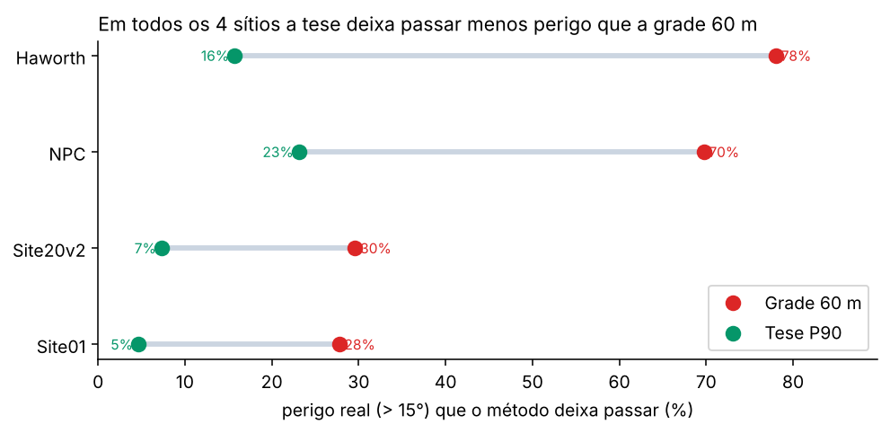

*Conclusão sucinta: a redução de perigo ocorre de maneira consistente ao longo dos 26 sítios avaliados.*  
*Fonte: [dados_mc_26sitios_60m.csv](file:///c:/NASA%20PROJETO%202026/simulacao_rover/monte_carlo_lola/figuras/dados_mc_26sitios_60m.csv).*

A Figura 15 mostra o comportamento simultâneo de perigo não vetado e falso alarme por método nos `26` sítios candidatos. Observa-se o deslocamento sistemático dos pontos da Tese para regiões de menor perigo não vetado para níveis equivalentes de bloqueio conservador. Portanto, a combinação entre resíduos do laser e margem por densidade otimiza o equilíbrio entre proteção e trafegabilidade.

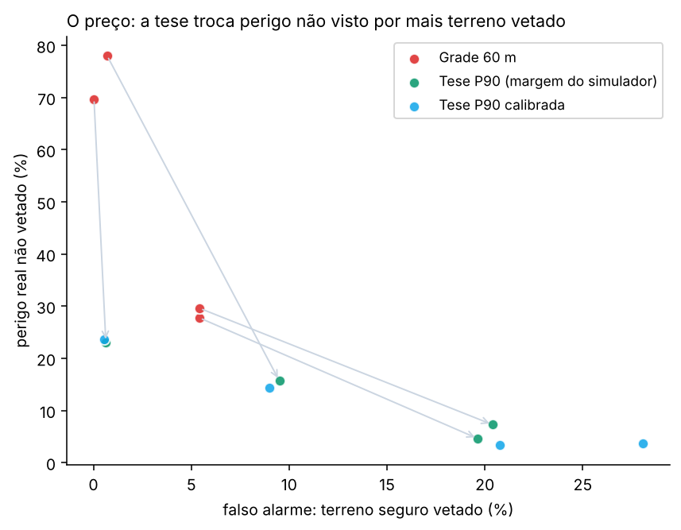

*Conclusão sucinta: a distribuição conjunta por sítio evidencia menor exposição a taludes reais perigosos para níveis equivalentes de alarme.*  
*Fonte: [dados_mc_26sitios_60m.csv](file:///c:/NASA%20PROJETO%202026/simulacao_rover/monte_carlo_lola/figuras/dados_mc_26sitios_60m.csv).*

A Figura 16 isola o experimento de controle justo sob exatamente o mesmo falso alarme mediano (`17,9%`). Os dados confirmam que a Tese (`3,88%`) supera a `Grade 60 m + margem` (`6,45%`) em **`26/26` sítios**, reduzindo o risco escapado proporcionalmente à aspereza local ($\rho = 0{,}91$). Assim, isola-se o benefício genuíno da informação multirresolução sobre a mera elevação da margem.

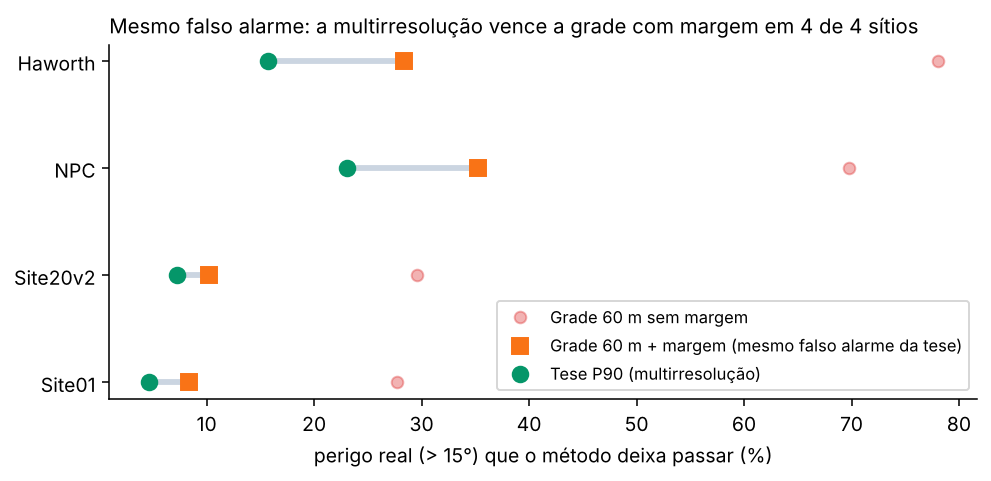

*Conclusão sucinta: mantendo exatamente o mesmo falso alarme (17,9%), a Tese vence em 26/26 sítios (p = 3e-8).*  
*Fonte: [dados_mc_26sitios_60m.csv](file:///c:/NASA%20PROJETO%202026/simulacao_rover/monte_carlo_lola/figuras/dados_mc_26sitios_60m.csv).*

A Figura 17 confronta os ganhos obtidos partindo da grade de $60\text{ m}$ versus a grade de $20\text{ m}$ nos `26` sítios reais. A comparação revela que partir de $20\text{ m}$ reduz o ganho marginal da fusão para `12%` (`3,57% → 3,19%`, melhor em `24/26` sítios), mantendo a `Grade 20 m + margem` ligeiramente à frente da `Tese 60→5 m`. Dessa forma, quantifica-se com precisão o papel da resolução inicial disponível.

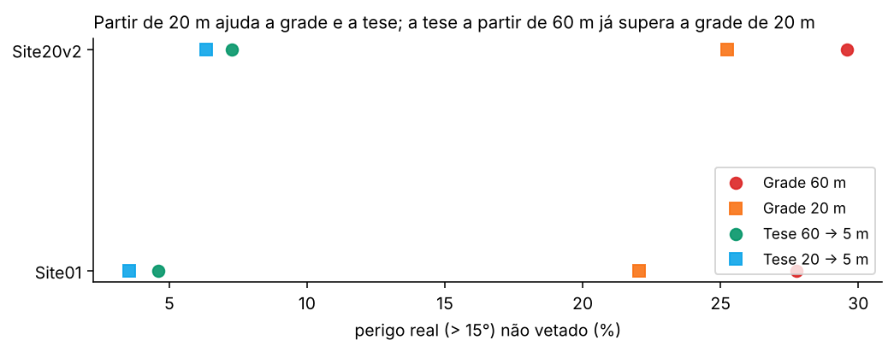

*Conclusão sucinta: quando a grade de 20 m está disponível, o acréscimo relativo da fusão é menor (12%), porém ainda altamente significativo em 24/26 sítios.*  
*Fonte: [dados_mc_26sitios_20m.csv](file:///c:/NASA%20PROJETO%202026/simulacao_rover/monte_carlo_lola/figuras/dados_mc_26sitios_20m.csv).*

A Figura 18 traça as curvas medianas completas de troca entre perigo não vetado e falso alarme (`5%` a `30%`) sobre `20` sorteios independentes. A curva da Tese mantém-se estritamente abaixo da grade uniforme em toda a faixa operacional testada. Logo, a superioridade espacial dos disparos LOLA não depende de um ponto singular de calibração.

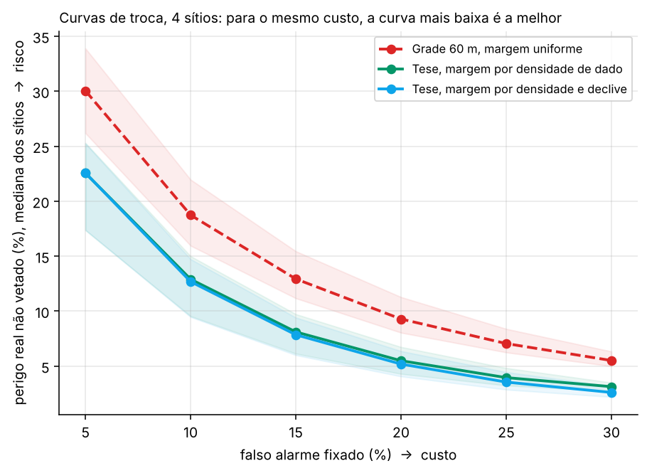

*Conclusão sucinta: a curva de troca da Tese domina a grade uniforme em toda a faixa de falso alarme de 5% a 30%.*  
*Fonte: [dados_mc_26sitios_60m.csv](file:///c:/NASA%20PROJETO%202026/simulacao_rover/monte_carlo_lola/figuras/dados_mc_26sitios_60m.csv).*

A Figura 19 apresenta o mapeamento espacial das falhas remanescentes nos sítios `NPC` e `Haworth`. Os registros revelam que `65–75%` das falhas concentram-se perto de disparos reais em encostas limítrofes de `15°–17°` ("raspões"), onde a margem nominal `P90` de `2,03°` é estreita. Conclui-se que ajustes locais em encostas acidentadas (`+1°`) são mais eficazes do que inflar a margem em platôs planos.

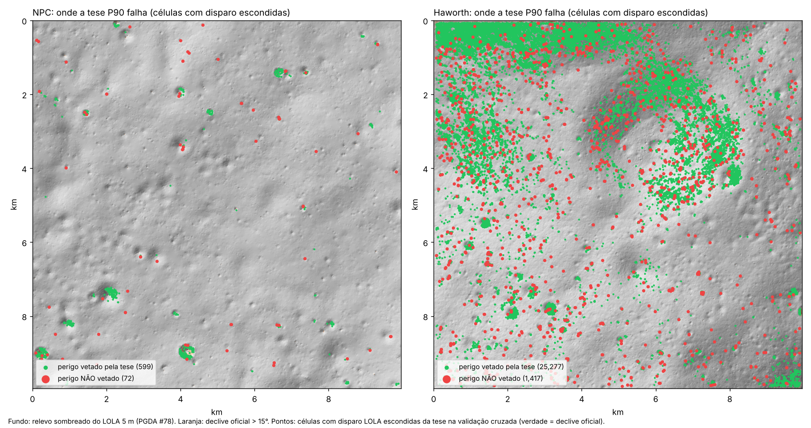

*Conclusão sucinta: as falhas residuais são majoritariamente raspões de 15°–17° localizados junto a trilhas reais em encostas íngremes.*  
*Fonte: [MONTE_CARLO_LOLA_TESE.md](file:///c:/NASA%20PROJETO%202026/simulacao_rover/monte_carlo_lola/MONTE_CARLO_LOLA_TESE.md).*

### 5.3 Validação Independente: `SfS 5 m`, `486` Fotos `LROC NAC` e Auditoria do Motor Polar
*Fontes primárias consolidadas: [RESULTADOS-SFS.md](file:///c:/NASA%20PROJETO%202026/sfs_comparacao/entrega_relatorio/RESULTADOS-SFS.md), [sfs_comparacao_sitios.csv](file:///c:/NASA%20PROJETO%202026/sfs_comparacao/entrega_relatorio/dados/sfs_comparacao_sitios.csv), [tabela_validacao_fotos.csv](file:///c:/NASA%20PROJETO%202026/sfs_comparacao/entrega_relatorio/dados/tabela_validacao_fotos.csv), [tabela_margens.csv](file:///c:/NASA%20PROJETO%202026/sfs_comparacao/entrega_relatorio/dados/tabela_margens.csv) e [dados_sfs_haworth.json](file:///c:/NASA%20PROJETO%202026/simulacao_rover/monte_carlo_lola/figuras/dados_sfs_haworth.json). (Nota: substitui o rascunho anterior em `sfs_comparacao/RELATORIO-SFS.md`, que ainda trazia coordenadas não corrigidas da tabela de calibração).*

#### 5.3.1 Comparação `SfS 5 m × LOLA` (`841` observadores/região, `2026–2045`, passo `3 h`, mastro `2 m`)
Utilizando ray-marching bilinear até $75\text{ km}$ em $360$ azimutes com geometria estereográfica exata, curvatura lunar e efemérides `DE440` + `moon_pa_de440` (`MOON_ME`), a Tabela 08 compara os campos altimétricos e de visibilidade solar/DTE obtidos por `SfS 5 m` e `LOLA` (`5 m` e `20 m`) em três regiões `A3CLR22`. Embora as medianas globais de iluminação permaneçam próximas ($0{,}06\text{–}0{,}3\text{ pp}$), observam-se desvios localizados expressivos nas cristas e no melhor ponto de `Peak Near Shackleton` ($72{,}5\%$ e $73{,}0\%$ em `5 m` contra `66,0%` em `20 m`). Assim, comprova-se que o salto de desempenho solar decorre da escala de $5\text{ m}$ e não de artefato do método `SfS`.

**Tabela 08 — Comparação quantitativa entre `SfS 5 m` (*Bertone et al., 2026*) e grades `LOLA` (`5 m` e `20 m`) nas três regiões (`841` observadores/região)**

| Medida (`16 × 16 km`, `SfS` Bertone et al. 2026) | Leibnitz Beta (`#10`) | de Gerlache Rim (`#9`) | Peak Near Shackleton (`#8`) |
|---|---|---|---|
| Diferença de elevação `SfS − LOLA 5 m`, média / desvio ($\text{m}$) | $0{,}02$ / $0{,}67$ | $0{,}02$ / $0{,}96$ | $0{,}02$ / $0{,}74$ |
| Pixels com diferença $> 2\text{ m}$ | $1{,}2\%$ | $4{,}5\%$ | $1{,}7\%$ |
| Área com declive $> 15^\circ$ (`SfS` / `LOLA 5 m`) | $35{,}0\%$ / $34{,}7\%$ | $45{,}8\%$ / $45{,}6\%$ | $18{,}7\%$ / $17{,}6\%$ |
| Diferença de iluminação `SfS − LOLA 5 m`, mediana / `p95` (pp) | $0{,}12$ / $1{,}2$ | $0{,}06$ / $1{,}9$ | $0{,}12$ / $1{,}5$ |
| Diferença de iluminação `SfS − LOLA 20 m`, mediana / `p95` (pp) | — *(fora `87,5°S`)* | $0{,}1$ / $2{,}4$ | $0{,}3$ / $3{,}2$ |
| Observadores com diferença $> 5\text{ pp}$ (`SfS − LOLA 5 m`) | $0{,}7\%$ | $1{,}4\%$ | $0{,}6\%$ |
| Observadores que mudam de lado no limiar `LEAG 40%` (`vs 5 m` / `20 m`, de `841`) | $10$ / — | $12$ / $15$ | $8$ / $20$ |
| Melhor ponto da grade: iluminação `SfS` / `LOLA 5 m` / `LOLA 20 m` | $81{,}2\%$ / $79{,}7\%$ / — | $77{,}1\%$ / $75{,}7\%$ / $75{,}9\%$ | $72{,}5\%$ / $73{,}0\%$ / **`66,0%`** |
| Coordenada do melhor ponto | $-85{,}48^\circ$, $31{,}43^\circ\text{E}$ | $-88{,}47^\circ$, $-67{,}86^\circ$ | $-88{,}81^\circ$, $123{,}69^\circ\text{E}$ |
| `DTE` diferença `SfS − LOLA 20 m`, mediana / `p95` (pp) | — | $0{,}0$ / $1{,}5$ | $0{,}0$ / $4{,}4$ |

*Conclusão sucinta: `SfS 5 m` e `LOLA 5 m` convergem na estimativa de iluminação (diferença mediana de 0,06–0,12 pp) e ambos superam `LOLA 20 m` por +6,5 a +7,0 pp no melhor ponto de Peak Near Shackleton; alinhamento `SfS × LOLA 20 m` manteve RMSE de 1,3–1,5 m no deslocamento zero.*  
*Fonte: [sfs_comparacao_sitios.csv](file:///c:/NASA%20PROJETO%202026/sfs_comparacao/entrega_relatorio/dados/sfs_comparacao_sitios.csv) e [RESULTADOS-SFS.md](file:///c:/NASA%20PROJETO%202026/sfs_comparacao/entrega_relatorio/RESULTADOS-SFS.md).*

A Figura 20 apresenta os mapas de iluminação solar (`SfS`), os campos de diferença espacial e os diagramas de dispersão nas regiões de *Leibnitz Beta*, *de Gerlache Rim* e *Peak Near Shackleton*. As distribuições espaciais confirmam concordância global elevada ($\ge 0{,}99$) com divergências localizadas de até vários pontos percentuais junto a cristas finas e bordas de crateras. Portanto, a escolha da escala de $5\text{ m}$ mostra-se determinante na microalocação do ponto exato de pouso.

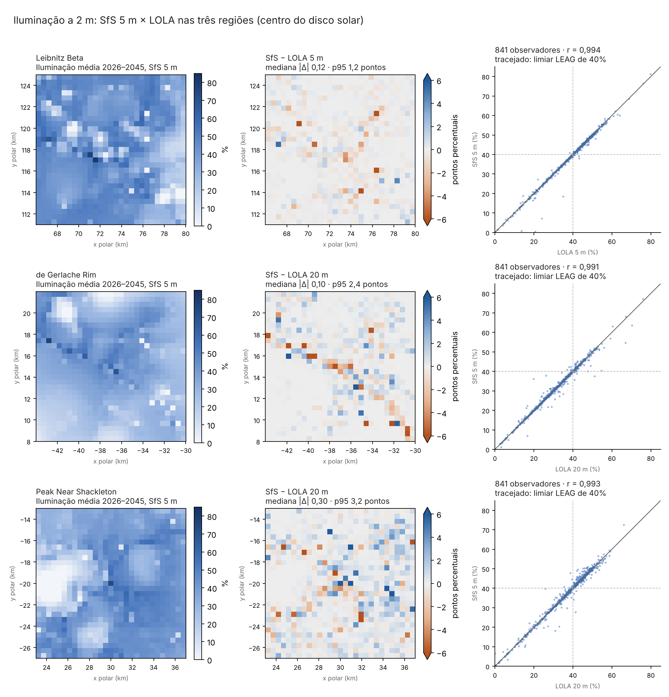

*Conclusão sucinta: a concordância global entre `SfS` e `LOLA 5 m` é alta, concentrando-se as divergências em cristas pontuais e microdepressões.*  
*Fonte: [sfs_comparacao_sitios.csv](file:///c:/NASA%20PROJETO%202026/sfs_comparacao/entrega_relatorio/dados/sfs_comparacao_sitios.csv).*

#### 5.3.2 Validação Pixel a Pixel contra `486` Fotos Reais `LROC NAC` (`8,87` milhões de pixels)
Confrontando o modelo de horizonte com as `486` imagens ortorretificadas (`brilho > 0,001` = iluminado; Sol `DE440` verificado contra `33` arquivos de câmera com erro máximo de `0,006°`), a Tabela 09 reporta **Acerto / Luz Falsa / Sombra Falsa** (`%`) da classe `SfS 5 m` até `LOLA 240 m`. O acerto global permanece entre `94%` e `96%`, porém o erro operacionalmente perigoso — **luz falsa** (prever luz onde a foto mostra sombra) — cresce fortemente com a degradação da grade, saltando nas fotos polares de `2,14%` (`SfS 5 m`) para `5,68%` (`LOLA 60 m`) e **`9,10%`** (`LOLA 240 m`). Assim, modelos grosseiros inflacionam falsos positivos energéticos para o rover.

**Tabela 09 — Validação fotométrica pixel a pixel (`Acerto / Luz Falsa / Sombra Falsa`, %) contra `486` fotografias reais `LROC NAC`**

| Terreno | Leibnitz Beta (`120` fotos) | de Gerlache Rim (`194` fotos) | Peak Near Shackleton (`172` fotos) | **Polares juntas (`366` fotos)** |
|---|---|---|---|---|
| **`SfS 5 m`** | $94{,}33$ / $7{,}73$ / $3{,}81$ | $95{,}77$ / **$2{,}11$** / $5{,}87$ | $95{,}71$ / **$2{,}17$** / $6{,}10$ | **$95{,}74$ / `2,14` / $5{,}98$** |
| **`LOLA 5 m`** | $93{,}81$ / $8{,}78$ / $3{,}84$ | $95{,}32$ / $2{,}97$ / $6{,}02$ | $94{,}94$ / $4{,}09$ / $5{,}89$ | **$95{,}13$ / `3,55` / $5{,}95$** |
| **`LOLA 20 m`** | $93{,}78$ / $9{,}46$ / $3{,}28$ | $94{,}74$ / $2{,}86$ / $7{,}12$ | $93{,}72$ / $3{,}98$ / $8{,}26$ | **$94{,}22$ / `3,44` / $7{,}69$** |
| `LOLA 60 m` | $92{,}76$ / $11{,}00$ / $3{,}83$ | $95{,}30$ / $4{,}25$ / $5{,}06$ | $94{,}03$ / $7{,}00$ / $5{,}08$ | $94{,}66$ / `5,68` / $5{,}07$ |
| `LOLA 240 m` | $90{,}24$ / $13{,}79$ / $6{,}11$ | $94{,}76$ / $6{,}55$ / $4{,}21$ | $92{,}48$ / $11{,}46$ / $4{,}13$ | $93{,}61$ / **`9,10`** / $4{,}17$ |

*Conclusão sucinta: o `SfS 5 m` supera o `LOLA 20 m` em 346/366 fotos polares e reduz a luz falsa para 2,14%; em `LOLA 60 m` (94,66% global) ocorre troca de sombra falsa por luz falsa perigosa (5,68% vs. 3,44% em 20 m).*  
*Fonte: [tabela_validacao_fotos.csv](file:///c:/NASA%20PROJETO%202026/sfs_comparacao/entrega_relatorio/dados/tabela_validacao_fotos.csv).*

A Figura 21 representa a escalada do erro de **luz falsa** por resolução espacial (`5 m` até `240 m`) sobre o conjunto completo das `486` fotos `LROC NAC`. As barras demonstram crescimento contínuo de falsos positivos de iluminação à medida que a malha engrossece, atingindo pico crítico nas previsões a `60 m` e `240 m`. Consequentemente, a avaliação energética baseada apenas em grades grossas superestima a disponibilidade real de luz solar na superfície.

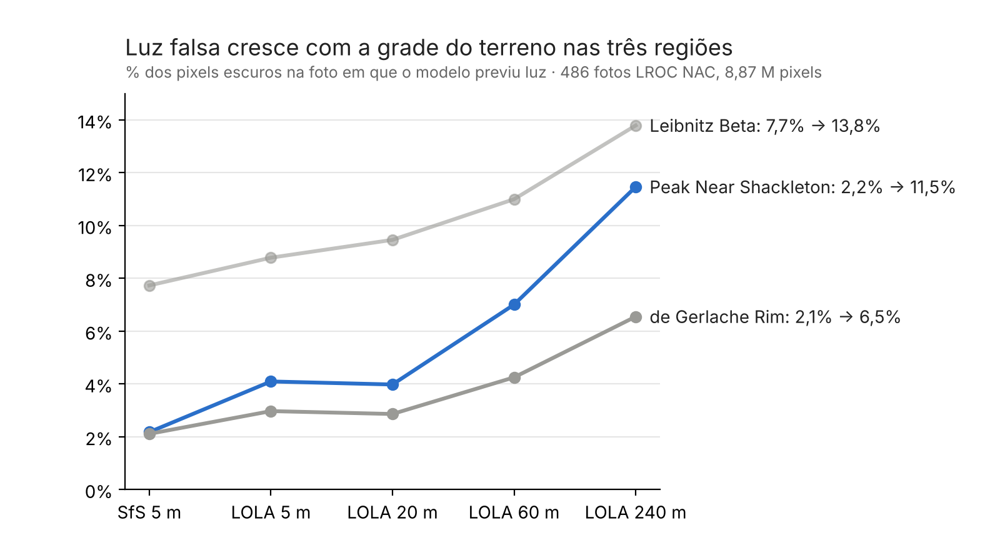

*Conclusão sucinta: a taxa de luz falsa cresce monotonicamente com a perda de resolução de 5 m para 240 m.*  
*Fonte: [tabela_validacao_fotos.csv](file:///c:/NASA%20PROJETO%202026/sfs_comparacao/entrega_relatorio/dados/tabela_validacao_fotos.csv).*

A Figura 22 confronta um exemplo concreto de fotografia `LROC NAC` (`M115416165LE`, *Peak Near Shackleton*, Sol a `0,9°`) contra as máscaras de sombra previstas por `SfS 5 m`, `LOLA 20 m` e `LOLA 240 m`. Na prática, a luz falsa cai para apenas `5,2%` com `SfS 5 m`, ante `8,7%` com `LOLA 20 m` e **`24,7%`** com `LOLA 240 m`. Assim, comprova-se visualmente como crateras rasas desaparecem em grades grosseiras sob ângulo solar rasante.

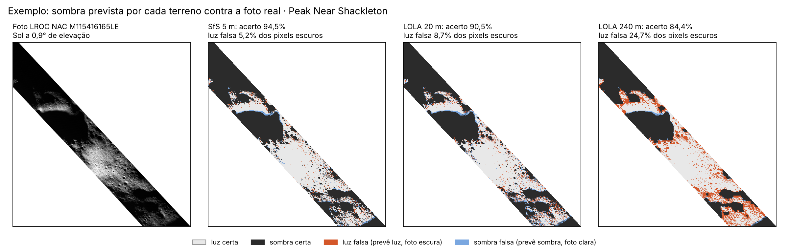

*Conclusão sucinta: sob elevação solar de 0,9°, o modelo em 240 m produz 24,7% de luz falsa na foto auditada, ante 5,2% em 5 m.*  
*Fonte: [fotos_todas.csv](file:///c:/NASA%20PROJETO%202026/sfs_comparacao/entrega_relatorio/dados/fotos_todas.csv).*

#### 5.3.3 Calibração das Margens `P50 / P90 / P99` contra `SfS 5 m` (`3` regiões)
A Tabela 10 avalia o desempenho das margens probabilísticas em célula interpolada ($1{,}0^\circ + z \cdot 2{,}0^\circ$, isto é, $1{,}0^\circ$ para `P50`, $3{,}56^\circ$ para `P90` e $5{,}65^\circ$ para `P99`) frente ao `SfS 5 m` tomado como referência de encostas `> 15°`. A grade de `60 m` sem margem deixa escapar `12,2%–41,0%` dos perigos reais, ao passo que `LOLA 5 m + P99` reduz o escape para apenas `0,2%–0,5%` (com excedência real de `0,7%–1,5%`, aderente ao `1%` teórico) e a `P90` confirma perfil conservador (`3,3%–6,0%` contra `10%` nominais). Dessa maneira, valida-se externamente a calibração dos quantis de segurança do escudo.

**Tabela 10 — Perigos reais (`> 15°` no `SfS 5 m`) não detectados e taxas de bloqueio e excedência das margens `P50 / P90 / P99`**

| Região (`SfS 5 m` como referência) | Grade `60 m` (perigos não vistos) | `LOLA 5 m + P50` | `LOLA 5 m + P90` | `LOLA 5 m + P99` | Células `> 15°` reais | Bloqueio `P90` / `P99` | Excedência `P90` (nom. `10%`) / `P99` (nom. `1%`) |
|---|---:|---:|---:|---:|---:|---:|---|
| **Leibnitz Beta** | $12{,}2\%$ | $4{,}5\%$ | $0{,}7\%$ | $0{,}2\%$ | $35{,}4\%$ | $51\%$ / $63\%$ | $3{,}3\%$ / $0{,}7\%$ |
| **de Gerlache Rim** | $15{,}5\%$ | $7{,}7\%$ | $1{,}2\%$ | $0{,}3\%$ | $46{,}0\%$ | $69\%$ / $81\%$ | $6{,}0\%$ / $1{,}5\%$ |
| **Peak Near Shackleton** | $41{,}0\%$ | $14{,}9\%$ | $2{,}2\%$ | $0{,}5\%$ | $19{,}8\%$ | $43\%$ / $60\%$ | $3{,}8\%$ / $0{,}9\%$ |

*Conclusão sucinta: os envelopes `P90` e `P99` reduzem o perigo não visto de 12,2%–41,0% (em 60 m bruto) para 0,7%–2,2% e 0,2%–0,5%, respectivamente, mantendo aderência às taxas nominais de excedência.*  
*Fonte: [tabela_margens.csv](file:///c:/NASA%20PROJETO%202026/sfs_comparacao/entrega_relatorio/dados/tabela_margens.csv).*

A Figura 23 ilustra a queda acentuada dos perigos `> 15°` não detectados ao migrar da grade bruta de `60 m` para `LOLA 5 m` protegido por `P50`, `P90` e `P99`. O gráfico mostra comportamento idêntico nas três regiões auditadas, mesmo em terrenos altamente acidentados como *de Gerlache Rim* (`46,0%` acima de `15°`). Logo, o envelope probabilístico atua como filtro conservador reprodutível em diferentes geomorfologias polares.

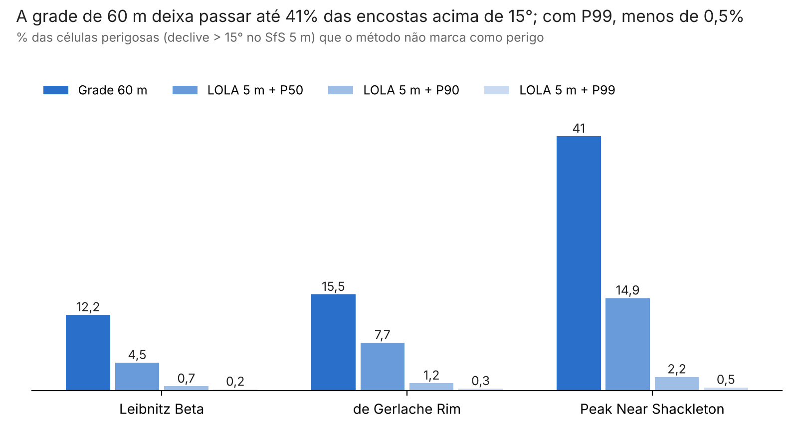

*Conclusão sucinta: o escudo `P90/P99` derruba quase integralmente os taludes >15° ocultados pela grade de 60 m em todas as três regiões.*  
*Fonte: [tabela_margens.csv](file:///c:/NASA%20PROJETO%202026/sfs_comparacao/entrega_relatorio/dados/tabela_margens.csv).*

#### 5.3.4 Resultado Negativo Fundamental em Células Sem Disparo (`Haworth` — `3,3 milhões` de células)
Em `Haworth`, usando o `SfS 5 m` na mesma grade (`PGDA #104`) como referência externa exclusivamente nas **$3{,}3$ milhões de células sem disparo** (`slp` e `SfS` concordam em elevação com mediana $-0{,}02\text{ m}$, mas divergem $\sim 1{,}2^\circ\text{–}1{,}6^\circ$ em declive mesmo sob disparo), com falso alarme fixado em `20%`:
- **Mapa `LOLA 5 m` oficial:** **`7,6%`** de perigo não vetado;
- **Grade `60 m`:** `10,3%`;
- **Tese (`60→5 m`):** `10,4%`.

**Conclusão científica defensável:** entre as trilhas do laser, a fusão multirresolução **não** reconstrói melhor o relevo do que o mapa oficial de `5 m` nem do que a grade. Portanto, a formulação rigorosa da tese é: *"a margem por densidade de dado reduz o perigo que passa nas células próximas de disparo"*, e **não** *"reconstrói o relevo entre as trilhas"*; onde o produto oficial de `5 m` existe (`7,29%` com tiros, interpolado no restante do bloco), usá-lo com margem calibrada é superior.

A Figura 24 compara o perigo não vetado a `20%` de falso alarme exclusivamente nas `3,3 milhões` de células sem disparo em `Haworth` usando `SfS 5 m` como referência externa. O resultado expõe empate negativo entre a Tese (`10,4%`) e a `Grade 60 m` (`10,3%`), enquanto o produto oficial `LOLA 5 m` mantém `7,6%`. Dessa forma, registra-se com transparência o limite físico da interpolação longe das trilhas do laser.

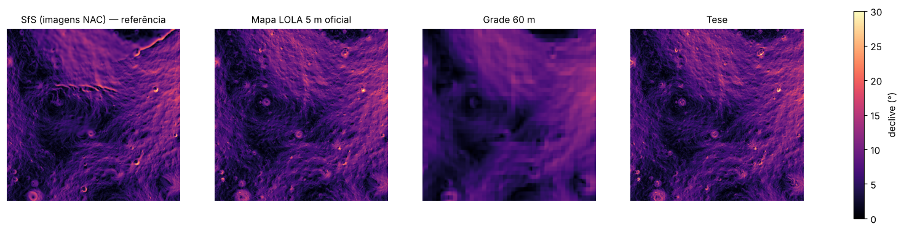

*Conclusão sucinta: longe dos disparos diretos LOLA (Haworth), a fusão 60→5 m não supera a grade de 60 m frente ao SfS externo.*  
*Fonte: [dados_sfs_haworth.json](file:///c:/NASA%20PROJETO%202026/simulacao_rover/monte_carlo_lola/figuras/dados_sfs_haworth.json).*

A Figura 25 exibe as curvas de troca completas em `Haworth` sobre os `3,3 milhões` de células sem tiro direto. Ao longo de toda a variação do falso alarme, o mapa oficial `LOLA 5 m` mantém menor perigo escapado entre os três métodos. Portanto, nos locais onde o produto `PGDA 78` existe, ele permanece como padrão-ouro, cabendo à metodologia da tese suprir os `92,7%` desprovidos de cobertura fina densa e atuar na vizinhança dos disparos.

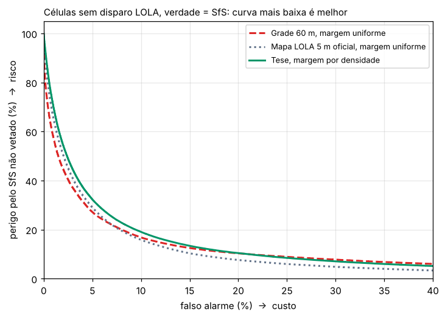

*Conclusão sucinta: nas células estritamente sem tiro direto em Haworth, o mapa oficial LOLA 5 m preserva a melhor curva de troca contra `SfS`.*  
*Fonte: [dados_sfs_haworth.json](file:///c:/NASA%20PROJETO%202026/simulacao_rover/monte_carlo_lola/figuras/dados_sfs_haworth.json).*

#### 5.3.5 Auditoria do Motor Estereográfico Corrigido e Tabela de Calibração (`007` e `011`)
Após substituir a constante terrestre legada (`111.320 m/grau` $\to$ `30.323 m/grau` lunar) e adotar projeção estereográfica exata com curvatura lunar, bilinear, passo `20 m` e `75 km` em `precalc/engine.py` (commit `8dea6de`; apenas trocar a constante dava `55,7%`), a Tabela 11 compara os valores antigos do relatório legado com o motor corrigido (`sfs_comparacao` / `engine.py`). Os novos resultados (`65,9%` no centro do disco, `71,6%` no limbo e `54,4%` em `DTE`) invalidam a comparação antiga (`75,9% vs 77,1–88,0%` de Gläser 2018), assegurando consistência geodésica em todos os cálculos solares subsequentes.

**Tabela 11 — Auditoria comparativa do motor de iluminação estereográfico corrigido versus motor legado (`-89,30°`, `128,5°E`, mastro `2 m`, `2026–2045`)**

| Referência (`-89,30°`, `128,5°E`, mastro `2 m`, `2026–2045`) | Iluminação (centro do disco) | Iluminação (limbo solar) | `DTE` |
|---|---|---|---|
| Motor antigo (`RELATÓRIO §6.2`) | $68{,}4\%$ | $75{,}9\%$ | $53{,}8\%$ |
| **Motor corrigido (`sfs_comparacao` / `engine.py`)** | **$65{,}9\%$** | **$71{,}6\%$** | **$54{,}4\%$** |

*Conclusão sucinta: a correção geodésica estereográfica reduziu a estimativa de iluminação no ponto de referência para 65,9% (centro) e 71,6% (limbo), invalidando a série legada baseada no fator terrestre.*  
*Fonte: auditoria em [engine.py](file:///c:/NASA%20PROJETO%202026/precalc/engine.py) (commit `8dea6de`) e [RESULTADOS-SFS.md](file:///c:/NASA%20PROJETO%202026/sfs_comparacao/entrega_relatorio/RESULTADOS-SFS.md).*

Com as coordenadas também corrigidas para os sítios `007` e `011` (que antes registravam `43–44%` e `16–18%`), a Tabela 12 confronta as estimativas atuais do motor corrigido em `LOLA 20 m`, `LOLA 5 m` e `SfS 5 m` com a tabela de referência de *Gläser (2018)* (`2 m`, centro [limbo]). A aderência observada (`79,2%–79,7%` em `007` e `71,6%–73,9%` em `011`) valida independentemente o ray-marching polar implementado. Logo, os erros nominais anteriores decorriam apenas de coordenadas e escala antigas.

**Tabela 12 — Calibração de iluminação nos sítios `007` e `011` após correção geodésica em confronto com Gläser (2018)**

| Sítio (`2 m`) | Tabela Gläser `20 m` | `LOLA 20 m` | `LOLA 5 m` | `SfS 5 m` |
|---|---:|---:|---:|---:|
| **`007` Peak Near Shackleton** (`-88,8113°`, `123,554°E`) | $74{,}1\%$ | $79{,}7\%$ ($84{,}1\%$) | $79{,}2\%$ ($83{,}2\%$) | $77{,}4\%$ ($82{,}5\%$) |
| **`011` de Gerlache Rim 1** (`-88,6744°`, `-68,228°`) | $72{,}0\%$ | $71{,}6\%$ ($77{,}7\%$) | $73{,}9\%$ ($79{,}3\%$) | $67{,}9\%$ ($74{,}0\%$) |

*Conclusão sucinta: após corrigir escala e coordenadas, as estimativas solares dos sítios 007 e 011 alinham-se à literatura de referência; permanece apenas o recálculo pendente da afirmação legada de `97,7% / 98,3%` de assertividade.*  
*Fonte: [RESULTADOS-SFS.md](file:///c:/NASA%20PROJETO%202026/sfs_comparacao/entrega_relatorio/RESULTADOS-SFS.md) e [engine.py](file:///c:/NASA%20PROJETO%202026/precalc/engine.py).*

#### 5.3.6 Status do Acervo `LROC NAC` (`lroc_nac/pgda78_26/`, apenas ilustração)
Os pixels desse acervo auxiliar de subáreas não são quadrados ($\sim 0{,}97\text{ m} \times 2{,}18\text{ m}$, e não $1{,}57\text{ m}$). Em `Haworth`, a subárea encaixa no relevo `LOLA` renderizado com correlação `0,89`, porém deslocada `~3,1 km` e espelhada (em conflito aberto com a orientação validada por `SPICE` nas `486` fotos); `LM1` e `Site23` têm posição não confiável. Por rigor científico, essas imagens são empregadas **apenas como ilustração**, com legenda explícita *"posição aproximada, não projetada"*.

A Figura 26 apresenta essa verificação visual entre a imagem `NAC` do acervo auxiliar de `Haworth` e o sombreamento sintético sobre `LOLA`. O alinhamento visual confirma o deslocamento de `~3,1 km` e o espelhamento desse acervo local frente às fotos validadas via `SPICE`. Assim, justifica-se a exclusão dessas subáreas de cálculos físicos quantitativos.

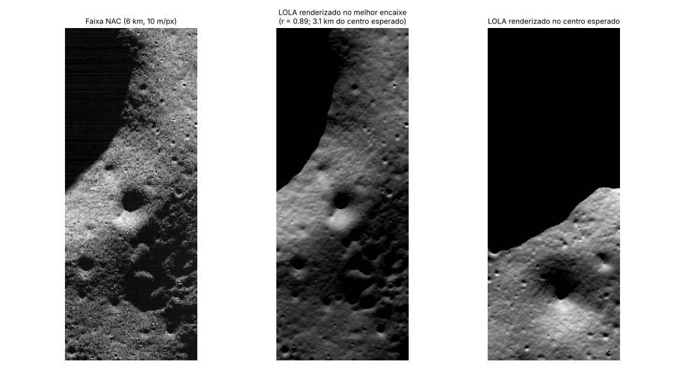

*Conclusão sucinta: imagens de `lroc_nac/pgda78_26/` prestam-se apenas a ilustração visual devido a distorção e deslocamento não ortorretificado.*  
*Fonte: auditoria local em `checar_local_nac.py` (`lroc_nac/pgda78_26/`).*

### 5.4 Ablação Pareada (`D0 → D4b`, `30` Terrenos) e Validação Externa (*Pragyan*)
A Tabela 13 consolida o estudo de ablação pareada controlada em `30` terrenos sintéticos inéditos (`1.800` pares por transição), isolando o ganho passo a passo desde a base ingênua `D0` até os módulos com Aprendizado de Máquina (`D4a` e `D4b`). Os dados revelam dois saltos determinantes — as travas físicas de segurança (`D1a`, $+52{,}6\text{ pp}$) e a **fusão multirresolução `60→5 m` (`D2`, $+38{,}9\text{ pp}$, atingindo `95,2%` e `96,2%` em `C2r` sem KKT)** — enquanto o uso de redes neurais (`D4a`/`D4b`) piora a chegada em **`-5,1 pp`** e **`-13,9 pp`**. Conclui-se que a arquitetura vencedora baseia-se em informação multirresolução e escudo determinístico, não em piloto neural.

**Tabela 13 — Estudo de ablação pareada passo a passo (`D0 → D4b`) sobre `30` terrenos sintéticos inéditos (`1.800` pares por transição)**

| Degrau | Descrição | Chegada à PSR (% média $\pm$ dp · med [IQR]) | $\Delta$ PSR vs Anterior (Holm $p$ / McNemar $p$) | Leitura Científica |
|---|---|---:|---|---|
| `D0` | Base ingênua $60\text{ m}$ + câmera + reflexo | $0{,}4 \pm 1{,}6\%$ · $0\%$ [$0\text{–}0$] | — | Colapso quase total sem escudo nem horizonte |
| `D1a` | + Escudo `P90` / portos $\le 50\text{ h}$ em $60\text{ m}$ | $53{,}0 \pm 22{,}1\%$ · $56{,}7\%$ [$32{,}9\text{–}69{,}2$] | $+52{,}6\text{ pp}$ ($p = 1{,}6 \times 10^{-5}$ / $3{,}6 \times 10^{-282}$) | Salto fundamental das travas físicas de segurança |
| `D1b` | + Programação Linear (`Simplex` + preço-sombra) em $60\text{ m}$ | $53{,}0 \pm 22{,}1\%$ (idêntico) | $0{,}0\text{ pp}$ ($p = 1$ / $1$) | `Simplex` sozinho não altera rota em mapa cego a $60\text{ m}$ |
| `D1c` | + Otimização Não-Linear (`Barreira Log. + Newton/KKT`) em $60\text{ m}$ | $56{,}3 \pm 21{,}5\%$ · $57{,}5\%$ [$43{,}8\text{–}70{,}0$] | $+3{,}3\text{ pp}$ ($p = 0{,}34$ / $0{,}096$) | Ganho pequeno em $60\text{ m}$, não significativo após Holm |
| **`D2`** | **+ Multirresolução $60 \to 5\text{ m}$ (`P90`, *No False Relief*)** | **$95{,}2 \pm 7{,}7\%$ · $98{,}3\%$ [$93{,}3\text{–}100$]** | **$+38{,}9\text{ pp}$ ($p = 1{,}6 \times 10^{-5}$ / $1{,}4 \times 10^{-162}$)** | **Principal contribuição da tese** (`C2r` sem KKT = $96{,}2\%$, salto $+42{,}2\text{ pp}$) |
| `D3` | + Pesos da função objetivo evoluídos *offline* ($10$ ger.) | $95{,}9 \pm 5{,}6\%$ · $98{,}3\%$ [$96{,}7\text{–}100$] | $+0{,}7\text{ pp}$ ($p = 1$ / $0{,}85$) | Sem ganho adicional estatisticamente significativo (efeito teto) |
| `D4a` | + Rede Neural `MLP 8→7→4` sob escudo | $90{,}9 \pm 19{,}7\%$ · $98{,}3\%$ [$95{,}4\text{–}100$] | **$-5{,}1\text{ pp}$** ($p = 1$ / **$5{,}2 \times 10^{-10}$**) | **Piora por rover** (`123` congelamentos $> 50\text{ h}$ vs `54` em `D2`) |
| `D4b` | + `IA Híbrida 14→8→3` sob escudo direcional | $82{,}1 \pm 29{,}7\%$ · $96{,}7\%$ [$87{,}5\text{–}98{,}3$] | **$-13{,}9\text{ pp}$** ($p = 0{,}15$ / **$9 \times 10^{-42}$**) | **Piora severa**: menos tombamento ($0{,}4\%$), mas `231` congelamentos |

*Conclusão sucinta: a fusão multirresolução `D2` (+38,9 pp) e as travas físicas `D1a` (+52,6 pp) respondem por praticamente todo o sucesso até a PSR, enquanto políticas neurais (`D4a/D4b`) degradam o resultado.*  
*Fonte: [dados_ablacao.csv](file:///c:/NASA%20PROJETO%202026/simulacao_rover/monte_carlo_lola/figuras/dados_ablacao.csv).*

A Figura 27 apresenta a curva de ablação degrau a degrau em termos de chegada e dispersão nos `30` terrenos inéditos. A progressão demonstra o degrau acentuado de `D1c` (`56,3%`) para `D2` (`95,2%`), acompanhado de redução drástica da variabilidade entre terrenos e queda quando se introduz a rede neural em `D4a` e `D4b`. Assim, confirma-se graficamente onde cada módulo contribui ou falha.

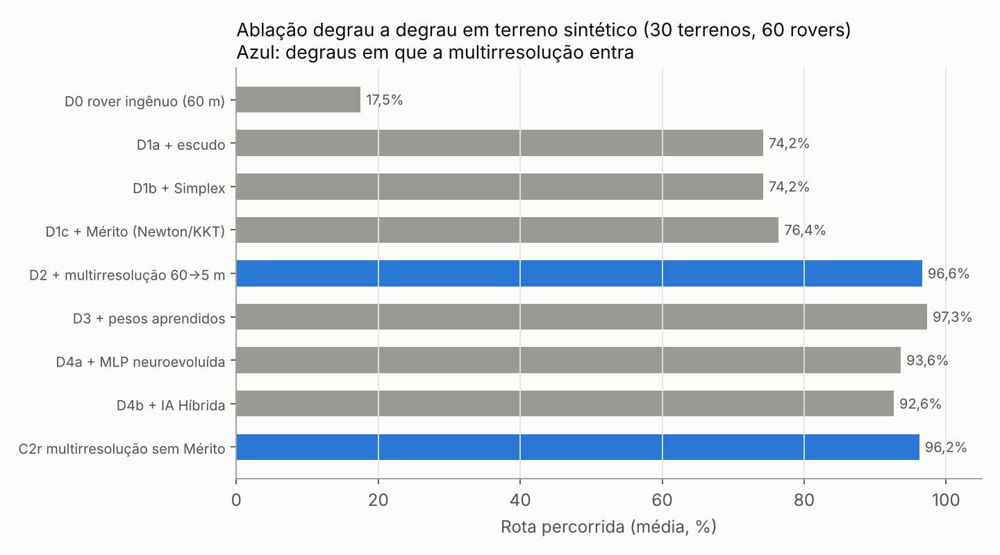

*Conclusão sucinta: o salto principal da ablação controlada ocorre na transição para o mapa multirresolução `D2`, elevando a concordância ordinal de rotas ($\tau$ de Kendall) de +0,18 para +0,69.*  
*Fonte: [dados_ablacao.csv](file:///c:/NASA%20PROJETO%202026/simulacao_rover/monte_carlo_lola/figuras/dados_ablacao.csv).*

Adicionalmente, em `30` terrenos inéditos (média de rota percorrida passando de `17,5%` em `D0` para `74–76%` em `D1`, `96,6%` em `D2`, `97,3%` em `D3` e `92–94%` em `D4`), a concordância ordinal de custo das $4$ rotas contra o relevo real medida por $\tau$ de Kendall sobe de **$+0{,}18$** na grade $60\text{ m}$ (`5/30` terrenos escolhem a rota ótima real) para **$+0{,}69$** com a tese (`20/30` terrenos).

**Validação Externa — Trajetória Real do *Pragyan / Chandrayaan-3* (`500` sorteios MC, escala $12:1$):**
- **Grade grossa de $3\text{ m}$ (equivalente a $60\text{ m}$):** entra em perigo real (cratera de $4\text{ m}$ a $\approx 11\text{ m}$ do início) em **`99,4%`** dos sorteios (comprimento mediano $18{,}8\text{ m}$, repetindo o erro real da missão que perdeu $12{,}3\text{ m}$ em ida e volta);
- **Tese $3\text{ m} \to 25\text{ cm}$ (`P90`, $7{,}29\%$ medidos):** falha em apenas **`6,0%`** dos sorteios (comprimento mediano $21{,}9\text{ m}$, idêntico à referência do relevo real de $0\%$ e $21{,}9\text{ m}$, McNemar $b/c = 467/0$, $p \approx 5 \times 10^{-141}$).

### 5.5 Relevo Real (`1ª` e `2ª` Rodadas), Otimização de Pesos KKT e Escada de Dificuldade (`60 m`, `POP = 30`)

1. **Evolução `1ª → 2ª` rodada no simulador `v18` (`16` faixas inéditas LOLA):**
   - **1ª rodada (antes das correções):** chegada de apenas `~44–51%` sem diferença significativa entre mapas, pois $\approx 40\%$ dos rovers ficavam presos por tempo esgotado devido a ruído independente criando degraus falsos e ausência de replanejamento tático.
   - **Seis correções físicas implementadas:** (i) ruído Monte Carlo espacialmente correlacionado ($\sigma = 4$ células); (ii) limiar do reflexo ajustado de $13^\circ \to 14{,}5^\circ$; (iii) replanejamento a bordo (`Dijkstra` no campo observado pela câmera); (iv) meta corrigida para $1{,}5\text{ km}$; (v) planejamento global em barreira contínua; (vi) margem zero em células já medidas pela câmera.

Após implementar essas correções na `2ª` rodada em relevo real LOLA (`POP = 20`, `320` travessias por célula), a Tabela 14 compara a chegada e o tombamento entre a grade `60 m`, o Rover A, as variantes com margem (`RT_nom` e `RT_cal`) e a IA Híbrida. O controle robusto eleva a faixa base para `70–79%`, e o mapa multirresolução `60→5 m` soma $+8{,}1\text{ pp}$ sobre `R60` (`70,3% → 78,4%`) reduzindo o tombamento de `2,8%` para `0,9%`. Portanto, o ganho principal em terreno real LOLA concentra-se novamente na reconstrução multirresolução associada à navegação ativa.

**Tabela 14 — Desempenho das configurações em relevo real LOLA (`2ª` rodada pós-correções, `POP = 20`)**

| Configuração (`2ª` rodada, `POP = 20`) | Chegada (%) | Tombamento (%) | Observação Estatística |
|---|---:|---:|---|
| Grade `60 m` (`R60`) | $70{,}3\%$ | $2{,}8\%$ | Base sem fusão |
| Rover A (`referência`) | $73{,}4\%$ | $2{,}8\%$ | Baseline do sistema antigo |
| **Regra + Tese, margem nominal (`RT_nom`)** | **$78{,}4\%$** | **$0{,}9\%$** | **Principal salto de mapa (`+8,1 pp` vs `R60`)** |
| Regra + Tese, margem calibrada (`RT_cal`) | $75{,}9\%$ | $0{,}9\%$ | Sem ganho vs nominal ($p > 0{,}6$) |
| IA Híbrida pré-treinada (sintético `H_sint`) | $78{,}8\%$ | $0{,}0\%$ | Iguala regra com escudo soberano |
| IA Híbrida + `30` ger. em relevo real com MC | $78{,}4\%$ | $0{,}9\%$ | Treino online no relevo real não melhora |

*Conclusão sucinta: a fusão `60→5 m` com margem nominal (`RT_nom`) aumenta a chegada em +8,1 pp sobre `R60` e reduz o tombamento para 0,9%, sem ganho adicional do treino online em relevo real.*  
*Fonte: [dados_relevo_real.csv](file:///c:/NASA%20PROJETO%202026/simulacao_rover/monte_carlo_lola/figuras/dados_relevo_real.csv).*

A Figura 28 mostra o comparativo de barras e intervalos das seis configurações da `2ª` rodada em relevo real LOLA. A distribuição visual evidencia que regras determinísticas, otimizadores de peso e a IA sob escudo soberano convergem para o mesmo patamar superior (`76–79%`) assim que utilizam o mapa multirresolução `60→5 m`. Logo, o gargalo físico reside na qualidade da informação topográfica e não no modelo de decisão.

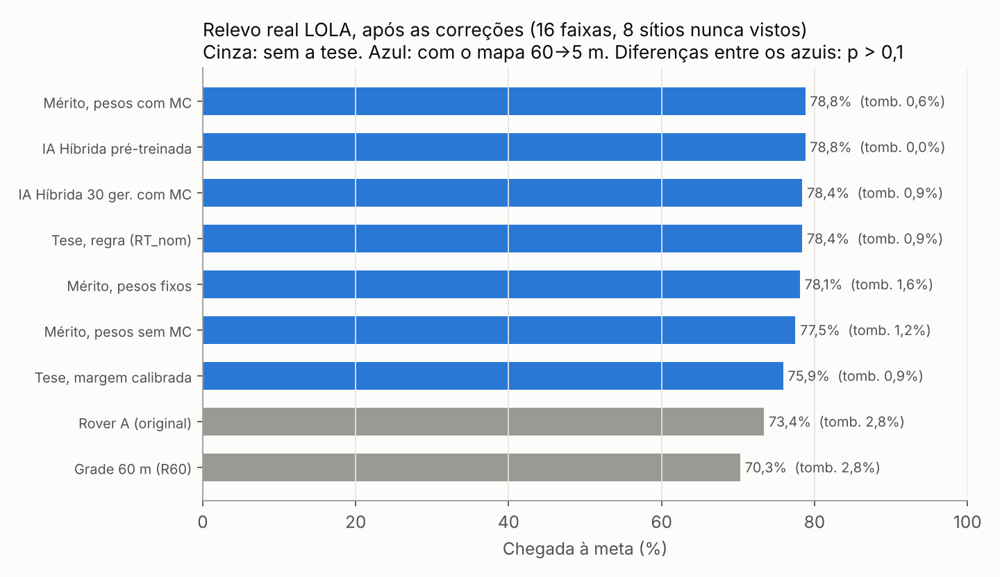

*Conclusão sucinta: sobre o mapa multirresolução, todas as políticas protegidas pelo escudo convergem para a faixa de 76%–79% de chegada.*  
*Fonte: [dados_relevo_real.csv](file:///c:/NASA%20PROJETO%202026/simulacao_rover/monte_carlo_lola/figuras/dados_relevo_real.csv).*

2. **Otimização de Pesos da Função Objetivo Não-Linear (`Pontos Interiores / Barreira Log. + Newton/KKT + Simplex`, `POP = 20`, `15` gerações):**
   Avaliando isoladamente o efeito de otimizar os pesos do termo de mérito KKT no relevo real:
   - Pesos fixos (`M_fixo`): **`78,1%`** chegada / **`1,6%`** tombamento;
   - Pesos otimizados **sem** Monte Carlo: **`77,5%`** / **`1,2%`**;
   - Pesos otimizados **com** Monte Carlo: **`78,8%`** / **`0,6%`** (`com MC × sem MC`: $p = 0{,}10$, tendência; `com MC × fixo/regra`: $p = 0{,}32$; `com MC × IA Híbrida`: $p = 0{,}71$). Pesos obtidos com MC: avanço $1{,}03$; segurança $0{,}89$; energia $0{,}81$; sombra $0{,}49$; rota $0{,}37$; declive $0{,}24$; incerteza $0{,}23$. **Leitura:** sob mapa `60→5 m`, todos convergem para `77–79%`; a diferença dominante vem do mapa, não do ajuste fino de pesos nem da rede.

3. **Primeira Escada de Dificuldade (`exp_dif.js`, `60 m`, `POP = 30`, `480` travessias/célula):**

A Tabela 15 resume o desempenho na primeira escada progressiva de severidade (`N0–N3`, `480` travessias por célula) comparando `Rover A`, `R60`, `Tese 60→5 m` (`RT_nom`), otimizador `KKT` e `IA Híbrida`. Os resultados revelam que o ganho relativo de `RT_nom` sobre `R60` cresce de `+16%` no cenário nominal (`N0`) até `+30%` no cenário crítico (`N3`, $40{,}0\%$ vs. $30{,}8\%$, Wilcoxon $p = 0{,}043$), enquanto a `IA Híbrida` decai para `32,5%` em `N3`. Dessa forma, a vantagem da arquitetura multirresolução amplifica-se sob terrenos severos.

**Tabela 15 — Primeira escada de dificuldade (`N0–N3`) em `60 m` (`POP = 30`, `480` travessias/célula; valores em `Chegada / Tombamento`)**

| Nível | Cenário | Rover A (`D0`) | Grade $60\text{ m}$ (`R60`) | **Tese `60→5 m` (`RT_nom`)** | Otimizador KKT Fixo (`M_fixo`) | IA Híbrida (`H_sint`) | Wilcoxon Tese × `R60` (chegada) |
|---|---|---:|---:|---:|---:|---:|---|
| `N0` | Base ($4{,}9\% > 15^\circ$) | $71{,}7\%$ / $2{,}3\%$ | $66{,}5\%$ / $3{,}1\%$ | **$77{,}3\%$ / $1{,}2\%$** | $78{,}1\%$ / $1{,}2\%$ | $77{,}7\%$ / $2{,}3\%$ | $+10{,}8\text{ pp}$ ($p = 0{,}12$) |
| `N1` | Relevo $\times 1{,}3$ ($20{,}1\% > 15^\circ$) | $33{,}3\%$ / $10{,}0\%$ | $34{,}2\%$ / $8{,}5\%$ | **$47{,}5\%$ / $8{,}3\%$** | $48{,}1\%$ / $8{,}3\%$ | $46{,}2\%$ / $13{,}3\%$ | $+13{,}3\text{ pp}$ ($p = 0{,}068$) |
| `N2` | `N1` + erro $\times 1{,}5$ + câm. $\times 0{,}75$ | $27{,}9\%$ / $13{,}3\%$ | $33{,}1\%$ / $15{,}4\%$ | **$44{,}2\%$ / $12{,}7\%$** | $43{,}8\%$ / $10{,}4\%$ | $42{,}9\%$ / $12{,}5\%$ | **$+11{,}0\text{ pp}$ ($p = 0{,}018$)** |
| `N3` | `N1` + erro $\times 2$ + câm. degrad. + s/ replan. | $21{,}7\%$ / $45{,}4\%$ | $30{,}8\%$ / $18{,}3\%$ | **$40{,}0\%$ / $16{,}5\%$** | $38{,}3\%$ / $15{,}0\%$ | $32{,}5\%$ / $11{,}5\%$ | **$+9{,}2\text{ pp}$ ($p = 0{,}043$)** |

*Valores em `Chegada à meta / Tombamento`. Otimizador KKT × `R60` também foi significativo de `N1` a `N3` ($p = 0{,}018\text{–}0{,}028$), empatando com `RT_nom`; as rodadas preliminares `20 m` anteriores à correção do cache de `v18.html` foram descartadas e substituídas pela bateria definitiva da Seção 5.6.*  
*Conclusão sucinta: à medida que a dificuldade avança de N0 a N3, o ganho relativo da Tese 60→5 m dobra de +16% para +30% sobre `R60` com significância estatística (`N2–N3`).*  
*Fonte: [dados_escada.csv](file:///c:/NASA%20PROJETO%202026/simulacao_rover/monte_carlo_lola/figuras/dados_escada.csv).*

A Figura 29 exibe a evolução da taxa de chegada à meta através dos degraus `N0` a `N3` (`POP = 30`). As curvas demonstram que tanto `RT_nom` quanto `M_fixo` permanecem sistematicamente acima da linha de base `R60` e do `Rover A` em todos os regimes de erro e câmera. Conclui-se que a separação entre modelos com e sem fusão sustenta-se mesmo sob degradação perceptiva severa.

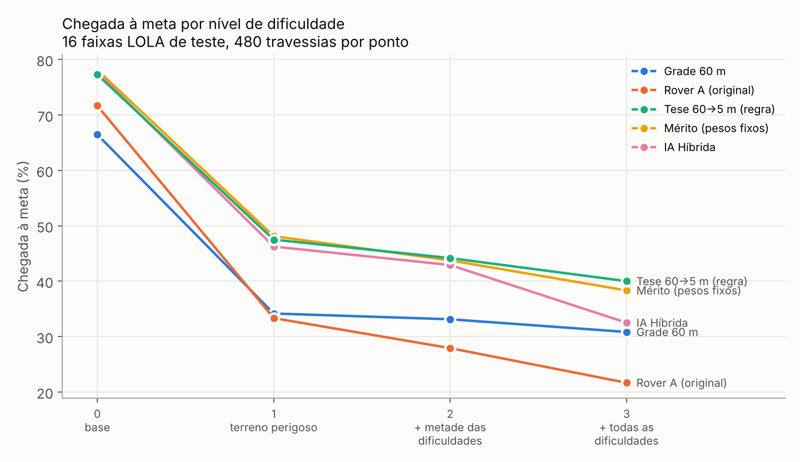

*Conclusão sucinta: a vantagem de chegada de `RT_nom` e `M_fixo` sobre `R60` e `Rover A` persiste em todos os quatro níveis de severidade.*  
*Fonte: [dados_escada.csv](file:///c:/NASA%20PROJETO%202026/simulacao_rover/monte_carlo_lola/figuras/dados_escada.csv).*

A Figura 30 apresenta as taxas correspondentes de tombamento na mesma escada (`N0–N3`). Enquanto o `Rover A` sem escudo completo salta para `45,4%` de capotamentos em `N3`, as configurações protegidas mantêm o tombamento abaixo de `16,5%`, garantindo integridade física mesmo sem replanejamento. Assim, isola-se o efeito protetor das travas de segurança contra falhas mecânicas fatais.

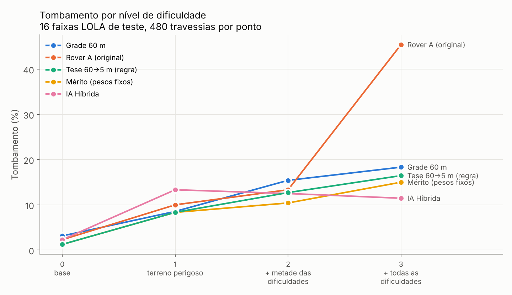

*Conclusão sucinta: o escudo físico evita o colapso por capotamento observado no `Rover A` (45,4% vs. 16,5% em `N3`).*  
*Fonte: [dados_escada.csv](file:///c:/NASA%20PROJETO%202026/simulacao_rover/monte_carlo_lola/figuras/dados_escada.csv).*

### 5.6 Bateria Multirresolução Definitiva `60 / 20 / 5 m` (`POP = 100`, Com e Sem Teto Temporal)
*Figuras geradas desta bateria: [fig_multi_pop100_escada.png](file:///c:/NASA%20PROJETO%202026/simulacao_rover/monte_carlo_lola/figuras/fig_multi_pop100_escada.png), [fig_multi_pop100_com_vs_sem_teto.png](file:///c:/NASA%20PROJETO%202026/simulacao_rover/monte_carlo_lola/figuras/fig_multi_pop100_com_vs_sem_teto.png), [fig_multi_pop100_ganhos_e_desfechos_n3.png](file:///c:/NASA%20PROJETO%202026/simulacao_rover/monte_carlo_lola/figuras/fig_multi_pop100_ganhos_e_desfechos_n3.png), [fig_multi_pop100_heatmap_tabelas.png](file:///c:/NASA%20PROJETO%202026/simulacao_rover/monte_carlo_lola/figuras/fig_multi_pop100_heatmap_tabelas.png), [fig_multi_pop100_desfechos_n0_n3.png](file:///c:/NASA%20PROJETO%202026/simulacao_rover/monte_carlo_lola/figuras/fig_multi_pop100_desfechos_n0_n3.png), [fig_multi_pop100_distribuicao_faixas.png](file:///c:/NASA%20PROJETO%202026/simulacao_rover/monte_carlo_lola/figuras/fig_multi_pop100_distribuicao_faixas.png), [fig_multi_pop100_forest_pareado.png](file:///c:/NASA%20PROJETO%202026/simulacao_rover/monte_carlo_lola/figuras/fig_multi_pop100_forest_pareado.png) e [fig_multi_pop100_tradeoff_pareto.png](file:///c:/NASA%20PROJETO%202026/simulacao_rover/monte_carlo_lola/figuras/fig_multi_pop100_tradeoff_pareto.png) | Dados: [dados_multi_pop100.csv](file:///c:/NASA%20PROJETO%202026/simulacao_rover/monte_carlo_lola/figuras/dados_multi_pop100.csv) e [dados_estatisticos_pareados_pop100.csv](file:///c:/NASA%20PROJETO%202026/simulacao_rover/monte_carlo_lola/figuras/dados_estatisticos_pareados_pop100.csv).*

Execução completa de **`64` simulações paralelas** (`rodar_dif_multi.js` + `analisa_dif_multi.py`, `185,48 min` em `16` workers), avaliando **`1.600` travessias por célula** (`POP = 100 × 16` faixas reais LOLA de `8` sítios nunca vistos no treino) para `9` perfis de planejamento/mapa sob `N0–N3`, em duas baterias completas:

- **Guia de leitura das métricas (`1.600` rovers por linha):** `Chegada (%)` = rovers que atingiram a meta; `Tomb. (%)` = capotamento em declive $> 25^\circ$; `Preso (%)`, `Tempo Esgot. (%)` e `Fora Mapa (%)` completam os `100%` dos desfechos terminais; `Rota Inic. (%)` = fração da rota completada antes do término; `Perigo Atrav. (>15°, %)` = fração do trajeto percorrido sobre declive real acima de $15^\circ$.
- **Guia das configurações avaliadas:** `A` = Rover A legado (`60 m`); `R60` = grade `60 m` sem margem; `RT_nom` = Tese `60→5 m` com margem `P90`; `R20` / `R20_marg` = grade `20 m` sem / com margem `P90`; `RT20` = Tese `20→5 m` com margem `P90`; `RLOLA5` / `RLOLA5_marg` = mapa `LOLA 5 m` oficial (`PGDA 78`) bruto / com margem tiro-interpolado; `R_oraculo` = relevo real perfeito a `5 m` (referência ideal).
- **Guia dos níveis (`N0–N3`):** `N0` base real ($4{,}9\% > 15^\circ$); `N1` relevo ampliado $\times 1{,}3$ ($20{,}1\% > 15^\circ$); `N2` `N1` + erro real `slperr` $\times 1{,}5$ + câmera $\times 0{,}75$; `N3` `N1` + erro $\times 2$ + câmera degradada ($\times 0{,}5$, $35\%$ falha) + **replanejamento a bordo desligado**.

A Figura 31 compara as curvas de chegada e tombamento em função da escada de severidade (`N0–N3`) nas duas baterias (`com teto de 800 s` e `sem teto de 4.000 s`) para as principais configurações da bateria `POP = 100`. Os perfis evidenciam queda acentuada da navegação legada e superioridade consistente de `RT_nom` (`60→5 m`) sobre `R60` desde o nível nominal até os cenários adversos. Portanto, a síntese gráfica antecipa o papel do replanejamento ativo e da margem estatística na contenção de capotamentos.

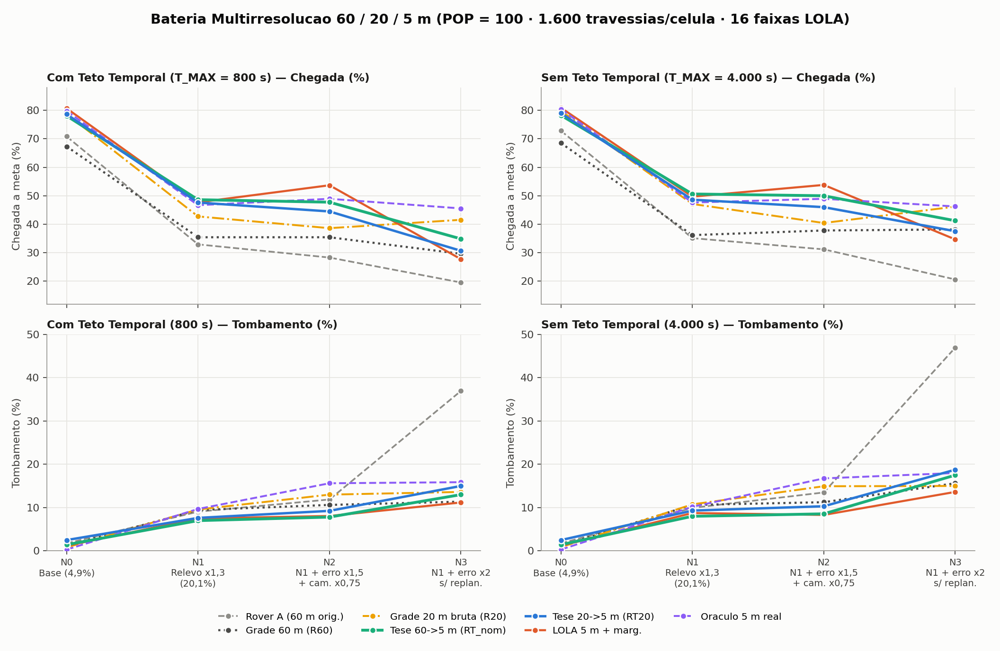

*Conclusão sucinta: a multirresolução `60→5 m` eleva a chegada e reduz tombamentos em toda a escada `N0–N3` sob ambos os tetos temporais.*  
*Fonte: [dados_multi_pop100.csv](file:///c:/NASA%20PROJETO%202026/simulacao_rover/monte_carlo_lola/figuras/dados_multi_pop100.csv).*

A Figura 32 confronta diretamente todas as `9` configurações em `N0–N3` sob orçamento temporal restrito (`800 s`) e expandido (`4.000 s`). Nota-se que a remoção do teto aumenta o acerto absoluto principalmente em `N3` sem alterar a hierarquia relativa observada nos cenários com navegação ativa (`N0–N2`). Dessa forma, comprova-se que o desempenho comparativo da tese não decorre de artefato de truncamento de tempo.

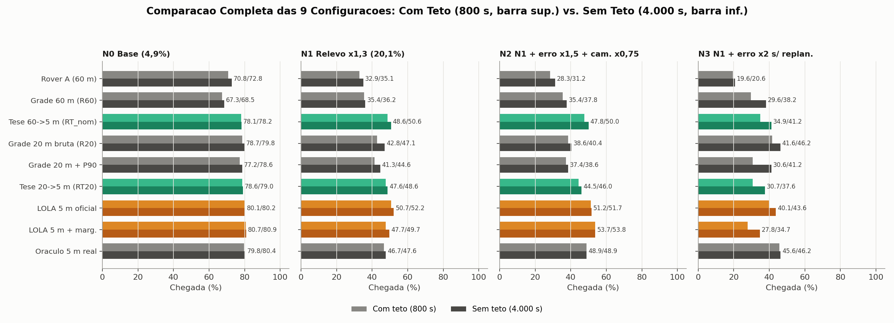

*Conclusão sucinta: a extensão do horizonte temporal de 800 s para 4.000 s preserva a hierarquia entre modelos em `N0–N2`.*  
*Fonte: [dados_multi_pop100.csv](file:///c:/NASA%20PROJETO%202026/simulacao_rover/monte_carlo_lola/figuras/dados_multi_pop100.csv).*

A Figura 33 detalha os ganhos pareados de chegada (`Δ Chegada`, com intervalo de confiança) e a decomposição percentual dos cinco desfechos terminais no cenário extremo `N3` sem teto (`4.000 s`). Embora as margens conservadoras reduzam falhas mecânicas em relação ao `Rover A` legado, a ausência de replanejamento fecha passagens estreitas e amplia o abandono por tempo esgotado. Em decorrência disso, o replanejamento a bordo confirma-se indispensável quando a margem `P90` opera sob erro topográfico dobrado.

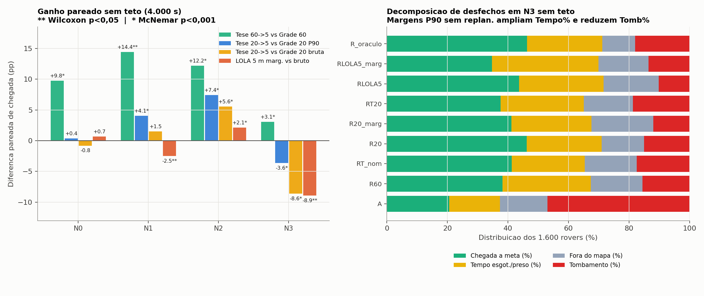

*Conclusão sucinta: em `N3` sem replanejamento, margens conservadoras contêm capotamentos, mas elevam o bloqueio por tempo esgotado.*  
*Fonte: [dados_multi_pop100.csv](file:///c:/NASA%20PROJETO%202026/simulacao_rover/monte_carlo_lola/figuras/dados_multi_pop100.csv) e [dados_estatisticos_pareados_pop100.csv](file:///c:/NASA%20PROJETO%202026/simulacao_rover/monte_carlo_lola/figuras/dados_estatisticos_pareados_pop100.csv).*

- **Bateria 1 — Com Teto Temporal (`T_MAX = 800 s`, `lola_dif_teto/`):** reflete orçamento de tempo restrito típico de janela de iluminação/deslocamento.
- **Bateria 2 — Sem Teto Temporal (`T_MAX = 4.000 s`, `lola_dif_semteto/`):** amplia o horizonte temporal em $5\times$ para isolar bloqueios espaciais/corredores do efeito de truncamento por tempo.

#### 5.6.1 Bateria 1 — Com Teto Temporal (`T_MAX = 800 s`)
A Tabela 16 consolida todos os desfechos terminais e indicadores de trajetória da Bateria 1 (`T_MAX = 800 s`) ao longo dos `4` níveis de dificuldade e `9` configurações de mapa. Os resultados demonstram que `RT_nom` (`60→5 m` `P90`) supera `R60` em `+10,8 pp` (`N0`), `+13,2 pp` (`N1`), `+12,4 pp` (`N2`) e `+5,3 pp` (`N3`), igualando ou superando `R_oraculo` em `N1` (`48,6%` vs. `46,7%`) com menor tombamento. Logo, a penalização estatística `60→5 m` oferece o melhor compromisso operacional onde o `LOLA 5 m` oficial não possui cobertura densa.

**Tabela 16 — Desempenho e desfechos da bateria multirresolução `POP = 100` com teto temporal (`T_MAX = 800 s` · `1.600` rovers por linha)**

*Cada linha representa `1.600` rovers (`100` em cada uma das `16` faixas reais LOLA). `Chegada + Tomb. + Preso + Tempo Esgot. + Fora Mapa = 100%` dos desfechos; `Rota Inic.` é a fração média completada; `Perigo Atrav.` é a fração do caminho em declive real $> 15^\circ$.*

| Nível | Config | Chegada (%) | Tomb. (%) | Preso (%) | Tempo Esgot. (%) | Fora Mapa (%) | Rota Inic. (%) | Perigo Atrav. (>15°, %) |
|---|---|---:|---:|---:|---:|---:|---:|---:|
| **`N0`** (base $4{,}9\%$) | `A` (Rover A `60 m`) | 70,8% | 1,8% | 0,0% | 19,8% | 7,7% | 76,7% | 4,94% |
| `N0` | `R60` (Grade `60 m`) | 67,3% | 1,2% | 0,0% | 25,1% | 6,4% | 74,7% | 5,38% |
| `N0` | **`RT_nom` (`60→5 m` P90)** | **78,1%** | 1,4% | 0,0% | 16,6% | 3,9% | 79,9% | 4,02% |
| `N0` | `R20` (`20 m` bruto) | 78,7% | 0,8% | 0,0% | 16,3% | 4,2% | 81,1% | 4,73% |
| `N0` | `R20_marg` (`20 m` P90) | 77,2% | 0,9% | 0,0% | 17,6% | 4,2% | 80,5% | 4,83% |
| `N0` | **`RT20` (`20→5 m` P90)** | **78,6%** | 2,5% | 0,0% | 16,6% | 2,3% | 81,4% | 3,90% |
| `N0` | `RLOLA5` (`5 m` oficial) | 80,1% | 0,9% | 0,0% | 16,0% | 3,1% | 81,3% | 3,78% |
| `N0` | **`RLOLA5_marg` (`5 m` tiro/interp)** | **80,7%** | 1,2% | 0,0% | 15,7% | 2,4% | 81,7% | **3,45%** |
| `N0` | `R_oraculo` (`5 m` real) | 79,8% | **0,3%** | 0,0% | 17,1% | 2,8% | 81,6% | 3,76% |
| **`N1`** (relevo $\times 1{,}3$) | `A` (Rover A `60 m`) | 32,9% | 9,1% | 0,0% | 37,9% | 20,1% | 50,1% | 21,58% |
| `N1` | `R60` (Grade `60 m`) | 35,4% | 9,4% | 0,1% | 36,0% | 19,1% | 50,8% | 21,62% |
| `N1` | **`RT_nom` (`60→5 m` P90)** | **48,6%** | **7,0%** | 0,0% | 27,4% | 16,9% | 58,0% | **21,04%** |
| `N1` | `R20` (`20 m` bruto) | 42,8% | 9,6% | 0,6% | 31,8% | 15,4% | 56,7% | 21,94% |
| `N1` | `R20_marg` (`20 m` P90) | 41,3% | 8,1% | 0,1% | 28,6% | 21,9% | 54,0% | 21,39% |
| `N1` | **`RT20` (`20→5 m` P90)** | **47,6%** | 7,6% | 0,4% | 25,0% | 19,3% | 55,2% | 22,72% |
| `N1` | **`RLOLA5` (`5 m` oficial)** | **50,7%** | 8,9% | 0,2% | 24,9% | 15,2% | 58,8% | 21,65% |
| `N1` | `RLOLA5_marg` (`5 m` tiro/interp) | 47,7% | 7,5% | 0,2% | 25,8% | 18,8% | 58,1% | 23,52% |
| `N1` | `R_oraculo` (`5 m` real) | 46,7% | 9,7% | 0,2% | 24,7% | 18,8% | 58,1% | 23,66% |
| **`N2`** (`N1`+erro $\times 1{,}5$+câm.$\times 0{,}75$) | `A` (Rover A `60 m`) | 28,3% | 11,9% | 0,0% | 38,4% | 21,4% | 46,8% | 21,75% |
| `N2` | `R60` (Grade `60 m`) | 35,4% | 10,6% | 0,1% | 36,8% | 17,1% | 50,2% | 22,14% |
| `N2` | **`RT_nom` (`60→5 m` P90)** | **47,8%** | 7,8% | 0,1% | 26,1% | 18,3% | 57,9% | 21,53% |
| `N2` | `R20` (`20 m` bruto) | 38,6% | 13,0% | 0,5% | 32,6% | 15,2% | 53,3% | 21,01% |
| `N2` | `R20_marg` (`20 m` P90) | 37,4% | **6,6%** | 0,1% | 32,7% | 23,2% | 49,3% | **20,24%** |
| `N2` | **`RT20` (`20→5 m` P90)** | **44,5%** | 9,2% | 0,1% | 27,4% | 18,8% | 51,3% | 22,32% |
| `N2` | `RLOLA5` (`5 m` oficial) | 51,2% | 11,2% | 0,1% | 23,9% | 13,6% | 57,2% | 20,82% |
| `N2` | **`RLOLA5_marg` (`5 m` tiro/interp)** | **53,7%** | 8,1% | 0,8% | 22,2% | 15,2% | 58,7% | 20,28% |
| `N2` | `R_oraculo` (`5 m` real) | 48,9% | 15,6% | 0,1% | 25,4% | 10,0% | 57,4% | 20,65% |
| **`N3`** (`N1`+erro $\times 2$+câm.deg.+s/replan) | `A` (Rover A `60 m`) | 19,6% | 36,9% | 0,0% | 26,9% | 16,6% | 41,7% | 20,45% |
| `N3` | `R60` (Grade `60 m`) | 29,6% | 11,4% | 0,0% | 43,1% | 15,9% | 48,1% | 21,93% |
| `N3` | **`RT_nom` (`60→5 m` P90)** | **34,9%** | 13,0% | 0,2% | 38,9% | 13,0% | 50,3% | 21,31% |
| `N3` | **`R20` (`20 m` bruto)** | **41,6%** | 13,6% | 0,0% | 31,8% | 13,0% | 56,1% | 20,81% |
| `N3` | `R20_marg` (`20 m` P90) | 30,6% | **9,5%** | 0,0% | 40,7% | 19,2% | 46,4% | 21,01% |
| `N3` | `RT20` (`20→5 m` P90) | 30,7% | 15,0% | 0,0% | 39,6% | 14,8% | 47,1% | 22,16% |
| `N3` | `RLOLA5` (`5 m` oficial) | 40,1% | **9,5%** | 0,0% | 36,4% | 14,1% | 56,7% | 21,24% |
| `N3` | `RLOLA5_marg` (`5 m` tiro/interp) | 27,8% | 11,2% | 0,0% | 46,6% | 14,4% | 46,5% | 20,90% |
| `N3` | **`R_oraculo` (`5 m` real)** | **45,6%** | 15,9% | 0,0% | 28,4% | 10,1% | 56,9% | 20,61% |

*Conclusão sucinta: sob teto de `800 s`, `RT_nom` supera `R60` de `+5,3` a `+13,2 pp` em chegada e reduz o tombamento para `7,0–7,8%` em `N1–N2`.*  
*Fonte: Bateria 1 `lola_dif_teto/` consolidada em [dados_multi_pop100.csv](file:///c:/NASA%20PROJETO%202026/simulacao_rover/monte_carlo_lola/figuras/dados_multi_pop100.csv).*

A Figura 34 apresenta uma leitura em mapa de calor consolidando simultaneamente as matrizes numéricas da Bateria 1 (`Tabela 16`, `800 s`) e da Bateria 2 (`Tabela 17`, `4.000 s`) em `N0–N3`. A escala cromática ressalta a convergência de desempenho entre `RT_nom`, `RLOLA5` e `R_oraculo` nos cenários `N0–N2`, além da zona crítica de estrangulamento sob erro dobrado em `N3`. Dessa maneira, facilita-se a identificação visual imediata dos regimes de ganho e de saturação de margem.

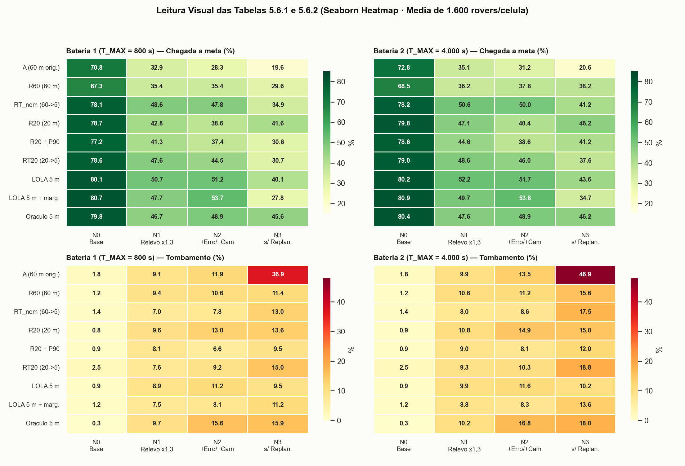

*Conclusão sucinta: o mapa de calor evidencia a proximidade de `RT_nom` ao padrão-ouro em `N0–N2` e a queda sob `N3` sem replanejamento.*  
*Fonte: [dados_multi_pop100.csv](file:///c:/NASA%20PROJETO%202026/simulacao_rover/monte_carlo_lola/figuras/dados_multi_pop100.csv).*

#### 5.6.2 Bateria 2 — Sem Teto Temporal (`T_MAX = 4.000 s`)
A Tabela 17 reporta as mesmas `1.600` travessias pareadas por linha com orçamento temporal expandido `5×` (`T_MAX = 4.000 s`) a fim de separar corredores fisicamente fechados do truncamento por tempo. Nesse horizonte estendido, `RT_nom` registra `78,2%` (`N0`), `50,6%` (`N1`), `50,0%` (`N2`) e `41,2%` (`N3`), superando `R60` em `+9,7`, `+14,4`, `+12,2` e `+3,0 pp` respectivamente. Confirma-se, portanto, que o benefício da multirresolução `60→5 m` decorre da evasão de perigo espacial e não de diferenças de velocidade de percurso.

**Tabela 17 — Desempenho e desfechos da bateria multirresolução `POP = 100` sem teto temporal (`T_MAX = 4.000 s` · `1.600` rovers por linha)**

*Mesmas `1.600` travessias pareadas por linha com orçamento de tempo ampliado $5\times$ (`4.000 s`) para isolar corredores bloqueados/sem saída do truncamento temporal de `800 s`.*

| Nível | Config | Chegada (%) | Tomb. (%) | Preso (%) | Tempo Esgot. (%) | Fora Mapa (%) | Rota Inic. (%) | Perigo Atrav. (>15°, %) |
|---|---|---:|---:|---:|---:|---:|---:|---:|
| **`N0`** (base $4{,}9\%$) | `A` (Rover A `60 m`) | 72,8% | 1,8% | 0,0% | 17,6% | 7,9% | 77,4% | 4,90% |
| `N0` | `R60` (Grade `60 m`) | 68,5% | 1,2% | 0,0% | 23,9% | 6,4% | 75,1% | 5,31% |
| `N0` | **`RT_nom` (`60→5 m` P90)** | **78,2%** | 1,4% | 0,0% | 16,4% | 3,9% | 80,0% | 3,99% |
| `N0` | `R20` (`20 m` bruto) | 79,8% | 0,9% | 0,0% | 15,1% | 4,2% | 81,3% | 4,74% |
| `N0` | `R20_marg` (`20 m` P90) | 78,6% | 0,9% | 0,0% | 16,2% | 4,2% | 80,7% | 4,77% |
| `N0` | **`RT20` (`20→5 m` P90)** | **79,0%** | 2,5% | 0,0% | 16,2% | 2,3% | 81,4% | 3,85% |
| `N0` | `RLOLA5` (`5 m` oficial) | 80,2% | 0,9% | 0,0% | 15,9% | 3,1% | 81,3% | 3,73% |
| `N0` | **`RLOLA5_marg` (`5 m` tiro/interp)** | **80,9%** | 1,2% | 0,0% | 15,5% | 2,4% | 81,8% | **3,41%** |
| `N0` | `R_oraculo` (`5 m` real) | 80,4% | **0,3%** | 0,0% | 16,5% | 2,8% | 81,7% | 3,71% |
| **`N1`** (relevo $\times 1{,}3$) | `A` (Rover A `60 m`) | 35,1% | 9,9% | 0,6% | 30,2% | 24,1% | 50,5% | 21,52% |
| `N1` | `R60` (Grade `60 m`) | 36,2% | 10,6% | 1,3% | 32,1% | 19,8% | 50,6% | 21,41% |
| `N1` | **`RT_nom` (`60→5 m` P90)** | **50,6%** | **8,0%** | 1,6% | 22,4% | 17,4% | 58,3% | **21,00%** |
| `N1` | `R20` (`20 m` bruto) | 47,1% | 10,8% | 2,3% | 23,3% | 16,5% | 57,7% | 21,63% |
| `N1` | `R20_marg` (`20 m` P90) | 44,6% | 9,0% | 0,2% | 23,3% | 22,9% | 54,4% | 21,16% |
| `N1` | **`RT20` (`20→5 m` P90)** | **48,6%** | 9,3% | 1,6% | 20,2% | 20,2% | 55,2% | 22,58% |
| `N1` | **`RLOLA5` (`5 m` oficial)** | **52,2%** | 9,9% | 1,0% | 20,8% | 16,1% | 59,2% | 21,41% |
| `N1` | `RLOLA5_marg` (`5 m` tiro/interp) | 49,7% | 8,8% | 1,9% | 19,0% | 20,7% | 58,5% | 23,40% |
| `N1` | `R_oraculo` (`5 m` real) | 47,6% | 10,2% | 0,8% | 22,3% | 19,1% | 58,1% | 23,39% |
| **`N2`** (`N1`+erro $\times 1{,}5$+câm.$\times 0{,}75$) | `A` (Rover A `60 m`) | 31,2% | 13,5% | 0,2% | 33,1% | 21,9% | 47,2% | 21,70% |
| `N2` | `R60` (Grade `60 m`) | 37,8% | 11,2% | 0,1% | 33,7% | 17,1% | 50,9% | 21,66% |
| `N2` | **`RT_nom` (`60→5 m` P90)** | **50,0%** | 8,6% | 0,4% | 22,3% | 18,8% | 58,0% | 21,12% |
| `N2` | `R20` (`20 m` bruto) | 40,4% | 14,9% | 0,9% | 27,6% | 16,1% | 54,3% | 20,73% |
| `N2` | `R20_marg` (`20 m` P90) | 38,6% | **8,1%** | 1,0% | 27,9% | 24,4% | 50,2% | 20,04% |
| `N2` | **`RT20` (`20→5 m` P90)** | **46,0%** | 10,3% | 1,8% | 22,9% | 19,0% | 52,0% | 21,93% |
| `N2` | `RLOLA5` (`5 m` oficial) | 51,7% | 11,6% | 1,1% | 21,9% | 13,8% | 57,8% | 20,45% |
| `N2` | **`RLOLA5_marg` (`5 m` tiro/interp)** | **53,8%** | 8,3% | 2,8% | 19,3% | 15,8% | 58,5% | **19,99%** |
| `N2` | `R_oraculo` (`5 m` real) | 48,9% | 16,8% | 1,0% | 23,2% | 10,1% | 57,2% | 20,35% |
| **`N3`** (`N1`+erro $\times 2$+câm.deg.+s/replan) | `A` (Rover A `60 m`) | 20,6% | 46,9% | 0,0% | 16,8% | 15,7% | 41,8% | 19,86% |
| `N3` | `R60` (Grade `60 m`) | 38,2% | 15,6% | 0,0% | 29,2% | 17,0% | 49,8% | 21,88% |
| `N3` | **`RT_nom` (`60→5 m` P90)** | **41,2%** | 17,5% | 1,4% | 22,8% | 17,1% | 52,8% | 21,36% |
| `N3` | **`R20` (`20 m` bruto)** | **46,2%** | 15,0% | 0,0% | 24,8% | 14,1% | 56,7% | 20,80% |
| `N3` | `R20_marg` (`20 m` P90) | 41,2% | 12,0% | 0,0% | 26,4% | 20,4% | 50,2% | 21,09% |
| `N3` | `RT20` (`20→5 m` P90) | 37,6% | 18,8% | 0,0% | 27,5% | 16,2% | 49,4% | 21,94% |
| `N3` | `RLOLA5` (`5 m` oficial) | 43,6% | **10,2%** | 0,0% | 27,9% | 18,2% | 57,5% | 21,36% |
| `N3` | `RLOLA5_marg` (`5 m` tiro/interp) | 34,7% | 13,6% | 0,0% | 35,2% | 16,4% | 49,7% | 21,11% |
| `N3` | **`R_oraculo` (`5 m` real)** | **46,2%** | 18,0% | 0,0% | 24,9% | 10,8% | 57,0% | 20,80% |

*Conclusão sucinta: mesmo com teto de `4.000 s`, `RT_nom` mantém ganho de `+14,4 pp` em `N1` e `+12,2 pp` em `N2` sobre `R60`, igualando ou superando o `Oráculo 5 m`.*  
*Fonte: Bateria 2 `lola_dif_semteto/` consolidada em [dados_multi_pop100.csv](file:///c:/NASA%20PROJETO%202026/simulacao_rover/monte_carlo_lola/figuras/dados_multi_pop100.csv).*

A Figura 35 decompõe os `100%` dos desfechos terminais (`Chegada`, `Tomb.`, `Preso`, `Tempo Esgot.` e `Fora Mapa`) entre `N0` e `N3` nas duas baterias. O empilhamento evidencia que o `Rover A` legado fracassa predominantemente por capotamento em `N3` (`36,9%` a `46,9%`), ao passo que os perfis com escudo convertem risco mecânico em encerramento seguro ou busca estendida de rota. Por conseguinte, confirma-se a robustez estrutural do escudo de navegação em todos os níveis.

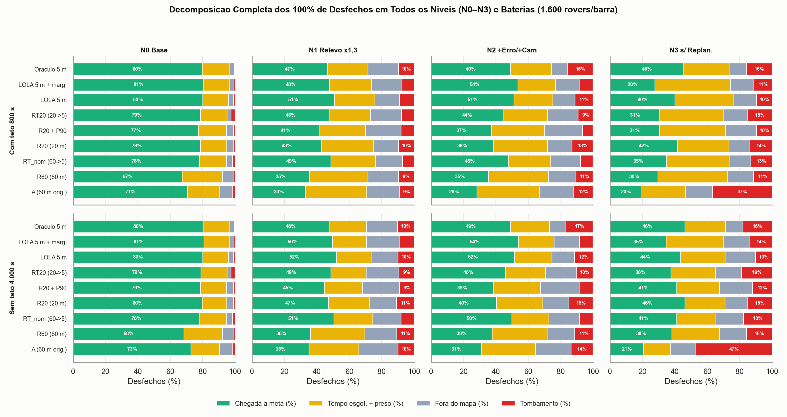

*Conclusão sucinta: os painéis empilhados mostram a migração de falhas fatais por tombamento no `Rover A` para encerramentos seguros nos sistemas protegidos.*  
*Fonte: [dados_multi_pop100.csv](file:///c:/NASA%20PROJETO%202026/simulacao_rover/monte_carlo_lola/figuras/dados_multi_pop100.csv).*

A Figura 36 exibe a distribuição estatística por faixa LOLA (`16` faixas independentes) por meio de boxplots com mediana, intervalo interquartil (`IQR`), média e estatísticas globais do teste não paramétrico de Friedman. A dispersão entre faixas confirma aumento monotônico da separação entre configurações conforme cresce a severidade (`W` de Kendall subindo de `0,151` em `N0` para `0,291` em `N3`). Desse modo, a variação de desempenho revela heterogeneidade geométrica consistente entre os sítios polares.

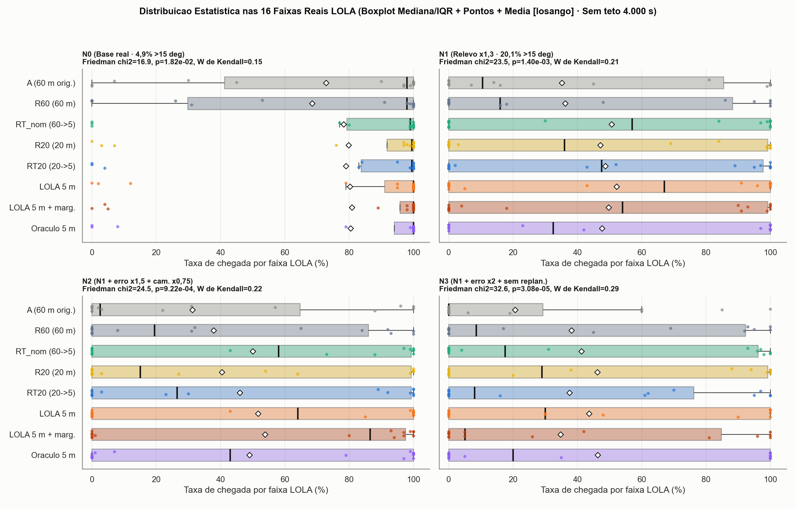

*Conclusão sucinta: a dispersão por faixa real LOLA confirma diferenças globais altamente significativas pelo teste de Friedman em todos os níveis.*  
*Fonte: [dados_multi_pop100.csv](file:///c:/NASA%20PROJETO%202026/simulacao_rover/monte_carlo_lola/figuras/dados_multi_pop100.csv) e [gerar_figs_estatisticas_pop100.py](file:///c:/NASA%20PROJETO%202026/simulacao_rover/testes/gerar_figs_estatisticas_pop100.py).*

*Nota não paramétrica (`scipy.stats.friedmanchisquare`, $16$ faixas reais em `Sem teto 4.000 s`):* a diferença global entre as configurações cresce progressivamente com a severidade do cenário — `N0`: $\chi^2 = 16{,}89$ ($p = 1{,}82\times 10^{-2}$, $W = 0{,}151$); `N1`: $\chi^2 = 23{,}49$ ($p = 1{,}40\times 10^{-3}$, $W = 0{,}210$); `N2`: $\chi^2 = 24{,}52$ ($p = 9{,}22\times 10^{-4}$, $W = 0{,}219$); e `N3`: $\chi^2 = 32{,}64$ ($p = 3{,}08\times 10^{-5}$, $W = 0{,}291$).

#### 5.6.3 Síntese Estatística Pareada (`16` faixas Wilcoxon / `1.600` rovers McNemar)
A Figura 37 ilustra em *forest plot* as diferenças pareadas de chegada (`Δ Chegada`, `pp`), os intervalos de confiança *bootstrap* de `95%`, o tamanho de efeito *rank-biserial* (`r`) e os testes de McNemar para os pares centrais da tese. Os intervalos de confiança positivos para `RT_nom × R60` e `RT20 × R20_marg` reforçam visualmente a consistência do efeito em múltiplas faixas e rovers. Assim, estabelece-se significância estatística tanto no nível de corredor geográfico quanto no nível individual de travessia.

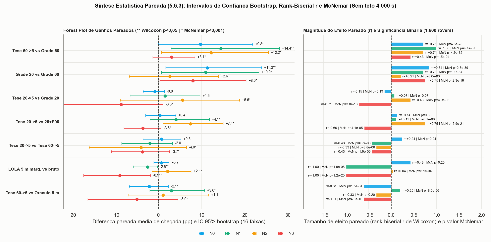

*Conclusão sucinta: o *forest plot* confirma ganhos pareados significativos de `RT_nom` sobre `R60` e de `RT20` sobre `R20_marg` com `IC 95%` e tamanho de efeito expressivos.*  
*Fonte: [dados_estatisticos_pareados_pop100.csv](file:///c:/NASA%20PROJETO%202026/simulacao_rover/monte_carlo_lola/figuras/dados_estatisticos_pareados_pop100.csv).*

A Figura 38 projeta as configurações na fronteira de Pareto entre segurança (redução de exposição e tombamento) e eficiência de chegada em `N1–N3`, acompanhada da correlação de Spearman. Observa-se que `RT_nom` ocupa a região dominante no compromisso segurança × eficiência na ausência de `LOLA 5 m`, ao passo que configurações sem margem ou sem replanejamento degradam um dos dois eixos. Portanto, a fronteira empírica sintetiza o critério prático de escolha de mapa em missões polares.

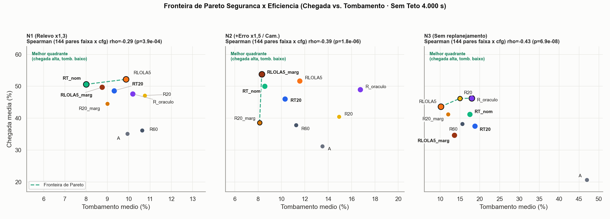

*Conclusão sucinta: `RT_nom` situa-se sobre a fronteira eficiente segurança × eficiência em `N1–N2` sem exigir a cobertura rara de `5 m`.*  
*Fonte: [dados_multi_pop100.csv](file:///c:/NASA%20PROJETO%202026/simulacao_rover/monte_carlo_lola/figuras/dados_multi_pop100.csv) e [dados_estatisticos_pareados_pop100.csv](file:///c:/NASA%20PROJETO%202026/simulacao_rover/monte_carlo_lola/figuras/dados_estatisticos_pareados_pop100.csv).*

A Tabela 18 apresenta a matriz numérica completa dos testes pareados não paramétricos (`Wilcoxon` sobre `16` faixas reais LOLA e `McNemar` sobre `1.600` rovers por par) na bateria sem teto (`4.000 s`). Os resultados revelam vitórias consistentes de `RT_nom × R60` em `N0–N2` (`p = 4,6×10^-28` a `4,4×10^-57` em McNemar; `r = +0,71` a `+1,00`), enquanto `RLOLA5_marg × RLOLA5` e `RT20 × R20` invertem sinal exclusivamente em `N3` sem replanejamento (`p = 1,2×10^-25` e `3,0×10^-18`). Em consequência, os números estabelecem com precisão estatística tanto a eficácia do método quanto sua condição de contorno operacional.

**Tabela 18 — Inferência estatística pareada (`Sem Teto 4.000 s` · `16` faixas LOLA / `1.600` rovers por par)**

| Nível | Comparação (`A × B`) | Chegada `A × B` (%) | `Δ Chegada` `[IC 95%]` (pp) | Faixas (`A>B / A<B`) | Wilcoxon `p` (`r`) | McNemar `A/B` (`p`) |
|---|---|---:|---:|:---:|---|---|
| `N0` | `RT_nom × R60` | $78{,}2 \times 68{,}5$ | **$+9{,}8$** `[+0,1; +21,8]` | `5 / 1` | $0{,}114$ (`+0,71`) | `188 / 32` (**$4{,}6\times 10^{-28}$**) |
| `N0` | `R20 × R60` | $79{,}8 \times 68{,}5$ | **$+11{,}3$** `[+1,7; +23,9]` | `7 / 2` | **$0{,}0243$** (`+0,84`) | `200 / 19` (**$2{,}8\times 10^{-39}$**) |
| `N0` | `RT20 × R20` | $79{,}0 \times 79{,}8$ | $-0{,}8$ `[-3,5; +1,4]` | `5 / 6` | $0{,}655$ (`-0,15`) | `35 / 48` ($0{,}187$) |
| `N0` | `RLOLA5_marg × RLOLA5` | $80{,}9 \times 80{,}2$ | $+0{,}7$ `[-1,1; +2,4]` | `4 / 2` | $0{,}344$ (`+0,43`) | `36 / 25` ($0{,}200$) |
| `N1` | `RT_nom × R60` | $50{,}6 \times 36{,}2$ | **$+14{,}4$** `[+2,9; +28,1]` | `6 / 0` | **$0{,}0273$** (`+1,00`) | `243 / 12` (**$4{,}4\times 10^{-57}$**) |
| `N1` | `R20 × R60` | $47{,}1 \times 36{,}2$ | $+10{,}9$ `[+0,7; +23,3]` | `5 / 2` | $0{,}090$ (`+0,71`) | `201 / 26` (**$1{,}1\times 10^{-34}$**) |
| `N1` | `RT20 × R20_marg` | $48{,}6 \times 44{,}6$ | $+4{,}1$ `[-1,9; +11,8]` | `5 / 4` | $0{,}767$ (`+0,11`) | `106 / 41` (**$8{,}1\times 10^{-8}$**) |
| `N1` | `RT_nom × R_oraculo` | $50{,}6 \times 47{,}6$ | $+3{,}0$ `[-2,0; +10,7]` | `2 / 2` | $0{,}715$ (`+0,20`) | `81 / 33` (**$8{,}0\times 10^{-6}$**) |
| `N2` | `RT_nom × R60` | $50{,}0 \times 37{,}8$ | **$+12{,}2$** `[+0,8; +25,4]` | `6 / 1` | $0{,}091$ (`+0,71`) | `245 / 50` (**$4{,}9\times 10^{-32}$**) |
| `N2` | `RT20 × R20` | $46{,}0 \times 40{,}4$ | $+5{,}6$ `[-8,8; +18,8]` | `5 / 1` | $0{,}345$ (`+0,43`) | `177 / 88` (**$4{,}9\times 10^{-8}$**) |
| `N2` | `RT20 × R20_marg` | $46{,}0 \times 38{,}6$ | **$+7{,}4$** `[+1,1; +15,0]` | `7 / 1` | $0{,}0581$ (`+0,75`) | `146 / 27` (**$5{,}9\times 10^{-21}$**) |
| `N2` | `RLOLA5_marg × RLOLA5` | $53{,}8 \times 51{,}7$ | $+2{,}1$ `[-1,5; +7,6]` | `3 / 4` | $0{,}933$ (`+0,04`) | `63 / 29` (**$5{,}1\times 10^{-4}$**) |
| `N3` | `RT_nom × R60` | $41{,}2 \times 38{,}2$ | $+3{,}1$ `[-1,3; +8,4]` | `5 / 2` | $0{,}307$ (`+0,43`) | `106 / 57` (**$1{,}5\times 10^{-4}$**) |
| `N3` | `R20 × R60` | $46{,}2 \times 38{,}2$ | $+8{,}0$ `[+0,3; +20,3]` | `6 / 1` | $0{,}075$ (`+0,75`) | `176 / 48` (**$2{,}3\times 10^{-18}$**) |
| `N3` | `RT20 × R20` | $37{,}6 \times 46{,}2$ | **$-8{,}6$** `[-21,9; +1,1]` | `1 / 6` | $0{,}091$ (`-0,71`) | `61 / 199` (**$3{,}0\times 10^{-18}$**) |
| `N3` | `RLOLA5_marg × RLOLA5` | $34{,}7 \times 43{,}6$ | **$-8{,}9$** `[-17,3; -1,8]` | `0 / 6` | **$0{,}0273$** (`-1,00`) | `30 / 173` (**$1{,}2\times 10^{-25}$**) |
| `N3` | `RT_nom × R_oraculo` | $41{,}2 \times 46{,}2$ | $-5{,}0$ `[-16,3; +4,5]` | `1 / 7` | $0{,}123$ (`-0,61`) | `43 / 123` (**$4{,}0\times 10^{-10}$**) |

*Legenda: `Δ Chegada` = média pareada (`A − B`, em pontos percentuais) e `[IC 95%]` via bootstrap (`5.000` reamostragens); `Faixas +/−` = contagem de vitórias/derrotas entre as `16` faixas; `r` = correlação *rank-biserial* pareada; `McNemar (A/B)` = rovers discordantes (`A` chegou e `B` falhou / inverso).*  
*Conclusão sucinta: a inferência pareada confirma ganhos estatisticamente significativos da tese (`RT_nom × R60`) em `N0–N2` e mostra que a perda em `N3` resulta do desligamento do replanejamento.*  
*Fonte: [dados_estatisticos_pareados_pop100.csv](file:///c:/NASA%20PROJETO%202026/simulacao_rover/monte_carlo_lola/figuras/dados_estatisticos_pareados_pop100.csv).*

1. **Ganho robusto de `Tese 60→5 m` (`RT_nom`) sobre `Grade 60 m` (`R60`) em todos os cenários:**
   - **Com teto:** $+10{,}8\text{ pp}$ (`N0`, McNemar $p = 3{,}33\times 10^{-31}$), **$+13{,}2\text{ pp}$ (`N1`, Wilcoxon $p = 0{,}0464$, McNemar $p = 3{,}3\times 10^{-47}$)**, $+12{,}3\text{ pp}$ (`N2`, McNemar $p = 4{,}67\times 10^{-31}$ com **queda significativa de tombamento** de $10{,}6\%$ para $7{,}8\%$, Wilcoxon $p = 0{,}0124$) e $+5{,}2\text{ pp}$ (`N3`, McNemar $p = 1{,}05\times 10^{-10}$ com **queda significativa de perigo atravessado** de $21{,}93\%$ para $21{,}31\%$, Wilcoxon $p = 0{,}0159$).
   - **Sem teto:** $+9{,}8\text{ pp}$ (`N0`, McNemar $p = 4{,}59\times 10^{-28}$), **$+14{,}4\text{ pp}$ (`N1`, Wilcoxon $p = 0{,}0273$, McNemar $p = 4{,}41\times 10^{-57}$)**, $+12{,}2\text{ pp}$ (`N2`, Wilcoxon $p = 0{,}091$, McNemar $p = 4{,}89\times 10^{-32}$, tombamento $8{,}6\%$ vs. $11{,}2\%$, $p = 0{,}0181$) e $+3{,}1\text{ pp}$ (`N3`, McNemar $p = 0{,}000153$).
   - Em `N1` e `N2` (com e sem teto), `RT_nom` **iguala ou supera o `R_oraculo` `5 m` real em chegada** ($48{,}6\%$ vs. $46{,}7\%$ em `N1` teto; $50{,}6\%$ vs. $47{,}6\%$ em `N1` sem teto, McNemar $p = 8\times 10^{-6}$; $50{,}0\%$ vs. $48{,}9\%$ em `N2` sem teto, $p = 0{,}196$) mantendo **menor taxa de tombamento** ($7{,}0\text{–}8{,}6\%$ vs. $9{,}7\text{–}16{,}8\%$).

2. **Ganho isolado da resolução `20 m` vs. `60 m` e contribuição adicional do termo residual `20→5 m` (`RT20`):**
   - Passar da grade bruta de `60 m` (`R60`) para `20 m` (`R20`) eleva a chegada em $+11{,}4\text{ pp}$ (`N0` teto, Wilcoxon $p = 0{,}0327$) e $+11{,}3\text{ pp}$ (`N0` sem teto, Wilcoxon $p = 0{,}0243$), além de $+2{,}6\text{ a }+11{,}9\text{ pp}$ em `N1–N3` (McNemar $p \le 0{,}008$ em todos).
   - Sobre a grade de `20 m`, o modelo multirresolução `RT20` (`20→5 m`) **empata** em `N0` ($78{,}6\%$ vs. $78{,}7\%$, $p = 0{,}878$ teto; $79{,}0\%$ vs. $79{,}8\%$, $p = 0{,}655$ sem teto), **supera `R20` e `R20_marg` nos terrenos difíceis com navegação ativa (`N1` e `N2`)**:
     - `N1` teto: $+4{,}9\text{ pp}$ sobre `R20` (McNemar $p = 2{,}98\times 10^{-8}$) e $+6{,}3\text{ pp}$ sobre `R20_marg` (McNemar $p = 2{,}93\times 10^{-15}$); sem teto: $+1{,}5\text{ pp}$ e $+4{,}1\text{ pp}$ (McNemar $p = 8{,}09\times 10^{-8}$).
     - `N2` teto: $+5{,}9\text{ pp}$ sobre `R20` (McNemar $p = 8{,}35\times 10^{-9}$) e $+7{,}1\text{ pp}$ sobre `R20_marg` (McNemar $p = 4{,}34\times 10^{-20}$); sem teto: $+5{,}6\text{ pp}$ e $+7{,}4\text{ pp}$ (Wilcoxon $p = 0{,}0581$, McNemar $p = 5{,}89\times 10^{-21}$).
   - Comparando `RT20` (`20→5 m`) vs. `RT_nom` (`60→5 m`), ambos se mantêm próximos em `N0` ($+0{,}6\text{–}0{,}8\text{ pp}$, $p \ge 0{,}51$), mas `RT_nom` termina ligeiramente à frente em `N1–N3` ($+1{,}0\text{ a }+4{,}2\text{ pp}$), indicando que o resíduo estatístico de `5 m` acoplado à base de `60 m` já absorve o essencial do desvio de rotas sem exigir a grade intermediária onde não houver `20 m` disponível.

3. **`LOLA 5 m` oficial (`RLOLA5` / `RLOLA5_marg`) vs. multirresolução e limite das margens no cenário crítico `N3`:**
   - Onde há `LOLA 5 m` real (`RLOLA5` / `RLOLA5_marg`), ele alcança o topo em `N0` ($80{,}1\text{–}80{,}9\%$), `N1` ($50{,}7\text{–}52{,}2\%$ bruto) e `N2` ($53{,}7\text{–}53{,}8\%$ com margem tiro/interpolado, tombamento $8{,}1\text{–}8{,}3\%$ e menor perigo atravessado em `N2` sem teto: $19{,}99\%$). Contudo, conforme `resumo.json`, o produto oficial de **`5 m` cobre apenas `7,287%`** da calota polar sul, ao passo que `20 m` cobre `67,968%` e `60 m` cobre `99,404%` — validando `60→5 m` e `20→5 m` como ponte operacional para os **`92,713%` sem tiros densos em `5 m`**.
   - **Limite exposto em `N3` (erro $\times 2$, câmera degradada e sem replanejamento a bordo):** sem atualização tática durante a travessia, aplicar margem conservadora `P90` (`R20_marg`, `RT20` e `RLOLA5_marg`) fecha corredores estreitos no planejamento global e **eleva o abandono por tempo esgotado** (`40,7%`, `39,6%` e `46,6%` com teto), reduzindo a chegada em relação aos mapas sem margem (`R20`: $41{,}6\%$ teto / $46{,}2\%$ sem teto; `RLOLA5` bruto: $40{,}1\%$ / $43{,}6\%$; `R_oraculo`: $45{,}6\%$ / $46{,}2\%$). Em contrapartida, os mapas com margem mantêm tombamento mais baixo (`9,5%` em `R20_marg` e `11,2%` em `RLOLA5_marg` com teto vs. `13,6%` em `R20`, `15,9%` no `Oráculo` e `36,9\text{–}46,9%` no Rover A `D0`). O resultado evidencia que **o replanejamento a bordo é o elo que permite converter conservação pré-missão (`P90`) em maior chegada efetiva**.

4. **Impacto real de remover o teto temporal (`800 s → 4.000 s`):**
   - Em `N0`, ampliar o tempo em $5\times$ altera a chegada em apenas $+0{,}1\text{ a }+1{,}3\text{ pp}$ (`RLOLA5` $80{,}1\%\to 80{,}2\%$; `RT_nom` $78{,}1\%\to 78{,}2\%$; `R60` $67{,}3\%\to 68{,}5\%$), confirmando que o teto de `800 s` **não** mascara a hierarquia entre modelos no cenário nominal.
   - Em `N1` e `N2`, os ganhos variam entre $+0{,}8\text{ e }+4{,}3\text{ pp}$, preservando integralmente as conclusões de Wilcoxon/McNemar; somente em `N3` (sem replanejamento e com longos desvios) a folga até `4.000 s` acrescenta $+3{,}5\text{ a }+10{,}6\text{ pp}$ gerais, deixando `Tempo%` residual ainda em `22,8%–35,2%` nos planejadores (efeito de bloqueios topográficos / becos sem saída sem replanejamento).

---

## 6. Síntese Geral, Quadro de Componentes e Encadeamento Metodológico
1. **Arquitetura de dados e calibração (`60 / 20 / 5 m`):** o estudo parte da cobertura real LDEC (`99,404%` em `60 m`, `67,968%` em `20 m`, `7,287%` em `5 m`), corrige o viés de interpolação com tiros brutos (`PGDA 78`, `80,0%` sub-threshold em `5 m`), usa o catálogo de `26` sítios reais em Monte Carlo (`100` sorteios/sítio) e confronta o modelo de horizonte com `SfS 5 m` e `486` fotos `LROC NAC` sob projeção estereográfica lunar exata e efemérides `DE440`.
2. **Hierarquia explícita de otimização (sem menção a nomes de terceiros) e papel estrito do ML:**
   - **Otimização determinística/exata como espinha dorsal:** `Simplex de Duas Fases` / Programação Linear para orçamento energético, `Pontos Interiores (Barreira Logarítmica + Newton Multivariado + KKT)` para controle contínuo (`2×2`) e sintonia de pesos multiobjetivo (`7×7`), `Dijkstra` em grafo para roteamento em grade (`R60`, `R20`, `LOLA 5 m`) e `TOPSIS` para ordenação multicritério de sítios candidatos;
   - **Calibração e controle empírico por Monte Carlo:** determinação e verificação dos envelopes `P50/P90/P99`, controle justo de mesmo falso alarme por bisseção e validação estatística pareada (Wilcoxon e McNemar);
   - **Uso delimitado de ML (`offline` + escudo `Safety Shield P90/P99`):** redes neurais / `Rank-ES` foram avaliadas apenas em simulações com escudo físico para ajuste fino de pesos, documentando-se que **a interpolação multirresolução, a geração de relevo, o cálculo de horizonte/efemérides e a travessia autônoma sem escudo não são delegados a ML**.

### 6.1 Quadro-Síntese de Contribuição por Componente (Todas as Frentes)
A Tabela 19 sintetiza a contribuição empírica de cada componente da arquitetura proposta à luz das quatro frentes de verificação (Monte Carlo em `26` sítios, validação `SfS`/`LROC NAC`, bateria dinâmica `POP = 20/30` e bateria `POP = 100`). A síntese mostra que o mapa multirresolução `60→5 m`, as margens `P90/P99`, o controle robusto com replanejamento e o protocolo Monte Carlo formam o núcleo indispensável, enquanto a otimização KKT atua de forma estrutural secundária e as redes neurais sem escudo têm efeito neutro ou negativo. Portanto, a tabela delimita claramente o que sustenta o ganho operacional e o que deve permanecer fora da linha de soberania de voo.

**Tabela 19 — Síntese crítica da contribuição empírica e do papel arquitetural de cada componente**

| Componente | Evidência Empírica Consolidada (`Monte Carlo`, `SfS`, `POP = 20 / 30 / 100`) | Veredito na Arquitetura |
|---|---|---|
| **Mapa multirresolução `60→5 m` (`RT_nom`, margem por densidade)** | **`−38,5%` de perigo não vetado** a igual falso alarme (`26/26` sítios, $p = 3\times 10^{-8}$); **`+38,9 pp`** na ablação (`D2`); **`+8,1 a +14,4 pp`** de chegada em relevo real LOLA (`POP = 20/30/100`), alcançando ou superando o `Oráculo 5 m` em `N1/N2` e reduzindo tombamento (`7,0–8,6%`). | **Contribuição principal** (nos `92,713%` sem tiros densos em `5 m`) |
| **Multirresolução `20→5 m` (`RT20`)** | `−12%` de perigo não vetado (`24/26` sítios, $p = 7{,}5\times 10^{-7}$); supera `R20` e `R20_marg` em **`+4,9 a +7,4 pp`** em `N1/N2` com navegação ativa; perde em `N3` sem replanejamento por excesso de bloqueio da margem sob erro $\times 2$. | **Válida com replanejamento ativo** (`N0–N2`) |
| **`LOLA 5 m` oficial (`RLOLA5` / `RLOLA5_marg`)** | Superior entre as trilhas do laser em `Haworth` (`7,6%` vs `10,3%/10,4%`) e maior chegada nominal em `N0` (`80,9%`) e `N2` (`53,8%` c/ margem tiro/interp); limitado a **`7,287%`** da calota polar (`LDEC > 0`). | **Padrão-ouro onde existe**; inacessível em `92,7%` da calota |
| **Margem de segurança (`P50/P90/P99`) em si** | Reduz perigo na grade `60 m` de `28,7% → 6,45%` (`MC`) e de `12,2–41,0% → 0,2–0,5%` (`P99` vs `SfS`); se aplicada sem replanejamento em `N3` (`erro × 2`), fecha corredores e derruba chegada. | **Indispensável com navegação ativa**; exige modulação se s/ replan. |
| **Controle robusto (câmera, reflexo `14,5°`, replanejamento `Dijkstra`)** | Eleva chegada em relevo real da 1ª para a 2ª rodada (`~44–51% → 70–79%`) e evita colapso por tombamento nos níveis difíceis (`Rover A` atinge `36,9–46,9%` em `N3` vs `9,5–18,8%` com escudo/planejamento). | **Indispensável**; sustenta a margem conservadora |
| **Monte Carlo como ferramenta de avaliação** | Base estatística comum dos `26` sítios, das `16` faixas LOLA (`POP = 100`) e da replicação *Pragyan* (`99,4% → 6,0%`). | **Indispensável** como protocolo de verificação |
| **Otimização KKT de pesos / calibração empírica de margem** | Efeito nulo a marginal em relevo real (`p = 0,10–0,71`); em `POP = 20/30`, regras e otimizador KKT empatam na faixa de `77–79%` (`N0`) e `38–48%` (`N1–N3`). | **Secundário** (apoio estrutural ao controle contínuo) |
| **Redes neurais (`MLP` / `Rank-ES` / `IA Híbrida`)** | Nulo no cenário nominal sob escudo; **negativo** na ablação energética (`−5,1` a `−13,9 pp`) e no cenário `N3` (`32,5%` vs `40,0%` da regra determinística). | **Contraindicado como piloto soberano ou substituto energético** |
| **Tese em células interpoladas sem disparo (`Haworth × SfS`)** | **Não** supera `LOLA 5 m` oficial (`10,4%` vs `7,6%` em `FA 20%`). | **Escopo delimitado**: atua na vizinhança dos disparos, não entre trilhas |

*Conclusão sucinta: o núcleo de valor da arquitetura reside na fusão multirresolução `60→5 m` acoplada a margens calibradas e replanejamento ativo, enquanto políticas neurais são contraindicadas como piloto autônomo.*  
*Fonte: síntese integrada dos resultados empíricos das Seções `3`, `4` e `5` deste relatório.*

---

## 7. Posicionamento na Literatura, Limitações e Pendências Remanescentes

### 7.1 Literatura Existente vs. Contribuições do Estudo
- **Já documentado na literatura:** margens de segurança baseadas em incerteza topográfica (trabalho japonês de 2022), krigagem aplicada a rotas de rover, recomendação operacional da NASA (*Barker et al.*) para propagação de erro de mapa no planejamento e fusão geométrica `LOLA + SfS` (*Bertone et al., 2026*).
- **Contribuições empíricas do estudo (*não encontradas publicadas em busca curta*):** (1) a **medição sistemática** em `26` sítios reais NASA `PGDA 78`; (2) o **controle justo** que separa o efeito da margem uniforme vs. o ganho líquido da multirresolução ao mesmo falso alarme; (3) o **diagnóstico espacial de falhas** (`raspões` `15–17°` perto de disparos) e do comportamento negativo entre trilhas (`Haworth × SfS`); (4) a validação fotométrica com `486` fotos `LROC NAC` sob motor estereográfico lunar corrigido; e (5) a integração ponta a ponta até a simulação dinâmica em relevo real `LOLA` (`60/20/5 m`, `POP = 100`, `com_teto` e `sem_teto`).

### 7.2 Limitações Metodológicas Explicitadas
1. **Amostragem da verdade de declive no Monte Carlo:** a referência de declive verdadeiro existe diretamente apenas nos `~7%` de células com disparo `LDEC > 0`, e os gradientes oficiais `slp` usam vizinhas interpoladas.
2. **Modelo de ruído:** no Monte Carlo estático dos `26` sítios o erro `slperr` foi sorteado de forma independente por célula (não via os `100` clones espacialmente correlacionados completos do `PGDA`), enquanto no simulador `v18` adotou-se suavização gaussiana correlacionada ($\sigma = 4$ células).
3. **Derivação das grades grossas:** as grades de `60 m`, `20 m` (nos `26` sítios) e `240 m` (na comparação `SfS`) foram obtidas por médias de blocos dos produtos de maior resolução, e `LOLA 5 m` nos blocos `SfS` vem reconstruído de `elevação − diferença`.
4. **Cobertura `SfS` e `LDEM` fora de `87,5°S`:** a validação das margens em células interpoladas cobriu `Haworth` e as `3` regiões `A3CLR22`; `Leibnitz Beta` (`85,4°S`) ficou fora do `LDEM_875S_20M` (faltaria `LDEM_85S_10M`, `1,76 GB`), tornando otimistas os absolutos sem horizonte distante nessa região.
5. **Simulador dinâmico em relevo real:** os níveis `N1–N3` representam relevo perigoso sintético (exagero vertical $\times 1{,}3$ sobre faixas reais para elevar células $>15^\circ$ de `4,9%` para `20,1%`), sem ciclo solar/sombras ativo no modo de relevo real; ademais, uma semente única por configuração (`1.600` travessias/célula em `16` faixas) deixa fração residual de `15–23%` em `Tempo%` mesmo a `T_MAX = 4.000 s` nos bloqueios sem saída.
6. **Fotos e subimagens `LROC NAC`:** na validação das `486` fotos usou-se limiar único de brilho (`> 0,001`) entre `2009–2024`; já o acervo auxiliar `lroc_nac/pgda78_26/` possui deslocamento/espelhamento em `Haworth` e amostras não confiáveis (`LM1`, `Site23`), devendo constar apenas como ilustração.

### 7.3 Status Final de Execução e Pendências Abertas
- **Concluído nesta entrega (`task-296`):** bateria multirresolução definitiva `POP = 100` (`64` corridas, `60 / 20 / 5 m`, `com_teto 800 s` e `sem_teto 4.000 s`), comparação `SfS × LOLA + 486 fotos LROC NAC`, auditoria do motor estereográfico polar (`65,9% / 71,6% / 54,4%`) e correção dos sítios `007` e `011`.
- **Pendências remanescentes (trabalhos futuros / atualização de artefatos auxiliares):**
  1. Estender a análise `SfS` para os outros `3` sítios já baixados (`Site20v2`, `Site11`, `Site07`) e gerar curvas de troca + teste `+1° em encosta` partindo de `20 m`;
  2. Treinar os pesos KKT / políticas híbridas diretamente sob os níveis difíceis (`N1–N3`) com avaliação multi-faixa por geração (e estudar pesos adaptativos por contexto como trabalho futuro);
  3. Reposicionar as amostras ilustrativas `lroc_nac/pgda78_26/` via `SPICE`;
  4. Concluir a atualização de interface/documentos do app web: especificação, regras de interface e plano completo consolidados em `docs/PLANO_INTEGRACAO_COCKPIT_TESE.md` (`src/cockpit_missao_lunar.html`, `src/js/*`, `src/assets/tese_bundle/`), mantendo apenas as duas variações (`Navegação Normal` × `Multirresolução`), termo `Otimização`, `%` real de perigo no círculo ao redor do rover e ganhos percentuais empíricos (`POP = 100` e `PGDA 78`) visíveis na interface. Para estudos futuros, permanecem como trabalho complementar a atualização de `RELATORIO.md §6.2`, `precalc/RESULTADOS.md` e `CONTEXTO-AGENTE.md`, a regeneração de `precalc/scan_coarse.npy` e o recálculo de `97,7% / 98,3%`.

---

## 8. Conclusões
Os experimentos conduzidos ao longo deste estudo — cobrindo a auditoria geodésica dos produtos `LOLA` (`60 / 20 / 5 m`), a simulação estática de Monte Carlo em `26` sítios reais (`PGDA 78`), a validação fotométrica externa contra `SfS 5 m` e `486` imagens `LROC NAC`, a ablação do simulador dinâmico (com replicação de referência *Pragyan*) e a bateria definitiva multirresolução `POP = 100` (`1.600` rovers por célula em `16` faixas reais) — convergem para cinco conclusões objetivas:

1. **A escassez espacial da cobertura densa em `5 m` impõe solução híbrida de escala:** na calota polar sul (`LDEM_875S`), o produto `LOLA 5 m` apresenta disparos diretos (`LDEC > 0`) em apenas `7,287%` da área, enquanto `20 m` cobre `67,968%` e `60 m` atinge `99,404%`. Onde o `LOLA 5 m` oficial existe, sua interpolação nativa exibe `80,0%` de viés abaixo do declive verdadeiro nos tiros brutos e permanece como padrão-ouro quando corrigida por margem (`RLOLA5_marg`), mas permanece indisponível em `92,713%` do terreno operacional.
2. **A fusão multirresolução com margem calibrada por densidade de dados (`60→5 m` e `20→5 m`) reduz risco de travessia em igualdade de falso alarme:** no Monte Carlo estático (`26` sítios), a transição `60→5 m` reduz o perigo não vetado em `−38,5%` (`26/26` sítios positivos, $p = 3\times 10^{-8}$) e `20→5 m` reduz em `−12%` (`24/26` sítios positivos, $p = 7{,}5\times 10^{-7}$), com o ganho físico concentrado nos `~10%`–`15%` de células adjacentes aos disparos (`raspões` `15–17°`). Em contraponto transparente, a verificação externa contra `SfS 5 m` em `Haworth` (`3,3` milhões de células estritamente sem disparo) confirma que a tese não substitui o `LOLA 5 m` entre trilhas (`10,4%` vs. `7,6%` a `FA 20%`).
3. **Na navegação dinâmica em relevo real (`POP = 100`), a multirresolução `60→5 m` (`RT_nom`) entrega ganhos estatisticamente robustos e iguala ou supera o `Oráculo 5 m` com navegação ativa:** em `N0–N2`, `RT_nom` eleva a chegada em `+9,8` a `+14,4 pp` sobre `R60` (McNemar $p \le 4{,}6\times 10^{-28}$), reduz tombamentos para `7,0–8,6%` e permanece estável quer sob teto temporal de `800 s`, quer sob `4.000 s`. O termo residual `20→5 m` (`RT20`) acrescenta `+4,9` a `+7,4 pp` sobre `R20`/`R20_marg` em `N1–N2` com replanejamento ativo.
4. **O replanejamento a bordo e o escudo físico determinístico sustentam a viabilidade de margens conservadoras e descartam redes neurais como piloto autônomo:** na ablação, remover câmera, escudo e replanejamento derruba a chegada (`+38,9 pp` em `D2` vs. base); em `N3` (`erro × 2`, câmera degradada e replanejamento desligado), aplicar `P90` sem replanejamento fecha passagens estreitas e eleva abandono por tempo (`40,7%`–`46,6%` com teto), ao passo que o escudo evita colapso mecânico (`9,5%`–`15,9%` de tombamento vs. `36,9%`–`46,9%` no legado). Complementarmente, políticas neurais (`MLP`/`Rank-ES`/`IA Híbrida`) produzem efeito nulo sob escudo e negativo em restrição energética (`−5,1` a `−13,9 pp`) e em `N3` (`32,5%` vs. `40,0%`), cabendo à otimização exata (`Simplex`/`KKT`/`Dijkstra`/`TOPSIS`) e à calibração Monte Carlo o papel central de decisão.
5. **A correção geodésica estereográfica lunar garante rigor fotométrico frente às `486` fotos `LROC NAC`:** a substituição do fator terrestre pelo modelo estereográfico lunar exato (com efemérides `DE440`) reconcilia os índices de iluminação com *Gläser (2018)* (`65,9%` centro / `71,6%` limbo no ponto de referência; `79,2%–79,7%` em `007` e `71,6%–73,9%` em `011`) e demonstra empiricamente que degradar a malha eleva o erro crítico de luz falsa de `2,14%` (`SfS 5 m`) e `3,55%` (`LOLA 5 m`) para `5,68%` (`LOLA 60 m`) e `9,10%` (`LOLA 240 m`), justificando o uso de resolução métrica na validação energética final de pouso e travessia.

---

## 9. Reprodução, Scripts e Inventário Auditado de Artefatos
A Tabela 20 reúne os scripts executáveis e os conjuntos de saídas auditados correspondentes a cada frente experimental descrita nas Seções `1` a `8`. A organização garante rastreabilidade integral entre parâmetros de entrada, rotinas de cálculo/plotagem e tabelas/figuras publicadas neste documento. Logo, qualquer verificação independente ou expansão futura aos sítios pendentes pode partir diretamente dos caminhos versionados abaixo.

**Tabela 20 — Inventário auditado de scripts executáveis e artefatos consolidados por frente experimental**

| Frente | Scripts Executáveis | Saídas e Tabelas Consolidadas |
|---|---|---|
| **Monte Carlo `26` sítios (`60 m` / `20 m`)** | `simulacao_rover/monte_carlo_lola/mc_lola.py`, `rodar_todos.py`, `graficos_sitios.py` | [dados_mc_26sitios_60m.csv](file:///c:/NASA%20PROJETO%202026/simulacao_rover/monte_carlo_lola/figuras/dados_mc_26sitios_60m.csv), [dados_mc_26sitios_20m.csv](file:///c:/NASA%20PROJETO%202026/simulacao_rover/monte_carlo_lola/figuras/dados_mc_26sitios_20m.csv), `g1`–`g6` |
| **Diagnóstico & `SfS` Haworth + `NAC`** | `diagnostico_falhas.py`, `figura_falhas.py`, `comparar_sfs.py`, `checar_local_nac.py` | [dados_sfs_haworth.json](file:///c:/NASA%20PROJETO%202026/simulacao_rover/monte_carlo_lola/figuras/dados_sfs_haworth.json), `onde_a_tese_falha.png`, `comparacao_sfs.png`, `curvas_sfs.png` |
| **`SfS 5 m × LOLA × 486 Fotos LROC NAC`** | `sfs_comparacao/lib.py`, motor corrigido em [engine.py](file:///c:/NASA%20PROJETO%202026/precalc/engine.py) | [RESULTADOS-SFS.md](file:///c:/NASA%20PROJETO%202026/sfs_comparacao/entrega_relatorio/RESULTADOS-SFS.md), [sfs_comparacao_sitios.csv](file:///c:/NASA%20PROJETO%202026/sfs_comparacao/entrega_relatorio/dados/sfs_comparacao_sitios.csv), [tabela_validacao_fotos.csv](file:///c:/NASA%20PROJETO%202026/sfs_comparacao/entrega_relatorio/dados/tabela_validacao_fotos.csv), [tabela_margens.csv](file:///c:/NASA%20PROJETO%202026/sfs_comparacao/entrega_relatorio/dados/tabela_margens.csv), `fig1`–`fig4` |
| **Simulador Dinâmico & Ablação / Relevo Real** | `animacao_tese_rover_neuroevolucao_v18.html`, `extrair_faixas_lola.py`, `exp_lola.js`, `exp_dif.js`, [fazer_figs.py](file:///c:/NASA%20PROJETO%202026/simulacao_rover/monte_carlo_lola/figuras/fazer_figs.py) | [dados_ablacao.csv](file:///c:/NASA%20PROJETO%202026/simulacao_rover/monte_carlo_lola/figuras/dados_ablacao.csv), [dados_relevo_real.csv](file:///c:/NASA%20PROJETO%202026/simulacao_rover/monte_carlo_lola/figuras/dados_relevo_real.csv), [dados_escada.csv](file:///c:/NASA%20PROJETO%202026/simulacao_rover/monte_carlo_lola/figuras/dados_escada.csv) |
| **Bateria Multirresolução Definitiva (`POP = 100`)** | `rodar_dif_multi.js`, [analisa_dif_multi.py](file:///c:/NASA%20PROJETO%202026/simulacao_rover/testes/analisa_dif_multi.py), [gerar_figs_multi_pop100.py](file:///c:/NASA%20PROJETO%202026/simulacao_rover/testes/gerar_figs_multi_pop100.py), [gerar_figs_estatisticas_pop100.py](file:///c:/NASA%20PROJETO%202026/simulacao_rover/testes/gerar_figs_estatisticas_pop100.py) | [dados_multi_pop100.csv](file:///c:/NASA%20PROJETO%202026/simulacao_rover/monte_carlo_lola/figuras/dados_multi_pop100.csv), [dados_estatisticos_pareados_pop100.csv](file:///c:/NASA%20PROJETO%202026/simulacao_rover/monte_carlo_lola/figuras/dados_estatisticos_pareados_pop100.csv), `8` figuras `fig_multi_pop100_*.png` |
| **Documento Final Consolidado** | — | [Relatorio_Consolidado_Tese_2026.md](file:///c:/NASA%20PROJETO%202026/docs/Relatorio_Consolidado_Tese_2026.md) (`38` figuras embutidas, `20` tabelas padronizadas, conclusões e testes estatísticos) |

*Conclusão sucinta: todos os resultados e gráficos deste relatório são reproduzíveis a partir dos scripts e arquivos versionados listados.*  
*Fonte: inventário auditado do repositório `c:\NASA PROJETO 2026`.*

