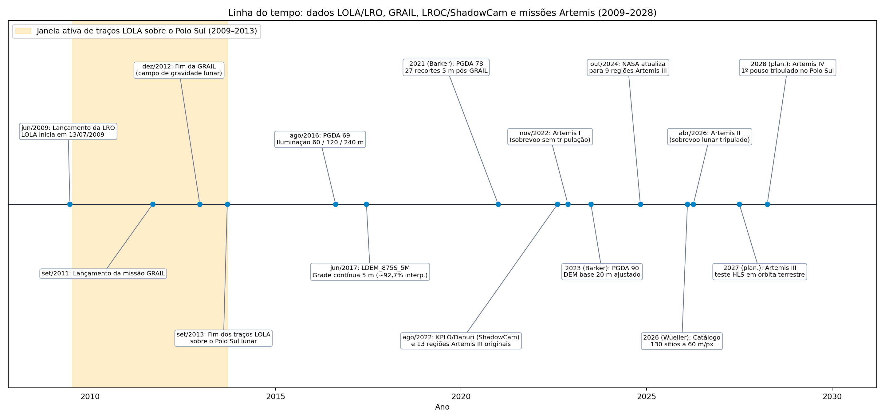
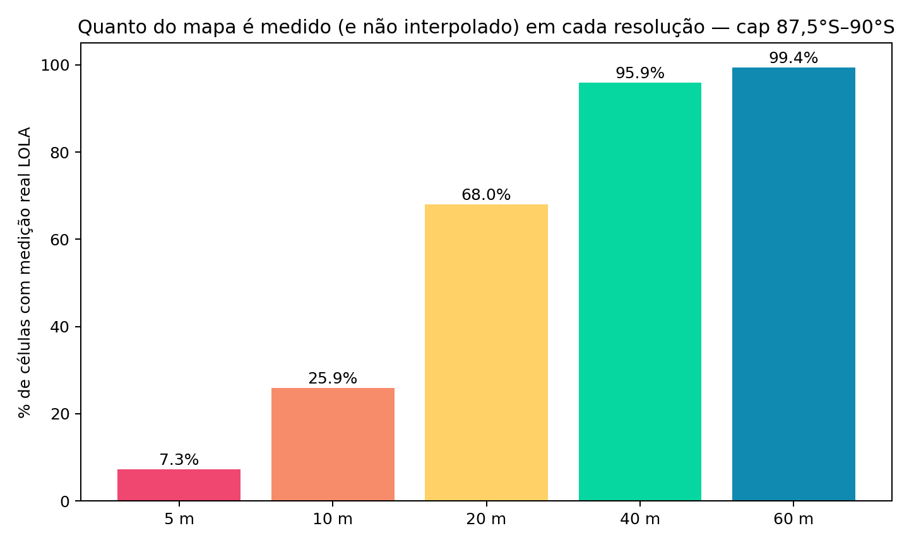
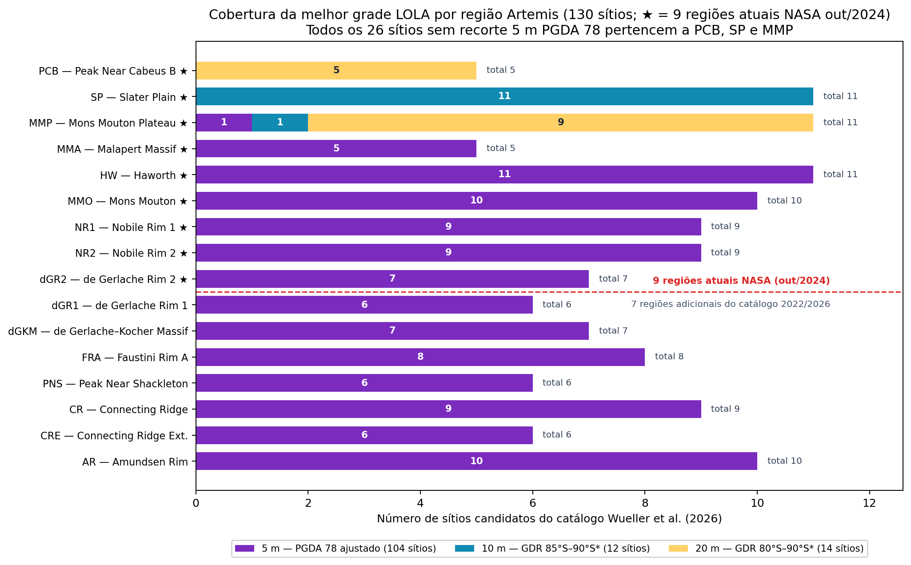

# Resumo Executivo e Posicionamento Científico

Esta monografia técnica consolida a arquitetura completa de dados, sensores orbitais, limitações físicas de resolução espacial, formulação matemática em LaTeX e plano experimental da tese de **Extrapolação Probabilística Multirresolução** aplicada à seleção de sítios de pouso e planejamento de rotas de exploração no Polo Sul da Lua.

O trabalho responde diretamente a um gargalo operacional central das futuras missões tripuladas do programa **Artemis** e de missões robóticas comerciais (**CLPS**): embora o catálogo mais recente de locais candidatos (*Wueller et al., 2026*, com **130 sítios** distribuídos em **16 regiões polares**) tenha avaliado a continuidade da iluminação solar e da visibilidade direta com a Terra (**DTE**) na grade de **$60\text{ m/pixel}$**, a engenharia de pouso e a sobrevivência térmica de veículos operam na escala de **$5\text{ m/pixel}$** (ou inferior). Ao mesmo tempo, **não existe um modelo digital de iluminação solar a $5\text{ m/px}$ nem a $1\text{ m/px}$ cobrindo todo o Polo Sul lunar** devido ao custo computacional proibitivo do traçado de raios em larga escala e à própria esparsidade física das medições de altimetria a laser.

A análise quantitativa direta sobre o acervo oficial baixado para esta pesquisa (**161 arquivos**, totalizando **$12{,}288\text{ GB}$**) comprova três fatos empíricos determinantes que fundamentam a metodologia proposta:

1. **Esparsidade real em $5\text{ m/px}$:** Na calota contínua de alta latitude ($87{,}5^\circ\text{S}\text{–}90^\circ\text{S}$, produto `LDEM_875S_5M`), apenas **$7{,}29\%$** das células de $5 \times 5\text{ m}$ contêm ao menos um disparo real do altímetro a laser LOLA; os **$92{,}71\%$** restantes são preenchidos por interpolação matemática.
2. **Lacuna persistente nas regiões atuais da NASA:** Apesar de os **27 recortes ajustados de $5\text{ m}$ (`PGDA 78`)** cobrirem **$104$ dos $130$ sítios ($80{,}0\%$)**, os restantes **$26$ sítios ($20{,}0\%$)** não possuem nenhum mapa topográfico a $5\text{ m}$ — e **todos esses $26$ sítios pertencem a três das nove regiões atuais priorizadas pela NASA em outubro de 2024**: *Peak Near Cabeus B* (`PCB`, $5/5$ em $20\text{ m}$), *Slater Plain* (`SP`, $11/11$ em $10\text{ m}$) e *Mons Mouton Plateau* (`MMP`, $9$ em $20\text{ m}$, $1$ em $10\text{ m}$ e apenas $1$ em $5\text{ m}$).
3. **Estratégia de calibração e correção:** Utilizamos os recortes reais de $5\text{ m}$ disponíveis (`LDEM_875S_5M` e `PGDA 78`) como bancada empírica para calibrar o efeito da resolução espacial sobre o bloqueio solar rasante e sobre a dispersão de declividades, corrigindo estatisticamente os sítios e rotas de travessia que só dispõem de grades a $60\text{ m}$, $20\text{ m}$ ou $10\text{ m}$ e quantificando o ganho de confiabilidade por classe de risco da missão.

---

# 0. Visão Geral Simplificada da Tese (Leitura Rápida)

Para facilitar a leitura direta do fio condutor científico sem os detalhes técnicos de formato de arquivo e protocolo experimental, esta seção resume em cinco pontos **o problema**, **a evolução das missões/técnicas** (*o que cada uma resolveu* e *qual problema ficou aberto*) e **o que a tese entrega**:

* **O problema central:** O catálogo mais completo de sítios candidatos (*Wueller et al., 2026*, $130$ sítios) calculou iluminação solar e comunicação Terra apenas a **$60\text{ m/px}$**, pois **não existe DEM de iluminação solar a $5\text{ m/px}$ nem a $1\text{ m/px}$ para o Polo Sul inteiro** e simular o polo inteiro em $5\text{ m}$ custaria $1.728\times$ mais. Porém, na escala de $60\text{ m}$, microcrateras e bordas sombreadas desaparecem (falsos positivos de segurança).

| Missão / Técnica | O que contribuiu para o Polo Sul | Principal problema criado ou não resolvido |
|---|---|---|
| **Laser `LOLA` (`LRO`)** *(2009–2013)* | Forneceu o arcabouço altimétrico absoluto a laser ($5\text{ m}$ por feixe), funcionando mesmo dentro do escuro total. | Coleta polar densa **parou em set/2013**; ao gerar a grade contínua de **$5 \times 5\text{ m}$**, **$92{,}71\%$ dos pixels ficam vazios** e dependem de interpolação matemática (além de erros de órbita entre trilhas). |
| **Gravimetria `GRAIL` $\to$ `PGDA 78` ($5\text{ m}$) e `PGDA 90` ($20\text{ m}$)** | Corrigiu os erros orbitais antigos (2009–2013), gerando a base contínua de $20\text{ m}$ e $27$ blocos ajustados de $5\text{ m}$ cobrindo **$104/130$ sítios ($80{,}0\%$)**. | **Não gera mapas de iluminação**; cada bloco tem apenas $16\text{ a }29{,}8\text{ km}$ (não alcança montanhas distantes); a mediana de tiros LOLA reais continua baixa (**$7{,}6\%$**, caindo até $0{,}08\%$); e deixa **$26$ sítios sem `5 m`** em `PCB`, `SP` e `MMP`. |
| **Câmera `LROC NAC` + `SfS`** | Combina fotos ópticas ao LOLA para produzir novos locais a $5\text{ m/px}$ e relevos locais de **$1\text{–}2\text{ m/px}$**. | **Não funciona no escuro / dentro de sombras (`PSR`)** e não entrega mapa polar contínuo de iluminação a $5\text{ m}$ ou $1\text{ m}$. |
| **`ShadowCam` (`KPLO/Danuri`)** | Sensibilidade $>200\times$ maior que a `NAC`, gerando imagens de **$\sim 1{,}7\text{–}2\text{ m/px}$** dentro das crateras permanentemente sombreadas via luz espalhada. | **Não é mapa de radiação solar** nem calcula energia fotovoltaica; serve apenas como verificação visual de pedras/rampas e gelo dentro das rotas escuras. |
| **Programa `Artemis` (`I–IV`) + *Wueller 2026*** | Avançou de *Artemis I* (2022) e *Artemis II* (abr/2026) rumo a *Artemis III* (2027 LEO HLS) e *IV* (2028 pouso); definiu **9 regiões atuais** e $130$ sítios (`2025–2032`). | Todos os $130$ sítios foram simulados apenas a **$60\text{ m/px}$**, exigindo correção estatística para refletir o risco real de **$5\text{ m/px}$** no pouso e nas rotas até $2\text{ km}$. |

: Síntese rápida do papel e da lacuna de cada missão e técnica observacional na tese. {#tbl:resumo_missoes_rapido}

* **O que a tese faz:** Usa os **$104$ sítios reais** com recorte de $5\text{ m}$ (junto com a calota $87{,}5^\circ\text{S}$) para calibrar empiricamente quanto de luz se perde e quanto a declividade se abre ao sair de $60\text{ m}$ ou $20\text{ m}$ para $5\text{ m}$ (controlando pela fração realmente medida `LDEC`), aplica essa correção aos **$26$ sítios sem $5\text{ m}$ (`PCB`, `SP`, `MMP`) e às rotas de travessia**, e mede o ganho objetivo na decisão (`TOPSIS`). *(Para a leitura isolada e ainda mais concisa, consulte também o arquivo separado `Tese_Versao_Simplificada.docx`.)*

---

# 1. Programa Artemis e Situação Atual dos Dados Polares (2009–2028)

## 1.1 Cronologia do Programa Artemis e Evolução das Missões

O planejamento atual de pouso lunar humano da NASA estrutura-se em uma arquitetura faseada de testes orbitais, validação de sistemas comerciais de alunissagem (**HLS — Human Landing System**, SpaceX e Blue Origin) e operações na superfície próximas ao Polo Sul lunar:

* **Artemis I (novembro de 2022):** Voo inaugural não tripulado do foguete *SLS* (*Space Launch System*) e da cápsula *Orion*, validando o escudo térmico, a navegação em órbita retrógrada distante e os sistemas de suporte para missões cislunares.
* **Artemis II (abril de 2026):** Primeiro voo tripulado do programa, conduzindo quatro astronautas em trajetória de sobrevoo lunar (*lunar flyby*) e retorno à Terra, validando suporte de vida manual, comunicações e perfil de reentrada com tripulação.
* **Artemis III (reestruturada para 2027, órbita baixa terrestre — LEO):** Em revisão programática recente da arquitetura Artemis, a missão Artemis III foi convertida em uma demonstração tripulada em órbita baixa terrestre para ensaiar operações críticas de aproximação, *rendezvous* e acoplamento entre a espaçonave *Orion* e módulos de teste dos sistemas de pouso comercial (**HLS**) da SpaceX e da Blue Origin antes da descida humana ao solo lunar.
* **Artemis IV (meta programática: início de 2028):** Alvo planejado para o **primeiro pouso tripulado do programa na região do Polo Sul lunar**, convertendo a seleção precisa do sítio e das rotas seguras em requisito imediato de engenharia.

## 1.2 Da Lista de 13 Regiões (2022) às 9 Regiões Atuais (Outubro de 2024) e ao Catálogo de 130 Sítios (Wueller et al., 2026)

Em agosto de 2022, a NASA anunciou **13 regiões candidatas** próximas ao Polo Sul para pouso tripulado (`FA`, `PNS`, `CR`, `CRE`, `dGR1`, `dGR2`, `dGKM`, `HW`, `MMA`, *Leibnitz Beta Plateau*, `NR1`, `NR2` e `AR`). Em **28 de outubro de 2024**, após reavaliação geotécnica, térmica e de janelas de lançamento, a agência consolidou a seleção em **9 regiões prioritárias atualizadas**:

1. **Peak Near Cabeus B (`PCB`)** — $5$ sítios no catálogo de 2026;
2. **Haworth (`HW`)** — $11$ sítios;
3. **Malapert Massif (`MMA`)** — $5$ sítios;
4. **Mons Mouton Plateau (`MMP`)** — $11$ sítios;
5. **Mons Mouton (`MMO`)** — $10$ sítios;
6. **Nobile Rim 1 (`NR1`)** — $9$ sítios;
7. **Nobile Rim 2 (`NR2`)** — $9$ sítios;
8. **de Gerlache Rim 2 (`dGR2`)** — $7$ sítios;
9. **Slater Plain (`SP`)** — $11$ sítios.

O estudo mais abrangente subsequente, publicado por *Wueller et al. (2026)*, analisou **130 sítios candidatos específicos** cobrindo tanto essas **9 regiões atuais ($78$ sítios)** quanto **7 regiões adicionais do conjunto de 2022 ($52$ sítios: `AR`, `CR`, `CRE`, `dGKM`, `dGR1`, `FRA` e `PNS`)**, simulando ano a ano ($2025\text{–}2032$) a visibilidade solar e terrestre a **$60\text{ m/pixel}$**. A Figura 1 sintetiza a sequência histórica conjunta de sensores orbitais, produtos geodésicos e marcos Artemis entre 2009 e 2028.

{width=98%}

## 1.3 Situação Atual do Problema: Por Que $60\text{ m/px}$ Foi Adotado e Onde Nossa Tese Atua

A adoção de $60\text{ m/pixel}$ no catálogo *Wueller et al. (2026)* não foi arbitrária: ela decorre de duas barreiras físicas e computacionais simultâneas:

1. **Explosão cúbica de custo computacional no traçado de raios ($O(N^3)$):** Para uma mesma janela quadrada de $16 \times 16\text{ km}$, refinar a malha de $60\text{ m/px}$ ($71.111\text{ pixels}$) para $5\text{ m/px}$ ($10.240.000\text{ pixels}$) multiplica em $144\times$ o número de pontos de avaliação e em $12\times$ o número de passos radiais por azimute ($200\text{ km} / 5\text{ m}$ vs. $200\text{ km} / 60\text{ m}$), impondo **$1.728\times$ mais operações de ponto flutuante** apenas para um recorte local — tornando impraticável simular todo o anel polar de $-83^\circ$ a $-90^\circ$ com $720$ azimutes ao longo de múltiplos anos em grades de $5\text{ m}$.
2. **Ausência de cobertura contínua a $5\text{ m}$ em toda a zona Artemis:** A grade polar contínua de $5\text{ m}$ (`LDEM_875S_5M`) limita-se a $87{,}5^\circ\text{S}\text{–}90^\circ\text{S}$ (contendo apenas **$42$ dos $130$ sítios**). Mesmo combinando com os 27 blocos locais do `PGDA 78`, **$26$ sítios ficam sem cobertura de $5\text{ m}$**.

**Como a tese atua diante desse cenário:** em vez de descartar o catálogo de $60\text{ m/px}$ ou tentar uma simulação bruta inexistente de $5\text{ m}$ para o polo inteiro, esta pesquisa usa os **recortes reais de $5\text{ m}$** disponíveis para **calibrar empiricamente a perda de iluminação e o crescimento da rugosidade topográfica entre $240\text{ m}$, $120\text{ m}$, $60\text{ m}$, $20\text{ m}$ e $5\text{ m}$**, aplicando essa correção probabilística aos sítios e rotas de travessia que só existem em grades de $60\text{ m}$, $20\text{ m}$ ou $10\text{ m}$, e avaliando o ganho objetivo na segurança de seleção.

---

# 2. Instrumentação Orbital e Limitações Físicas dos Sensores

## 2.1 Altímetro a Laser `LOLA` (*Lunar Orbiter Laser Altimeter*, Sonda `LRO`)

O instrumento **LOLA**, embarcado na sonda norte-americana *Lunar Reconnaissance Orbiter* (`LRO`, lançada em junho de 2009, iniciando operações sistemáticas em **13 de julho de 2009**), mede a elevação da superfície lunar por tempo de voo de pulsos laser infravermelhos. Cada disparo a $28\text{ Hz}$ é dividido por um elemento difrativo em cinco feixes com pegada superficial de aproximadamente $5\text{ m}$ de diâmetro cada, referenciados à esfera lunar padrão IAU de raio $R_{\text{Lua}} = 1.737.400\text{ m}$.

Um fato operacional decisivo frequentemente omitido em análises superficiais é que **as trilhas altimétricas polares densas do LOLA sobre o Polo Sul encerraram-se em setembro de 2013**, quando a órbita elíptica congelada da `LRO` deixou de passar continuamente sobre as baixas altitudes polares com a mesma geometria densa de cobertura. Consequentemente, a quase totalidade dos DEMs polares derivados do LOLA (`LDEM_875S_5M`, `PGDA 78`, `PGDA 90`) baseia-se nessa janela histórica de coleta de 2009 a 2013, reprocessada e reajustada ao longo da década seguinte.

### O Problema da Grade `5 × 5 m`: Dados Reais Medidos vs. Interpolação Matemática

Embora o produto `LDEM_875S_5M.IMG` apresente espaçamento nominal de $5 \times 5\text{ m}$ entre $-87{,}5^\circ$ e $-90^\circ$ ($30.336 \times 30.336\text{ pixels}$), os perfis orbitais do LOLA têm largura limitada e deixam amplos corredores sem amostragem direta entre passagens adjacentes. A tabela de contagem `LDEC_875S_5M.IMG` registra exatamente quantos retornos individuais do laser atingiram cada célula de $5\text{ m}$ (`LDEC = 0` indica pixel vazio de medição direta, preenchido por **interpolação matemática** via *spline* / triangulação).

A varredura completa do arquivo `LDEC_875S_5M.IMG` na calota $87{,}5^\circ\text{S}\text{–}90^\circ\text{S}$ produziu os seguintes valores medidos diretamente em disco:

| Resolução Espacial da Grade | Tamanho da Célula | Células com $\ge 1$ Disparo Real LOLA ($\%$) | Células Preenchidas por Interpolação ($\%$) | Interpretação Cartográfica |
|---:|---:|---:|---:|---|
| **$5\text{ m/px}$** | $25\text{ m}^2$ | **$7{,}29\%$** | **$92{,}71\%$** | Mais de $90\%$ da matriz é superfície interpolada matematicamente entre trilhas. |
| **$10\text{ m/px}$** | $100\text{ m}^2$ | **$25{,}90\%$** | **$74{,}10\%$** | Aproximadamente três quartos da malha dependem de interpolação. |
| **$20\text{ m/px}$** | $400\text{ m}^2$ | **$67{,}97\%$** | **$32{,}03\%$** | Limiar em que a maioria dos pixels contém ao menos uma medida direta. |
| **$40\text{ m/px}$** | $1.600\text{ m}^2$ | **$95{,}93\%$** | **$4{,}07\%$** | Cobertura praticamente contínua de perfis reais. |
| **$60\text{ m/px}$** | $3.600\text{ m}^2$ | **$99{,}40\%$** | **$0{,}60\%$** | Cobertura laser quase integral ($>99\%$), razão pela qual a escala de $60\text{ m}$ é numericamente estável em grandes áreas. |
| **$120\text{ m/px}$** | $14.400\text{ m}^2$ | **$99{,}997\%$** | **$0{,}003\%$** | Cobertura completa na grade intermediária `PGDA 69` ($240\text{ m} \approx 100\%$). |

: Fração de células com medição direta de laser LOLA versus interpolação matemática dentro da calota polar de $87{,}5^\circ\text{S}$ a $90^\circ\text{S}$. {#tbl:cobertura_lola}

| Variável do Conjunto Exposto (Tabela 1) | $N$ | Média $\pm s$ | Mediana | $Q_1\text{–}Q_3$ ($\text{IQR}$) | Mín. – Máx. |
|---|---:|---:|---:|---:|---:|
| Células com $\ge 1$ disparo real LOLA ($\%$) | $6$ | $66{,}08 \pm 40{,}56$ | $81{,}95$ | $36{,}42\text{–}98{,}53$ ($62{,}12$) | $7{,}29\text{–}99{,}997$ |
| Células interpoladas matematicamente ($\%$) | $6$ | $33{,}92 \pm 40{,}56$ | $18{,}05$ | $1{,}47\text{–}63{,}58$ ($62{,}12$) | $0{,}003\text{–}92{,}71$ |

: Estatística descritiva da fração amostrada vs. interpolada entre as seis resoluções da calota polar ($87{,}5^\circ\text{S}\text{–}90^\circ\text{S}$). {#tbl:desc_cobertura_lola}

As Figuras 2, 3, 4 e 5 ilustram essa dualidade espacial: a Figura 2 quantifica a curva multirresolução; a Figura 3 exibe o mosaico isolado de $5\text{ m}$ (`LDEC_875S_5M`); a **Figura 4** coloca todas as escalas de **$5\text{ m}$ a $120\text{ m}$ na mesma régua de cores (`0% → 100%`)**, tornando imediata a transição do vermelho quase uniforme a $5\text{ m}$ ($7{,}3\%$) ao verde sólido em $60\text{ m}$ ($99{,}4\%$); e a Figura 5 aproxima uma janela de $2 \times 2\text{ km}$ ao redor do Sítio `001` (*Connecting Ridge*, `Nº 126`), evidenciando exatamente quais pixels de $5\text{ m}$ possuem tiro real ($8{,}9\%$, verde) versus preenchimento interpolado ($91{,}1\%$, vermelho), em contraste com a mesma região reamostrada a $20\text{ m}$ ($77{,}1\%$ das células amostradas).

{width=82%}

{width=88%}

{width=98%}

{width=94%}

## 2.2 Missão `GRAIL` e Correção Geodésica (`PGDA 78` a $5\text{ m}$ e `PGDA 90` a $20\text{ m}$)

Os primeiros DEMs polares construídos diretamente com os dados de 2009–2013 herdavam incertezas de reconstrução orbital da sonda `LRO`, traduzidas em deslocamentos sistemáticos laterais (dezenas de metros) e verticais (metros) entre passagens cruzadas do laser. A missão dupla **GRAIL** (*Gravity Recovery and Interior Laboratory*, lançada em setembro de 2011 e encerrada em dezembro de 2012) mapeou o campo gravitacional lunar em altíssima ordem esférica harmônica (`GL0900C` / modelos subsequentes).

A disponibilidade desse modelo gravitacional preciso permitiu à equipe do LOLA/GSFC:

1. **Corrigir retrospectivamente os erros de órbita dos perfis LOLA de 2009 a 2013**, co-registrando as trilhas individuais por ajuste de cruzamentos (*crossover adjustment*) e minimização de resíduos entre órbitas antigas;
2. **Gerar o conjunto `PGDA 78` (*Barker et al., 2021*):** $27$ recortes de $5\text{ m/px}$ altamente ajustados sobre alvos estratégicos do Polo Sul — acompanhados de grades explícitas de declividade (`*_slp.tif`), contagem de tiros (`*_ldec.tif`), incerteza vertical total (`*_toterr.tif`), erro de inclinação (`*_slperr.tif`) e realizações estocásticas de erro (`Clones`), que servem de **gabarito empírico** para a nossa equação de incerteza e para a calibração multirresolução;
3. **Gerar o DEM base ajustado `PGDA 90` (*Barker et al., 2023*):** mosaico contínuo em **$20\text{ m/px}$** cobrindo integralmente de $80^\circ\text{S}$ a $90^\circ\text{S}$ com alinhamento geodésico corrigido pela gravimetria GRAIL, hoje utilizado pela NASA como superfície base contínua de referência regional.

## 2.3 Câmera `LROC NAC` + *Shape-from-Shading* (`SfS`): Avanços e Limitações no Escuro

Para superar o limite de esparsidade do laser em áreas críticas de engenharia de pouso ($1\text{–}5\text{ m}$), aplica-se a técnica de **Shape-from-Shading (`SfS`)** (fotoclinometria) sobre imagens ópticas métricas da **LROC NAC** (*Narrow Angle Camera*, resolução nativa de $\sim 0{,}5\text{ a }2\text{ m/px}$).

* **Conexão com o LOLA:** O `SfS` inverte a função fotométrica lunar a partir da radiância solar refletida em múltiplas imagens sob diferentes ângulos solares para recuperar variações de micro-declividade e gerar mapas de **$5\text{ m/px}$** em mais localidades e novos produtos localizados de **$1\text{–}2\text{ m/px}$** (revelando cristas afiladas, blocos e microcrateras invisíveis nos intervalos não amostrados do laser). Contudo, o `SfS` sofre de deriva espacial de baixas frequências (*bowing* ou inclinação global espúria); por isso, sua solidez depende obrigatoriamente de ser **ancorado ao arcabouço geodésico absoluto do LOLA pós-GRAIL** (*Barker / USGS Ames Stereo Pipeline*).
* **Limitação física intransponível — Escuridão e Ambiguidade:** O `SfS` **não funciona no escuro**. Dentro de sombras projetadas e no interior de **PSRs** (*Permanently Shadowed Regions*), onde não há incidência solar direta, o algoritmo não dispõe de sinal fotométrico direto para inferir topografia — produzindo vazios estruturais ou artefatos se não for restringido externamente. Soma-se a isso a ambiguidade entre variação real de inclinação e variação de albedo superficial sob ângulos rasantes ($\le 1{,}54^\circ$).

> **NOTA PERMANENTE DE CONTORNO DA TESE (CRÍTICO PARA O PLANO EXPERIMENTAL):**  
> **NÃO existe modelo digital de iluminação solar a $5\text{ m/px}$ nem a $1\text{ m/px}$ cobrindo o Polo Sul lunar inteiro.** Os mapas globais de iluminação polar disponíveis (`PGDA 69`) restringem-se às resoluções de $60\text{ m}$, $120\text{ m}$ e $240\text{ m/px}$. Mesmo os produtos `LROC NAC SfS` de $1\text{–}2\text{ m/px}$ e `PGDA 78` de $5\text{ m/px}$ limitam-se a janelas locais selecionadas e não eliminam o custo exponencial do traçado de raios em larga escala. Toda simulação polar ampla (como os 130 sítios de *Wueller et al., 2026* a $60\text{ m/px}$) necessita, portanto, de **correção estatística calibrada multirresolução** para estimar o risco real em $5\text{ m}$.

## 2.4 Câmera `ShadowCam` (Sonda Sul-Coreana `KPLO / Danuri`)

Lançada em **5 de agosto de 2022** a bordo da sonda orbital sul-coreana *Korea Pathfinder Lunar Orbiter* (**KPLO / Danuri**), a **ShadowCam** é um instrumento ótico desenvolvido pela NASA/ASU especificamente projetado para imagear o interior das crateras em sombra permanente do Polo Sul lunar.

* **Funcionamento e resolução:** Utiliza sensor *TDI CCD* (*Time Delay Integration*) com sensibilidade luminosa **superior a $200\times$** à da câmera `LROC NAC`, operando na resolução espacial típica de **$\sim 1{,}7\text{ a }2\text{ m/px}$** em faixas de cerca de $5\text{ km}$ de largura. Em vez de luz solar direta, capta a tênue **iluminação secundária espalhada** pelas paredes internas iluminadas das crateras adjacentes ou por relevos distantes.
* **O que a `ShadowCam` NÃO é:** Como corretamente observado na concepção deste projeto, a `ShadowCam` **não é um mapa de radiação solar nem mede horas de luz direta para geração fotovoltaica**. Em regiões totalmente escuras, o fluxo secundário serve para imageamento ótico de alto ganho, não para balanço energético do lander nem para cálculo de horizonte solar primário.
* **O que a `ShadowCam` efetivamente acrescenta à tese e à engenharia de missão:**
  1. **Detecção direta de obstáculos no escuro ($\sim 2\text{ m}$):** Permite inspecionar matacões (*boulders*), escarpas frescas e microcrateras dentro das *PSRs* onde o `LROC NAC SfS` fica cego e onde o LOLA a $5\text{ m}$ é $92{,}7\%$ interpolado;
  2. **Planejamento de segurança para travessias robóticas e EVA:** Garante auditoria visual pré-missão das rotas curtas (até $2\text{ km}$) que saem dos platôs iluminados rumo às áreas de coleta de voláteis no interior das sombras;
  3. **Mapeamento morfológico e assinaturas de refletância de voláteis/geada:** Contribui para qualificar cientificamente a camada de retorno de recursos (**ISRU**) associada à área de *PSR* (`area_psr_m2`) ao verificar acessibilidade real de taludes no escuro.

| Sensor / Missão | Período Polar Chave | Princípio Físico | Resoluções / Produtos Derivados | O que Resolve na Tese | Limitação Principal |
|---|---|---|---|---|---|
| **LOLA (`LRO`)** | jul/2009 – set/2013 (trilhas polares densas) | Altimetria a laser ativa ($28\text{ Hz} \times 5$ feixes de $5\text{ m}$) | `LDEM_875S_5M` ($5\text{ m}$), GDR $10/20/60\text{ m}$ | Referência geodésica absoluta $Z$ (funciona no escuro e sob Sol rasante) | Trilhas esparsas: **$92{,}71\%$ interpolado a $5\text{ m}$**; encerrou coleta polar densa em set/2013 |
| **GRAIL** | set/2011 – dez/2012 | Gravimetria por rastreamento duplo orbital | Modelo gravitacional para reajuste orbital LOLA $\to$ **`PGDA 78`** ($5\text{ m}$) e **`PGDA 90`** ($20\text{ m}$) | Corrige erros de órbita 2009–2013; gera tiles $5\text{ m}$ ajustados + `toterr`/`slp` | Não adiciona novos tiros de laser; apenas $104/130$ sítios têm recorte `PGDA 78` |
| **LROC NAC + `SfS`** | 2009–presente (recortes locais) | Fotoclinometria óptica + controle LOLA | Recortes locais de $5\text{ m/px}$ e **$1\text{–}2\text{ m/px}$** | Refina micro-rugosidade em áreas iluminadas sem depender só de interpolação LOLA | **Não funciona no escuro/PSR**; ambiguidade albedo-declividade; sem mapa polar completo de iluminação |
| **ShadowCam (`KPLO/Danuri`)** | ago/2022–presente | Imageamento *TDI CCD* ($>200\times$ NAC) com luz espalhada secundária | Imagens óticas de **$\sim 1{,}7\text{–}2\text{ m/px}$** dentro de PSRs | Auditoria de obstáculos, rochas e rotas dentro de sombras permanentes | **Não é mapa de radiação solar/energia**; satura fora de sombras; exige cuidado na inversão geométrica 3D |

: Síntese comparativa dos quatro pilares observacionais que condicionam a seleção de sítios no Polo Sul lunar. {#tbl:sensores_comparativo}

---

# 3. Apresentação dos Arquivos, Variáveis, Unidades e Distribuição dos 130 Sítios

## 3.1 Inventário dos Arquivos do Projeto e Unidades Disponíveis

Os dados verificados em disco no repositório distribuem-se entre o catálogo tabular de *Wueller et al. (2026)*, os kernels astronômicos oficiais do NAIF/SPICE e os três grupos do acervo geodésico polar (`dados/acervo_tese/`, totalizando **$161$ arquivos** e **$12{,}288\text{ GB}$**, além dos arquivos base em `dados/dem/` e `dados/kernels/`):

| Grupo / Caminho Local | Formato | Cobertura / Dimensão | Resolução | Variáveis / Unidades Físicas e Conversão | Papel no Pipeline da Tese |
|---|---|---|---|---|---|
| `sites/artemis_sitios_wueller2026.csv` | Texto `CSV` | $130$ sítios ($16$ regiões; $-83{,}37^\circ$ a $-89{,}63^\circ$) | Simulação base a **$60\text{ m/px}$** (mastro $2\text{ m}$) | Coordenadas ($^\circ$), dias contínuos de Sol e Sol+Terra ($2025\text{–}2032$, $\text{dias}$), área PSR ($\text{m}^2$) | Universo de decisão de 130 candidatos (`Nº 1` ao norte a `Nº 130` ao sul) e série nominal de $60\text{ m}$ |
| `01_LDEM_5M_MIT/LDEM_875S_5M.IMG` + `.LBL` | PDS3 binário (`int16` LSB) | Cap $87{,}5^\circ\text{S}\text{–}90^\circ\text{S}$ ($30.336 \times 30.336\text{ px}$; $1{,}84\text{ GB}$) | **$5\text{ m/px}$** | Cota topográfica $Z$ ($\text{m}$): $Z = \text{DN} \times 0{,}5$; $R = Z + 1.737.400\text{ m}$ | Horizonte próximo e calibração contínua para $42$ sítios acima de $87{,}5^\circ\text{S}$ |
| `01_LDEM_5M_MIT/LDEC_875S_5M.IMG` + `.LBL` | PDS3 binário (`int8`) | Cap $87{,}5^\circ\text{S}\text{–}90^\circ\text{S}$ ($30.336 \times 30.336\text{ px}$; $920\text{ MB}$) | **$5\text{ m/px}$** | Contagem inteira ($0\text{ a }8\text{ tiros/célula}$): `0` = interpolado, $\ge 1$ = medido | Medição direta da razão medido ($7{,}29\%$) vs. interpolado ($92{,}71\%$) |
| `02_PGDA_78_5M/<Recorte>/*_final_adj_5mpp_*.tif` | GeoTIFF (`float32`) | $27$ blocos locais (ex.: `Site01` com $3.200 \times 3.200\text{ px} = 16 \times 16\text{ km}$) | **$5\text{ m/px}$** (escala `5.0, 5.0` m) | `surf`: $Z\text{ (m)}$; `slp`: $S\text{ (}^\circ\text{)}$; `ldec`: tiros; `toterr`: $\varepsilon\text{ (m)}$; `slperr`: $\sigma_S\text{ (}^\circ\text{)}$ | Gabarito ajustado pós-GRAIL em **$104/130$ sítios**; calibração de $\varepsilon$, $S$ e horizonte |
| `03_PGDA_69_Iluminacao/AVGVISIB_*` e `LPSR_*` | PDS3 binário (`int16`) | Calotas $85^\circ\text{S}$ ($60\text{ m}$, $5.058^2$), $75^\circ\text{S}$ ($120\text{ m}$, $7.624^2$), $65^\circ\text{S}$ ($240\text{ m}$, $6.420^2$) | **$60, 120, 240\text{ m/px}$** | `AVGVISIB` / `_EARTH`: fração $[0, 1] = \text{DN} \times 0{,}00004$; `LPSR`: binário $0/1$ | Referência oficial da NASA de iluminação plurianual em $60\text{ m}$, $120\text{ m}$ e $240\text{ m}$ |
| `dados/dem/LDEM_875S_20M.IMG` + `.LBL` | PDS3 binário (`int16`) | Cap $87{,}5^\circ\text{S}\text{–}90^\circ\text{S}$ | **$20\text{ m/px}$** | Cota topográfica $Z$ ($\text{m}$) relativa a $1.737.400\text{ m}$ | Degrau intermediário ($20\text{ m}$) entre $60\text{ m}$ e $5\text{ m}$ na escada de resolução |
| `dados/kernels/` (`de440s.bsp`, `moon_pa_de440_*.bpc`, etc.) | NAIF/SPICE | Sistema Sol–Terra–Lua (`DE440`, `MOON_ME`, `naif0012.tls`, `pck00011.tpc`) | Efemérides contínuas ($\text{s}$) | Vetores posição/azimute/elevação ($^\circ$) e tempo dinâmico TDB/UTC | Cálculo *ceteris paribus* exato da altura solar e visada DTE nas simulações próprias |

: Inventário técnico de arquivos, formatos, escalas de conversão e unidades disponíveis no repositório local. {#tbl:inventario_arquivos}

## 3.2 Variáveis de `sites/artemis_sitios_wueller2026.csv`

O catálogo `artemis_sitios_wueller2026.csv` reúne **21 colunas** para cada um dos **130 pontos candidatos**:

| Grupo / Coluna no CSV | Tipo | Unidade Física | Significado e Uso na Formulação Matemática |
|---|---|---|---|
| `regiao` | Texto | Sigla ($16$ códigos) | Região candidata (ex.: `PCB`, `NR2`, `MMP`, `SP`, `HW`, `MMO`, `MMA`, `NR1`, `dGR2`, `AR`, etc.). Permite filtrar pelas $9$ regiões atuais de out/2024. |
| `sitio` | Texto | Identificador | Código do sítio dentro da região (ex.: `PCB04`, `001`/sub-índices `CR01..CR09`, etc.). Associado ao índice ordenado norte $\to$ sul $n \in \{1, \dots, 130\}$. |
| `lat`, `lon` | Real | Graus ($^\circ$) | Latitude planetocêntrica sul ($\varphi \in [-89{,}6319^\circ;\; -83{,}3691^\circ]$) e longitude leste positiva ($\lambda \in [-180^\circ;\; +180^\circ]$) no referencial `MOON_ME`. Convertidas em $(x, y)$ estereográficos polares em metros. |
| `dias_sol_2025` $\dots$ `dias_sol_2032` ($8$ col.) | Inteiro | Dias contínuos | Duração máxima ininterrupta de visibilidade solar no ano $A \in \{2025, \dots, 2032\}$, simulada por *Wueller et al. (2026)* a **$60\text{ m/px}$** e mastro de $2\text{ m}$ ($D_{60\text{m}, i}^{\text{Sol}}$). |
| `dias_sol_terra_2025` $\dots$ `dias_sol_terra_2032` ($8$ col.) | Inteiro | Dias contínuos | Duração máxima contínua simultânea de **Sol + visibilidade direta da Terra (`DTE`)** no ano $A$ a $60\text{ m/px}$ ($D_{60\text{m}, i}^{\text{DTE}}$). |
| `area_psr_m2` | Inteiro / Real | $\text{m}^2$ | Área total de regiões permanentemente sombreadas (`PSR`) acessível em um raio de caminhada/rover de até $2\text{ km}$ do ponto de pouso ($A_{\text{PSR}, i}$). Métrica de potencial científico e de *ISRU*. |

: Estrutura completa das 21 colunas de `sites/artemis_sitios_wueller2026.csv`. {#tbl:colunas_csv}

## 3.3 Variáveis Extraídas dos Arquivos Raster (`GeoTIFF` e `.IMG/.LBL`)

Diferentemente do formato PDS3 (`.IMG` binário puro acompanhado de metadados em texto `.LBL`), os arquivos **`GeoTIFF` (`*_5mpp_*.tif`)** do `PGDA 78` armazenam matrizes em ponto flutuante `float32` já convertidas para unidades físicas (metros e graus), com georreferenciamento embutido nas *tags* `ModelPixelScaleTag = (5.0, 5.0, 0.0)` e `ModelTiepointTag` (canto superior esquerdo em coordenadas $(x_0, y_0)$ estereográficas polares sul em metros; ex.: `Site01` com `tie = (-19000.0, -4000.0)` m e dimensões $3.200 \times 3.200\text{ px}$).

| Camada / Produto Raster | Formato | Expressão de Leitura e Unidade | Variável Matemática Associada e Função na Tese |
|---|---|---|---|
| `*_surf.tif` (`PGDA 78`) / `LDEM_*` (`.IMG`) | `float32` / `int16` | `PGDA 78`: valor direto $Z\text{ (m)}$; `.IMG`: $Z = \text{DN} \cdot 0{,}5\text{ (m)}$ | Elevação topográfica $Z(x, y)$ para traçar perfis de horizonte $\alpha(\phi)$ a $5\text{ m}$ e $20\text{ m}$ |
| `*_ldec.tif` (`PGDA 78`) / `LDEC_875S_5M` (`.IMG`) | `float32` / `int8` | Contagem inteira $N_{\text{LOLA}} \ge 0$ | Fração real amostrada ($N_{\text{LOLA}} > 0$) vs. interpolada ($N_{\text{LOLA}} = 0$) na elipse de pouso |
| `*_slp.tif` (`PGDA 78`) | `float32` | Valor direto $S\text{ (}^\circ\text{)}$ em escala de $5\text{ m/px}$ | Estatísticas reais da elipse de pouso ($100\text{ m}$ de raio): média $\bar S$, dispersão $\sigma_S$ e taxa segura $P(S \le 8^\circ)$ |
| `*_toterr.tif` (`PGDA 78`) | `float32` | Erro RMS vertical $\bar\varepsilon\text{ (m)}$ | Validação espacial pixel a pixel da equação de Barker $\varepsilon(R, S)$ sobre vazios e cristas |
| `*_slperr.tif` (`PGDA 78`) | `float32` | Incerteza de inclinação $\sigma_S^{\text{err}}\text{ (}^\circ\text{)}$ | Propagação de erro na taxa de conformidade de pouso $P(S \le S_{\text{lim}})$ e travessia ($S \le 15^\circ\text{–}20^\circ$) |
| `AVGVISIB_*` / `_EARTH` (`PGDA 69`) | `int16` (`.IMG`) | $F = \text{DN} \times 0{,}00004 \in [0, 1]$ | Referência NASA de iluminação média e DTE em $60\text{ m}$, $120\text{ m}$ e $240\text{ m}$ para calibrar $k_{\text{sombra}}$ |
| `LPSR_*` (`PGDA 69`) | `int16` (`.IMG`) | $\text{PSR} = \text{round}(\text{DN} \times 0{,}000025 + 0{,}5) \in \{0, 1\}$ | Máscara oficial de sombra permanente em $60\text{ m}$, $120\text{ m}$ e $240\text{ m}$ |

: Variáveis físicas extraídas das camadas `GeoTIFF` (`PGDA 78`) e binários PDS3 (`.IMG/.LBL`). {#tbl:variaveis_raster}

## 3.4 Mapa Temático de Resoluções e Distribuição dos 130 Sítios por Região

O cruzamento geodésico exato das coordenadas dos $130$ sítios numerados de norte a sul (**`Nº 1 PCB04`** a $-83{,}3691^\circ$ até **`Nº 130 CR08`** a $-89{,}6319^\circ$) contra todos os arquivos do acervo revela a seguinte distribuição quantitativa da melhor grade topográfica LOLA disponível:

* **$104$ sítios ($80{,}0\%$)** localizam-se dentro de recortes de **$5\text{ m/px}$ ajustados (`PGDA 78`)**, distribuídos em $14$ blocos (`DM1`: 10, `DM2`: 9, `Haworth`: 11, `LM7`: 8, `SL2`: 10, `SL3`: 6, `Site01`: 9, `Site06`: 11, `Site07`: 6, `Site11`: 3, `Site20`: 8, `Site20v2`: 1, `Site23`: 5, `Site42`: 7); desses $104$, **$42$** também integram a calota contínua `LDEM_875S_5M` ($87{,}5^\circ\text{S}\text{–}90^\circ\text{S}$).
* **$12$ sítios ($9{,}2\%$)** não estão cobertos por `PGDA 78` nem pela calota de $5\text{ m}$, tendo como melhor grade LOLA disponível a malha de **$10\text{ m/px}$ (`GDR 85°S–90°S`)** (`SP`: 11 sítios; `MMP01`: 1 sítio).
* **$14$ sítios ($10{,}8\%$)** situam-se ao norte de $-85^\circ$ fora dos recortes `PGDA 78`, dispondo no máximo da grade de **$20\text{ m/px}$ (`GDR 80°S–90°S`)** (`PCB`: 5 sítios; `MMP02, MMP04..MMP11`: 9 sítios).

A Figura 6 projeta esses estratos de resolução sobre a iluminação média polar (`PGDA 69`, $120\text{ m}$), e a Figura 7 detalha o empilhamento região por região. Nota-se um resultado estrutural crítico: **todos os $26$ sítios desprovidos de mapa a $5\text{ m}$ pertencem às três regiões incorporadas/revisadas em outubro de 2024 (`PCB`, `SP` e `MMP`)**, enquanto todas as demais regiões ($13$ das $16$) possuem $100\%$ de cobertura em $5\text{ m}$ `PGDA 78`.

> **NOTA CRÍTICA DE CONTRASTE (`PGDA 78`): Topografia `5 m` abrangente $\neq$ Iluminação `5 m` pronta:**  
> Embora os **$104/130$ sítios ($80{,}0\%$)** com cobertura `PGDA 78` ofereçam uma bancada estatística muito mais ampla que os antigos $4$ sítios de referência, a inspeção direta dos GeoTIFFs evidencia quatro restrições inegociáveis: **(1)** nenhum desses blocos traz simulação pronta de iluminação solar a $5\text{ m}$; **(2)** as janelas medem apenas $16 \times 16\text{ km}$ (`Site01`, `Site04`, `Site07`, `Site11`, `Site20`), $20 \times 20\text{ km}$ (`DM1`, `DM2`, `LM1..8`, `NPA..D`, `SL2`, `SL3`, `Shoemaker`, `Site06`, `Site42`), $21 \times 21\text{ km}$ (`Site23`), $26 \times 26\text{ km}$ (`Site20v2`) ou $29{,}8 \times 29{,}8\text{ km}$ (`Haworth`), não cobrindo o horizonte distante ($100\text{–}200\text{ km}$) sem acoplamento a `20/60/120 m`; **(3)** dentro da elipse de $100\text{ m}$ dos $104$ sítios, a **mediana de pixels com tiro real LOLA (`LDEC > 0`) é de apenas $7{,}6\%$** (variando de **$0{,}08\%$** em `Nº 16 NR2_K2023`, $0{,}48\%$ em `Nº 26 AR03`, $0{,}80\%$ em `Nº 20 AR10` e $1{,}11\%$ em `Nº 21 AR06` até o máximo de $21{,}24\%$); e **(4)** contando sobreposições entre blocos, $15$ dos $27$ recortes contêm sítios (`Site04` sobrepõe $2$ sítios já presentes em blocos vizinhos), outros $12$ blocos (`LM1..6`, `LM8`, `NPA..D`, `Shoemaker`) têm zero sítios do catálogo de 2026 e os $26$ sítios restantes em `PCB`, `SP` e `MMP` permanecem integralmente sem `5 m`.

{width=95%}

{width=98%}

As Figuras 8 e 9 consolidam a evolução histórica em cinco marcos (`2007–2023`) comparando os **$130$ sítios candidatos** com a **superfície total do Polo Sul lunar (`80°S–90°S`, área esférica de $288.139\text{ km}^2$)**, separando nos blocos de $5\text{ m}$ o que possui disparo direto de laser LOLA (`LDEC > 0`) do que é interpolação matemática (sem contagem de "$5\text{ m}$ nominal").

{width=98%}

{width=98%}

| Marco Cartográfico | Período | 130 Sítios: $5\text{ m}$ Real / Interp. | 130 Sítios: $\ge 10\text{ m}$ | Polo Sul ($288.139\text{ km}^2$): $5\text{ m}$ Real / Interp. | Polo Sul: $\ge 10\text{ m}$ |
|---|---|---|---|---|---|
| **1. Pré-LRO (Kaguya LALT)** | `2007–09` | $0{,}00\% / 0{,}00\%$ | $100\%$ ($\ge 500\text{ m}$) | $0{,}00\% / 0{,}00\%$ | $100\%$ ($\ge 500\text{ m}$) |
| **2. LOLA Pioneiro (`Mazarico`)** | `2011` | $0{,}00\% / 0{,}00\%$ | $100\%$ ($120\text{–}240\text{ m}$) | $0{,}00\% / 0{,}00\%$ | $100\%$ ($120\text{–}240\text{ m}$) |
| **3. PGDA 69 Polar (`60 m`)** | `2016` | $0{,}00\% / 0{,}00\%$ | $80{,}77\%$ ($60\text{ m}$); $19{,}23\%$ ($\ge 120\text{ m}$) | $0{,}00\% / 0{,}00\%$ | $31{,}89\%$ ($60\text{ m}$); $68{,}11\%$ ($\ge 120\text{ m}$) |
| **4. LOLA GDR V2 (`LDEM_875S`)** | `2017` | $3{,}45\% / 37{,}32\%$ | $40{,}00\%$ ($10\text{ m}$); $19{,}23\%$ ($20\text{ m}$) | $0{,}58\% / 7{,}38\%$ | $23{,}93\%$ ($10\text{ m}$); $68{,}11\%$ ($20\text{ m}$) |
| **5. Pós-GRAIL (`PGDA 78 + 90`)** | `2021–23` | **$6{,}14\% / 73{,}86\%$** | $9{,}23\%$ ($10\text{ m}$); $10{,}77\%$ ($20\text{ m}$) | **$0{,}70\% / 9{,}13\%$** | $22{,}56\%$ ($10\text{ m}$); $67{,}61\%$ ($20\text{ m}$) |

: Evolução histórica da cobertura cartográfica real ($5\text{ m}$ por disparo direto `LDEC > 0` vs. interpolado, $10\text{ m}$, $20\text{ m}$, $60\text{ m}$ e base macro $\ge 120\text{ m}$) nos $130$ sítios candidatos e no Polo Sul inteiro ($80^\circ\text{S}\text{–}90^\circ\text{S}$). {#tbl:evolucao_resolucao_5marcos}

| Variável Percentual nos 5 Marcos | $N$ | Média $\pm s$ ($\%$) | Mediana ($\%$) | $Q_1\text{–}Q_3$ ($\text{IQR}$) | Mín. – Máx. ($\%$) |
|---|---:|---:|---:|---:|---:|
| 130 Sítios — $5\text{ m}$ tiro real (`LDEC > 0`) | $5$ | $1{,}92 \pm 2{,}79$ | $0{,}00$ | $0{,}00\text{–}3{,}45$ ($3{,}45$) | $0{,}00\text{–}6{,}14$ |
| 130 Sítios — $5\text{ m}$ interpolado | $5$ | $22{,}24 \pm 33{,}08$ | $0{,}00$ | $0{,}00\text{–}37{,}32$ ($37{,}32$) | $0{,}00\text{–}73{,}86$ |
| 130 Sítios — base macro ($\ge 120\text{ m}$) | $5$ | $43{,}85 \pm 51{,}86$ | $19{,}23$ | $0{,}00\text{–}100{,}00$ ($100{,}00$) | $0{,}00\text{–}100{,}00$ |
| Polo Sul inteiro — $5\text{ m}$ tiro real (`LDEC > 0`) | $5$ | $0{,}26 \pm 0{,}35$ | $0{,}00$ | $0{,}00\text{–}0{,}58$ ($0{,}58$) | $0{,}00\text{–}0{,}70$ |
| Polo Sul inteiro — $5\text{ m}$ interpolado | $5$ | $3{,}30 \pm 4{,}56$ | $0{,}00$ | $0{,}00\text{–}7{,}38$ ($7{,}38$) | $0{,}00\text{–}9{,}13$ |
| Polo Sul inteiro — base macro ($\ge 120\text{ m}$) | $5$ | $53{,}62 \pm 50{,}65$ | $68{,}11$ | $0{,}00\text{–}100{,}00$ ($100{,}00$) | $0{,}00\text{–}100{,}00$ |

: Estatística descritiva da série de cinco marcos ($N = 5$ etapas cronológicas, 2007–2023) nos $130$ sítios candidatos e na área esférica do Polo Sul lunar. {#tbl:desc_evolucao_5marcos}

---

# 4. Formulação Matemática em LaTeX: Calibração, Incerteza, Extrapolação e Protocolo Estatístico

Para tornar a formulação matemática auditável e encadeada passo a passo sem exigir ainda a simulação completa dos $130$ sítios, extraímos diretamente de `sites/artemis_sitios_wueller2026.csv` e do Apêndice A um **recorte piloto real de $N = 6$ sítios** cobrindo os três estratos de grade (`5 m PGDA 78`, `10 m GDR` e `20 m GDR`) e cinco regiões atuais da NASA mais a referência histórica `CR`:

| Sítio (`Nº` — Região) | Lat / Lon ($^\circ$) | Melhor Grade (`LDEC` $5\text{ m}$) | $\bar S \pm \sigma_S$ / $P(\le 8^\circ)$ / $\bar\varepsilon$ ($5\text{ m}$) | Sol `2026 / 2028` ($\text{d}$) | Área PSR ($\text{m}^2$) |
|---|---|---|---|---:|---:|
| `001` (`126` — `CR`) | $-89{,}4661$ / $-136{,}9490$ | `5 m` (`7,2%`) | $3{,}1 \pm 1{,}3^\circ$ / $99{,}9\%$ / $0{,}38\text{ m}$ | `21 / 18` | $91.600$ |
| `MMO01` (`49` — `MMO`) | $-85{,}4160$ / $31{,}8506$ | `5 m` (`6,5%`) | $4{,}7 \pm 1{,}8^\circ$ / $96{,}5\%$ / $0{,}54\text{ m}$ | `21 / 17` | $334.600$ |
| `NR106` (`40` — `NR1`) | $-85{,}1557$ / $36{,}9860$ | `5 m` (`9,4%`) | $4{,}1 \pm 1{,}9^\circ$ / $97{,}7\%$ / $0{,}47\text{ m}$ | `16 / 12` | $173.400$ |
| `HW04` (`68` — `HW`) | $-86{,}5680$ / $-21{,}4727$ | `5 m` (`15,6%`) | $4{,}2 \pm 1{,}8^\circ$ / $97{,}5\%$ / $0{,}35\text{ m}$ | `13 / 1` | $94.200$ |
| `SP06` (`80` — `SP`) | $-87{,}0730$ / $126{,}1310$ | `10 m*` (`—`) | `—` *(sem `5 m`)* | `21 / 9` | $0$ |
| `PCB05` (`2` — `PCB`) | $-83{,}5388$ / $-71{,}9419$ | `20 m*` (`—`) | `—` *(sem `5 m`)* | `5 / 0` | $0$ |

: Amostra piloto de seis sítios reais extraída do catálogo para demonstração encadeada das equações (`4.1` a `4.5`). {#tbl:amostra_piloto}

| Variável da Amostra Piloto | $N$ | Média $\pm s$ | Mediana | $Q_1\text{–}Q_3$ ($\text{IQR}$) | Mín. – Máx. |
|---|---:|---:|---:|---:|---:|
| Latitude ($^\circ$) | $6$ | $-86{,}20 \pm 2{,}02$ | $-85{,}99$ | $-86{,}95\text{ a }-85{,}22$ ($1{,}73$) | $-89{,}47\text{ a }-83{,}54$ |
| Dias contínuos de Sol `2026` a $60\text{ m}$ ($\text{d}$) | $6$ | $16{,}17 \pm 6{,}40$ | $18{,}50$ | $13{,}75\text{–}21{,}00$ ($7{,}25$) | $5{,}00\text{–}21{,}00$ |
| Dias contínuos de Sol `2028` a $60\text{ m}$ ($\text{d}$) | $6$ | $9{,}50 \pm 7{,}71$ | $10{,}50$ | $3{,}00\text{–}15{,}75$ ($12{,}75$) | $0{,}00\text{–}18{,}00$ |
| Área PSR acessível até $2\text{ km}$ ($\text{m}^2$) | $6$ | $115.633 \pm 125.748$ | $92.900$ | $22.900\text{–}153.600$ ($130.700$) | $0\text{–}334.600$ |
| Fração medida `LDEC > 0` em $5\text{ m}$ ($\%$) | $4$ | $9{,}68 \pm 4{,}14$ | $8{,}30$ | $7{,}03\text{–}10{,}95$ ($3{,}93$) | $6{,}50\text{–}15{,}60$ |
| Inclinação média $\bar S$ em $5\text{ m}$ ($^\circ$) | $4$ | $4{,}03 \pm 0{,}67$ | $4{,}15$ | $3{,}85\text{–}4{,}33$ ($0{,}48$) | $3{,}10\text{–}4{,}70$ |
| Dispersão $\sigma_S$ em $5\text{ m}$ ($^\circ$) | $4$ | $1{,}70 \pm 0{,}27$ | $1{,}80$ | $1{,}68\text{–}1{,}83$ ($0{,}15$) | $1{,}30\text{–}1{,}90$ |
| Conformidade $P(S_{5\text{m}} \le 8^\circ)$ ($\%$) | $4$ | $97{,}90 \pm 1{,}43$ | $97{,}60$ | $97{,}25\text{–}98{,}25$ ($1{,}00$) | $96{,}50\text{–}99{,}90$ |
| Erro vertical médio `toterr` $\bar\varepsilon$ ($\text{m}$) | $4$ | $0{,}43 \pm 0{,}09$ | $0{,}42$ | $0{,}37\text{–}0{,}49$ ($0{,}11$) | $0{,}35\text{–}0{,}54$ |

: Estatística descritiva da amostra piloto extraída (Tabela anterior). {#tbl:desc_amostra_piloto}

## 4.1 Projeção Estereográfica Polar Sul e Geometria Solar/Terrestre

Dada uma coordenada planetocêntrica $(\varphi, \lambda)$ em radianos no referencial `MOON_ME`, com raio lunar padrão $R_{\text{Lua}} = 1.737.400\text{ m}$ e polo de projeção em $\varphi_0 = -\pi/2$, a distância radial estereográfica secante padrão no plano tangente sul é:

$$r(\varphi) = 2\,R_{\text{Lua}} \tan\!\left(\frac{\frac{\pi}{2} + \varphi}{2}\right)$$

As coordenadas cartesianas planas $(x, y)$ em metros (com eixo $+x$ apontando ao longo do meridiano $90^\circ\text{E}$ e $+y$ ao longo de $180^\circ$) escrevem-se como:

$$x = r(\varphi)\,\sin\lambda, \qquad y = r(\varphi)\,\cos\lambda$$

Para qualquer ponto observador $P_0 = (x_0, y_0, Z_0 + h_{\text{mastro}})$ e qualquer pixel de terreno distante $P_k = (x_k, y_k, Z_k)$ situado à distância planar $d_k = \sqrt{(x_k - x_0)^2 + (y_k - y_0)^2}$ na direção azimutal $\phi$, considerando a curvatura esférica lunar, o ângulo de elevação do horizonte nessa direção é:

$$\alpha(\phi) = \max_{d_k \le d_{\text{máx}}} \arctan\!\left(\frac{(Z_k - Z_0 - h_{\text{mastro}}) - \dfrac{d_k^2}{2 R_{\text{Lua}}}}{d_k}\right)$$

Integrado sobre $720$ azimutes ($\Delta\phi = 0{,}5^\circ$), o perfil $\alpha(\phi)$ determina instantaneamente em cada passo horário $t$ (computado *ceteris paribus* via Kernels `DE440`) se o centro e a fração do disco solar de diâmetro angular $\delta_{\odot} \approx 0{,}53^\circ$ (e o centro da Terra para `DTE`) encontram-se desobstruídos acima da crista topográfica local.

**Aplicação numérica preliminar (Passo 1):**
* **Conversão estereográfica de dois pontos extremos da amostra:** Para `001` ($\varphi = -89{,}4661^\circ$, $\lambda = -136{,}9490^\circ$), obtém-se $r = 16.189{,}8\text{ m}$ do polo, $x = -11.051{,}9\text{ m}$ e $y = -11.830{,}6\text{ m}$ (dentro do recorte `Site01`). Para `MMO01` ($\varphi = -85{,}4160^\circ$, $\lambda = 31{,}8506^\circ$), resulta $r = 139.076{,}4\text{ m}$, $x = 73.391{,}5\text{ m}$ e $y = 118.135{,}3\text{ m}$, enquanto `PCB05` encontra-se a $r = 196.133{,}1\text{ m}$ do polo.
* **Efeito acoplado de curvatura e campo próximo ($h_{\text{mastro}} = 2{,}0\text{ m}$):** Uma crista distante de $\Delta Z = 1.500\text{ m}$ a $d_k = 50\text{ km}$ sofre abatimento esférico de $d_k^2 / (2 R_{\text{Lua}}) = 719{,}47\text{ m}$, resultando em $\alpha = 0{,}892^\circ$; já um micro-talude local de apenas $\Delta Z = 3{,}0\text{ m}$ a $d_k = 50\text{ m}$ sofre curvatura desprezível ($0{,}001\text{ m}$), mas impõe bloqueio imediato de $\alpha = 1{,}145^\circ$ — consumindo quase todo o teto solar polar ($\approx 1{,}54^\circ$).

## 4.2 Equação Analítica de Incerteza Topográfica (Barker et al., 2021) e Acoplamento Angular de Campo Próximo

Em grades interpoladas do LOLA — como os $92{,}71\%$ de pixels vazios na malha de $5\text{ m}$ — a incerteza vertical média $\varepsilon$ (em metros RMS) depende do espaçamento efetivo $R$ até o disparo de laser mais próximo e da declividade local $S$ (em graus):

$$\varepsilon(R, S) = 0{,}0210\,R + 0{,}0051\,S + 0{,}022$$

Para converter essa incerteza vertical métrica em bloqueio angular adicional sobre o horizonte de campo próximo à distância característica de microcrateras $d_{\text{prox}}$ (ex.: $15\text{ a }50\text{ m}$ ao redor da elipse de pouso), define-se o ângulo de elevação de erro:

$$\Delta\theta(R, S, d_{\text{prox}}) = \arctan\!\left(\frac{\varepsilon(R, S)}{d_{\text{prox}}}\right)$$

Como a altura solar máxima de verão no Polo Sul é de apenas $\theta_{\odot,\text{máx}} \approx 1{,}54^\circ$ (correspondente à obliquidade lunar), pequenas elevações em $\Delta\theta$ provocadas pela transição de uma malha alisada de $60\text{ m}$ para micro-relevo real de $5\text{ m}$ comprimem severamente as janelas contínuas de luz.

**Aplicação numérica preliminar (Passo 2 — Verificação física sobre `PGDA 78`):**
* Aplicando a equação em `MMO01` ($\bar S = 4{,}7^\circ$), tem-se $\varepsilon(60;\, 4{,}7) = 1{,}306\text{ m}$, $\varepsilon(20;\, 4{,}7) = 0{,}466\text{ m}$ e $\varepsilon(5;\, 4{,}7) = 0{,}151\text{ m}$. Em `001` ($\bar S = 3{,}1^\circ$), resulta $\varepsilon(60;\, 3{,}1) = 1{,}298\text{ m}$, $\varepsilon(20;\, 3{,}1) = 0{,}458\text{ m}$ e $\varepsilon(5;\, 3{,}1) = 0{,}143\text{ m}$.
* **Confronto direto com `toterr.tif`:** O erro vertical real medido no `PGDA 78` (`0,38 m` em `001`, `0,54 m` em `MMO01`, `0,47 m` em `NR106`, `0,35 m` em `HW04`) é cerca de $2{,}4\times\text{ a }3{,}6\times$ maior do que $\varepsilon(5\text{ m})$ nominal, aproximando-se de $\varepsilon(20\text{ m}) \approx 0{,}46\text{ m}$. Essa concordância física explica por que a alta fração interpolada (`LDEC = 0` em $\sim 90\text{–}93{,}5\%$ dos pixels desses sítios) amplia o espaçamento efetivo $R_{\text{ef}}$ entre disparos reais de laser.
* **Impacto angular a $d_{\text{prox}} = 25\text{ m}$:** A incerteza de escala macro de $60\text{ m}$ ($\varepsilon \approx 1{,}30\text{ m}$) corresponde a $\Delta\theta(60\text{ m}) = \arctan(1{,}30/25) \approx 2{,}98^\circ$ — quase o dobro da elevação solar polar máxima ($1{,}54^\circ$) — contra $\Delta\theta(5\text{ m}) \approx 0{,}33^\circ\text{ a }0{,}35^\circ$ no caso nominal denso.

## 4.3 Lei de Decaimento Multirresolução em Área e Calibração Empírica *Ceteris Paribus*

Ao atravessar a escada completa de resoluções disponíveis no acervo — $R \in \{240\text{ m},\; 120\text{ m},\; 60\text{ m},\; 20\text{ m},\; 5\text{ m}\}$, correspondendo às áreas de pixel $A = R^2 \in \{57.600,\; 14.400,\; 3.600,\; 400,\; 25\text{ m}^2\}$ — modelamos o efeito sistemático do alisamento de pixel como um decaimento log-linear da iluminação ou da duração solar em função da razão de áreas:

$$L(A) = L(A_{\text{macro}}) - k_{\text{sombra}}(S)\,\ln\!\left(\frac{A_{\text{macro}}}{A}\right)$$

onde $A_{\text{macro}} = (60\text{ m})^2 = 3.600\text{ m}^2$ (grade base *Wueller et al., 2026*) ou $A_{\text{ref}} = (20\text{ m})^2 = 400\text{ m}^2$ (para regiões disponíveis em $20\text{ m}$ como `PCB` e `MMP`), e o parâmetro de erosão $k_{\text{sombra}}(S)$ é **calibrado empiricamente em condições *ceteris paribus*** sobre os sítios reais que dispõem simultaneamente das cinco escalas de DEM ($240\text{ m} \to 5\text{ m}$).

Para incorporar o efeito protetor da elevação física do painel fotovoltaico acima do micro-relevo (conforme observado nos testes de altura de mastro de *Barker et al., 2021*), a dispersão adicional de perda entre a grade macro e a escala real de $5\text{ m}$ recebe atenuação com a altura $h_{\text{mastro}}$:

$$f_{\text{mastro}}(h_{\text{mastro}}) = \exp\!\left(-0{,}42\,(h_{\text{mastro}} - 1{,}0)\right)$$

$$\sigma_{5\text{m}, i}(R_{\text{orig}}, S_i, h_{\text{mastro}}) = \varepsilon(R_{\text{orig}}, S_i)\,\left(1 + \frac{S_i}{12^\circ}\right)\,f_{\text{mastro}}(h_{\text{mastro}})$$

Dado o nível de confiança requerido pelo risco da missão — $C = 50\%$ ($z_{0{,}50} = 0$), $C = 90\%$ ($z_{0{,}90} = 1{,}282$) ou **$C = 99\%$ ($z_{0{,}99} = 2{,}326$, padrão humano *Artemis*)** — e explicitando o fator de conversão dimensional $\kappa_t$ ($\text{dias/m}$, a ser calibrado na Etapa 2 nos $104$ sítios; adotado provisoriamente $\kappa_t = 1{,}0\text{ dia/m}$ neste exemplo preliminar), define-se a dispersão temporal equivalente:

$$\sigma_{5\text{m}, i}(R_{\text{orig}}, S_i, h_{\text{mastro}}) = \kappa_t\,\varepsilon(R_{\text{orig}}, S_i)\,\left(1 + \frac{S_i}{12^\circ}\right)\,f_{\text{mastro}}(h_{\text{mastro}})$$

com estimativa corrigida de dias contínuos efetivos na escala de $5\text{ m}$ dada por:

$$D_{\text{conf}, 5\text{m}, i}(C) = \max\!\left(0,\;\; D_{\text{ef}, R_{\text{orig}}, i} - \Delta D_{\text{cal}, i}(R_{\text{orig}} \to 5\text{ m}) - z_C\,\sigma_{5\text{m}, i}\right)$$

e a probabilidade associada de sustentar pelo menos a duração mínima de missão $D_{\text{missão}}$ sob micro-sombreamento de $5\text{ m}$ resulta em:

$$P_{\text{sucesso}, 5\text{m}}(i) = \Phi\!\left(\frac{D_{\text{ef}, R_{\text{orig}}, i} - \Delta D_{\text{cal}, i} - D_{\text{missão}}}{\sigma_{5\text{m}, i}}\right) \times 100\%$$

**Aplicação numérica preliminar (Passo 3 — Semente $4$ resoluções e propagação nos $6$ sítios piloto):**
Para ancorar $k_{\text{sombra}}$ em valores publicados antes da execução completa nos $104$ sítios, extraem-se de `calibracao_sitios_referencia_4resolucoes.csv` os quatro sítios clássicos de calibração com séries publicadas de iluminação anual em `240 m` (*Mazarico 2011*), `60 m` (*Wueller 2026*), `20 m` (*Gläser 2018*) e `5 m` (*Barker 2021*):

| Sítio (Nome) | $S_{60\text{m}}$ ($^\circ$) | Ilum. `240 m` ($\%$) | Ilum. `60 m` ($\%$) | Ilum. `20 m` ($\%$) | Ilum. `5 m P50` ($\%$) |
|---|---:|---:|---:|---:|---:|
| `001` (*Connecting Ridge*) | $4{,}5$ | $89{,}0$ | $82{,}4$ | $76{,}0$ | $71{,}1$ |
| `004` (*Shackleton Rim*) | $6{,}8$ | $86{,}5$ | $80{,}1$ | $81{,}0$ | $72{,}4$ |
| `007` (*Peak Near Shackleton*) | $5{,}2$ | $84{,}2$ | $78{,}5$ | $74{,}1$ | $68{,}9$ |
| `011` (*de Gerlache Rim 1*) | $4{,}8$ | $83{,}0$ | $76{,}8$ | $72{,}0$ | $67{,}5$ |

: Extrato preliminar de quatro sítios de referência com histórico multirresolução publicado (`240 m` a `5 m`). {#tbl:semente_4res}

| Variável da Semente (`240 → 5 m`) | $N$ | Média $\pm s$ | Mediana | $Q_1\text{–}Q_3$ ($\text{IQR}$) | Mín. – Máx. |
|---|---:|---:|---:|---:|---:|
| Inclinação $S_{60\text{m}}$ ($^\circ$) | $4$ | $5{,}33 \pm 1{,}02$ | $5{,}00$ | $4{,}72\text{–}5{,}60$ ($0{,}88$) | $4{,}50\text{–}6{,}80$ |
| Iluminação `240 m` ($\%$) | $4$ | $85{,}67 \pm 2{,}65$ | $85{,}35$ | $83{,}90\text{–}87{,}12$ ($3{,}22$) | $83{,}00\text{–}89{,}00$ |
| Iluminação `60 m` ($\%$) | $4$ | $79{,}45 \pm 2{,}38$ | $79{,}30$ | $78{,}08\text{–}80{,}67$ ($2{,}60$) | $76{,}80\text{–}82{,}40$ |
| Iluminação `20 m` ($\%$) | $4$ | $75{,}78 \pm 3{,}85$ | $75{,}05$ | $73{,}57\text{–}77{,}25$ ($3{,}68$) | $72{,}00\text{–}81{,}00$ |
| Iluminação `5 m P50` ($\%$) | $4$ | $69{,}97 \pm 2{,}19$ | $70{,}00$ | $68{,}55\text{–}71{,}42$ ($2{,}87$) | $67{,}50\text{–}72{,}40$ |
| Parâmetro ajustado $k_{\text{sombra}}$ ($\text{pp}/\ln A$) | $4$ | $1{,}946 \pm 0{,}380$ | $1{,}977$ | $1{,}838\text{–}2{,}085$ ($0{,}247$) | $1{,}452\text{–}2{,}379$ |

: Estatística descritiva da semente de calibração em quatro resoluções (Tabela anterior). {#tbl:desc_semente_4res}

Ajustando a lei log-linear em $\ln(A_{60}/A)$ nos quatro pontos ($\ln(3600/25) = 4{,}970$ entre $60\text{ m}$ e $5\text{ m}$), obtém-se inclinação média preliminar $\bar k_{\text{sombra}} = 1{,}946\text{ pp}/\ln A$, equivalente a uma atenuação relativa média $\eta_{60\to 5} = (1{,}946 \times 4{,}970)/79{,}45 = 12{,}17\%$ na janela solar. Mantendo $h_{\text{mastro}} = 2{,}0\text{ m}$ ($f_{\text{mastro}} = e^{-0{,}42} = 0{,}6570$) e meta de missão $D_{\text{missão}} = 10\text{ dias}$ em `2026` (usando provisoriamente a mediana de `104` sítios $\bar S = 3{,}40^\circ$ para `SP06` e `PCB05` apenas para ilustrar o fluxo), obtém-se a propagação encadeada sobre a amostra piloto:

| Sítio (`2026`) | $D_{60\text{m}}$ ($\text{d}$) | $\Delta D_{\text{cal}}$ / $\sigma_{5\text{m}}$ ($\text{d}$) | $D_{\text{conf}}$ `P50` ($\text{d}$) | $D_{\text{conf}}$ `P90 / P99` ($\text{d}$) | $P(\ge 10\text{ d})$ ($\%$) |
|---|---:|---:|---:|---:|---:|
| `001` (`CR`) | $21$ | $2{,}56$ / $1{,}073$ | $18{,}44$ | $17{,}07\text{ / }15{,}95$ | $100{,}0\%$ |
| `MMO01` (`MMO`) | $21$ | $2{,}56$ / $1{,}194$ | $18{,}44$ | $16{,}91\text{ / }15{,}67$ | $100{,}0\%$ |
| `NR106` (`NR1`) | $16$ | $1{,}95$ / $1{,}149$ | $14{,}05$ | $12{,}58\text{ / }11{,}38$ | $100{,}0\%$ |
| `HW04` (`HW`) | $13$ | $1{,}58$ / $1{,}156$ | $11{,}42$ | **$9{,}94\text{ / }8{,}73$** | **$89{,}0\%$** |
| `SP06` (`SP*`) | $21$ | $2{,}56$ / $1{,}096$ | $18{,}44$ | $17{,}04\text{ / }15{,}90$ | $100{,}0\%$ |
| `PCB05` (`PCB*`) | $5$ | $0{,}61$ / $1{,}096$ | $4{,}39$ | $2{,}99\text{ / }1{,}84$ | $0{,}0\%$ |

: Propagação preliminar da janela contínua de Sol (`2026`) de $60\text{ m}$ para `5 m` (`P50/P90/P99`, $D_{\text{missão}} = 10\text{ d}$). {#tbl:cadeia_step3}

| Métrica Resultante (Passo 3) | $N$ | Média $\pm s$ | Mediana | $Q_1\text{–}Q_3$ ($\text{IQR}$) | Mín. – Máx. |
|---|---:|---:|---:|---:|---:|
| Dispersão $\sigma_{5\text{m}}$ ($\text{d}$) | $6$ | $1{,}127 \pm 0{,}046$ | $1{,}123$ | $1{,}096\text{–}1{,}154$ ($0{,}058$) | $1{,}073\text{–}1{,}194$ |
| Duração corrigida `P50` ($\text{d}$) | $6$ | $14{,}20 \pm 5{,}62$ | $16{,}25$ | $12{,}08\text{–}18{,}44$ ($6{,}36$) | $4{,}39\text{–}18{,}44$ |
| Duração corrigida `P90` ($\text{d}$) | $6$ | $12{,}75 \pm 5{,}61$ | $14{,}75$ | $10{,}60\text{–}17{,}01$ ($6{,}41$) | $2{,}99\text{–}17{,}07$ |
| Duração corrigida `P99` ($\text{d}$) | $6$ | $11{,}58 \pm 5{,}61$ | $13{,}53$ | $9{,}39\text{–}15{,}84$ ($6{,}45$) | $1{,}84\text{–}15{,}95$ |

: Estatística descritiva da cadeia de propagação preliminar (`P50`, `P90`, `P99`) sobre os seis sítios piloto. {#tbl:desc_cadeia_step3}

Observa-se já nessa amostra reduzida o mecanismo central de detecção de falsos positivos: o sítio `HW04` aparenta margem folgada a $60\text{ m}$ ($13\text{ d} \ge 10\text{ d}$) e ainda passa em `P50` ($11{,}42\text{ d}$), mas **reprova simultaneamente em `P90` ($9{,}94\text{ d} < 10\text{ d}$) e `P99` ($8{,}73\text{ d} < 10\text{ d}$, $P = 89{,}0\%$)** — antes mesmo do colapso para $1\text{ d}$ em `2028`.

## 4.4 Declividade Probabilística na Elipse de Pouso (`100 m`) e Correção de Rotas (`60 m / 20 m → 5 m`)

Dentro de uma elipse de pouso com raio de $100\text{ m}$ ($\text{Área} \approx 31.416\text{ m}^2 \approx 1.257$ células de $5 \times 5\text{ m}$), uma grade de $60\text{ m}$ avalia apenas $\sim 9$ pixels grossos e mascara bordas íngremes de microcrateras decamétricas (fator determinante no tombamento real do módulo robótico *Athena IM-2* em março de 2025 em Mons Mouton). A modelagem na escala de $5\text{ m}$ avalia a fração local segura dentro da elipse $E_{100\text{m}}(i)$:

$$P(S_{5\text{m}} \le S_{\text{lim}} \mid i) = \frac{1}{|E_{100\text{m}}(i)|}\sum_{(x,y) \in E_{100\text{m}}(i)} \mathbb{I}\!\left(S_{5\text{m}}(x, y) \le S_{\text{lim}}\right)$$

onde os limites de engenharia são $S_{\text{lim}} = 8^\circ$ (requisito padrão HLS / *Wueller 2026*) e $5^\circ$ (meta conservadora para veículos de centro de gravidade elevado), enquanto ao longo das **rotas de travessia até os sítios sem `5 m`** ($d \le 2\text{ km}$ rumo a PSRs), aplica-se a extensão estocástica da dispersão de declividade calibrada ($\hat{\sigma}_{S, 5\text{m}}$ nos tiles `PGDA 78`):

$$P_{\text{rota}}(S_{5\text{m}} \le S_{\text{mob}} \mid \gamma) = \Phi\!\left(\frac{S_{\text{mob}} - S_{\text{obs}, R_{\text{orig}}}(\gamma)}{\sqrt{\sigma_{S, \text{macro}}^2 + \hat{\sigma}_{S, 5\text{m}}^2}}\right)$$

com $S_{\text{mob}} = 15^\circ$ para rovers classe *VIPER* (*Lim et al., 2024*) e $S_{\text{mob}} = 20^\circ$ para caminhada humana em traje *EVA* (*Wueller et al., 2026*), auditando posteriormente segmentos sombreados com imagens `ShadowCam` ($1{,}7\text{–}2\text{ m/px}$).

**Aplicação numérica preliminar (Passo 4):**
* Nos quatro sítios piloto com `PGDA 78`, a conformidade empírica de pouso $P(S_{5\text{m}} \le 8^\circ)$ varia de $96{,}5\%$ (`MMO01`) a $99{,}9\%$ (`001`), com média $97{,}90 \pm 1{,}43\%$ (Tabela anterior).
* Ao longo de um segmento ilustrativo de descida rumo a PSR com $S_{\text{obs}, 60\text{m}} = 10{,}0^\circ$, $\sigma_{S,\text{macro}} = 1{,}5^\circ$ e dispersão sub-pixel $\hat{\sigma}_{S, 5\text{m}} = 1{,}8^\circ$ (ordem de grandeza medida em `MMO01` e `HW04`), a dispersão combinada resulta em $\sqrt{1{,}5^2 + 1{,}8^2} = 2{,}343^\circ$, fornecendo $P_{\text{rota}}(\le 15^\circ) = 98{,}36\%$ para rover *VIPER* e $P_{\text{rota}}(\le 20^\circ) = 100{,}00\%$ para caminhada humana *EVA*.

## 4.5 Otimização Reversa e Ranqueamento Multicritério (`TOPSIS` + Monte Carlo)

Sobre o subconjunto de sítios aprovados nas restrições rígidas (*Hard Constraints*: balanço de bateria/eclipse de $3{,}9\text{ h}$, envelope orbital $\varphi \le -84^\circ$, região atualizada NASA, resiliência ao atraso de $+1\text{ ano}$ e filtro probabilístico $P_{\text{sucesso}, 5\text{m}} \ge C$), normaliza-se a matriz de critérios $x_{ik}$ ($k \in \{\text{Sol}_{5\text{m}}, P_{\text{pouso}}, A_{\text{PSR}}, \text{Estab}_{A+1}\}$):

$$r_{ik} = \frac{x_{ik}}{\sqrt{\sum_{j} x_{jk}^2}}, \qquad v_{ik} = w_k\,r_{ik}$$

obtendo as distâncias euclidianas até as soluções ideal ($v_k^+$) e anti-ideal ($v_k^-$) e o índice de proximidade **`TOPSIS`**:

$$R_i = \frac{d_i^-}{d_i^+ + d_i^-} \times 100\%, \qquad d_i^{\pm} = \sqrt{\sum_k \left(v_{ik} - v_k^{\pm}\right)^2}$$

Por fim, executam-se $1.000$ realizações de Monte Carlo sorteando $(w_1, w_2, w_3, w_4)$ no simplex unitário acoplado à incerteza $\sigma_{5\text{m}, i}$, avaliando o **ganho da correção multirresolução** pelo deslocamento de classificação ($\Delta \text{Rank}_{60\text{m} \to 5\text{m}}$) e pela redução de falsos positivos entre os candidatos originalmente aprovados a $60\text{ m}$ ou $20\text{ m}$.

**Aplicação numérica preliminar (Passo 5 — Funil e inversão de ranking na amostra piloto):**
Aplicando as restrições rígidas para uma missão de referência ($D_{\text{missão}} = 10\text{ d}$, $A_{\text{PSR}} > 0$, $\varphi \le -84^\circ$ e robustez em `2028`):
1. `PCB05` é eliminado no envelope polar ($\varphi = -83{,}5388^\circ > -84^\circ$), luz insuficiente ($5\text{ d}$ em `2026` / $0\text{ d}$ em `2028`) e ausência de PSR;
2. `SP06`, apesar de exibir $21\text{ d}$ em `2026`, cai para $9\text{ d} < 10\text{ d}$ em `2028` e possui $A_{\text{PSR}} = 0\text{ m}^2$;
3. `HW04` falha no critério `P90/P99` em `2026` ($9{,}94\text{ d}$ e $8{,}73\text{ d} < 10\text{ d}$) e cai para $1\text{ d}$ em `2028`.

Sobre os três sobreviventes (`001`, `MMO01`, `NR106`), tomando pesos ilustrativos $w = (0{,}30;\; 0{,}25;\; 0{,}25;\; 0{,}20)$ para ($\text{Sol}$, $P_{\text{pouso}}$, $A_{\text{PSR}}$, $\text{Sol}_{2028}$), a comparação direta entre a leitura ingênua (`60 m`) e a tese (`P90/P99`) revela inversão imediata de preferência já neste subconjunto mínimo:

| Sítio Sobrevivente | `TOPSIS` Ingênuo `60 m` ($\%$) | `TOPSIS` Tese `P90` ($\%$) | `TOPSIS` Tese `P99` ($\%$) | Deslocamento $\Delta\text{Rank}_{60\text{m}\to\text{P99}}$ |
|---|---:|---:|---:|---:|
| `MMO01` (`MMO`) | $94{,}98$ (`#1`) | $94{,}91$ (`#1`) | $94{,}70$ (`#1`) | $0$ (mantém `#1`) |
| `001` (`CR`) | $28{,}52$ (`#3`) | $29{,}73$ (`#3`) | **$30{,}91$ (`#2`)** | **$+1$ (sobe `#3 → #2`)** |
| `NR106` (`NR1`) | $30{,}33$ (`#2`) | $29{,}99$ (`#2`) | $29{,}63$ (`#3`) | $-1$ (cai `#2 → #3`) |

: Ranqueamento `TOPSIS` preliminar sobre os três sítios sobreviventes da amostra piloto (antes vs. depois da correção `P90/P99`). {#tbl:topsis_piloto}

| Método Avaliado (Sobreviventes) | $N$ | Média $\pm s$ | Mediana | $Q_1\text{–}Q_3$ ($\text{IQR}$) | Mín. – Máx. |
|---|---:|---:|---:|---:|---:|
| Escore `TOPSIS 60 m` ($\%$) | $3$ | $51{,}28 \pm 37{,}86$ | $30{,}33$ | $29{,}42\text{–}62{,}66$ ($33{,}23$) | $28{,}52\text{–}94{,}98$ |
| Escore `TOPSIS P90` ($\%$) | $3$ | $51{,}54 \pm 37{,}56$ | $29{,}99$ | $29{,}86\text{–}62{,}45$ ($32{,}59$) | $29{,}73\text{–}94{,}91$ |
| Escore `TOPSIS P99` ($\%$) | $3$ | $51{,}75 \pm 37{,}20$ | $30{,}91$ | $30{,}27\text{–}62{,}80$ ($32{,}53$) | $29{,}63\text{–}94{,}70$ |

: Estatística descritiva dos escores `TOPSIS` na amostra piloto (Tabela anterior). {#tbl:desc_topsis_piloto}

## 4.6 Protocolo Estatístico Descritivo e Inferencial (Comparação Sem Tese vs. Com Tese)

Para assegurar rigor estatístico homogêneo desde a apresentação exploratória dos dados até o julgamento final entre os métodos, a tese adota dois protocolos complementares:

1. **Estatística Descritiva obrigatória para todo conjunto numérico exposto:** Toda tabela com variáveis quantitativas é acompanhada por sua síntese descritiva completa — tamanho amostral ($N$), média e desvio-padrão amostral ($\bar x \pm s$), mediana, quartis e amplitude interquartílica ($Q_1\text{–}Q_3$ e $\text{IQR} = Q_3 - Q_1$), além de mínimo e máximo. A apresentação conjunta de medidas paramétricas e não paramétricas é essencial neste problema porque `dias_sol`, `area_psr_m2`, `LDEC > 0` e `toterr` apresentam forte assimetria e presença de zeros.
2. **Estatística Inferencial na conclusão para comparar os métodos *Sem a Tese (`60 m`)* vs. *Com a Tese (`5 m / P90–P99`)*:** Ao finalizar a execução integral das Etapas 1 a 4 sobre os $130$ sítios e suas rotas, serão aplicados cinco testes de hipóteses específicos (com nível de significância $\alpha = 0{,}05$ e correção para múltiplas comparações quando aplicável):
   * **Diferença pareada em dias efetivos de Sol e escore `TOPSIS` ($\Delta D$, $\Delta R_i$):** Teste de **Wilcoxon pareado (*signed-rank*)** sobre os mesmos sítios antes e depois da correção multirresolução (acompanhado do teste *t* pareado quando a normalidade dos resíduos não for rejeitada por *Shapiro-Wilk*), reportando $p$-valor e tamanho de efeito $r = |Z|/\sqrt{N}$;
   * **Redução pareada de falsos positivos de segurança (aprovado em `60 m` vs. reprovado em `P90/P99` ou $P(S\le 8^\circ)$):** **Teste de McNemar** em tabela de contingência $2\times 2$ pareada por sítio, com razão de chances pareada e intervalo de confiança exato de $95\%$;
   * **Mudança estatística de ordenamento (*Ranking* completo):** Coeficientes de correlação de postos de **Spearman ($\rho_s$)** e **Kendall ($\tau_b$)** entre a classificação a $60\text{ m}$ e a classificação `P90/P99`, acompanhados de $p$-valor e intervalo de confiança por reamostragem *bootstrap* ($B = 2.000$);
   * **Efeito da interpolação `LOLA` (`LDEC = 0` vs. `LDEC > 0`):** Testes de **Mann-Whitney U** e **Kolmogorov-Smirnov (KS)** de duas amostras comparando os erros `toterr.tif`, `slperr.tif` e resíduos de iluminação entre células com disparo direto e células interpoladas;
   * **Heterogeneidade entre regimes geomorfológicos e faixas de latitude:** Teste de **Kruskal-Wallis** para verificar se o ganho ou resíduo da calibração difere significativamente entre blocos `PGDA 78` próximos ao polo ($<-88^\circ$) e blocos periféricos ($-83{,}5^\circ\text{ a }-86^\circ$), fundamentando a estratificação aplicada sobre `PCB`, `SP` e `MMP`.

## 4.7 Metodologia Experimental em 5 Degraus Progressivos (*Ablation Study*)

Para isolar com rigor a contribuição real de cada técnica — evitando atribuir à Inteligência Artificial méritos que pertencem à otimização clássica, à margem de segurança ou à multirresolução — a tese estrutura a comparação experimental em **cinco degraus progressivos**, inserindo **uma ferramenta por vez** e comparando cada transição (**Com vs. Sem**) sobre os mesmos terrenos e sementes (*ceteris paribus*):

| Degrau | Configuração Avaliada | Escala / Dados | Princípio Central do Método | O que Isola na Comparação |
|---|---|---|---|---|
| **0** | **Base Ingênua** | `60 m` (estresse) / `20 m` (realista) | Planejamento e decisão diretos sobre a grade bruta, sem otimizador, sem multirresolução e sem margem de risco. | Linha de base mínima (referência sem método). |
| **1** | **`+ Otimização Clássica` (Marcato)** | `60 m` / `20 m` | Aplicação progressiva de restrições rígidas/Pareto, `Simplex` 2 Fases (PL + dualidade/preço-sombra), `Barreira Logarítmica + Newton 2×2 KKT`, `PD / A*` e `Branch & Bound`. | Ganho máximo alcançável apenas com pesquisa operacional clássica na grade grossa. |
| **2** | **`+ Multirresolução` (`→ 5 m`)** | `60/20 m → 5 m` (`PGDA 78`) | Correção local pelo resíduo nos disparos reais `LOLA` (`LDEC > 0`) via convolução gaussiana ponderada por densidade + trava assimétrica *No False Relief*. | Prova se a multirresolução agrega ganho **mesmo após** a otimização clássica. |
| **3** | **`+ Monte Carlo & Otimização Robusta`** | `5 m` + incerteza `LDEC = 0` | Sorteios estocásticos sobre a fração interpolada (`~92,71%`) e erro oficial (`slperr`/`toterr`) para calibrar quantis `P50/P90/P99`, restrições robustas no Marcato e calibração transparente (*Grid/Random Search* *out-of-sample*) dos pesos globais, além de curvas de troca com **mesmo falso alarme**. | Separa o efeito de "ser mais cauteloso" (margem) do efeito de saber onde o mapa foi medido. |
| **4** | **`+ Neuroevolução (MLP)` sob Escudo `P90/P99`** | `5 m` + Escudo Determinístico | Rede neural leve (`MLP 8→7→4`, treinada *offline* por neuroevolução e congelada) para decisão tática dinâmica dependente do estado local, filtrada por **Escudo de Segurança (`P90/P99`)** que veta ações fisicamente inseguras. | Mede se a política neural dinâmica supera os pesos fixos da otimização robusta clássica. |

: Arquitetura metodológica em cinco degraus progressivos (*ablation study*) para avaliação **Com vs. Sem** cada módulo. {#tbl:metodologia_5degraus}

### Princípio de Cada Bloco Metodológico

1. **Degrau 0 — Grade Bruta (`60 m` como cenário de estresse e `20 m` como baseline polar realista):** No Polo Sul ($\varphi \le -80^\circ$), a NASA disponibiliza grade contínua de `20 m/px` (`PGDA 90`), enquanto análises globais de iluminação usam `60 m/px` (*Wueller et al., 2026*). Avaliar ambos permite separar o desempenho no cenário polar realista (`20 m`) do cenário de estresse/baixa resolução efetiva (`60 m`).
2. **Degrau 1 — Ferramentas Clássicas de Otimização (Marcato) na Grade Grossa:**
   * *Restrições Rígidas (*Hard Constraints*) e Fronteira de Pareto:* eliminam previamente soluções fisicamente inviáveis (reserva mínima de bateria `SOC`, limite de declividade do veículo e permanência máxima em sombra `Safe Havens <= 50 h`).
   * *Programação Linear (`Simplex` Duas Fases) e Dualidade:* resolve alocação de recursos e expõe preços-sombra para gargalos energéticos/temporais.
   * *Otimização Não Linear Restrita (`Barreira Logarítmica + Newton 2×2 KKT`):* suaviza a função de mérito penalizando a aproximação dos limites de segurança.
   * *Programação Dinâmica (`PD`) / `A*` e `Branch & Bound`:* determina trajetórias globais de custo mínimo e decisões discretas na grade macro antes da descida de escala.
3. **Degrau 2 — Correção Multirresolução (`60/20 m → 5 m`) + *No False Relief*:** Extrai o resíduo altimétrico observado exclusivamente nas células com disparo real `LOLA` (`LDEC > 0`), propaga-o localmente por convolução gaussiana atenuada pela densidade de disparos e impõe a regra assimétrica *No False Relief*: ausência de medida nunca gera alívio de risco.
4. **Degrau 3 — Monte Carlo + Otimização Robusta (`P50/P90/P99`):** Gera múltiplas realizações plausíveis do relevo/declividade subpixel nas áreas interpoladas (`LDEC = 0`) para estimar empiricamente os quantis `P50`, `P90` e `P99`. Esses quantis alimentam diretamente as restrições da Otimização Robusta e uma busca transparente (*Grid/Random Search* *out-of-sample*) sobre poucos parâmetros escalares (`SOC_min`, `w_LDEC`, `w_rota`), além de permitir a comparação justa sob **mesmo falso alarme** (`FA = 5%–30%`).
5. **Degrau 4 — Neuroevolução (`MLP`) sob Escudo Determinístico (`Safety Shield`):** Enquanto os Degraus 1 a 3 operam com pesos fixos, a rede `MLP` (`8→7→4`) adapta a escolha tática em tempo real ao estado instantâneo do rover (bateria, proximidade ao PSR, iluminação e incerteza local). O **Escudo `P90/P99`** atua entre a rede e o atuador, vetando qualquer passo que viole sobrevivência energética ou limite de inclinação, garantindo que o ganho adaptativo da IA nunca comprometa a segurança da missão.

### Protocolo Específico do Monte Carlo em Dados Reais (`PGDA 78` — `N = 26` Sítios)
Para validar o Degrau 2 e o Degrau 3 diretamente sobre topografia lunar real antes de acoplar o controlador neural do rover, aplica-se um protocolo dedicado nos recortes centrais ($10 \times 10\text{ km}$, $2000 \times 2000$ células a $5\text{ m/px}$) dos **$26$ sítios independentes** do `PGDA 78` (partindo de grades grossas de `60 m` e `20 m`):
* **Validação Cruzada em 5 Dobras sobre Disparos Reais (`LDEC > 0`):** Apenas células com medição direta a laser possuem verdade medida; os disparos são particionados em $5$ dobras, ocultando uma dobra por vez para que o modelo nunca veja a resposta avaliada.
* **$100$ Sorteios Monte Carlo com Erro Oficial (`slperr`):** Em cada sorteio, o declive verdadeiro de cada célula conferida é amostrado como $\mathcal{N}(\text{slp}, \text{slperr}^2)$, contabilizando **perigo não vetado** (células $> 15^\circ$ que passaram), **falso alarme** (células seguras vetadas) e erro mediano do declive.
* **Margem Calibrada Independente vs. Controle Justo (`Mesmo Falso Alarme`):** Quantis empíricos separados por densidade (perto vs. longe de disparo) são calibrados em $20$ sorteios independentes dos de avaliação. Para isolar o ganho da multirresolução do simples conservadorismo, ajusta-se por bisseção uma margem uniforme na grade grossa até igualar exatamente o falso alarme da tese (`FA = 5%, 10%, 15%, 20%, 25%, 30%`).
* **Auditoria nas Células Interpoladas (`LDEC = 0` via `SfS`):** Como os disparos reais cobrem em média `~7%` das células, o comportamento sobre os `~93%` interpolados é auditado de forma independente contra modelos *Shape-from-Shading* (`LROC NAC SfS`, `PGDA #104`) em região de controle (ex.: *Haworth*).

### Consolidação Estatística Final
Ao concluir as baterias experimentais em dados reais (`N = 26` sítios `PGDA 78` em `60 m` e `20 m`, mais validação independente `SfS` em Haworth) e no simulador tático (`v14` sob múltiplas sementes Monte Carlo), todas as transições entre degraus serão avaliadas com estatística descritiva completa ($N$, $\bar x \pm s$, mediana, $Q_1\text{–}Q_3 / \text{IQR}$, mín.–máx.) e inferência pareada (**Wilcoxon**, **McNemar**, **Spearman/Kendall**, tamanho de efeito $r$ e correção **Holm-Bonferroni**), com exportação em `.csv` para reprodutibilidade independente.

---

# 5. Plano de Trabalho Revisado e Sugestões para Fortalecimento da Tese

## 5.1 Atualização do Diagnóstico Prévio vs. Realidade Verificada no Acervo

O planejamento preliminar anterior assumia que apenas **4 sítios de referência** possuíam cobertura a $5\text{ m}$ e que os restantes $126$ deveriam ser integralmente inferidos a partir de apenas quatro amostras locais. A inspeção completa do acervo baixado (`161` arquivos, `12,288 GB`) corrigiu e fortaleceu substancialmente a base empírica da pesquisa:

* **N = 104 sítios reais com DEM a $5\text{ m}$ (`PGDA 78`):** A calibração multirresolução passa de $4$ amostras pontuais para uma bancada de **$104$ sítios ($80{,}0\%$)** em **$14$ blocos `PGDA 78` distintos**, além de **$42$ sítios** na calota contínua `LDEM_875S_5M`, conferindo elevada significância estatística para o ajuste de $k_{\text{sombra}}(S)$ e $\sigma_S$.
* **Foco cirúrgico dos $26$ sítios e rotas sem $5\text{ m}$ (`PCB`, `SP`, `MMP`):** Em vez de extrapolar cegamente para $126$ sítios sem validação, a tese valida o modelo por **validação cruzada (*leave-one-region-out*) dentro dos $104$ sítios que têm $5\text{ m}$**, e então o aplica para **corrigir as $3$ regiões atuais da NASA que não possuem `5 m` (`PCB` em $20\text{ m}$, `SP` em $10\text{ m}$, `MMP` quase toda em $20\text{ m}$/ $10\text{ m}$)** bem como **todas as rotas de travessia avaliadas apenas a $60\text{ m}$ ou $20\text{ m}$**.

## 5.2 Cronograma Executivo das Próximas Etapas

1. **Etapa 1 — Execução da Matriz *Ceteris Paribus* (`240 / 120 / 60 / 20 / 5 m`):** Utilizar o motor geométrico de horizonte solar já construído com Kernels `DE440` para gerar curvas idênticas de perda de iluminação e mudança de declividade nos $104$ sítios (e seus vizinhos de $2\text{ km}$) em todas as escalas presentes no acervo.
2. **Etapa 2 — Calibração Empírica e Teste de Interpolação (`LDEC`):** Ajustar a curva $k_{\text{sombra}}(S)$ e medir separadamente os resíduos em áreas com disparo direto (`LDEC > 0`, $7{,}29\%$) versus zonas matematicamente interpoladas (`LDEC = 0`, $92{,}71\%$), comparando também contra a camada `toterr.tif` real do `PGDA 78`.
3. **Etapa 3 — Validação Cruzada + Correção das Regiões `PCB`, `SP`, `MMP` e Rotas (`60 / 20 m → 5 m`):** Ocultar propositalmente a camada de $5\text{ m}$ de regiões de controle (ex.: `MMO`, `MMA`, `HW`) para medir o erro de previsão antes de aplicar a correção definitiva aos $26$ sítios sem $5\text{ m}$ e às rotas inter-sítios.
4. **Etapa 4 — Quantificação do Ganho Operacional (`Δ TOPSIS` e Redução de Falsos Positivos):** Comparar o ranking de decisão ingênuo a $60\text{ m/px}$ versus o ranking corrigido (`P50`, `P90`, `P99`), demonstrando quantos sítios perdem elegibilidade ao passar pelo filtro de microtopografia e qual o ganho de segurança nas rotas até as *PSRs*.

## 5.3 Sugestões Metodológicas Adicionais para Valorizar a Tese

Para elevar o trabalho ao nível de artigo científico de periódico ou defesa rigorosa perante banca espacial:

1. **Decomposição do Erro em "Interpolação LOLA (`92,7%`) vs. Alisamento de Pixel (`60 → 5 m`)":** Como os recortes `PGDA 78` trazem simultaneamente `*_ldec.tif`, `*_toterr.tif` e `*_slperr.tif`, sugere-se incluir na tese uma subseção testando se as áreas sem tiro laser possuem distribuição de erro compatível com os limites da equação de Barker — transformando a fração `LDEC > 0` da elipse de pouso em uma covariável explícita de confiança.
2. **Estratificação por Latitude e Regime Geomorfológico:** Sítios entre $-83{,}4^\circ$ e $-85{,}5^\circ$ (como `PCB` e grande parte de `MMP`) apresentam ângulos azimutais de terreno e relevos de maciços distintos da faixa $-88^\circ\text{ a }-90^\circ$ (`CR`, `CRE`, `PNS`). Calibrar o modelo estratificando por classe de declividade média ($\bar S < 4^\circ$, $4^\circ\text{–}7^\circ$, $>7^\circ$) e faixa de latitude evita viés de transferência sobre `PCB` e `MMP`.
3. **Camada Binária de Auditoria `ShadowCam` para o Trecho Final das Rotas em PSR:** Propor formalmente na arquitetura do software e na tese um **indicador de prontidão observacional**: a energia e a inclinação de $60/20 \to 5\text{ m}$ vêm do motor físico-estatístico (baseado em LOLA/GRAIL/Kernels), enquanto o último trecho da rota dentro da sombra permanente recebe uma **etiqueta de verificação óptica `ShadowCam` (`~2 m/px`)** quando houver recobrimento da sonda *Danuri*, mantendo rigorosamente separadas as grandezas físicas (radiação solar direta vs. imageamento ótico por luz espalhada).
4. **Índice de "Estabilidade de Ranking" entre Resoluções (Correlação de Spearman $\rho_s$):** Além de comparar acurácia numérica pontual ($\text{dias}$ e $\%$), medir como a correlação de ordenamento de Spearman $\rho_s$ entre os $130$ sítios degrada ao descer de $60\text{ m}$ para $5\text{ m}$ — oferecendo uma métrica sintética única do quanto uma lista de seleção sem correção pode induzir a escolhas subótimas.

---

# 6. Extensão Operacional em 3 Camadas, Regra *No False Relief* e Limites Céticos

Como desdobramento operacional da tese para missões de superfície sem exigir computação pesada a bordo, a modelagem probabilística passa a operar de forma acoplada em **três horizontes temporais**, submetidos a uma regra assimétrica de segurança que impede falso alívio diante da incerteza residual do regolito lunar.

## 6.1 Arquitetura Operacional em Três Horizontes Temporais

1. **Camada 1 — Núcleo Pré-Pouso (Tese Base `P90/P99`):** Calcula a máscara geométrica de horizonte distante ($d > 500\text{ m}$ até $200\text{ km}$) com Kernels `DE440` e estabelece as margens conservadoras `P90/P99` contra os `~92,71%` de interpolação da grade de $5\text{ m}$ (`LDEC = 0`) e sobre os $26$ sítios sem cobertura `PGDA 78` (`PCB`, `SP`, `MMP`).
2. **Camada 2 — Replanejamento de Turno / Dia (Ciclo Lento: Satélite $\to$ Terra $\to$ Rover):** Entre turnos operacionais ou janelas de recarga solar, a equipe em solo processa e co-registra novos produtos orbitais no referencial `MOON_ME`, enviando ao veículo apenas pacotes leves e pré-validados:
   * **Deltas locais de elevação $\Delta Z(x,y)$:** recortes de alta resolução (`LROC NAC SfS` de $1\text{–}5\text{ m}$ em áreas iluminadas) já ajustados geometricamente ao DEM base;
   * **Polígonos/máscaras de veto de obstáculo:** extraídos em Terra a partir de imagens **`ShadowCam` ($\sim 1{,}7\text{–}2\text{ m/px}$)** dentro de *PSRs*, bloqueando matacões, escarpas e taludes instáveis antes do deslocamento.
3. **Camada 3 — Coleta do Próprio Rover em Movimento (Ciclo Curto Local, $5\text{–}50\text{ m}$):** Atualiza em voo apenas o termo de relevo próximo $\alpha_{\text{local}}(\phi)$ por envelope superior conservador:

$$\alpha_{\text{total}}(\phi) = \max\!\left(\alpha_{\text{distante}}(\phi),\,\alpha_{\text{rover}}(\phi)\right)$$

utilizando cinco conjuntos de telemetria nativa do veículo:
   * **Micro-topografia relativa (`LiDAR` / câmeras estéreo `NavCam/HazCam`):** elevação local $z_{\text{loc}}$ em grade curta ($\text{m}$), detectando matacões e microcrateras sub-pixel não resolvidas no LOLA;
   * **Inclinação real sob as rodas (`IMU` — *roll/pitch* em $^\circ$):** confronta a atitude medida do chassi com a distribuição esperada em `5 m` e sinaliza risco imediato de tombamento;
   * **Posição relativa corrigida (odometria visual + registro de marcos, não apenas giro de roda):** mitiga deriva acumulada por patinação (*wheel slip*) no regolito antes de gravar qualquer atualização espacial;
   * **Telemetria fotovoltaica real (`W`, corrente/tensão dos painéis + detecção de sombra no mastro):** audita se a entrada ou saída de penumbra ocorreu antes ou depois do previsto para o azimute solar instantâneo $\phi(t)$;
   * **Metadado de incerteza do próprio sensor (`SNR` e alcance útil em $\text{m}$):** bloqueia atualizações geométricas além de $\sim 20\text{–}50\text{ m}$, faixa na qual a acurácia angular da estereoscopia e do `LiDAR` se degrada.

## 6.2 Regra Assimétrica de Segurança (*No False Relief*)

Para preservar o rigor probabilístico da tese contra **falso alívio operacional**:

* **Endurecimento imediato (*Fail-Safe*):** qualquer obstáculo sub-pixel, inclinação medida acima do limiar ou sombreamento antecipado detectado no turno ou percurso **aumenta imediatamente o ângulo de bloqueio ou veta o trecho**.
* **Proibição de relaxamento automático:** atravessar um trecho momentaneamente plano ou bem iluminado **não reduz** as margens conservadoras `P90/P99` nos metros seguintes ainda não medidos pelo sensor de bordo, pois a taxa média de `~92,71%` de interpolação na grade de $5\text{ m}$ mantém plausível a ocorrência de microcrateras íngremes logo adiante.

## 6.3 Limites Céticos Físicos e Sensoriais que Permanecem

Para evitar interpretações otimistas além da física de aquisição dos sensores, permanecem inegociáveis três limites estruturais:

1. **Alcance curto do rover (`20–50 m`) frente ao Sol rasante ($1{,}54^\circ$):** sob elevação solar máxima típica de $1{,}54^\circ$, uma crista com apenas $3\text{ m}$ de desnível a $120\text{ m}$ de distância já projeta sombra sobre o veículo antes que `LiDAR` ou `NavCam` tenham resolução angular para detectá-la. Portanto, a telemetria embarcada **complementa** a prevenção de curto alcance, mas **nunca substitui** a máscara pré-calculada de horizonte distante ($d > 500\text{ m}$ até $200\text{ km}$) nem o ciclo lento em solo.
2. **Patinação (*wheel slip*) e desalinhamento espacial:** contagem de rotação de rodas isolada sofre deriva severa no regolito fino lunar; toda atualização local requer odometria visual ancorada em marcos topográficos, e todo pacote orbital ($\Delta Z$ e máscaras de veto) deve chegar pré-amarrado em Terra ao referencial `MOON_ME`.
3. **Sem processamento orbital bruto a bordo:** restrições estritas de largura de banda, capacidade computacional qualificada para radiação e risco de erro de co-registro impedem enviar imagens brutas de `LROC NAC` ou `ShadowCam` para processamento em tempo real no rover; o ciclo lento opera exclusivamente por deltas altimétricos e polígonos de veto validados em solo.

---

# Apêndice A — Catálogo Completo Numerado do Norte ao Sul (Nº 1 a Nº 130)

A tabela a seguir ordena integralmente os **130 sítios candidatos** do catálogo *Wueller et al. (2026)* por latitude crescente em direção ao Polo Sul, do sítio mais ao norte (**`Nº 1` — `PCB04`, a $-83{,}3691^\circ$**) ao sítio mais próximo ao polo (**`Nº 130` — `CR08`, a $-89{,}6319^\circ$**). Para cada ponto são apresentados: a **melhor grade LOLA disponível** (`5 m PGDA 78 ajustado`, `10 m GDR 85°S*` ou `20 m GDR 80°S*`), a **fonte de `5 m`** correspondente, o percentual de **pixels com tiro real LOLA (`LDEC > 0`)** dentro da elipse de $100\text{ m}$ de raio, a **inclinação média $\bar S$** ($^\circ$) e seu **desvio-padrão $\sigma_S$** ($^\circ$) a $5\text{ m}$, a **probabilidade empírica de pouso seguro $P(S \le 8^\circ)$** ($\%$), a **incerteza vertical média $\bar\varepsilon$** ($\text{m}$) de `toterr` e os **dias contínuos de Sol em 2026** a $60\text{ m/px}$. *(Observação: o asterisco `*` indica melhor resolução nominal LOLA GDR existente fora da cobertura dos 27 recortes ajustados `PGDA 78` e além da calota `LDEM_875S_5M`.)*

| Nº | Região | Sítio | Lat (°) | Lon (°) | Melhor grade LOLA | Fonte 5 m | Pixels medidos 5 m (%) | $\bar S$ (°) | $\sigma_S$ (°) | $P(S\le 8^\circ)$ (%) | $\bar\varepsilon$ (m) | Dias Sol 2026 |
|---:|---|---|---:|---:|---|---|---:|---:|---:|---:|---:|---:|
| 1 | PCB | PCB04 | -83,3691 | -67,6646 | 20 m (GDR 80S)* | — | — | — | — | — | — | 3 |
| 2 | PCB | PCB05 | -83,5388 | -71,9419 | 20 m (GDR 80S)* | — | — | — | — | — | — | 5 |
| 3 | PCB | PCB03 | -83,5630 | -68,2009 | 20 m (GDR 80S)* | — | — | — | — | — | — | 1 |
| 4 | NR2 | NR205 | -83,6185 | 59,0568 | 5 m (PGDA 78 ajustado) | PGDA 78 (DM2) | 2,2 | 4,9 | 1,2 | 99,7 | 0,53 | 0 |
| 5 | PCB | PCB02 | -83,6317 | -67,6339 | 20 m (GDR 80S)* | — | — | — | — | — | — | 0 |
| 6 | MMP | MMP09 | -83,6844 | 32,8848 | 20 m (GDR 80S)* | — | — | — | — | — | — | 0 |
| 7 | NR2 | NR203 | -83,6871 | 57,0082 | 5 m (PGDA 78 ajustado) | PGDA 78 (DM2) | 3,7 | 2,1 | 1,1 | 100,0 | 0,41 | 0 |
| 8 | PCB | PCB01 | -83,7633 | -69,9829 | 20 m (GDR 80S)* | — | — | — | — | — | — | 1 |
| 9 | NR2 | NR206 | -83,7805 | 59,2824 | 5 m (PGDA 78 ajustado) | PGDA 78 (DM2) | 2,6 | 3,6 | 1,2 | 99,9 | 0,68 | 17 |
| 10 | NR2 | NR204 | -83,7847 | 57,6830 | 5 m (PGDA 78 ajustado) | PGDA 78 (DM2) | 3,3 | 3,9 | 0,9 | 99,8 | 0,43 | 2 |
| 11 | NR2 | NR208 | -83,9064 | 57,8114 | 5 m (PGDA 78 ajustado) | PGDA 78 (DM2) | 3,2 | 2,1 | 0,6 | 100,0 | 0,42 | 13 |
| 12 | NR2 | NR207 | -83,9181 | 59,3265 | 5 m (PGDA 78 ajustado) | PGDA 78 (DM2) | 3,0 | 3,3 | 2,1 | 96,4 | 0,45 | 17 |
| 13 | AR | AR08 | -84,0198 | 69,9101 | 5 m (PGDA 78 ajustado) | PGDA 78 (DM1) | 4,2 | 3,7 | 1,3 | 99,8 | 0,54 | 19 |
| 14 | NR2 | NR201 | -84,0539 | 56,4813 | 5 m (PGDA 78 ajustado) | PGDA 78 (DM2) | 4,2 | 2,8 | 1,8 | 99,0 | 0,39 | 14 |
| 15 | AR | AR09 | -84,0718 | 67,8044 | 5 m (PGDA 78 ajustado) | PGDA 78 (DM1) | 2,5 | 1,6 | 0,9 | 100,0 | 0,65 | 11 |
| 16 | NR2 | NR2_K2023 | -84,0737 | 59,1974 | 5 m (PGDA 78 ajustado) | PGDA 78 (DM2) | 0,1 | 4,0 | 0,7 | 100,0 | 1,53 | 17 |
| 17 | AR | AR07 | -84,1037 | 69,6895 | 5 m (PGDA 78 ajustado) | PGDA 78 (DM1) | 3,8 | 3,1 | 1,3 | 100,0 | 0,61 | 18 |
| 18 | MMP | MMP10 | -84,1383 | 25,6422 | 20 m (GDR 80S)* | — | — | — | — | — | — | 0 |
| 19 | NR2 | NR202 | -84,1553 | 59,8351 | 5 m (PGDA 78 ajustado) | PGDA 78 (DM2) | 3,4 | 4,0 | 1,5 | 97,2 | 0,58 | 17 |
| 20 | AR | AR10 | -84,1924 | 67,2810 | 5 m (PGDA 78 ajustado) | PGDA 78 (DM1) | 0,8 | 2,2 | 1,0 | 100,0 | 1,11 | 12 |
| 21 | AR | AR06 | -84,1965 | 69,1606 | 5 m (PGDA 78 ajustado) | PGDA 78 (DM1) | 1,1 | 1,7 | 1,0 | 100,0 | 0,98 | 15 |
| 22 | MMP | MMP08 | -84,2114 | 40,8100 | 20 m (GDR 80S)* | — | — | — | — | — | — | 0 |
| 23 | AR | AR05 | -84,2292 | 69,8771 | 5 m (PGDA 78 ajustado) | PGDA 78 (DM1) | 3,5 | 3,4 | 1,7 | 98,5 | 0,58 | 18 |
| 24 | MMP | MMP11 | -84,2690 | 36,6724 | 20 m (GDR 80S)* | — | — | — | — | — | — | 0 |
| 25 | AR | AR04 | -84,3587 | 68,8507 | 5 m (PGDA 78 ajustado) | PGDA 78 (DM1) | 2,1 | 2,0 | 1,2 | 100,0 | 0,80 | 15 |
| 26 | AR | AR03 | -84,4131 | 69,2908 | 5 m (PGDA 78 ajustado) | PGDA 78 (DM1) | 0,5 | 4,6 | 0,9 | 100,0 | 2,34 | 19 |
| 27 | MMP | MMP05 | -84,4159 | 28,2118 | 20 m (GDR 80S)* | — | — | — | — | — | — | 11 |
| 28 | AR | AR02 | -84,4384 | 67,9722 | 5 m (PGDA 78 ajustado) | PGDA 78 (DM1) | 4,8 | 3,1 | 1,7 | 99,6 | 0,47 | 18 |
| 29 | AR | AR01 | -84,4672 | 66,9700 | 5 m (PGDA 78 ajustado) | PGDA 78 (DM1) | 3,5 | 4,8 | 0,8 | 99,9 | 0,53 | 15 |
| 30 | MMP | MMP06 | -84,5961 | 30,4525 | 20 m (GDR 80S)* | — | — | — | — | — | — | 10 |
| 31 | MMP | MMP07 | -84,6834 | 37,3387 | 20 m (GDR 80S)* | — | — | — | — | — | — | 2 |
| 32 | MMP | MMP04 | -84,6863 | 20,8866 | 20 m (GDR 80S)* | — | — | — | — | — | — | 0 |
| 33 | MMP | MMP02 | -84,8055 | 24,8871 | 20 m (GDR 80S)* | — | — | — | — | — | — | 0 |
| 34 | MMP | MMP03 | -84,9683 | 31,1530 | 5 m (PGDA 78 ajustado) | PGDA 78 (Site20v2) | 5,3 | 2,5 | 1,9 | 97,3 | 0,62 | 8 |
| 35 | NR1 | NR104 | -85,0173 | 37,8745 | 5 m (PGDA 78 ajustado) | PGDA 78 (Site06) | 8,6 | 4,2 | 1,9 | 96,6 | 0,45 | 0 |
| 36 | NR1 | NR109 | -85,0405 | 37,4339 | 5 m (PGDA 78 ajustado) | PGDA 78 (Site06) | 4,1 | 2,4 | 1,1 | 100,0 | 0,67 | 0 |
| 37 | NR1 | NR105 | -85,0722 | 37,5550 | 5 m (PGDA 78 ajustado) | PGDA 78 (Site06) | 6,9 | 4,4 | 1,4 | 97,5 | 0,57 | 0 |
| 38 | NR1 | NR108 | -85,1027 | 36,7514 | 5 m (PGDA 78 ajustado) | PGDA 78 (Site06) | 8,8 | 3,4 | 1,4 | 99,0 | 0,52 | 17 |
| 39 | MMP | MMP01 | -85,1114 | 26,7102 | 10 m (GDR 85S)* | — | — | — | — | — | — | 0 |
| 40 | NR1 | NR106 | -85,1557 | 36,9860 | 5 m (PGDA 78 ajustado) | PGDA 78 (Site06) | 9,4 | 4,1 | 1,9 | 97,7 | 0,47 | 16 |
| 41 | MMO | MMO07 | -85,1953 | 32,9287 | 5 m (PGDA 78 ajustado) | PGDA 78 (Site20) | 4,4 | 2,3 | 1,0 | 100,0 | 0,75 | 0 |
| 42 | NR1 | NR107 | -85,1978 | 37,1774 | 5 m (PGDA 78 ajustado) | PGDA 78 (Site06) | 4,9 | 3,8 | 1,5 | 99,0 | 0,64 | 0 |
| 43 | NR1 | NR102 | -85,2606 | 36,8888 | 5 m (PGDA 78 ajustado) | PGDA 78 (Site06) | 6,7 | 3,3 | 1,4 | 99,9 | 0,64 | 0 |
| 44 | MMO | MMO06 | -85,2614 | 30,1862 | 5 m (PGDA 78 ajustado) | PGDA 78 (Site20) | 9,5 | 4,5 | 1,2 | 99,4 | 0,44 | 0 |
| 45 | NR1 | NR101 | -85,2950 | 36,9168 | 5 m (PGDA 78 ajustado) | PGDA 78 (Site06) | 4,5 | 4,4 | 1,7 | 98,8 | 0,74 | 21 |
| 46 | MMO | MMO05 | -85,3439 | 28,5944 | 5 m (PGDA 78 ajustado) | PGDA 78 (Site20) | 5,9 | 5,0 | 1,4 | 98,6 | 0,59 | 0 |
| 47 | MMO | MMO03 | -85,4085 | 30,4056 | 5 m (PGDA 78 ajustado) | PGDA 78 (Site20) | 7,9 | 3,0 | 1,4 | 99,9 | 0,50 | 8 |
| 48 | MMO | MMO04 | -85,4089 | 28,1500 | 5 m (PGDA 78 ajustado) | PGDA 78 (Site20) | 10,3 | 3,2 | 1,7 | 98,5 | 0,45 | 0 |
| 49 | MMO | MMO01 | -85,4160 | 31,8506 | 5 m (PGDA 78 ajustado) | PGDA 78 (Site20) | 6,5 | 4,7 | 1,8 | 96,5 | 0,54 | 21 |
| 50 | MMO | MMO10 | -85,4608 | 31,4902 | 5 m (PGDA 78 ajustado) | PGDA 78 (Site20) | 6,8 | 2,6 | 1,4 | 99,9 | 0,54 | 0 |
| 51 | dGKM | dGKM06 | -85,4633 | -117,5940 | 5 m (PGDA 78 ajustado) | PGDA 78 (Site42) | 3,1 | 3,1 | 1,0 | 99,7 | 0,60 | 3 |
| 52 | MMO | MMO09 | -85,4665 | 33,0398 | 5 m (PGDA 78 ajustado) | PGDA 78 (Site06) | 8,6 | 4,6 | 2,0 | 95,4 | 0,47 | 0 |
| 53 | MMO | MMO02 | -85,4810 | 29,5494 | 5 m (PGDA 78 ajustado) | PGDA 78 (Site20) | 12,2 | 3,4 | 1,8 | 99,0 | 0,41 | 21 |
| 54 | MMO | MMO08 | -85,5130 | 35,7041 | 5 m (PGDA 78 ajustado) | PGDA 78 (Site06) | 8,1 | 3,6 | 1,8 | 97,4 | 0,49 | 0 |
| 55 | dGKM | dGKM01 | -85,5196 | -115,3830 | 5 m (PGDA 78 ajustado) | PGDA 78 (Site42) | 3,3 | 3,4 | 1,1 | 99,8 | 0,83 | 1 |
| 56 | NR1 | NR103 | -85,5456 | 37,5572 | 5 m (PGDA 78 ajustado) | PGDA 78 (Site06) | 11,5 | 4,6 | 2,1 | 95,1 | 0,40 | 21 |
| 57 | dGKM | dGKM05 | -85,7072 | -113,8610 | 5 m (PGDA 78 ajustado) | PGDA 78 (Site42) | 2,5 | 2,2 | 1,0 | 100,0 | 0,74 | 0 |
| 58 | dGKM | dGKM_K2023 | -85,7259 | -116,8130 | 5 m (PGDA 78 ajustado) | PGDA 78 (Site42) | 7,8 | 3,9 | 1,4 | 99,7 | 0,36 | 13 |
| 59 | dGKM | dGKM02 | -85,7775 | -116,5020 | 5 m (PGDA 78 ajustado) | PGDA 78 (Site42) | 4,7 | 4,2 | 1,3 | 99,7 | 0,46 | 14 |
| 60 | dGKM | dGKM03 | -85,8574 | -112,6860 | 5 m (PGDA 78 ajustado) | PGDA 78 (Site42) | 5,3 | 4,9 | 1,6 | 98,3 | 0,50 | 12 |
| 61 | dGKM | dGKM04 | -85,8651 | -114,4430 | 5 m (PGDA 78 ajustado) | PGDA 78 (Site42) | 2,5 | 2,7 | 0,9 | 100,0 | 0,72 | 3 |
| 62 | MMA | MMA01 | -85,9425 | -0,9436 | 5 m (PGDA 78 ajustado) | PGDA 78 (Site23) | 11,3 | 3,5 | 2,0 | 97,2 | 0,37 | 0 |
| 63 | MMA | MMA03 | -85,9577 | -3,2783 | 5 m (PGDA 78 ajustado) | PGDA 78 (Site23) | 15,5 | 3,8 | 1,5 | 99,1 | 0,31 | 21 |
| 64 | MMA | MMA_K2023 | -85,9919 | 2,0564 | 5 m (PGDA 78 ajustado) | PGDA 78 (Site23) | 10,3 | 3,1 | 1,5 | 99,7 | 0,41 | 21 |
| 65 | MMA | MMA02 | -86,0153 | 3,3821 | 5 m (PGDA 78 ajustado) | PGDA 78 (Site23) | 12,9 | 3,8 | 2,0 | 96,3 | 0,35 | 0 |
| 66 | MMA | MMA04 | -86,3098 | -0,4593 | 5 m (PGDA 78 ajustado) | PGDA 78 (Site23) | 21,2 | 4,3 | 1,9 | 99,0 | 0,26 | 4 |
| 67 | HW | HW10 | -86,5272 | -14,8763 | 5 m (PGDA 78 ajustado) | PGDA 78 (Haworth) | 14,2 | 2,4 | 1,5 | 99,7 | 0,30 | 1 |
| 68 | HW | HW04 | -86,5680 | -21,4727 | 5 m (PGDA 78 ajustado) | PGDA 78 (Haworth) | 15,6 | 4,2 | 1,8 | 97,5 | 0,35 | 13 |
| 69 | HW | HW09 | -86,6230 | -26,0746 | 5 m (PGDA 78 ajustado) | PGDA 78 (Haworth) | 12,7 | 1,8 | 1,0 | 100,0 | 0,30 | 2 |
| 70 | HW | HW05 | -86,6616 | -30,5483 | 5 m (PGDA 78 ajustado) | PGDA 78 (Haworth) | 9,1 | 3,4 | 1,3 | 99,8 | 0,36 | 3 |
| 71 | HW | HW01 | -86,7682 | -20,5140 | 5 m (PGDA 78 ajustado) | PGDA 78 (Haworth) | 11,0 | 3,8 | 2,2 | 95,2 | 0,36 | 2 |
| 72 | HW | HW02 | -86,8076 | -21,7194 | 5 m (PGDA 78 ajustado) | PGDA 78 (Haworth) | 18,1 | 3,7 | 1,4 | 99,0 | 0,30 | 1 |
| 73 | HW | HW03 | -86,8596 | -19,8934 | 5 m (PGDA 78 ajustado) | PGDA 78 (Haworth) | 10,6 | 3,3 | 1,7 | 99,3 | 0,32 | 13 |
| 74 | HW | HW08 | -86,9240 | -25,8094 | 5 m (PGDA 78 ajustado) | PGDA 78 (Haworth) | 12,3 | 5,2 | 1,8 | 94,0 | 0,35 | 6 |
| 75 | HW | HW07 | -86,9324 | -23,0203 | 5 m (PGDA 78 ajustado) | PGDA 78 (Haworth) | 12,7 | 3,3 | 1,6 | 99,2 | 0,26 | 21 |
| 76 | SP | SP11 | -86,9504 | 126,6750 | 10 m (GDR 85S)* | — | — | — | — | — | — | 18 |
| 77 | HW | HW_K2023 | -86,9895 | -24,2545 | 5 m (PGDA 78 ajustado) | PGDA 78 (Haworth) | 15,8 | 3,4 | 1,6 | 98,9 | 0,30 | 21 |
| 78 | SP | SP10 | -87,0319 | 130,7020 | 10 m (GDR 85S)* | — | — | — | — | — | — | 17 |
| 79 | HW | HW06 | -87,0499 | -24,2402 | 5 m (PGDA 78 ajustado) | PGDA 78 (Haworth) | 6,5 | 3,5 | 1,2 | 99,5 | 0,36 | 21 |
| 80 | SP | SP06 | -87,0730 | 126,1310 | 10 m (GDR 85S)* | — | — | — | — | — | — | 21 |
| 81 | SP | SP07 | -87,1306 | 127,8570 | 10 m (GDR 85S)* | — | — | — | — | — | — | 19 |
| 82 | SP | SP05 | -87,1818 | 119,7030 | 10 m (GDR 85S)* | — | — | — | — | — | — | 13 |
| 83 | SP | SP09 | -87,1837 | 133,3440 | 10 m (GDR 85S)* | — | — | — | — | — | — | 16 |
| 84 | SP | SP04 | -87,1925 | 123,0340 | 10 m (GDR 85S)* | — | — | — | — | — | — | 12 |
| 85 | SP | SP03 | -87,2825 | 123,7480 | 10 m (GDR 85S)* | — | — | — | — | — | — | 10 |
| 86 | SP | SP08 | -87,3275 | 130,0540 | 10 m (GDR 85S)* | — | — | — | — | — | — | 9 |
| 87 | SP | SP02 | -87,3818 | 126,5130 | 10 m (GDR 85S)* | — | — | — | — | — | — | 2 |
| 88 | SP | SP01 | -87,4783 | 124,5210 | 10 m (GDR 85S)* | — | — | — | — | — | — | 18 |
| 89 | FRA | FRA01 | -87,6425 | 97,2617 | 5 m (PGDA 78 ajustado) | PGDA 78 (LM7) | 8,3 | 2,5 | 2,0 | 97,4 | 0,34 | 20 |
| 90 | FRA | FRA02 | -87,7492 | 95,0842 | 5 m (PGDA 78 ajustado) | PGDA 78 (LM7) | 7,8 | 2,2 | 1,6 | 99,0 | 0,34 | 20 |
| 91 | FRA | FRA08 | -87,9018 | 88,0518 | 5 m (PGDA 78 ajustado) | PGDA 78 (LM7) | 6,0 | 3,1 | 1,9 | 98,4 | 0,38 | 0 |
| 92 | FRA | FRA07 | -87,9120 | 82,0721 | 5 m (PGDA 78 ajustado) | PGDA 78 (LM7) | 5,3 | 3,8 | 1,7 | 97,9 | 0,46 | 12 |
| 93 | dGR2 | dGR206 | -87,9467 | -62,0981 | 5 m (PGDA 78 ajustado) | PGDA 78 (SL2) | 8,0 | 1,9 | 1,1 | 100,0 | 0,31 | 0 |
| 94 | FRA | FRA03 | -87,9631 | 94,3707 | 5 m (PGDA 78 ajustado) | PGDA 78 (LM7) | 6,6 | 4,1 | 1,6 | 99,3 | 0,36 | 10 |
| 95 | dGR2 | dGR202 | -88,0371 | -75,0441 | 5 m (PGDA 78 ajustado) | PGDA 78 (SL2) | 8,8 | 4,1 | 1,7 | 97,3 | 0,29 | 3 |
| 96 | FRA | FRA06 | -88,0582 | 86,0952 | 5 m (PGDA 78 ajustado) | PGDA 78 (LM7) | 6,4 | 4,8 | 1,8 | 96,2 | 0,37 | 11 |
| 97 | dGR2 | dGR205 | -88,0646 | -62,0736 | 5 m (PGDA 78 ajustado) | PGDA 78 (SL2) | 6,0 | 2,2 | 1,1 | 100,0 | 0,33 | 0 |
| 98 | FRA | FRA04 | -88,0748 | 93,5487 | 5 m (PGDA 78 ajustado) | PGDA 78 (LM7) | 6,2 | 2,1 | 1,2 | 100,0 | 0,36 | 8 |
| 99 | FRA | FRA05 | -88,0976 | 89,7822 | 5 m (PGDA 78 ajustado) | PGDA 78 (LM7) | 7,5 | 3,4 | 1,7 | 98,9 | 0,39 | 0 |
| 100 | dGR2 | dGR204 | -88,1377 | -74,3330 | 5 m (PGDA 78 ajustado) | PGDA 78 (SL2) | 10,3 | 2,0 | 1,3 | 99,6 | 0,27 | 7 |
| 101 | dGR2 | dGR203 | -88,1408 | -71,6955 | 5 m (PGDA 78 ajustado) | PGDA 78 (SL2) | 4,9 | 2,1 | 1,2 | 99,5 | 0,38 | 7 |
| 102 | dGR2 | dGR201 | -88,3891 | -68,8647 | 5 m (PGDA 78 ajustado) | PGDA 78 (SL2) | 8,1 | 2,4 | 1,5 | 99,9 | 0,32 | 9 |
| 103 | dGR1 | dGR104 | -88,4290 | -64,8767 | 5 m (PGDA 78 ajustado) | PGDA 78 (SL2) | 5,3 | 4,8 | 1,3 | 98,6 | 0,36 | 0 |
| 104 | dGR1 | dGR103 | -88,4446 | -62,4905 | 5 m (PGDA 78 ajustado) | PGDA 78 (SL2) | 7,7 | 2,4 | 1,5 | 99,3 | 0,31 | 0 |
| 105 | dGR2 | dGR2_K2023 | -88,4500 | -67,8591 | 5 m (PGDA 78 ajustado) | PGDA 78 (SL2) | 8,2 | 4,1 | 2,1 | 97,5 | 0,31 | 8 |
| 106 | dGR1 | dGR101 | -88,5134 | -68,0146 | 5 m (PGDA 78 ajustado) | PGDA 78 (SL2) | 8,7 | 3,8 | 1,7 | 98,5 | 0,33 | 7 |
| 107 | dGR1 | dGR105 | -88,6208 | -57,1839 | 5 m (PGDA 78 ajustado) | PGDA 78 (Site11) | 14,1 | 6,0 | 1,5 | 89,8 | 0,24 | 7 |
| 108 | CRE | CRE04 | -88,6738 | -109,1940 | 5 m (PGDA 78 ajustado) | PGDA 78 (SL3) | 5,5 | 2,9 | 1,2 | 99,8 | 0,40 | 9 |
| 109 | dGR1 | 011 | -88,6744 | -68,2280 | 5 m (PGDA 78 ajustado) | PGDA 78 (Site11) | 8,3 | 3,8 | 2,3 | 94,2 | 0,32 | 21 |
| 110 | PNS | PNS05 | -88,6973 | 131,0820 | 5 m (PGDA 78 ajustado) | PGDA 78 (Site07) | 4,2 | 3,4 | 1,7 | 99,3 | 0,54 | 15 |
| 111 | CRE | CRE05 | -88,7305 | -108,6260 | 5 m (PGDA 78 ajustado) | PGDA 78 (SL3) | 8,4 | 2,7 | 1,3 | 99,9 | 0,28 | 9 |
| 112 | CRE | CRE03 | -88,7880 | -107,3040 | 5 m (PGDA 78 ajustado) | PGDA 78 (SL3) | 9,1 | 2,8 | 1,3 | 99,8 | 0,27 | 9 |
| 113 | PNS | 007 | -88,8113 | 123,5540 | 5 m (PGDA 78 ajustado) | PGDA 78 (Site07) | 10,7 | 3,6 | 1,9 | 98,1 | 0,30 | 21 |
| 114 | PNS | PNS03 | -88,8518 | 126,9920 | 5 m (PGDA 78 ajustado) | PGDA 78 (Site07) | 12,9 | 3,8 | 1,8 | 98,4 | 0,26 | 11 |
| 115 | PNS | PNS04 | -88,9092 | 120,5380 | 5 m (PGDA 78 ajustado) | PGDA 78 (Site07) | 7,4 | 4,7 | 1,3 | 98,4 | 0,34 | 0 |
| 116 | dGR1 | dGR102 | -88,9489 | -74,2119 | 5 m (PGDA 78 ajustado) | PGDA 78 (Site11) | 8,1 | 3,6 | 1,7 | 98,6 | 0,31 | 3 |
| 117 | PNS | PNS01 | -88,9691 | 134,1060 | 5 m (PGDA 78 ajustado) | PGDA 78 (Site07) | 9,6 | 3,1 | 1,5 | 99,0 | 0,34 | 7 |
| 118 | CRE | CRE01 | -89,0109 | -94,6104 | 5 m (PGDA 78 ajustado) | PGDA 78 (SL3) | 9,8 | 3,4 | 1,5 | 99,6 | 0,29 | 21 |
| 119 | PNS | PNS02 | -89,0607 | 128,4420 | 5 m (PGDA 78 ajustado) | PGDA 78 (Site07) | 10,0 | 2,9 | 1,3 | 99,5 | 0,29 | 8 |
| 120 | CRE | CRE06 | -89,1168 | -102,6120 | 5 m (PGDA 78 ajustado) | PGDA 78 (SL3) | 4,8 | 2,4 | 1,1 | 99,9 | 0,38 | 7 |
| 121 | CRE | CRE02 | -89,2964 | -114,0580 | 5 m (PGDA 78 ajustado) | PGDA 78 (SL3) | 4,3 | 3,7 | 1,1 | 100,0 | 0,49 | 1 |
| 122 | CR | CR04 | -89,3323 | -118,5060 | 5 m (PGDA 78 ajustado) | PGDA 78 (Site01) | 10,8 | 3,5 | 2,2 | 96,6 | 0,34 | 8 |
| 123 | CR | CR03 | -89,4142 | -114,0950 | 5 m (PGDA 78 ajustado) | PGDA 78 (Site01) | 12,2 | 3,9 | 1,8 | 98,5 | 0,29 | 5 |
| 124 | CR | CR05 | -89,4207 | -149,4720 | 5 m (PGDA 78 ajustado) | PGDA 78 (Site01) | 12,7 | 3,3 | 1,8 | 97,9 | 0,28 | 15 |
| 125 | CR | CR06 | -89,4441 | -137,2910 | 5 m (PGDA 78 ajustado) | PGDA 78 (Site01) | 7,2 | 2,4 | 1,5 | 99,0 | 0,41 | 21 |
| 126 | CR | 001 | -89,4661 | -136,9490 | 5 m (PGDA 78 ajustado) | PGDA 78 (Site01) | 7,2 | 3,1 | 1,3 | 99,9 | 0,38 | 21 |
| 127 | CR | CR07 | -89,4913 | -138,3520 | 5 m (PGDA 78 ajustado) | PGDA 78 (Site01) | 10,7 | 3,1 | 1,6 | 99,8 | 0,32 | 21 |
| 128 | CR | CR01 | -89,5273 | -154,5920 | 5 m (PGDA 78 ajustado) | PGDA 78 (Site01) | 13,0 | 4,5 | 1,6 | 98,7 | 0,29 | 3 |
| 129 | CR | CR02 | -89,5361 | -149,9370 | 5 m (PGDA 78 ajustado) | PGDA 78 (Site01) | 13,5 | 2,7 | 1,6 | 99,1 | 0,27 | 21 |
| 130 | CR | CR08 | -89,6319 | -125,1400 | 5 m (PGDA 78 ajustado) | PGDA 78 (Site01) | 10,4 | 2,2 | 1,1 | 100,0 | 0,29 | 0 |

### Estatística Descritiva do Catálogo Completo (Apêndice A)

| Variável Numérica do Catálogo | $N$ | Média $\pm s$ | Mediana | $Q_1\text{–}Q_3$ ($\text{IQR}$) | Mín. – Máx. |
|---|---:|---:|---:|---:|---:|
| Latitude ($^\circ$) | $130$ | $-86{,}415 \pm 1{,}874$ | $-86{,}163$ | $-88{,}072\text{ a }-84{,}846$ ($3{,}226$) | $-89{,}632\text{ a }-83{,}369$ |
| Longitude ($^\circ$) | $130$ | $7{,}20 \pm 81{,}77$ | $30{,}30$ | $-67{,}81\text{ a }67{,}67$ ($135{,}48$) | $-154{,}59\text{ a }134{,}11$ |
| Pixels medidos `5 m` (`LDEC > 0`, $\%$) | $104$ | $7{,}67 \pm 4{,}03$ | $7{,}60$ | $4{,}47\text{–}10{,}30$ ($5{,}83$) | $0{,}10\text{–}21{,}20$ |
| Inclinação média $\bar S$ a `5 m` ($^\circ$) | $104$ | $3{,}40 \pm 0{,}91$ | $3{,}40$ | $2{,}70\text{–}4{,}00$ ($1{,}30$) | $1{,}60\text{–}6{,}00$ |
| Dispersão de declividade $\sigma_S$ ($^\circ$) | $104$ | $1{,}48 \pm 0{,}36$ | $1{,}50$ | $1{,}20\text{–}1{,}72$ ($0{,}52$) | $0{,}60\text{–}2{,}30$ |
| Probabilidade empírica $P(S_{5\text{m}} \le 8^\circ)$ ($\%$) | $104$ | $98{,}72 \pm 1{,}63$ | $99{,}25$ | $98{,}38\text{–}99{,}90$ ($1{,}52$) | $89{,}80\text{–}100{,}00$ |
| Incerteza vertical média $\bar\varepsilon$ (`toterr`, $\text{m}$) | $104$ | $0{,}467 \pm 0{,}268$ | $0{,}385$ | $0{,}320\text{–}0{,}532$ ($0{,}212$) | $0{,}240\text{–}2{,}340$ |
| Dias contínuos de Sol `2026` a `60 m` ($\text{d}$) | $130$ | $8{,}92 \pm 7{,}82$ | $8{,}00$ | $0{,}25\text{–}16{,}75$ ($16{,}50$) | $0{,}00\text{–}21{,}00$ |

: Estatística descritiva das variáveis numéricas do catálogo completo de $130$ sítios (`N = 104` com cobertura `PGDA 78` a `5 m`). {#tbl:desc_apendice_a}
