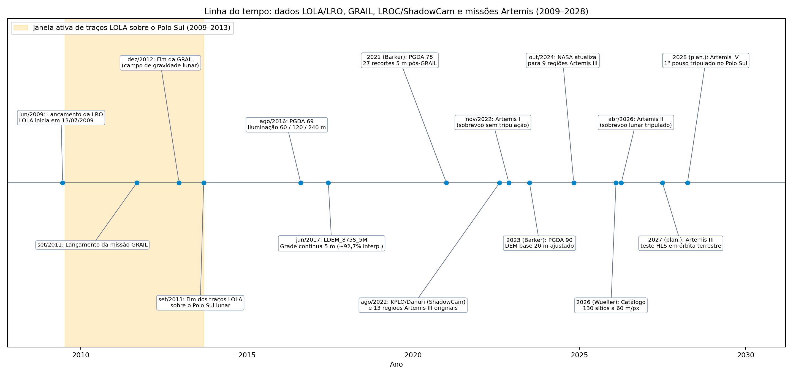
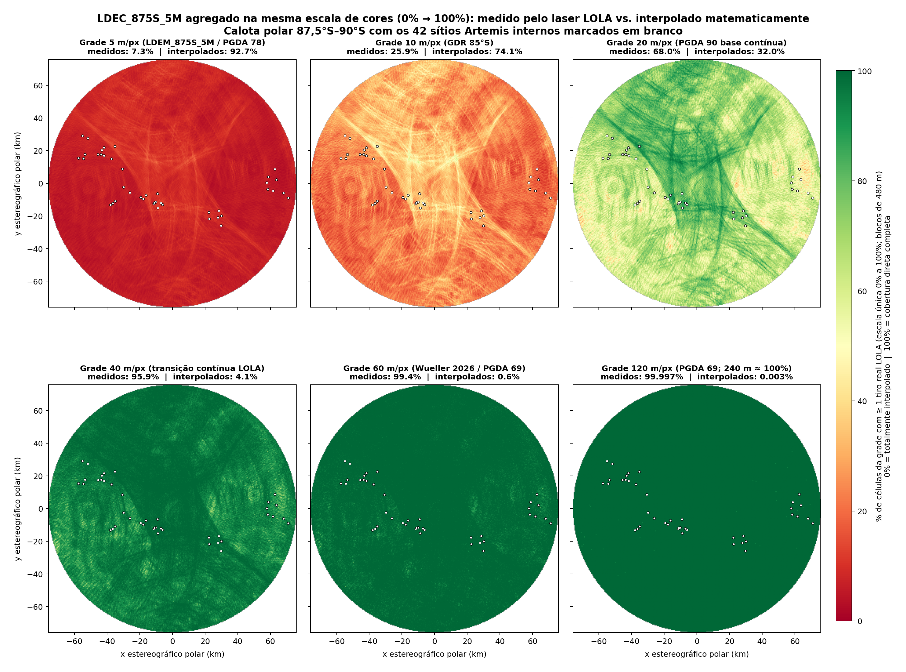
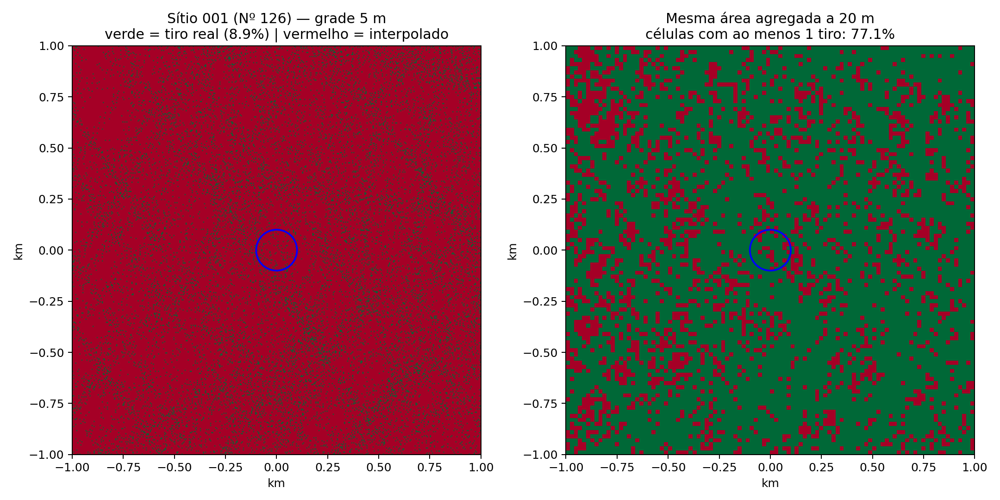
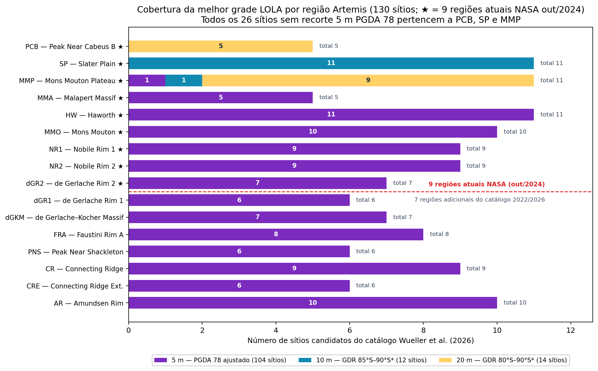
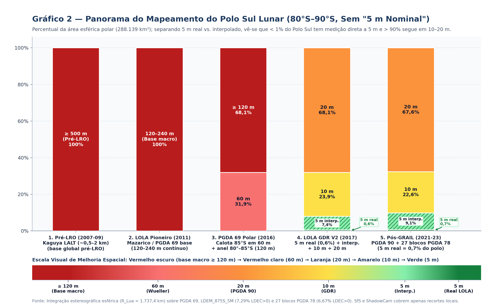

# 1. A Tese em Um Parágrafo

O catálogo oficial mais recente de locais candidatos ao pouso no Polo Sul lunar (*Wueller et al., 2026*, $130$ sítios) calculou a duração contínua da iluminação solar e da comunicação direta com a Terra (**DTE**) na grade de **$60\text{ m/pixel}$**, pois **não existe modelo digital de iluminação a $5\text{ m/px}$ nem a $1\text{ m/px}$ para o Polo Sul inteiro** e simular todo o anel polar em $5\text{ m}$ consome $1.728\times$ mais operações. Entretanto, engenheiros e rovers pousam na escala de **$5\text{ m}$**, onde microcrateras e blocos invisíveis a $60\text{ m}$ projetam sombras e rampas críticas. **O objetivo desta tese** é usar os recortes reais de $5\text{ m}$ já existentes (`104` dos `130` sítios no `PGDA 78` e os `42` na calota `LDEM_875S_5M`) para **calibrar empiricamente a perda de iluminação e o aumento da variabilidade de declividade entre resoluções**, **corrigir estatisticamente os sítios e rotas de travessia que só existem em $60\text{ m}$, $20\text{ m}$ ou $10\text{ m}$** e **medir o ganho de segurança na seleção final**.

---

# 2. Evolução das Missões e Técnicas: O que Contribuiu vs. O que Ficou Sem Resolver

Cada missão espacial e técnica cartográfica avançou a resolução do Polo Sul lunar, mas trouxe ou deixou aberto um problema específico que justifica diretamente o método desta tese:

| Missão / Técnica | O que contribuiu | Principal problema criado ou não resolvido |
|---|---|---|
| **1. Laser `LOLA` (`LRO`)** *(2009–2013)* | Gerou o arcabouço altimétrico absoluto a laser no Polo Sul ($5$ feixes de $5\text{ m}$ por pulso), funcionando mesmo no escuro completo e sob Sol rasante ($\le 1{,}54^\circ$). | A coleta polar densa **encerrou em setembro de 2013**. Ao transformar essas trilhas em grade contínua de **$5 \times 5\text{ m}$** (`LDEM_875S_5M`), **$92{,}71\%$ dos pixels ficam vazios** e são preenchidos por **interpolação matemática** (apenas $7{,}29\%$ têm tiro real). Trilhas antigas também carregavam erros de órbita. |
| **2. Missão `GRAIL` $\to$ `PGDA 78` ($5\text{ m}$) e `PGDA 90` ($20\text{ m}$)** *(2011–2023)* | O campo gravitacional *GRAIL* corrigiu retrospectivamente os erros orbitais do LOLA (2009–2013), gerando a base contínua de **`20 m` (`PGDA 90`)** e $27$ blocos ajustados de **`5 m` (`PGDA 78`)** que cobrem **$104/130$ sítios ($80{,}0\%$)**. | **Não gera mapas de iluminação**; cada bloco mede só $16 \times 16\text{ km}$ a $29{,}8 \times 29{,}8\text{ km}$ (não enxerga montanhas do horizonte a $100\text{–}200\text{ km}$); a mediana de tiros reais na elipse de pouso ainda é baixa (**$7{,}6\%$**, mínimo de $0{,}08\%$); e deixa **$26$ sítios sem $5\text{ m}$**. |
| **3. `LROC NAC` + *Shape-from-Shading* (`SfS`)** | Usa imagens ópticas ancoradas ao LOLA para estender áreas a $5\text{ m/px}$ e gerar novos recortes locais ultrafinos de **$1\text{–}2\text{ m/px}$**. | **Não funciona no escuro**: é fisicamente impossível inferir relevo dentro de sombras ou crateras em sombra permanente (`PSR`), além de sofrer ambiguidade entre albedo e declividade. **Continua sem existir DEM de iluminação a $5\text{ m}$ ou $1\text{ m}$ para o Polo Sul inteiro.** |
| **4. `ShadowCam` (`KPLO / Danuri`)** *(ago/2022–presente)* | Detector com sensibilidade $>200\times$ superior à `NAC` fotografa o interior das crateras em sombra permanente a **$\sim 1{,}7\text{–}2\text{ m/px}$** usando luz espalhada das paredes vizinhas. | **Não é mapa de radiação solar** nem calcula balanço de energia no Sol. Sua utilidade é complementar: checar visualmente **obstáculos (matacões/escarpas) e indícios de gelo** no trecho escuro das rotas até `PSR`. |
| **5. Programa `Artemis` (`I–IV`) + Catálogo *Wueller et al. (2026)*** | *Artemis I* (nov/2022) e *Artemis II* (abr/2026) abriram caminho para *Artemis III* (2027, teste HLS em órbita terrestre) e *IV* (2028, 1º pouso polar). NASA definiu **9 regiões atuais** (out/2024) e *Wueller 2026* mapeou **$130$ sítios** ($2025\text{–}2032$). | Todo o catálogo rodou apenas a **$60\text{ m/px}$** porque `5 m` completo é caro e inexiste no polo todo. Além disso, todos os **$26$ sítios sem DEM $5\text{ m}$** concentram-se em três regiões prioritárias novas (**`PCB`**, **`SP`** e **`MMP`**). |

: Resumo das contribuições e limitações em aberto em cada etapa observacional. {#tbl:simplificada_missoes}

{width=96%}

---

# 3. O Que os Dados Reais Mostram Sobre o Problema da Resolução

Analisando diretamente os arquivos oficiais baixados para esta pesquisa (`161` arquivos; `LDEM_875S_5M`, `LDEC_875S_5M`, $27$ recortes `PGDA 78`, `PGDA 69` e os `130` sítios ordenados de norte — **`Nº 1 PCB04`, `-83,3691°`** — ao sul — **`Nº 130 CR08`, `-89,6319°`**), aparecem três evidências visuais centrais:

1. **Na escala `0% → 100%`, `5 m` é quase todo interpolado e `60 m` é quase todo medido:** A Figura 2 compara a mesma calota `87,5°S–90°S` agregada de `5 m` até `120 m` em uma única legenda de cores. A **`5 m`**, apenas **`7,3%`** das células têm tiro direto de laser (**vermelho dominante**, `92,7%` interpolação); a **`20 m`**, **`68,0%`**; e a **`60 m`**, **`99,4%`** (**verde sólido**).
2. **Na elipse de pouso real (`100 m` de raio), o contraste é imediato:** Mesmo em um ponto bem amostrado próximo ao polo como o Sítio `001` (`Nº 126`), a Figura 3 mostra que **`91,1%`** dos pixels de $5\text{ m}$ no chão de pouso são interpolados (`8,9%` reais), contra **`77,1%`** de células medidas ao agregar para $20\text{ m}$.
3. **Topografia `5 m` abrangente $\neq$ Iluminação `5 m` pronta:** Embora **`104/130` sítios (`80,0%`)** tenham DEM local de $5\text{ m}$ no `PGDA 78` (mediana de **`7,6%`** de tiros reais LOLA na elipse, variando de **`0,08%`** em `Nº 16 NR2_K2023` até `21,24%`), **nenhum** tem mapa de iluminação solar em `5 m`, as janelas limitam-se a $16\text{–}29{,}8\text{ km}$ (não alcançando montanhas a $100\text{–}200\text{ km}$) e os **`26` sítios sem `5 m`** pertencem integralmente a **`PCB` ($5$ em `20 m`)**, **`SP` ($11$ em `10 m`)** e **`MMP` ($9$ em `20 m`, $1$ em `10 m`, $1$ em `5 m`)** (Figura 4).

{width=96%}

{width=92%}

{width=95%}

4. **O salto nos sítios $\neq$ cobertura real do Polo Sul em $5\text{ m}$:** As Figuras 5 e 6 colocam em linha do tempo (`2007–2023`) a evolução real da resolução separando tiro direto do laser LOLA (`LDEC > 0`) e interpolação: mesmo após GRAIL + PGDA 78, apenas **$6{,}1\%$** dos $130$ sítios candidatos e **$0{,}7\%$** do Polo Sul inteiro ($80^\circ\text{S}\text{–}90^\circ\text{S}$, $288.139\text{ km}^2$) possuem medição real direta a $5\text{ m}$.

{width=96%}

{width=96%}

| Marco | Período | 130 Sítios: $5\text{ m}$ Real / Interp. | 130 Sítios: $\ge 10\text{ m}$ | Polo Sul: $5\text{ m}$ Real / Interp. | Polo Sul: $\ge 10\text{ m}$ |
|---|---|---|---|---|---|
| **1. Pré-LRO** | `2007–09` | $0{,}00\% / 0{,}00\%$ | $100\%$ ($\ge 500\text{ m}$) | $0{,}00\% / 0{,}00\%$ | $100\%$ ($\ge 500\text{ m}$) |
| **2. LOLA Pioneiro** | `2011` | $0{,}00\% / 0{,}00\%$ | $100\%$ ($120\text{–}240\text{ m}$) | $0{,}00\% / 0{,}00\%$ | $100\%$ ($120\text{–}240\text{ m}$) |
| **3. PGDA 69 Polar** | `2016` | $0{,}00\% / 0{,}00\%$ | $80{,}77\%$ ($60\text{ m}$); $19{,}23\%$ ($\ge 120\text{ m}$) | $0{,}00\% / 0{,}00\%$ | $31{,}89\%$ ($60\text{ m}$); $68{,}11\%$ ($\ge 120\text{ m}$) |
| **4. LOLA GDR V2** | `2017` | $3{,}45\% / 37{,}32\%$ | $40{,}00\%$ ($10\text{ m}$); $19{,}23\%$ ($20\text{ m}$) | $0{,}58\% / 7{,}38\%$ | $23{,}93\%$ ($10\text{ m}$); $68{,}11\%$ ($20\text{ m}$) |
| **5. Pós-GRAIL** | `2021–23` | **$6{,}14\% / 73{,}86\%$** | $9{,}23\%$ ($10\text{ m}$); $10{,}77\%$ ($20\text{ m}$) | **$0{,}70\% / 9{,}13\%$** | $22{,}56\%$ ($10\text{ m}$); $67{,}61\%$ ($20\text{ m}$) |

: Síntese numérica dos cinco marcos cartográficos nos $130$ sítios candidatos e no Polo Sul inteiro ($288.139\text{ km}^2$). {#tbl:simplificada_5marcos}

| Variável ($N = 5$ marcos) | $N$ | Média $\pm s$ ($\%$) | Mediana ($\%$) | $Q_1\text{–}Q_3$ ($\text{IQR}$) | Mín. – Máx. ($\%$) |
|---|---:|---:|---:|---:|---:|
| 130 Sítios — $5\text{ m}$ real / interp. | $5$ | $1{,}92 \pm 2{,}79$ / $22{,}24 \pm 33{,}08$ | $0{,}00$ / $0{,}00$ | $0\text{–}3{,}45$ / $0\text{–}37{,}32$ | $0\text{–}6{,}14$ / $0\text{–}73{,}86$ |
| Polo Sul — $5\text{ m}$ real / interp. | $5$ | $0{,}26 \pm 0{,}35$ / $3{,}30 \pm 4{,}56$ | $0{,}00$ / $0{,}00$ | $0\text{–}0{,}58$ / $0\text{–}7{,}38$ | $0\text{–}0{,}70$ / $0\text{–}9{,}13$ |

: Estatística descritiva resumida da cobertura real vs. interpolada a $5\text{ m}$ ao longo dos cinco marcos históricos. {#tbl:desc_simplificada_5marcos}

---

# 4. Dados Utilizados e Formulação Matemática Essencial

Sem detalhes acessórios, entram diretamente nas equações da tese apenas dois conjuntos de dados:

| Fonte | Variáveis usadas na tese | Papel direto |
|---|---|---|
| `artemis_sitios_wueller2026.csv` ($130$ sítios) | `lat`, `lon` ($^\circ$), `dias_sol_2025..2032`, `dias_sol_terra_2025..2032` ($\text{dias}$), `area_psr_m2` ($\text{m}^2$) | Fornece os $130$ candidatos ordenados e a série nominal a $60\text{ m/px}$ que será corrigida. |
| `PGDA 78` (GeoTIFF $5\text{ m}$), `LDEM/LDEC_875S` ($5\text{ m}$, $20\text{ m}$) e `PGDA 69` ($60/120/240\text{ m}$) + Kernels `DE440` | Altitude $Z$ ($\text{m}$), contagem real `LDEC` (tiros/célula), declividade $S$ ($^\circ$), erro vertical `toterr` $\varepsilon$ ($\text{m}$) e elevação solar/Terra exata | Permite simular *ceteris paribus* o efeito de resolução de $240\text{ m} \to 5\text{ m}$ nos `104` sítios reais e calibrar o modelo para sítios e rotas em `60/20/10 m`. |

: Conjunto mínimo de variáveis de entrada da tese. {#tbl:simplificada_variaveis}

As quatro equações que conectam esses dados são:

1. **Ângulo de horizonte e curvatura lunar** (sobre grade estereográfica polar sul de raio $R_{\text{Lua}} = 1.737.400\text{ m}$):
   $$\alpha(\phi) = \max_{d_k \le d_{\text{máx}}} \arctan\!\left(\frac{(Z_k - Z_0 - h_{\text{mastro}}) - \dfrac{d_k^2}{2 R_{\text{Lua}}}}{d_k}\right)$$

2. **Incerteza vertical nas áreas interpoladas (*Barker et al., 2021*) e bloqueio angular próximo** (a distância $d_{\text{prox}}$):
   $$\varepsilon(R, S) = 0{,}0210\,R + 0{,}0051\,S + 0{,}022\text{ m}, \qquad \Delta\theta = \arctan\!\left(\frac{\varepsilon(R, S)}{d_{\text{prox}}}\right)$$

3. **Lei empírica de perda de luz pela área do pixel ($A = R^2$)** calibrada em condições *ceteris paribus* de $240\text{ m}$ até $5\text{ m}$:
   $$L(A) = L(A_{\text{macro}}) - k_{\text{sombra}}(S)\,\ln\!\left(\frac{A_{\text{macro}}}{A}\right)$$

4. **Correção conservadora de iluminação e declividade para sítios e rotas sem `5 m`** (nível de confiança $z_C \in \{0;\; 1{,}282;\; 2{,}326\}$ para `P50 / P90 / P99`):
   $$D_{\text{conf}, 5\text{m}, i}(C) = \max\!\left(0,\;\; D_{\text{ef}, R_{\text{orig}}, i} - \Delta D_{\text{cal}, i}(R_{\text{orig}} \to 5\text{ m}) - z_C\,\sigma_{5\text{m}, i}\right)$$
   $$P_{\text{rota}}(S_{5\text{m}} \le S_{\text{mob}}) = \Phi\!\left(\frac{S_{\text{mob}} - S_{\text{obs}, R_{\text{orig}}}}{\sqrt{\sigma_{S, \text{macro}}^2 + \hat{\sigma}_{S, 5\text{m}}^2}}\right)$$

## Aplicação Encadeada Preliminar (`6` Sítios Reais Extraídos)

Para situar o encadeamento completo das equações (`4.1` $\to$ `4.5`) antes da simulação integral, aplicamos a sequência em **seis sítios reais** (`001`, `MMO01`, `NR106`, `HW04`, `SP06`, `PCB05`) com semente preliminar $\bar k_{\text{sombra}} = 1{,}946\text{ pp}/\ln A$ ($\eta_{60\to 5} = 12{,}17\%$), $h_{\text{mastro}} = 2{,}0\text{ m}$ ($f_{\text{mastro}} = 0{,}6570$), $\kappa_t = 1{,}0\text{ dia/m}$ e meta $D_{\text{missão}} = 10\text{ d}$ em `2026`:

| Sítio (Região / Grade) | Sol `2026 / 2028` ($\text{d}$) | $\bar S$ / `toterr` ($5\text{ m}$) | `P50` ($\text{d}$) | `P90 / P99` ($\text{d}$) | `TOPSIS 60m → P99` |
|---|---:|---:|---:|---:|---|
| `001` (`CR`, `5 m`) | `21 / 18` | $3{,}1^\circ$ / $0{,}38\text{ m}$ | $18{,}44$ | $17{,}07\text{ / }15{,}95$ | $28{,}52\% \to 30{,}91\%$ (`#3 → #2`) |
| `MMO01` (`MMO`, `5 m`) | `21 / 17` | $4{,}7^\circ$ / $0{,}54\text{ m}$ | $18{,}44$ | $16{,}91\text{ / }15{,}67$ | $94{,}98\% \to 94{,}70\%$ (`#1 → #1`) |
| `NR106` (`NR1`, `5 m`) | `16 / 12` | $4{,}1^\circ$ / $0{,}47\text{ m}$ | $14{,}05$ | $12{,}58\text{ / }11{,}38$ | $30{,}33\% \to 29{,}63\%$ (`#2 → #3`) |
| `HW04` (`HW`, `5 m`) | `13 / 1` | $4{,}2^\circ$ / $0{,}35\text{ m}$ | $11{,}42$ | **$9{,}94\text{ / }8{,}73$** | Eliminado (`P90/P99 < 10 d`; `2028`) |
| `SP06` (`SP`, `10 m*`) | `21 / 9` | `—` *(sem `5 m`)* | $18{,}44$ | $17{,}04\text{ / }15{,}90$ | Eliminado (`PSR = 0`; `2028 = 9 d`) |
| `PCB05` (`PCB`, `20 m*`) | `5 / 0` | `—` *(sem `5 m`)* | $4{,}39$ | $2{,}99\text{ / }1{,}84$ | Eliminado ($\varphi > -84^\circ$; `PSR = 0`) |

: Exemplo encadeado preliminar em seis sítios reais extraídos do catálogo. {#tbl:simplificada_cadeia}

| Variável do Conjunto Exposto | $N$ | Média $\pm s$ | Mediana | $Q_1\text{–}Q_3$ ($\text{IQR}$) | Mín. – Máx. |
|---|---:|---:|---:|---:|---:|
| Sol `2026` nominal `60 m` ($\text{d}$) | $6$ | $16{,}17 \pm 6{,}40$ | $18{,}50$ | $13{,}75\text{–}21{,}00$ ($7{,}25$) | $5{,}00\text{–}21{,}00$ |
| Sol corrigido `P90` ($\text{d}$) | $6$ | $12{,}75 \pm 5{,}61$ | $14{,}75$ | $10{,}60\text{–}17{,}01$ ($6{,}41$) | $2{,}99\text{–}17{,}07$ |
| Sol corrigido `P99` ($\text{d}$) | $6$ | $11{,}58 \pm 5{,}61$ | $13{,}53$ | $9{,}39\text{–}15{,}84$ ($6{,}45$) | $1{,}84\text{–}15{,}95$ |
| `TOPSIS 60 m` / `P99` ($\%$) | $3$ | $51{,}28 \pm 37{,}86$ / $51{,}75 \pm 37{,}20$ | $30{,}33$ / $30{,}91$ | $29{,}42\text{–}62{,}66$ / $30{,}27\text{–}62{,}80$ | $28{,}52\text{–}94{,}98$ / $29{,}63\text{–}94{,}70$ |

: Estatística descritiva dos valores expostos na cadeia preliminar (Tabela anterior). {#tbl:simplificada_desc}

**Regra Estatística da Tese (Descritiva e Inferencial):** Toda tabela com dados numéricos apresenta conjuntamente estatística descritiva ($N$, média $\pm s$, mediana, $Q_1\text{–}Q_3 / \text{IQR}$, mínimo e máximo). Ao concluir os cálculos completos, a comparação **Sem Tese (`60 m`) vs. Com Tese (`5 m P90/P99`)** será validada por **estatística inferencial**: teste de **Wilcoxon pareado** ($\Delta D$, $\Delta R_i$), **teste de McNemar** (redução pareada de falsos positivos), correlações de **Spearman ($\rho_s$) / Kendall ($\tau_b$)** com *bootstrap* para ranqueamento, e **Mann-Whitney U / Kolmogorov-Smirnov** nos resíduos `LDEC = 0` vs. `LDEC > 0`.

---

# 5. Plano de Execução Direto (4 Etapas)

1. **Simulação *ceteris paribus* nos `104` sítios com `PGDA 78` / `LDEM_875S_5M`:** Medir exatamente quanto cada sítio perde em dias de Sol e quanto a inclinação se dispersa ao cruzar `240 → 120 → 60 → 20 → 5 m` sob os mesmos Kernels `DE440` (acoplando os blocos de `16–29,8 km` à base distante de `20/60/120 m`).
2. **Controle pelo grau de interpolação (`LDEC`):** Comparar o comportamento da perda e dos erros reais (`toterr.tif`) em função da fração realmente medida pelo LOLA (de `0,08%` a `21,24%`).
3. **Validação cruzada e correção das regiões descobertas (`PCB`, `SP`, `MMP`) e rotas (`60/20 m → 5 m`):** Ocultar o dado de `5 m` de regiões de teste entre as `104` cobertas para validar o erro de previsão e, em seguida, corrigir os **`26` sítios sem `5 m`** e as **rotas de travessia de até `2 km` até `PSR`** (incorporando auditoria óptica `ShadowCam` no trecho escuro quando disponível).
4. **Avaliação do ganho operacional:** Quantificar quantos falsos positivos de `60 m/px` são filtrados no nível `P90/P99` e como o ranqueamento seguro (`TOPSIS`) e a taxa de conformidade de pouso ($S \le 8^\circ$) melhoram após a correção.

## Metodologia Experimental em 5 Degraus (*Ablation Study* — Com vs. Sem)

Para comprovar o ganho isolado de cada ferramenta sem atribuir à IA o mérito da otimização clássica ou da margem de segurança, o estudo experimental compara **cinco degraus progressivos** (*ceteris paribus* sobre `60 m` como cenário de estresse e `20 m` como mapa polar realista `< -80°S`):

| Degrau | Método Adicionado | Princípio do Método | O que Prova |
|---|---|---|---|
| **0** | **Base Ingênua** (`60 m` / `20 m`) | Planejamento direto na grade bruta, sem otimizador nem margem. | Linha de base sem método. |
| **1** | **`+ Otimização Clássica` (Marcato)** | *Hard Constraints*/Pareto, `Simplex` 2 Fases (PL + dualidade), `Barreira Logarítmica + Newton KKT`, `PD / A*` e `Branch & Bound` na grade grossa. | Teto alcançável pela pesquisa operacional clássica antes de descer de escala. |
| **2** | **`+ Multirresolução` (`60/20 → 5 m`)** | Correção pelos disparos reais `LOLA` (`LDEC > 0`) via convolução gaussiana ponderada por densidade + regra *No False Relief*. | Se a multirresolução agrega ganho **mesmo após** o método clássico. |
| **3** | **`+ Monte Carlo & Otimização Robusta`** | Sorteios sobre a fração interpolada (`~92,71%`, `LDEC = 0`) calibrando quantis `P50/P90/P99`, restrições robustas, busca transparente de pesos (*out-of-sample*) e curvas de troca sob **mesmo falso alarme** (`5%–30%`). | Separa o efeito de cautela (margem) do ganho de saber onde o laser realmente mediu. |
| **4** | **`+ Neuroevolução (MLP)` sob Escudo `P90/P99`** | Rede neural leve (`MLP 8→7→4`, congelada) para decisão tática dinâmica, filtrada por **Escudo Determinístico (`P90/P99`)** que veta ações fisicamente inseguras. | Se a política neural dinâmica supera os pesos fixos da otimização robusta. |

: Estrutura metodológica em cinco degraus progressivos para comparação pareada (**Com vs. Sem**) com estatística descritiva, Wilcoxon, McNemar, Spearman e correção Holm-Bonferroni. {#tbl:simplificada_5degraus}

**Protocolo Monte Carlo nos Dados Reais (`PGDA 78`, `N = 26` sítios):** Nos Degraus 2 e 3, os recortes de $10 \times 10\text{ km}$ (`5 m/px`) passam por **validação cruzada em 5 dobras** sobre os disparos reais `LDEC > 0`, **$100$ sorteios Monte Carlo** com $\mathcal{N}(\text{slp}, \text{slperr}^2)$, calibração independente em $20$ sorteios e **controle justo com o mesmo falso alarme** (`FA 5%–30%`) em `60 m` e `20 m`, além de auditoria nas células interpoladas (`LDEC = 0`) via `SfS` (*Haworth*).

---

# 6. Extensão Operacional em 3 Camadas e Limites Céticos

Sem exigir processamento pesado a bordo, a arquitetura da tese estende-se para a operação na superfície lunar em **três horizontes temporais** sob uma trava determinística de não relaxamento:

1. **Camada 1 — Núcleo Pré-Pouso (`P90/P99`):** Mantém a máscara de horizonte distante ($d > 500\text{ m}$ até $200\text{ km}$) e as margens conservadoras `P90/P99` contra os `~92,71%` de interpolação em `5 m` e os `26` sítios sem `5 m` (`PCB`, `SP`, `MMP`).
2. **Camada 2 — Replanejamento de Turno / Dia (Satélite $\to$ Terra $\to$ Rover):** Entre turnos ou recargas, a equipe em solo co-registra produtos orbitais em `MOON_ME` e envia apenas pacotes compactos: deltas locais de elevação $\Delta Z(x,y)$ (`LROC NAC SfS`, `1–5 m` em área iluminada) e polígonos de veto de obstáculos (`ShadowCam`, $\sim 1{,}7\text{–}2\text{ m/px}$ em PSRs).
3. **Camada 3 — Telemetria do Rover em Movimento (`5–50 m`):** Atualiza apenas o horizonte próximo via $\alpha_{\text{total}}(\phi) = \max(\alpha_{\text{distante}}(\phi), \alpha_{\text{rover}}(\phi))$ com cinco sinais nativos: `LiDAR`/estéreo `NavCam/HazCam` ($z_{\text{loc}}$), `IMU` (*roll/pitch*), odometria visual ancorada em marcos (mitigando *wheel slip*), telemetria fotovoltaica real + sombra no mastro no azimute $\phi(t)$, e metadados `SNR` / alcance útil (`20–50 m`).

## Regra Assimétrica de Segurança (*No False Relief*)

* **Endurecimento imediato (*Fail-Safe*):** qualquer obstáculo, rampa acima do limite ou sombra antecipada **aumenta imediatamente o bloqueio ou veta o trecho**.
* **Proibição de relaxamento automático:** encontrar terreno momentaneamente plano ou iluminado **não reduz** as margens `P90/P99` nos metros à frente ainda não medidos (onde microcrateras ocultas pela interpolação em `5 m` permanecem plausíveis).

## Limites Céticos Físicos e Sensoriais que Permanecem

* **Alcance curto (`20–50 m`) vs. Sol rasante ($1{,}54^\circ$):** uma crista de $3\text{ m}$ a $120\text{ m}$ já projeta sombra antes de ser resolvida pelos sensores locais; a telemetria do rover **complementa** a segurança próxima, mas **nunca substitui** a máscara de horizonte distante ($d > 500\text{ m}$ até $200\text{ km}$).
* **Patinação (*wheel slip*) e registro espacial:** contagem isolada de roda deriva no regolito, exigindo odometria visual + marcos, bem como pré-amarração em Terra de todos os deltas e máscaras ao referencial `MOON_ME`.
* **Zero processamento orbital bruto a bordo:** restrições de banda, CPU espacial e risco de desalinhamento impedem enviar imagens brutas de `LROC NAC`/`ShadowCam` para processamento em voo.
