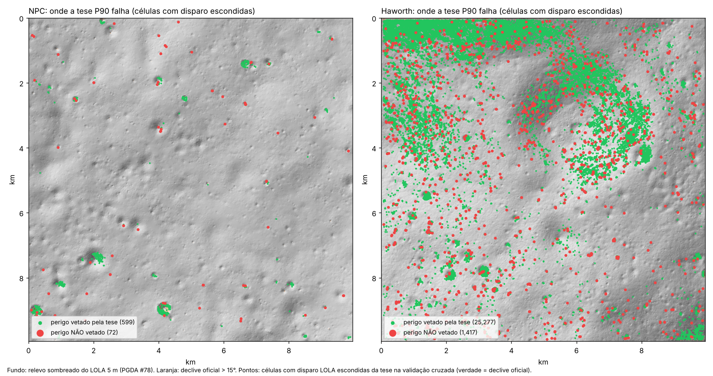
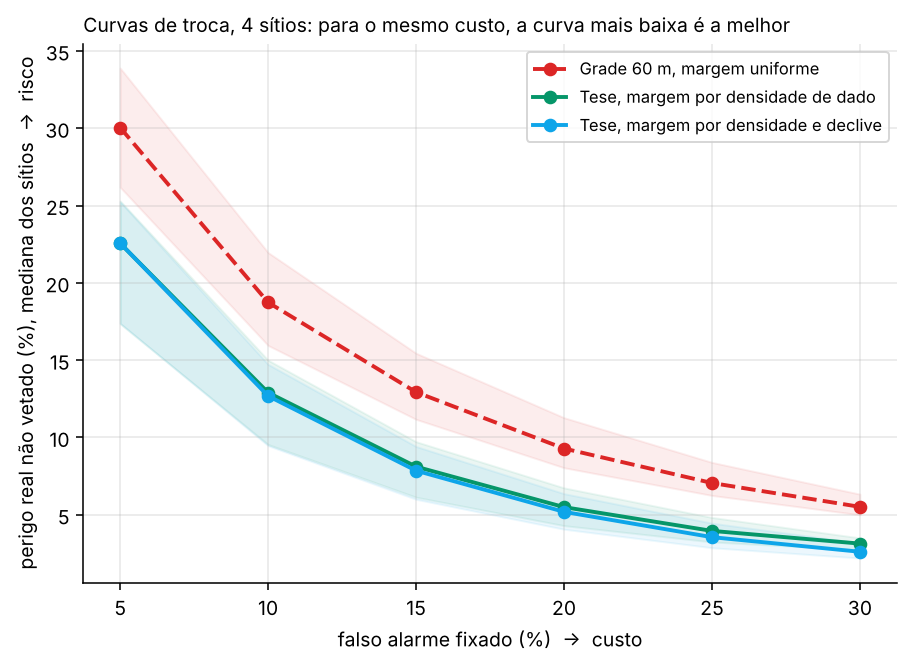
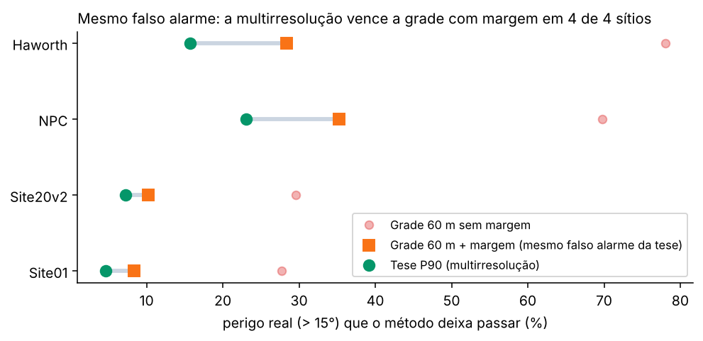
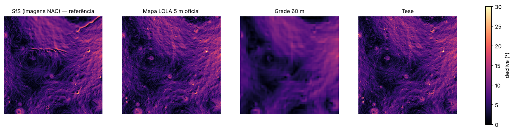
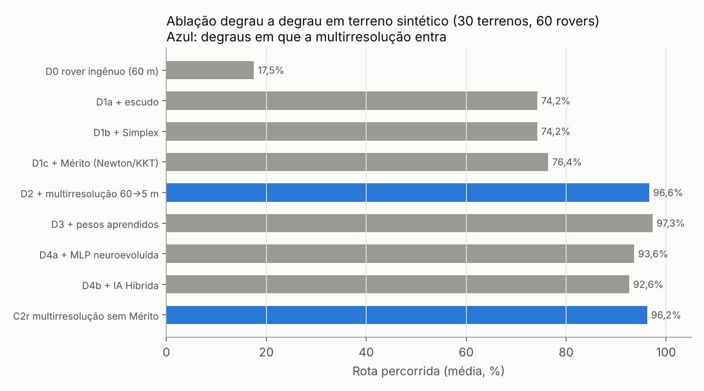
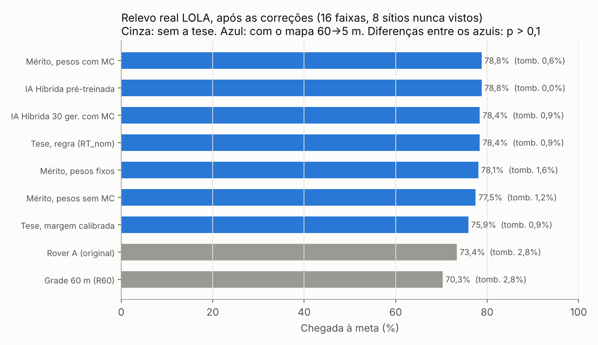
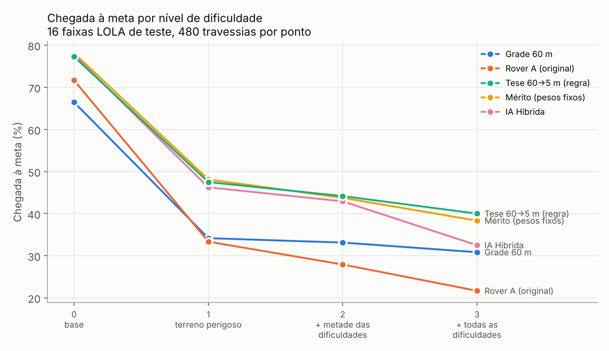
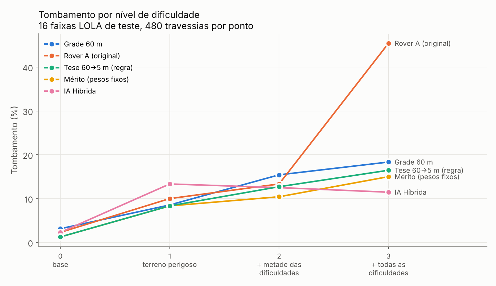

# Resumo completo dos resultados — do Monte Carlo LOLA aos testes de dificuldade

**Para:** o agente que vai redigir o relatório/tese.
**Projeto:** NASA Space Apps 2026, *Lunar Landing Site Navigator* (rovers no polo sul lunar).
**Período:** 14–15/11/2026.
**Pasta no PC da equipe:** `C:\NASA PROJETO 2026\simulacao_rover\` (subpasta `monte_carlo_lola\` para as análises de dados reais).

**Fontes detalhadas, que são a referência para números e métodos:**
- `monte_carlo_lola\MONTE_CARLO_LOLA_TESE.md`: Monte Carlo, diagnóstico, curvas de troca, SfS, NAC, novidade, limitações e referências.
- `RESULTADOS-RELEVO-REAL.md`: simulador v18 em relevo real, primeira e segunda rodada.
- `monte_carlo_lola\RESULTADOS-MERITO.md`: pesos do Mérito com e sem Monte Carlo.
- `monte_carlo_lola\RESULTADOS-ESCADA-DIFICULDADE.md`: escada de dificuldade.
- `ESTATISTICA-ABLACAO.md` / `RESULTADOS-ABLACAO.md`: ablação em terreno sintético (anterior ao v18).

**Regras de redação que a autora pediu:**
- Não chamar nada de "inédito". Usar "não encontrado publicado (busca curta)".
- Apresentar resultados nulos e negativos com a mesma clareza que os positivos.
- Distinguir **calibração** (ajustar a margem com dados medidos), **treino** (otimizar pesos ou rede) e **avaliação** (teste em dados nunca vistos).

## Figuras e dados (pasta `figuras/`, ao lado deste arquivo)

Todas as figuras estão em PNG (160 dpi) e cada uma tem os dados numéricos em CSV/JSON, para o relatório poder refazer ou restilizar os gráficos. As figuras novas são geradas por `figuras/fazer_figs.py`.

| Figura | O que mostra | Seção | Dados |
|---|---|---|---|
| `g1_perigo_por_sitio.png` | Perigo não vetado por sítio: grade 60 m × tese | 1 | `dados_mc_26sitios_60m.csv` |
| `g2_troca_perigo_alarme.png` | Perigo × falso alarme de cada método, por sítio | 1 | idem |
| `g5_controle_mesmo_alarme.png` | Controle justo: grade + margem × tese com o mesmo falso alarme | 1 | idem (colunas `gradeFA_*`, `teseP90_*`) |
| `g4_60m_x_20m.png` | Partir de 60 m × de 20 m | 1 | `dados_mc_26sitios_20m.csv` |
| `g6_curvas_troca.png` | **Curvas de troca** (mediana dos 26 sítios) — resultado mais forte | 1 | colunas `curva_*_FA*` |
| `onde_a_tese_falha.png` | Mapa das falhas em NPC e Haworth | 1 (diagnóstico) | — |
| `comparacao_sfs.png`, `curvas_sfs.png` | Validação com SfS em Haworth (células sem disparo) | 2 | `dados_sfs_haworth.json` |
| `checagem_local_nac_haworth.png` | Encaixe da foto NAC no relevo LOLA (ilustração) | 3 | — |
| `fig_ablacao_sintetica.png` | Ablação degrau a degrau em terreno sintético | 4 | `dados_ablacao.csv` |
| `fig_relevo_real_configuracoes.png` | Chegada no relevo real (2ª rodada + Mérito) | 5–6 | `dados_relevo_real.csv` |
| `fig_escada_chegada.png` | **Escada de dificuldade: chegada** | 7 | `dados_escada.csv` |
| `fig_escada_tombamento.png` | Escada de dificuldade: tombamento | 7 | `dados_escada.csv` |

Colunas de `dados_mc_26sitios_*.csv` (uma linha por sítio, valores em %): `grade_*` = grade sem margem; `teseP90_*` = tese P90 nominal; `teseP90cal_*` = calibrada; `gradeP90_*` = grade + margem P90 calibrada; `gradeFA_*` = grade + margem com o mesmo falso alarme da tese (controle justo); `teseEnc_*` = tese + 1° em encosta; `curva_{grade,tese,teseDecl}_FA{5..30}` = perigo não vetado com o falso alarme fixado; `erro_mediano_*` = erro do declive (graus).

---

---

## 0. A ideia da tese em uma frase

O rover parte de um mapa grosso (60 m ou 20 m) e corrige o relevo localmente com os disparos reais do laser LOLA (5 m). Depois veta qualquer célula cujo declive estimado, mais uma margem, passe do limite do rover (15°). A margem é menor perto de disparo e maior onde o mapa foi interpolado ("multirresolução 60→5 m"; o mapa não é "5 m puro").

**Siglas.**
- **LOLA:** Lunar Orbiter Laser Altimeter, o laser do LRO. Cada disparo cobre ~5 m, e só ~7% das células de 5 m têm disparo; o resto é interpolado.
- **PGDA #78:** produto da NASA GSFC com altura, disparos por célula (ldec), declive e erro do declive célula a célula para os sítios do polo sul.
- **SfS:** shape-from-shading, relevo reconstruído a partir do sombreamento das fotos.
- **NAC:** câmera de alta resolução do LRO.

---

## 1. Monte Carlo com dados reais (26 sítios, 100 sorteios cada)

**Método.**
- Recorte de 10 × 10 km por sítio. Site20 foi excluído por ser duplicata do Site20v2.
- **Grade grossa** = média em blocos, reinterpolada para 5 m.
- **Tese** = grade + resíduo dos disparos, espalhado por convolução normalizada gaussiana. Peso de confiança den/(den+0,02): longe do dado, a correção vai a zero ("No False Relief").
- **Margem nominal** = 1 + zσ, com σ = 0,8° perto de dado e 2,0° longe. Em P90 isso dá 2,03° / 3,56°.
- **Verdade** = validação cruzada em 5 dobras sobre as células com disparo, com o declive verdadeiro sorteado de Normal(slp, slperr) usando o erro oficial.
- **Métricas:** perigo não vetado (células >15° liberadas) e falso alarme (células seguras vetadas).
- **Controle justo:** grade + margem uniforme ajustada por bisseção para ter **o mesmo falso alarme** da tese.
- **Estatística:** cada sítio é uma unidade (N = 26), Wilcoxon pareado.

### Resultados principais

| Medida (mediana entre sítios) | Grade 60 m | Grade 60 m + margem (mesmo alarme) | Tese P90 60→5 m |
|---|---|---|---|
| Perigo não vetado | 28,7% | 6,45% | **3,88%** |
| Falso alarme | 4,7% | 17,9% | 17,9% |
| Erro mediano do declive | 1,08° | — | 0,61° |

1. **Com o mesmo custo, a tese deixa passar 38,5% menos perigo** (IQR 32–44%), em 26 de 26 sítios (p = 3·10⁻⁸). O ganho cresce com a aspereza do sítio (Spearman ρ = 0,91).
2. **A maior parte do ganho vem da margem:** a grade passa de 28,7% para 6,5% só com a margem. A multirresolução acrescenta um ganho real e consistente por cima disso.
3. **Partindo de 20 m** (o mapa realista ao sul de 80°S, PGDA #90): 3,57% → 3,19%, ou 12% menos perigo, em 24 de 26 sítios (p = 7,5·10⁻⁷). O erro do declive cai 14% (0,55° → 0,47°), mais perto do real em 21 de 26 sítios.
4. **Correção registrada:** a grade de 20 m com margem (3,57%) é um pouco **melhor** que a tese partindo de 60 m (3,88%). Portanto **não** dizer "a tese a partir de 60 m equivale a um mapa 3× mais fino".
5. **Margem calibrada** (quantis medidos; P90 = 2,99° perto e 2,78° longe): 3,44% de perigo com 19,2% de alarme. Melhor que a nominal em 22 de 26 sítios, mas é outro ponto da mesma troca entre perigo e alarme.

### Diagnóstico das falhas (NPC, Haworth)

- **Quase tudo que passa é raspão:** ~76% das falhas estão entre 15° e 17°; só 1–3% passam de 20°.
- As falhas se concentram **perto de dado**, onde a margem é pequena (65–75% das falhas), em encostas.
- **Ajuste "+1° em encosta":** perigo 3,9% → 2,1% (26 de 26 sítios), mas o alarme sobe de 17,9% para 23,0%.
  - Rende nos sítios acidentados (Haworth: 15,7% → 10,7%, com +3 pontos de alarme).

  - Nos lisos, só acrescenta alarme.

### Curvas de troca (resultado mais forte)

Varrendo a margem de zero ao máximo, com o falso alarme fixado entre 5% e 30%, a curva da tese fica abaixo da curva da grade em **26 de 26 sítios** (25 de 26 a 30%), sempre com p = 3·10⁻⁸.

| Falso alarme fixado | 5% | 10% | 20% | 30% |
|---|---|---|---|---|
| Perigo não vetado, grade 60 m | 23,3% | 14,3% | 6,9% | 3,5% |
| Perigo não vetado, tese | 16,6% | 9,5% | 4,1% | 2,1% |
| Redução | 29% | 35% | 40% | 42% |

Uma margem que cresce também com o declive melhora menos de 0,2 ponto: o que importa é saber onde o laser mediu.

**Figuras:** `fig5_curvas_troca.png`, `g6_curvas_troca.png`, `g1…g5`, `onde_a_tese_falha.png`.

---

## 2. Validação independente com SfS (Haworth) — resultado negativo importante

**Dado:** SfS de Bertone et al. (PGDA #104 / Zenodo 17954508), na mesma grade do LOLA.

- **SfS e LOLA concordam em altura** (diferença mediana −0,02 m), mas **discordam ~1,2–1,6° em declive** até nas células com disparo. A própria referência tem incerteza do tamanho das diferenças entre os métodos.
- **Nas células sem disparo** (3,3 milhões), perigo não vetado com falso alarme de 20%:

| Método | Perigo não vetado (alarme 20%) |
|---|---|
| Mapa LOLA 5 m oficial | **7,6%** |
| Grade 60 m | 10,3% |
| Tese | 10,4% |

- **Conclusão:** entre as trilhas do laser, a tese **não** reconstrói melhor o relevo que o mapa oficial nem que a grade. O ganho do Monte Carlo vale para as células com disparo e sua vizinhança.
- **Melhor opção onde o mapa oficial de 5 m existe:** usá-lo com margem uniforme. Uma margem maior longe dos disparos não ajudou nesse mapa.
- **Ressalva:** a comparação cobre um sítio só. Há outros 3 sítios SfS baixados (Site20v2, Site11, Site07), ainda não comparados.
- **Frase defensável:** "a margem por densidade de dado reduz o perigo que passa nas células próximas de disparo", e não "reconstrói o relevo entre as trilhas".

---

## 3. Fotos LROC NAC (ilustração, não medida)

- **Acervo:** 26 sítios (`lroc_nac\pgda78_26\`).
- **Escala:** os pixels não são quadrados, ~0,97 m × 2,18 m (não 1,57 m).
- **Checagem em Haworth:** o recorte encaixa no relevo LOLA renderizado com correlação 0,89, mas **deslocado ~3,1 km** do centro esperado e espelhado. O espelhamento contradiz a orientação que o outro agente validou por SPICE; isso segue em aberto.
- **Recortes suspeitos:** LM1 e Site23 estão em posição não confiável.
- **Uso no relatório:** só como ilustração, com legenda "posição aproximada, não projetada".

---

## 4. Ablação em terreno sintético (simulador, antes do v18)

N = 30 terrenos, 60 rovers por terreno, métrica de rota percorrida.

| Degrau | Rota percorrida (média) |
|---|---|
| D0 (rover ingênuo, 60 m) | 17,5% |
| D1 (+ escudo, Simplex, Mérito) | 74–76% |
| **D2 (+ multirresolução 60→5 m)** | **96,6%** |
| D3 (+ pesos aprendidos) | 97,3% |
| D4 (+ redes neuroevoluídas) | 92–94%, com mais variância |
| C2r (multirresolução sem Mérito) | 96,2% |

No terreno sintético, o maior salto vem da multirresolução; as redes não ajudaram. Detalhes em `ESTATISTICA-ABLACAO.md`.

---

## 5. Simulador v18 em relevo real LOLA

**O que mudou no simulador.**
- 52 faixas reais de 3 km × 550 m (2 por sítio, ~5% das células >15°), divididas em:
  - **treino:** 17 sítios;
  - **validação:** Site04;
  - **teste:** 8 sítios **nunca vistos** (Site23, Site42, Site11, LM8, Site20v2, LM3, NPB, Shoemaker; 16 faixas).
- O mapa de bordo é a tese com os disparos reais.
- Seletor de margem nominal ou calibrada.
- Monte Carlo do erro LOLA opcional no treino; no teste ele sempre sorteia, com as mesmas sementes (comparação pareada).

**1ª rodada (antes das correções):** chegada de ~44–51%, nada significativo. A principal causa de fracasso era **ficar preso** (~40% em tempo esgotado), não tombar.

**Correções feitas** (a autora pediu: "se ele fica preso, é preciso corrigir"):
1. ruído do Monte Carlo espacialmente correlacionado (σ = 4 células), porque o ruído independente criava degraus falsos;
2. limite do reflexo de 13° para 14,5°;
3. replanejamento a bordo (Dijkstra no que foi visto);
4. meta corrigida para 1,5 km;
5. planejamento em solo com barreira contínua;
6. margem zero nas células já vistas pela câmera.

**2ª rodada (após as correções; 16 faixas, população 20, Wilcoxon pareado):**

| Configuração | Chegada | Tombamento |
|---|---|---|
| Grade 60 m (R60) | 70,3% | 2,8% |
| Rover A (referência) | 73,4% | 2,8% |
| Regra + tese, margem nominal (RT_nom) | 78,4% | 0,9% |
| Regra + tese, margem calibrada | 75,9% | 0,9% |
| IA Híbrida pré-treinada (sintético) | 78,8% | 0,0% |
| IA Híbrida + 30 gerações em relevo real com Monte Carlo | 78,4% | 0,9% |

**Leitura:**
- O **controle robusto** (replanejamento) levou de ~45% para 70–79% de chegada.
- O **mapa** 60→5 m dá +8 pontos sobre a grade e reduz o tombamento de 2,8% para 0,9%.
- **Sem ganho:** calibrar a margem, treinar em relevo real e pôr Monte Carlo no treino (p > 0,6).

---

## 6. Pesos do Mérito (Marcato: Newton/KKT + Simplex) em relevo real

Mesmas 16 faixas, população 20, 15 gerações de otimização dos pesos.

| Configuração | Chegada | Tombamento |
|---|---|---|
| Mérito, pesos fixos | 78,1% | 1,6% |
| Mérito, pesos otimizados **sem** Monte Carlo | 77,5% | 1,2% |
| Mérito, pesos otimizados **com** Monte Carlo | 78,8% | 0,6% |

- Comparações: com MC × sem MC p = 0,10 (tendência); com MC × fixo p = 0,32; com MC × regra p = 0,32; com MC × IA Híbrida p = 0,71.
- Pesos aprendidos (com MC): avanço 1,03; segurança 0,89; energia 0,81; sombra 0,49; rota 0,37; declive 0,24; incerteza 0,23.
- **Conclusão:** com o mapa 60→5 m, tudo fica em 77–79%. Pesos e rede não fazem diferença significativa.

---

## 7. Escada de dificuldade — onde a tese se destaca

**Motivação:** no teste base, a grade bruta chegava longe porque:
1. o terreno é fácil (~5% de células >15°);
2. câmera, replanejamento e reflexos corrigem o mapa ruim;
3. ~20% das travessias falham por tempo ou por sair do mapa, em qualquer configuração (teto compartilhado);
4. o próprio rover A já chega a 73%.

**Desenho:** 16 faixas de teste, população 30 (480 travessias por célula da tabela), sem treino. O terreno perigoso é **sintético**, derivado do real por exagero vertical; deixar isso claro no texto.

| Nível | Mudança | Células >15° |
|---|---|---|
| 0 | Base | 4,9% |
| 1 | Relevo × 1,3 (terreno perigoso) | 20,1% |
| 2 | Nível 1 + metade das dificuldades: erro real do declive × 1,5; câmera com alcance × 0,75 | 20,1% |
| 3 | Nível 1 + todas: erro × 2; câmera degradada (alcance × 0,5, 35% de leituras perdidas); **sem replanejamento** | 20,1% |

**Chegada à meta / tombamento:**

| Nível | Rover A | Grade 60 m | **Tese 60→5 m (regra)** | Mérito fixo | IA Híbrida |
|---|---|---|---|---|---|
| 0 | 71,7 / 2,3 | 66,5 / 3,1 | **77,3 / 1,2** | 78,1 / 1,2 | 77,7 / 2,3 |
| 1 | 33,3 / 10,0 | 34,2 / 8,5 | **47,5 / 8,3** | 48,1 / 8,3 | 46,2 / 13,3 |
| 2 | 27,9 / 13,3 | 33,1 / 15,4 | **44,2 / 12,7** | 43,8 / 10,4 | 42,9 / 12,5 |
| 3 | 21,7 / 45,4 | 30,8 / 18,3 | **40,0 / 16,5** | 38,3 / 15,0 | 32,5 / 11,5 |

**Tese × grade 60 m, chegada:**

| Nível | Ganho | p |
|---|---|---|
| 0 | +10,8 pts | 0,12 |
| 1 | +13,3 pts | 0,068 |
| 2 | +11,0 pts | **0,018** |
| 3 | +9,2 pts | **0,043** |

Mérito × grade foi significativo nos níveis 1 a 3 (p = 0,018–0,028).

**Leitura:**
- **A vantagem do mapa se mantém em todos os níveis** e fica estatisticamente significativa nos difíceis.
- **Em termos relativos ela dobra:** +16% no nível 0, +30% no nível 3.
- **Em pontos absolutos não cresce.** A hipótese "mais incerteza amplia a diferença" só vale em termos relativos e de significância.
- **Tombamento:** com terreno perigoso, a vantagem do mapa no tombamento some (8,3% × 8,5% no nível 1). Quem segura o tombamento é o sistema do rover: sem ele, o rover A chega a 45% de tombamento no nível 3.
- **Regra e Mérito empatam** em todos os níveis. A IA Híbrida fica atrás só no nível 3 (−7,5 pts, p = 0,18).

---

## 8. Quadro-síntese: a importância de cada componente

| Componente | Efeito medido |
|---|---|
| **Mapa multirresolução 60→5 m com margem por densidade** | O maior: −38% de perigo não vetado (mesmo custo, 26/26 sítios); +8 a +13 pts de chegada na missão; significativo nos níveis difíceis |
| Margem de segurança em si | Grande (28,7% → 6,5% de perigo na grade) |
| Controle robusto (replanejamento, câmera) | Grande: chegada de ~45% para 70–79%; segura o tombamento nos cenários difíceis |
| Monte Carlo como **avaliação** | Indispensável: base de todos os números confiáveis |
| Monte Carlo como calibração da margem ou no treino | Nulo na missão (p > 0,3) |
| Pesos do Mérito otimizados | Nulo a pequeno (tendência p = 0,10 a favor do MC) |
| Redes neurais (Rank-ES, IA Híbrida) | Nulo; pior no cenário mais difícil |
| Tese nas células interpoladas (SfS) | **Não** melhora o mapa oficial de 5 m |

---

## 9. Limitações que devem constar

1. A verdade do Monte Carlo só existe em ~7% das células (as que têm disparo), e o declive oficial ali usa vizinhas interpoladas.
2. O erro foi sorteado como Normal independente por célula. Os 100 clones correlacionados do PGDA não foram usados.
3. A grade grossa foi derivada do próprio mapa de 5 m.
4. A validação com SfS cobre um sítio só, e a referência tem incerteza própria.
5. No simulador:
   - testes com 16 faixas;
   - população de 20 a 30;
   - uma execução por configuração;
   - sem sombras no modo de relevo real;
   - terreno perigoso sintético (exagero vertical);
   - teto de ~20% de falhas por tempo ou por sair do mapa.
6. A revisão de literatura foi curta.

**O que já existe na literatura** (ver §8 do `MONTE_CARLO_LOLA_TESE.md`): margem por incerteza de mapa (trabalho japonês de 2022), krigagem para rotas de rover, recomendação da NASA (Barker) de usar o erro do mapa no planejamento, e fusão LOLA + SfS.

**O que é contribuição** (não encontrada publicada): a **medição** em 26 sítios reais, a separação entre margem e multirresolução com o mesmo custo, o diagnóstico de onde a tese falha e a integração ponta a ponta com teste em relevo real.

---

## 10. Pendências (não rodadas)

- Curvas de troca e "+1° em encosta" partindo de 20 m.
- SfS para Site20v2, Site11 e Site07 (os dados já foram baixados).
- Rodada de população 100 com várias sementes (iniciada e interrompida para priorizar a escada).
- Treinar os pesos do Mérito ou a rede nos níveis difíceis.
- Avaliar cada geração em várias faixas.
- Reposicionar os recortes NAC por SPICE.
- Pesos adaptativos por contexto (rede neural definindo os pesos do Mérito): trabalho futuro.

---

## 11. Arquivos e reprodução

**Monte Carlo** (`monte_carlo_lola\`):
- `mc_lola.py`, `rodar_todos.py [--grossa 20]`, `graficos_sitios.py`
- saídas em `resultados\` (`resumo_sitios.csv`, figuras g1–g6, `GRAFICOS_SITIOS.html`)

**Diagnóstico e SfS** (`monte_carlo_lola\diagnostico\`):
- `diagnostico_falhas.py`, `figura_falhas.py`
- `comparar_sfs.py --sfs <pasta> --sitio <nome>`; resultados em `sfs_Haworth\`
- `checar_local_nac.py`, `checar_faixa_nac.py`

**Simulador:**
- `animacao_tese_rover_neuroevolucao_v18.html` (relevo real embutido)
- `monte_carlo_lola\extrair_faixas_lola.py`

**Experimentos sem tela** (`testes\`):
- `exp_lola.js` (CFG = RT_nom, RT_cal, R60, H_sint, H_lola30, M_fixo, M_MC, M_semMC…) e `analisa_lola.py`
- `exp_dif.js` (escada; env NIV = 0–3, CFG, POP) e `lola4_analise.txt`
